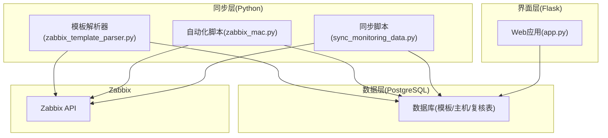
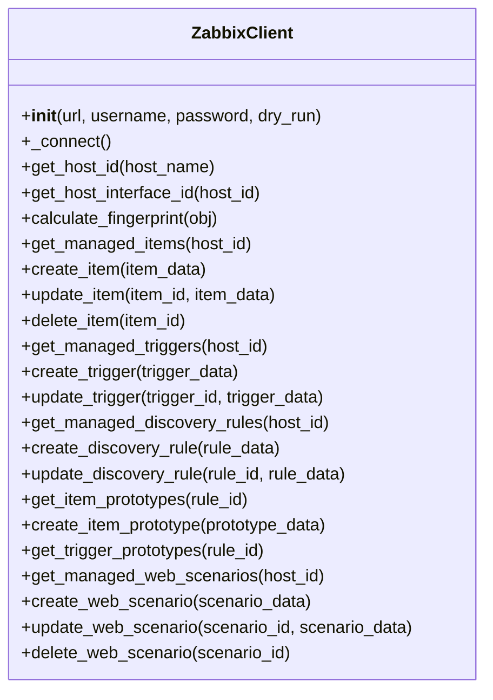
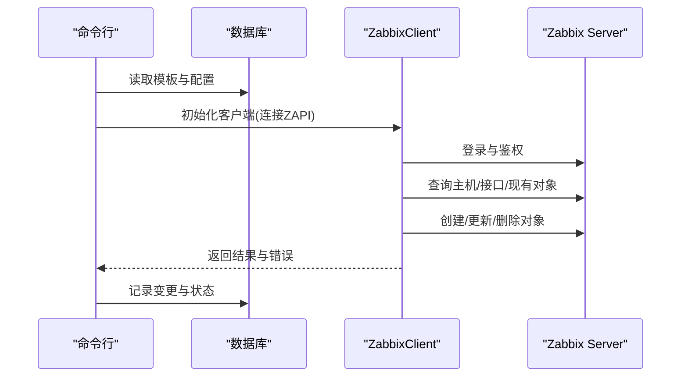
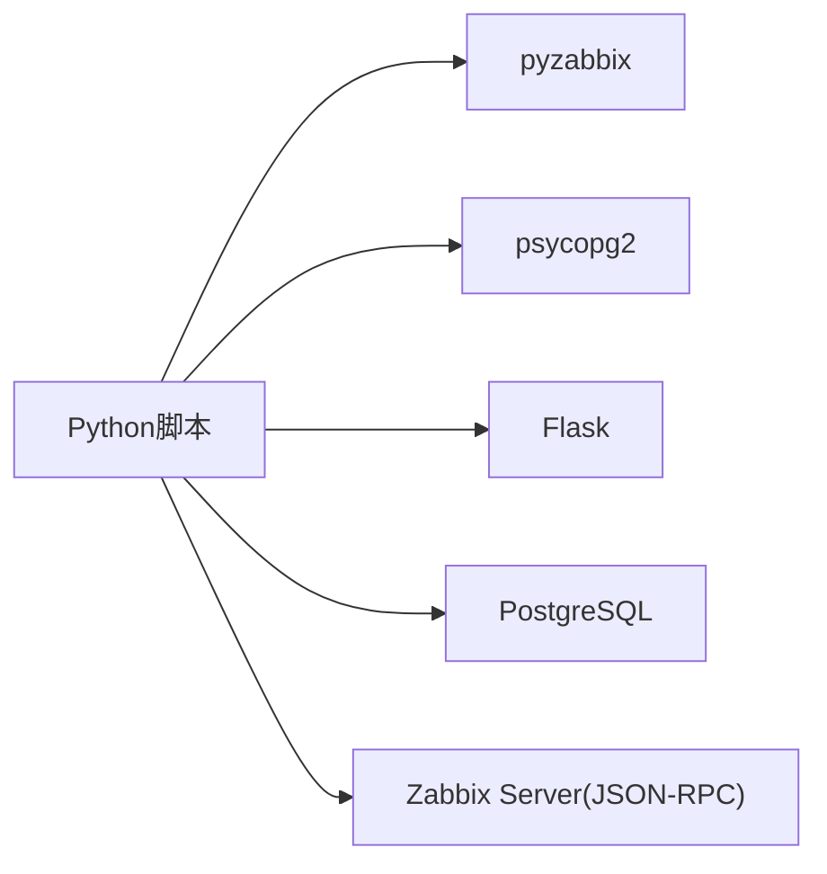

# API参考文档

<cite>
**本文档引用的文件**
- [app.py](file://app.py)
- [zabbix_mac.py](file://zabbix_mac.py)
- [zabbix_template_parser.py](file://zabbix_template_parser.py)
- [sync_monitoring_data.py](file://sync_monitoring_data.py)
- [check_api_params.py](file://check_api_params.py)
- [create_tables.sql](file://create_tables.sql)
- [create_mac_tables.sql](file://create_mac_tables.sql)
- [create_review_tables.sql](file://create_review_tables.sql)
- [monitor_config.yaml](file://monitor_config.yaml)
- [CODE_WIKI.md](file://CODE_WIKI.md)
- [ZABBIX_SETUP_GUIDE.md](file://ZABBIX_SETUP_GUIDE.md)
</cite>

## 目录
1. [简介](#简介)
2. [项目结构](#项目结构)
3. [核心组件](#核心组件)
4. [架构总览](#架构总览)
5. [详细组件分析](#详细组件分析)
6. [依赖分析](#依赖分析)
7. [性能考虑](#性能考虑)
8. [故障排除指南](#故障排除指南)
9. [结论](#结论)
10. [附录](#附录)

## 简介
本API参考文档面向Zabbix监控审核与自动化控制中心，聚焦于以下目标：
- Zabbix API的集成方式与调用方法，重点说明ZabbixClient类的公共接口与使用示例
- Web API接口的完整规范（当前仓库以Flask Web界面为主，非REST风格），包括路由、请求响应格式与认证机制
- 数据模型定义与字段说明，覆盖监控项、触发器、主机等核心实体
- 错误码与错误处理策略
- API使用的最佳实践与性能优化建议
- API测试与调试工具与方法

## 项目结构
该项目采用“数据库驱动 + Zabbix API同步 + Web管理界面”的三层架构：
- 数据层：PostgreSQL数据库，存储监控模板、主机、复核表等
- 同步层：Python脚本通过Zabbix API与数据库交互，实现声明式同步
- 界面层：Flask Web应用，提供模板、监控项、触发器、主机与复核表的管理界面

图表来源
- [app.py](file://app.py)
- [sync_monitoring_data.py](file://sync_monitoring_data.py)
- [zabbix_mac.py](file://zabbix_mac.py)
- [zabbix_template_parser.py](file://zabbix_template_parser.py)

章节来源
- [CODE_WIKI.md](file://CODE_WIKI.md)
- [ZABBIX_SETUP_GUIDE.md](file://ZABBIX_SETUP_GUIDE.md)

## 核心组件
- ZabbixClient类：封装Zabbix API调用，提供主机、监控项、触发器、自动发现规则、Web场景等管理能力
- Flask Web应用：提供模板、监控项、触发器、主机与复核表的增删改查界面
- 同步脚本：从数据库读取配置，调用Zabbix API进行声明式同步
- 模板解析器：从Zabbix模板中抽取监控项、触发器、自动发现规则与原型，写入数据库

章节来源
- [zabbix_mac.py](file://zabbix_mac.py)
- [app.py](file://app.py)
- [sync_monitoring_data.py](file://sync_monitoring_data.py)
- [zabbix_template_parser.py](file://zabbix_template_parser.py)

## 架构总览
ZabbixClient是Zabbix API的核心客户端，提供统一的CRUD与查询接口；Web应用通过Flask路由与数据库交互；同步脚本与自动化脚本通过ZabbixClient与Zabbix Server交互。

图表来源
- [zabbix_mac.py](file://zabbix_mac.py)

## 详细组件分析

### ZabbixClient类API参考
- 初始化与连接
  - 构造函数：接收Zabbix API URL、用户名、密码与dry-run标志
  - 连接方法：内部重试机制，支持最大重试次数与延迟
- 主机与接口
  - 获取主机ID：按主机名查询hostid
  - 获取主机接口ID：优先选择Zabbix agent接口，否则返回首个可用接口
- 监控项管理
  - 列表：获取主机所有受管理监控项
  - 创建：传入监控项数据，返回监控项ID
  - 更新：传入监控项ID与数据，返回布尔结果
  - 删除：传入监控项ID，返回布尔结果
- 触发器管理
  - 列表：过滤带管理标签的触发器
  - 创建：自动附加管理标签，返回触发器ID
  - 更新：自动附加管理标签，返回布尔结果
- 自动发现规则与原型
  - 规则：列出主机受管理规则，创建/更新规则
  - 原型：监控项原型与触发器原型的获取与创建
- Web场景管理
  - 列表：过滤带管理标签的web场景
  - 创建/更新/删除：自动附加管理标签

使用示例路径
- [zabbix_mac.py](file://zabbix_mac.py)

章节来源
- [zabbix_mac.py](file://zabbix_mac.py)

### Web界面路由与数据模型
当前项目以Flask Web界面为主，提供模板、监控项、触发器、主机与复核表的管理页面。路由遵循REST风格但以HTML表单提交为主，非严格REST API。

- 系统信息与模板
  - GET /system-info：系统信息详情
  - GET /templates：模板列表
  - GET /template/<int:template_id>：模板详情
- 监控项与触发器
  - GET /items：监控项列表
  - GET/POST /item/add：添加监控项
  - GET/POST /item/edit/<int:item_id>：编辑监控项
  - GET /item/delete/<int:item_id>：删除监控项
  - GET /triggers：触发器列表
  - GET/POST /trigger/add：添加触发器
  - GET/POST /trigger/edit/<int:trigger_id>：编辑触发器
  - GET /trigger/delete/<int:trigger_id>：删除触发器
- 主机管理
  - GET /hosts：主机列表
  - GET/POST /host/add：添加主机
  - GET/POST /host/edit/<int:host_id>：编辑主机
  - GET /host/delete/<int:host_id>：删除主机
- 复核表管理
  - 监控项复核：GET /items-review；GET/POST /item-review/edit/<int:review_id>；GET /item-review/confirm/<int:review_id>；GET /item-review/unconfirm/<int:review_id>
  - 触发器复核：GET /triggers-review；GET/POST /trigger-review/edit/<int:review_id>；GET /trigger-review/confirm/<int:review_id>；GET /trigger-review/unconfirm/<int:review_id>
  - 监控项原型复核：GET /item-prototypes-review；GET/POST /item-prototype-review/edit/<int:review_id>；GET /item-prototype-review/confirm/<int:review_id>；GET /item-prototype-review/unconfirm/<int:review_id>
  - 触发器原型复核：GET /trigger-prototypes-review；GET/POST /trigger-prototype-review/edit/<int:review_id>；GET /trigger-prototype-review/confirm/<int:review_id>；GET /trigger-prototype-review/unconfirm/<int:review_id>

请求与响应
- 请求：表单提交，Content-Type为application/x-www-form-urlencoded
- 响应：渲染HTML模板，使用Flask的flash消息提示操作结果

认证机制
- 当前Web界面未实现认证拦截，建议在生产环境中增加认证中间件或反向代理认证

章节来源
- [app.py](file://app.py)

### 数据模型定义与字段说明
数据库采用PostgreSQL，核心表包括模板、监控项、触发器、自动发现规则、过滤条件、原型与复核表。

- 模板表(mac_templates)
  - 字段：id, name(唯一), description, created_at, updated_at
- 监控项表(mac_items)
  - 字段：id, item_key(唯一), name, type, value_type, delay, description, units, multiplier, delta, history, trends, status, template_name, created_at, updated_at
- 触发器表(mac_triggers)
  - 字段：id, name, expression, priority, description, status, template_name, created_at, updated_at
- 自动发现规则表(mac_discovery_rules)
  - 字段：id, name, key, delay, evaltype, status, template_name, created_at, updated_at
- 过滤条件表(mac_filter_conditions)
  - 字段：id, discovery_rule_id(外键), macro, value, operator, created_at
- 监控项原型表(mac_item_prototypes)
  - 字段：id, discovery_rule_id(外键), name, key, value_type, delay, description, units, multiplier, delta, history, trends, status, created_at, updated_at
- 触发器原型表(mac_trigger_prototypes)
  - 字段：id, discovery_rule_id(外键), description, expression, priority, status, created_at, updated_at
- 主机表(mac_hosts)
  - 字段：id, name(唯一), description, created_at, updated_at
- 主机模板关联表(mac_host_templates)
  - 字段：id, host_id(外键), template_id(外键), created_at
- 主机额外监控项表(mac_host_extra_items)
  - 字段：id, host_name, item_key, name, type, value_type, delay, description, units, multiplier, delta, history, trends, status, created_at, updated_at
- 复核表
  - items_review、triggers_review、item_prototypes_review、trigger_prototypes_review：包含原始表字段与复核字段(modified、confirmed、status_verification)，并建立唯一约束

章节来源
- [create_mac_tables.sql](file://create_mac_tables.sql)
- [create_review_tables.sql](file://create_review_tables.sql)
- [create_tables.sql](file://create_tables.sql)

### API调用与同步流程
- 同步脚本流程
  - 从数据库读取模板、监控项、触发器、自动发现规则及其原型
  - 通过ZabbixClient连接Zabbix API
  - 对比现有配置与目标配置，执行创建/更新/删除操作
  - 记录变更并生成报告

图表来源
- [sync_monitoring_data.py](file://sync_monitoring_data.py)
- [zabbix_mac.py](file://zabbix_mac.py)

章节来源
- [sync_monitoring_data.py](file://sync_monitoring_data.py)
- [zabbix_mac.py](file://zabbix_mac.py)

### 错误码与错误处理策略
- 连接与鉴权
  - ZabbixAPIException：连接失败、登录失败、权限不足等
  - 重试策略：最大重试次数与延迟，避免瞬时网络波动影响
- 数据库异常
  - 连接失败、SQL执行失败、唯一约束冲突等
  - 统一捕获并回滚事务，记录日志
- Web界面
  - 表单提交失败时使用flash消息提示，重定向至相应页面
- 建议
  - 在生产环境启用更严格的日志级别
  - 对关键操作增加幂等性校验与指纹对比

章节来源
- [zabbix_mac.py](file://zabbix_mac.py)
- [app.py](file://app.py)

### API测试与调试工具
- API参数检查脚本
  - 通过ZabbixAPI查询方法参数，辅助理解API签名
- 运行与验证
  - 使用--dry-run模式预演同步，避免破坏生产环境
  - 通过Web界面进行复核与确认
- 日志与报告
  - 详细日志输出便于定位问题
  - 同步完成后生成变更报告

章节来源
- [check_api_params.py](file://check_api_params.py)
- [CODE_WIKI.md](file://CODE_WIKI.md)

## 依赖分析
- Python依赖
  - pyzabbix：Zabbix API客户端
  - psycopg2：PostgreSQL数据库驱动
  - Flask：Web应用框架
- 数据库依赖
  - PostgreSQL：存储监控模板与配置
- 外部系统
  - Zabbix Server：提供JSON-RPC API

图表来源
- [zabbix_mac.py](file://zabbix_mac.py)
- [app.py](file://app.py)

章节来源
- [CODE_WIKI.md](file://CODE_WIKI.md)

## 性能考虑
- 并发与批处理
  - 同步脚本支持并发线程数配置，提升大规模主机同步效率
- 重试与退避
  - Zabbix API调用具备指数退避重试，降低瞬时错误影响
- 数据库索引
  - 为常用查询字段建立索引，提升查询性能
- 模拟运行
  - 使用--dry-run模式评估变更范围与影响，避免不必要的API调用

章节来源
- [CODE_WIKI.md](file://CODE_WIKI.md)
- [zabbix_mac.py](file://zabbix_mac.py)
- [create_tables.sql](file://create_tables.sql)

## 故障排除指南
- 常见问题
  - 连接Zabbix API失败：检查URL、用户名、密码与网络连通性
  - 主机不存在：确认主机名与Zabbix中注册的主机一致
  - 同步失败：检查用户权限、数据库配置与Zabbix模板一致性
  - 数据库连接失败：检查数据库服务状态与连接参数
  - Web服务器启动失败：检查端口占用并释放端口
- 日志输出
  - 详细日志有助于定位问题，建议在生产环境调整日志级别

章节来源
- [CODE_WIKI.md](file://CODE_WIKI.md)

## 结论
本项目通过数据库驱动的模板管理、Zabbix API的声明式同步以及Web界面的复核机制，构建了完整的Zabbix监控审核与自动化控制体系。ZabbixClient提供了统一的API封装，Web界面与同步脚本共同保障了配置的一致性与可审计性。建议在生产环境中结合认证、日志与监控，持续优化同步策略与性能。

## 附录

### Web界面路由一览
- 系统信息：GET /system-info
- 模板管理：GET /templates；GET /template/<int:template_id>
- 监控项管理：GET /items；GET/POST /item/add；GET/POST /item/edit/<int:item_id>；GET /item/delete/<int:item_id>
- 触发器管理：GET /triggers；GET/POST /trigger/add；GET/POST /trigger/edit/<int:trigger_id>；GET /trigger/delete/<int:trigger_id>
- 主机管理：GET /hosts；GET/POST /host/add；GET/POST /host/edit/<int:host_id>；GET /host/delete/<int:host_id>
- 复核表管理：监控项、触发器、原型均有对应的复核与确认路由

章节来源
- [app.py](file://app.py)

### 数据库初始化与示例
- 初始化脚本：create_tables.sql、create_mac_tables.sql、create_review_tables.sql
- 示例数据：包含Linux模板、监控项、触发器、自动发现规则与原型的示例

章节来源
- [create_tables.sql](file://create_tables.sql)
- [create_mac_tables.sql](file://create_mac_tables.sql)
- [create_review_tables.sql](file://create_review_tables.sql)

### 配置文件
- 监控配置示例：monitor_config.yaml，定义主机、模板与额外监控项

章节来源
- [monitor_config.yaml](file://monitor_config.yaml)