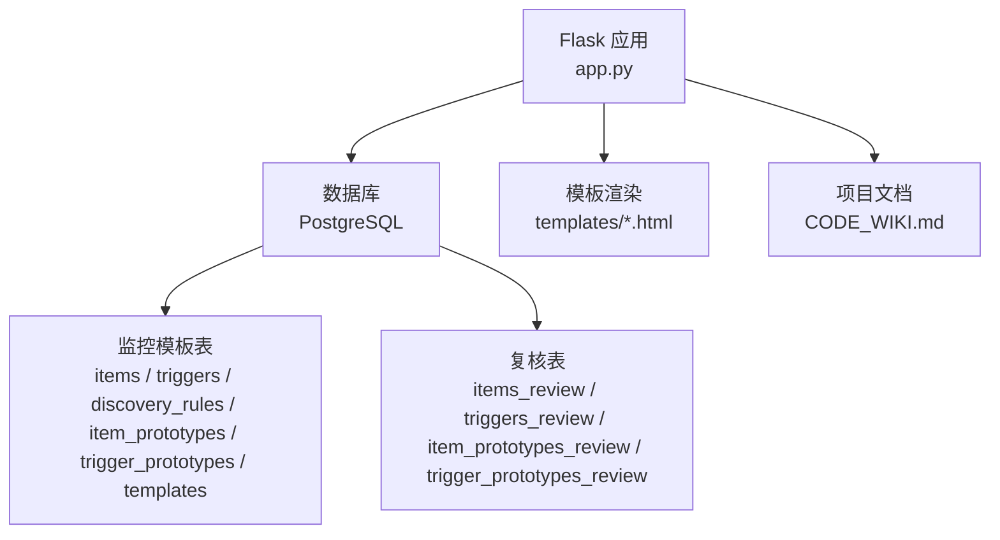
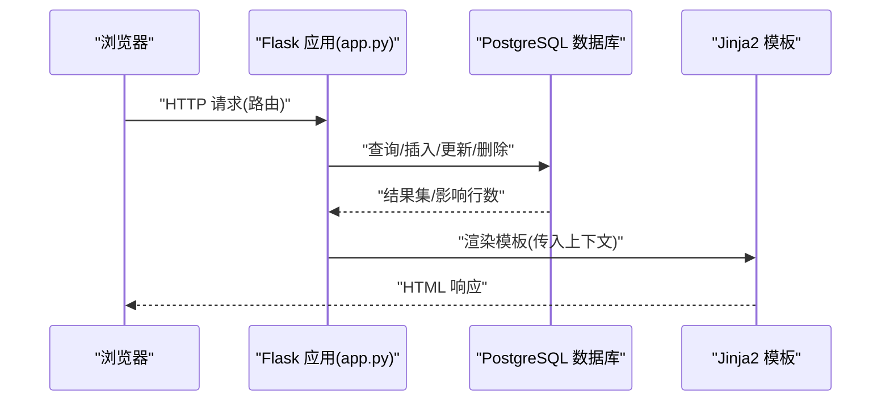
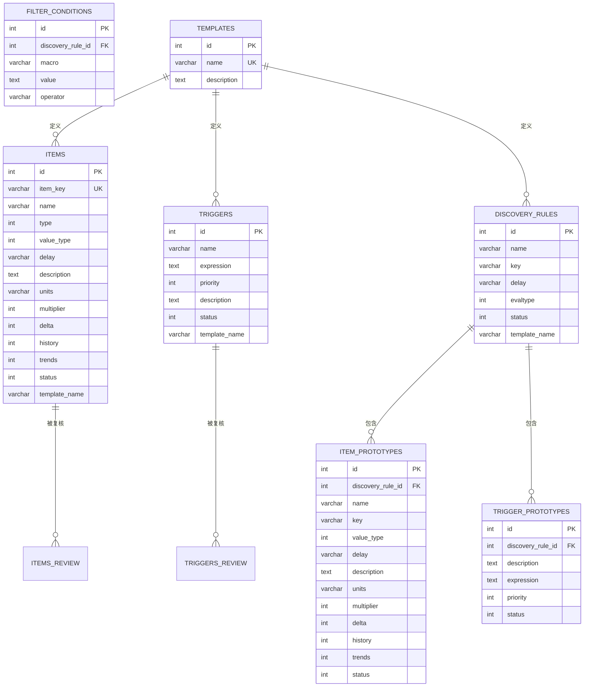
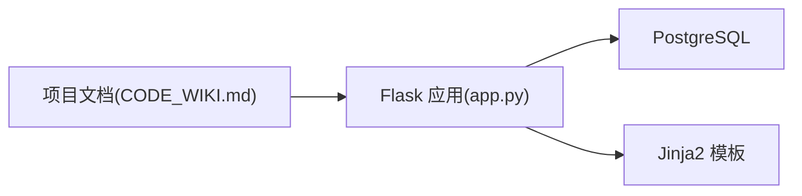

# Web API接口

<cite>
**本文引用的文件**
- [app.py](file://app.py)
- [CODE_WIKI.md](file://CODE_WIKI.md)
- [create_tables.sql](file://create_tables.sql)
- [create_review_tables.sql](file://create_review_tables.sql)
- [monitor_config.yaml](file://monitor_config.yaml)
- [templates/items.html](file://templates/items.html)
- [templates/triggers.html](file://templates/triggers.html)
- [templates/hosts.html](file://templates/hosts.html)
- [templates/add_item.html](file://templates/add_item.html)
- [templates/add_trigger.html](file://templates/add_trigger.html)
- [templates/add_host.html](file://templates/add_host.html)
- [check_api_params.py](file://check_api_params.py)
- [zabbix_mac.py](file://zabbix_mac.py)
</cite>

## 目录
1. [简介](#简介)
2. [项目结构](#项目结构)
3. [核心组件](#核心组件)
4. [架构总览](#架构总览)
5. [详细组件分析](#详细组件分析)
6. [依赖分析](#依赖分析)
7. [性能考虑](#性能考虑)
8. [故障排除指南](#故障排除指南)
9. [结论](#结论)
10. [附录](#附录)

## 简介
本文件面向Web API接口使用者与维护者，系统化梳理基于Flask的应用在本项目中的路由设计与HTTP接口规范。重点覆盖监控项管理、触发器管理、主机管理、自动发现规则、复核表等模块的路由与交互方式；并结合数据库表结构与前端模板，给出请求参数、响应格式、错误处理与状态语义的完整说明。同时补充认证机制、中间件与安全注意事项，以及最佳实践、客户端集成与调试方法。

## 项目结构
本项目采用“Flask Web应用 + PostgreSQL数据库 + Jinja2模板”的典型MVC风格组织：
- Web应用入口与路由集中在app.py
- 数据库初始化与表结构定义在SQL脚本中
- 复核表结构与初始化在独立SQL脚本中
- 前端模板位于templates目录，提供增删改查的UI交互
- 项目Wiki文档提供整体架构、类与方法说明、运行参数与最佳实践

图表来源
- [app.py:1-774](file://app.py#L1-L774)
- [create_tables.sql:1-198](file://create_tables.sql#L1-L198)
- [create_review_tables.sql:1-201](file://create_review_tables.sql#L1-L201)

章节来源
- [app.py:1-774](file://app.py#L1-L774)
- [CODE_WIKI.md:170-299](file://CODE_WIKI.md#L170-L299)

## 核心组件
- Flask应用与路由：提供监控项、触发器、主机、自动发现规则与复核表的管理界面与交互
- 数据库层：定义监控模板与复核表结构，支持增删改查与唯一性约束
- 前端模板：基于Bootstrap的表单与表格，支撑CRUD操作
- 项目文档：提供路由清单、类与方法说明、运行参数与最佳实践

章节来源
- [CODE_WIKI.md:170-299](file://CODE_WIKI.md#L170-L299)
- [create_tables.sql:1-198](file://create_tables.sql#L1-L198)
- [create_review_tables.sql:1-201](file://create_review_tables.sql#L1-L201)

## 架构总览
Web应用通过Flask路由接收HTTP请求，经数据库连接与SQL操作完成数据持久化，再通过Jinja2模板渲染返回HTML页面。整体流程如下：

图表来源
- [app.py:26-29](file://app.py#L26-L29)
- [app.py:96-101](file://app.py#L96-L101)
- [templates/items.html:1-37](file://templates/items.html#L1-L37)

## 详细组件分析

### 监控项管理接口
- 列表查看：GET /items
  - 功能：按模板名与键值排序列出监控项
  - 响应：渲染items.html，表格包含ID、键值、名称、模板、更新间隔、状态与操作按钮
  - 数据源：查询mac_items表
- 新增监控项：GET/POST /item/add
  - GET：渲染add_item.html表单，下拉模板列表来自mac_templates
  - POST：提交表单字段，写入mac_items
  - 字段要点：item_key、name、type、value_type、delay、template_name、可选description、units、multiplier、delta、history、trends、status
- 编辑监控项：GET/POST /item/edit/<int:item_id>
  - GET：根据id查询mac_items，渲染edit_item.html
  - POST：更新mac_items对应记录
- 删除监控项：GET /item/delete/<int:item_id>
  - 功能：删除mac_items中指定id的记录

请求参数与响应格式
- 表单字段（新增/编辑）：
  - 必填：item_key、name、type、value_type、delay、template_name
  - 可选：description、units、multiplier、delta、history、trends、status
- 响应：成功后闪存提示并重定向至/items；异常时回滚并提示错误

状态语义
- 状态字段status：0表示启用，1表示禁用

章节来源
- [app.py:93-221](file://app.py#L93-L221)
- [templates/items.html:1-37](file://templates/items.html#L1-L37)
- [templates/add_item.html:1-96](file://templates/add_item.html#L1-L96)

### 触发器管理接口
- 列表查看：GET /triggers
  - 功能：按模板名与名称排序列出触发器
  - 响应：渲染triggers.html，表格包含ID、名称、表达式、优先级、模板、状态与操作按钮
  - 数据源：查询mac_triggers表
- 新增触发器：GET/POST /trigger/add
  - GET：渲染add_trigger.html表单，下拉模板列表来自mac_templates
  - POST：提交表单字段，写入mac_triggers
  - 字段要点：name、expression、priority、template_name、可选description、status
- 编辑触发器：GET/POST /trigger/edit/<int:trigger_id>
  - GET：根据id查询mac_triggers，渲染edit_trigger.html
  - POST：更新mac_triggers对应记录
- 删除触发器：GET /trigger/delete/<int:trigger_id>
  - 功能：删除mac_triggers中指定id的记录

请求参数与响应格式
- 表单字段（新增/编辑）：
  - 必填：name、expression、priority、template_name
  - 可选：description、status
- 响应：成功后闪存提示并重定向至/triggers；异常时回滚并提示错误

状态语义
- 状态字段status：0表示启用，1表示禁用

章节来源
- [app.py:223-332](file://app.py#L223-L332)
- [templates/triggers.html:1-37](file://templates/triggers.html#L1-L37)
- [templates/add_trigger.html:1-50](file://templates/add_trigger.html#L1-L50)

### 主机管理接口
- 列表查看：GET /hosts
  - 功能：返回空列表（mac_hosts表已被删除），展示占位页面
- 新增主机：GET/POST /host/add
  - GET：渲染add_host.html表单
  - POST：提交name、可选template_name、description，写入mac_hosts
- 编辑主机：GET/POST /host/edit/<int:host_id>
  - GET：根据id查询mac_hosts，渲染edit_host.html
  - POST：更新mac_hosts对应记录
- 删除主机：GET /host/delete/<int:host_id>
  - 功能：删除mac_hosts中指定id的记录

请求参数与响应格式
- 表单字段（新增/编辑）：
  - 必填：name
  - 可选：template_name、description
- 响应：成功后闪存提示并重定向至/hosts；异常时回滚并提示错误

章节来源
- [app.py:334-409](file://app.py#L334-L409)
- [templates/hosts.html:1-36](file://templates/hosts.html#L1-L36)
- [templates/add_host.html:1-23](file://templates/add_host.html#L1-L23)

### 自动发现规则与原型接口
- 监控项原型管理：GET /item-prototypes
  - 功能：返回空列表（mac开头表已删除），展示占位页面
- 触发器原型管理：GET /trigger-prototypes
  - 功能：返回空列表（mac开头表已删除），展示占位页面

说明
- 本项目当前未使用mac开头的原型表，相关路由仅返回空数据或占位页面

章节来源
- [app.py:79-91](file://app.py#L79-L91)

### 复核表接口
复核表用于基于主机IP关联监控配置，支持修改、确认/取消确认与标记修改状态。涉及四类复核表：items_review、triggers_review、item_prototypes_review、trigger_prototypes_review。

- 监控项复核表
  - 列表：GET /items-review
  - 编辑：GET/POST /item-review/edit/<int:review_id>
  - 确认：GET /item-review/confirm/<int:review_id>
  - 取消确认：GET /item-review/unconfirm/<int:review_id>
- 触发器复核表
  - 列表：GET /triggers-review
  - 编辑：GET/POST /trigger-review/edit/<int:review_id>
  - 确认：GET /trigger-review/confirm/<int:review_id>
  - 取消确认：GET /trigger-review/unconfirm/<int:review_id>
- 监控项原型复核表
  - 列表：GET /item-prototypes-review
  - 编辑：GET/POST /item-prototype-review/edit/<int:review_id>
  - 确认：GET /item-prototype-review/confirm/<int:review_id>
  - 取消确认：GET /item-prototype-review/unconfirm/<int:review_id>
- 触发器原型复核表
  - 列表：GET /trigger-prototypes-review
  - 编辑：GET/POST /trigger-prototype-review/edit/<int:review_id>
  - 确认：GET /trigger-prototype-review/confirm/<int:review_id>
  - 取消确认：GET /trigger-prototype-review/unconfirm/<int:review_id>

请求参数与响应格式
- 编辑接口通常为GET/POST：
  - GET：根据id查询复核表记录，渲染对应edit_*_review.html
  - POST：更新复核表记录（含modified=true、confirmed=false等字段）
- 确认/取消确认接口为GET：
  - 将confirmed字段切换为true/false
- 响应：成功后闪存提示并重定向至对应列表页；异常时回滚并提示错误

状态语义
- modified：是否被修改
- confirmed：是否已确认
- status_verification：状态核验（默认pending）

章节来源
- [app.py:411-771](file://app.py#L411-L771)

### 数据模型与表结构
- 监控模板表
  - items：监控项模板
  - triggers：触发器模板
  - discovery_rules：自动发现规则
  - filter_conditions：发现规则过滤条件
  - item_prototypes：监控项原型
  - trigger_prototypes：触发器原型
  - templates：模板元数据
- 复核表
  - items_review、triggers_review、item_prototypes_review、trigger_prototypes_review

图表来源
- [create_tables.sql:4-89](file://create_tables.sql#L4-L89)
- [create_review_tables.sql:4-102](file://create_review_tables.sql#L4-L102)

章节来源
- [create_tables.sql:1-198](file://create_tables.sql#L1-L198)
- [create_review_tables.sql:1-201](file://create_review_tables.sql#L1-L201)

## 依赖分析
- Flask应用依赖PostgreSQL数据库提供数据持久化
- 前端模板依赖Bootstrap样式与Flask的flash消息机制
- 项目文档提供路由清单、类与方法说明、运行参数与最佳实践

图表来源
- [app.py:14-24](file://app.py#L14-L24)
- [CODE_WIKI.md:170-299](file://CODE_WIKI.md#L170-L299)

章节来源
- [app.py:14-24](file://app.py#L14-L24)
- [CODE_WIKI.md:170-299](file://CODE_WIKI.md#L170-L299)

## 性能考虑
- 查询优化：数据库表已创建索引以提升查询性能（如items、triggers、discovery_rules等）
- 并发与异步：Web应用为同步阻塞模型，未使用异步框架；若需高并发，可考虑升级至异步Web框架或引入连接池
- 前端渲染：模板渲染在服务器端完成，建议在大数据量场景下增加分页或懒加载

## 故障排除指南
常见问题与定位建议
- 数据库连接失败：检查DB_CONFIG中的主机、端口、数据库名、用户名与密码
- 页面空白或占位：mac开头表已被删除，相关路由返回空数据或占位页面
- 表单提交失败：检查必填字段与模板下拉列表是否正确
- 确认/取消确认无效：确认目标记录存在且未被删除

章节来源
- [app.py:18-24](file://app.py#L18-L24)
- [app.py:337-339](file://app.py#L337-L339)

## 结论
本项目的Web API以Flask路由为核心，围绕监控模板与复核表提供完整的CRUD能力。通过明确的路由清单、清晰的表单字段与状态语义，以及完善的错误处理与重定向机制，满足日常监控配置管理与审核需求。建议在生产环境中加强认证与授权、输入校验与审计日志，以提升安全性与可观测性。

## 附录

### 路由清单与HTTP方法
- GET /
- GET /system-info
- GET /templates
- GET /template/<int:template_id>
- GET /item-prototypes
- GET /trigger-prototypes
- GET /items
- GET/POST /item/add
- GET/POST /item/edit/<int:item_id>
- GET /item/delete/<int:item_id>
- GET /triggers
- GET/POST /trigger/add
- GET/POST /trigger/edit/<int:trigger_id>
- GET /trigger/delete/<int:trigger_id>
- GET /hosts
- GET/POST /host/add
- GET/POST /host/edit/<int:host_id>
- GET /host/delete/<int:host_id>
- GET /items-review
- GET/POST /item-review/edit/<int:review_id>
- GET /item-review/confirm/<int:review_id>
- GET /item-review/unconfirm/<int:review_id>
- GET /triggers-review
- GET/POST /trigger-review/edit/<int:review_id>
- GET /trigger-review/confirm/<int:review_id>
- GET /trigger-review/unconfirm/<int:review_id>
- GET /item-prototypes-review
- GET/POST /item-prototype-review/edit/<int:review_id>
- GET /item-prototype-review/confirm/<int:review_id>
- GET /item-prototype-review/unconfirm/<int:review_id>
- GET /trigger-prototypes-review
- GET/POST /trigger-prototype-review/edit/<int:review_id>
- GET /trigger-prototype-review/confirm/<int:review_id>
- GET /trigger-prototype-review/unconfirm/<int:review_id>

章节来源
- [CODE_WIKI.md:261-299](file://CODE_WIKI.md#L261-L299)

### 认证机制、中间件与安全
- 认证机制：当前Flask应用未内置认证/授权中间件，建议在生产环境接入Flask-Login或JWT等认证方案
- 中间件：可扩展before_request钩子进行统一鉴权、CSRF防护与审计日志
- 安全建议：限制数据库凭据、启用HTTPS、对输入参数进行严格校验与白名单过滤、对敏感操作增加二次确认

### 客户端集成与调试
- 客户端集成：直接使用浏览器访问Web界面；如需自动化，可基于requests库模拟表单提交或导出模板数据
- 调试工具：使用浏览器开发者工具查看网络请求与响应；结合后端日志定位问题
- API参数参考：可使用pyzabbix客户端查询Zabbix API方法参数，辅助理解原型与触发器原型的创建参数

章节来源
- [check_api_params.py:1-42](file://check_api_params.py#L1-L42)
- [zabbix_mac.py:39-200](file://zabbix_mac.py#L39-L200)