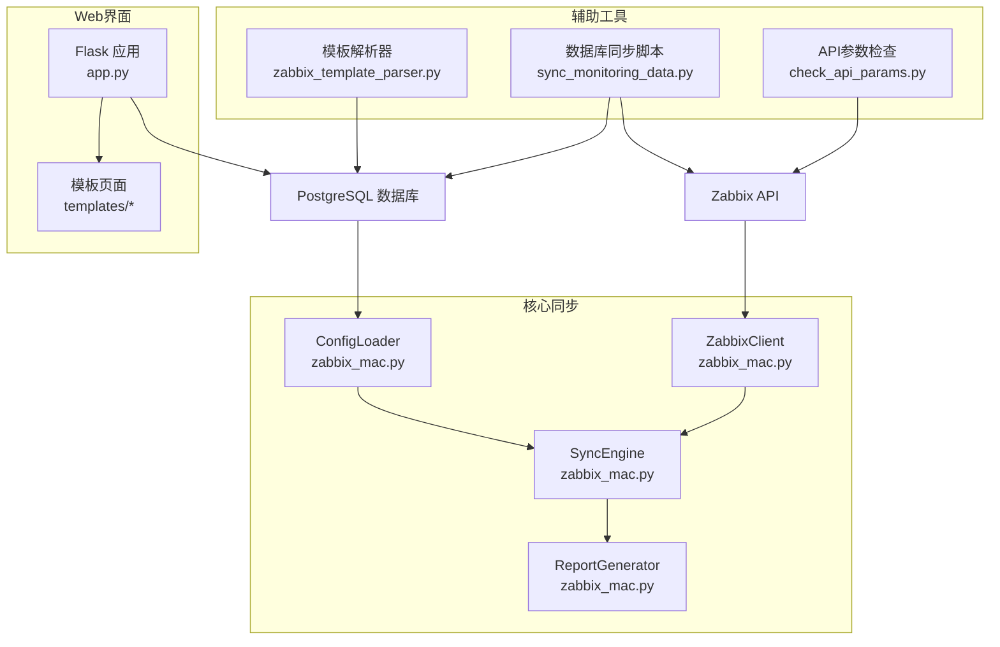
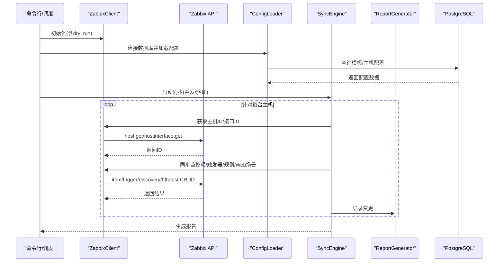
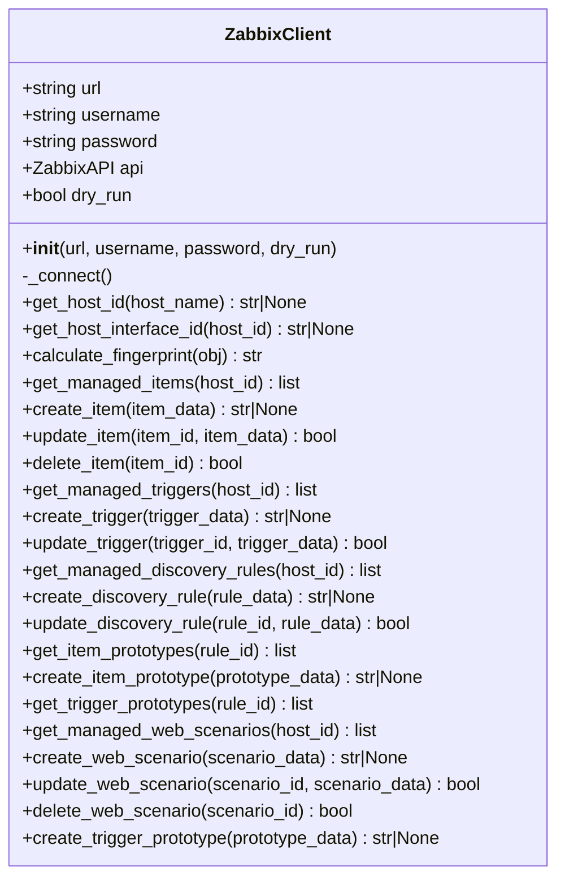
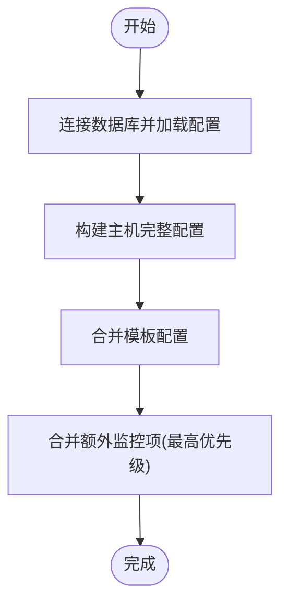
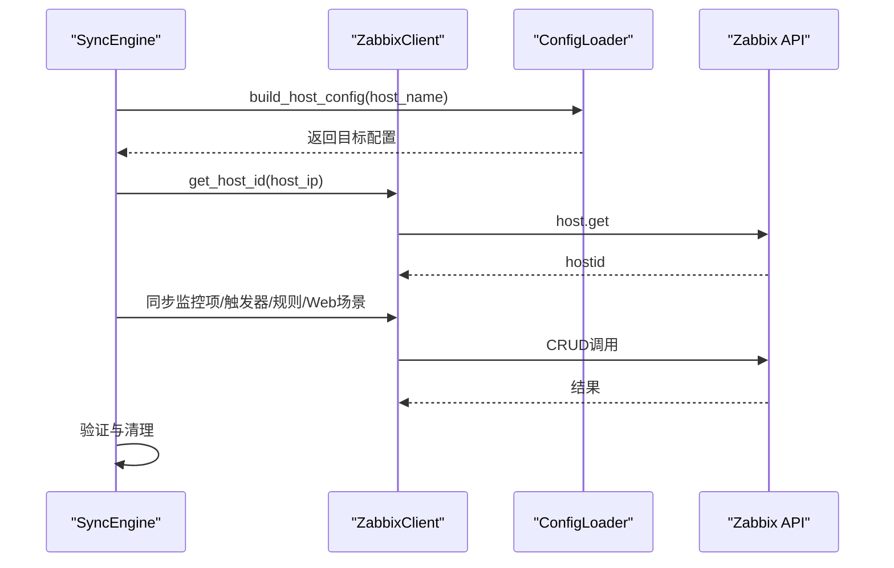
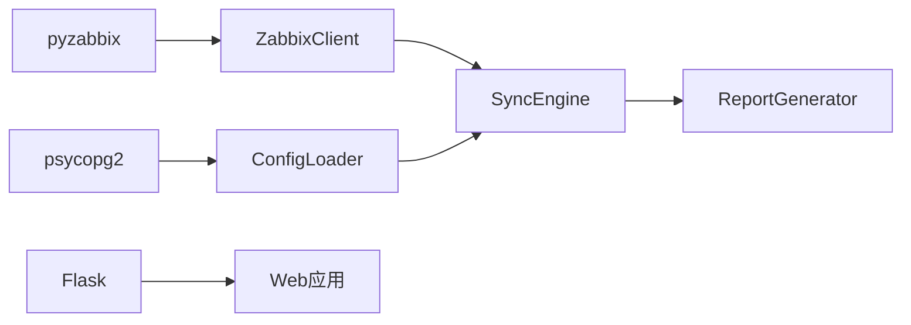

# Zabbix API集成

<cite>
**本文引用的文件**
- [zabbix_mac.py](file://zabbix_mac.py)
- [app.py](file://app.py)
- [zabbix_template_parser.py](file://zabbix_template_parser.py)
- [sync_monitoring_data.py](file://sync_monitoring_data.py)
- [check_api_params.py](file://check_api_params.py)
- [monitor_config.yaml](file://monitor_config.yaml)
- [base_templates/common.yaml](file://base_templates/common.yaml)
- [base_templates/web.yaml](file://base_templates/web.yaml)
- [CODE_WIKI.md](file://CODE_WIKI.md)
</cite>

## 目录
1. [简介](#简介)
2. [项目结构](#项目结构)
3. [核心组件](#核心组件)
4. [架构总览](#架构总览)
5. [详细组件分析](#详细组件分析)
6. [依赖关系分析](#依赖关系分析)
7. [性能考虑](#性能考虑)
8. [故障排除指南](#故障排除指南)
9. [结论](#结论)
10. [附录](#附录)

## 简介
本项目为Zabbix监控审核与自动化控制中心，围绕Zabbix 5.0 API构建，提供声明式同步、Web管理界面、复核表审核等功能。重点文档化ZabbixClient类的设计与实现，涵盖构造参数、连接建立、错误处理、重试机制、并发与dry_run模式；并系统梳理监控项、触发器、自动发现规则、监控项原型、触发器原型、Web场景的CRUD方法，以及最佳实践与性能优化建议。

## 项目结构
项目采用“核心同步脚本 + Web界面 + 模板解析 + 同步脚本”的分层组织方式，核心同步脚本zabbix_mac.py承载ZabbixClient与同步引擎，Web应用app.py提供可视化管理，zabbix_template_parser.py负责模板解析入库，sync_monitoring_data.py提供从数据库到Zabbix的同步能力。

图表来源
- [zabbix_mac.py:1-200](file://zabbix_mac.py#L1-L200)
- [app.py:1-120](file://app.py#L1-L120)
- [zabbix_template_parser.py:1-120](file://zabbix_template_parser.py#L1-L120)
- [sync_monitoring_data.py:1-120](file://sync_monitoring_data.py#L1-L120)
- [check_api_params.py:1-42](file://check_api_params.py#L1-L42)

章节来源
- [CODE_WIKI.md:17-125](file://CODE_WIKI.md#L17-L125)

## 核心组件
- ZabbixClient：封装Zabbix API调用，提供连接、主机/接口查询、指纹计算、CRUD方法与重试机制。
- ConfigLoader：从数据库加载模板与主机配置，支持合并与回退。
- SyncEngine：核心同步引擎，负责主机维度的同步、清理、并发与验证。
- ReportGenerator：变更记录与报告生成。
- Flask Web应用：提供监控配置的可视化管理与复核表功能。

章节来源
- [zabbix_mac.py:39-899](file://zabbix_mac.py#L39-L899)
- [app.py:1-774](file://app.py#L1-L774)

## 架构总览
系统通过ZabbixClient与Zabbix API交互，ConfigLoader从数据库加载配置，SyncEngine协调同步流程，ReportGenerator记录变更，Web界面提供管理与复核。

图表来源
- [zabbix_mac.py:1533-1595](file://zabbix_mac.py#L1533-L1595)
- [zabbix_mac.py:899-1097](file://zabbix_mac.py#L899-L1097)

## 详细组件分析

### ZabbixClient类设计与实现
- 构造函数参数
  - url：Zabbix API地址
  - username/password：认证凭据
  - dry_run：是否模拟运行（不实际调用API）
- 连接建立
  - _connect：使用pyzabbix.ZabbixAPI连接并登录，带重试（最多3次，间隔2秒），捕获ZabbixAPIException与通用异常。
- 错误处理与重试
  - 所有API调用均包裹重试逻辑，区分ZabbixAPIException与未知异常，达到最大重试次数后抛出异常。
- 指纹计算
  - calculate_fingerprint：排除itemid/hostid/triggerid/ruleid/prototypeid/created/lastclock等字段，对剩余键值排序后MD5，便于比较差异。
- 主机与接口
  - get_host_id：按host过滤查询hostid，不存在返回None。
  - get_host_interface_id：优先选择agent接口(type=1)，否则返回首个接口。
- 监控项CRUD
  - get_managed_items：获取主机监控项（Zabbix 5.0无标签，直接返回）。
  - create_item/update_item/delete_item：创建、更新、删除监控项，dry_run模式下仅记录日志。
- 触发器CRUD
  - get_managed_triggers：过滤带管理标签的触发器。
  - create_trigger/update_trigger：创建/更新时自动附加管理标签。
- 自动发现规则CRUD
  - get_managed_discovery_rules：返回主机规则（Zabbix 5.0可能无标签）。
  - create_discovery_rule/update_discovery_rule：创建/更新时附加管理标签；兼容不同API返回键（ruleids/itemids）。
- 监控项原型CRUD
  - get_item_prototypes：按discoveryids查询原型。
  - create_item_prototype：创建时附加管理标签。
- 触发器原型CRUD
  - get_trigger_prototypes：按discoveryids查询原型。
  - create_trigger_prototype：创建时支持传入discoveryruleid或直接传参，Zabbix 5.0使用discoveryids参数。
- Web场景CRUD
  - get_managed_web_scenarios：过滤带管理标签的web场景。
  - create_web_scenario/update_web_scenario/delete_web_scenario：创建/更新/删除web场景，创建时附加管理标签。

图表来源
- [zabbix_mac.py:39-899](file://zabbix_mac.py#L39-L899)

章节来源
- [zabbix_mac.py:39-899](file://zabbix_mac.py#L39-L899)

### ConfigLoader类设计与实现
- 数据库连接与重试：connect_db支持重试，失败时自动reset_connection。
- 配置加载：load_config/load_config_from_db从数据库加载主机模板映射与额外监控项。
- 模板加载：load_template_from_db从复核表或原始表加载监控项、触发器、自动发现规则及其原型。
- 合并与构建：deep_merge合并模板，build_host_config合并模板与额外项，优先级为额外项最高。
- 并发安全：ReportGenerator使用锁保护变更记录。

图表来源
- [zabbix_mac.py:916-1463](file://zabbix_mac.py#L916-L1463)

章节来源
- [zabbix_mac.py:916-1463](file://zabbix_mac.py#L916-L1463)

### SyncEngine类设计与实现
- 单主机同步：sync_host根据host_name（实际为host_ip）获取host_id，构建目标配置，依次同步监控项、触发器、自动发现规则与Web场景。
- 并发同步：sync_all_hosts支持多主机并发，内部使用线程池执行。
- 清理与验证：同步完成后进行验证，dry_run模式下跳过实际操作。
- 依赖处理：触发器同步时先创建后设置依赖关系。

图表来源
- [zabbix_mac.py:1533-1595](file://zabbix_mac.py#L1533-L1595)

章节来源
- [zabbix_mac.py:1533-1595](file://zabbix_mac.py#L1533-L1595)

### Web管理界面（Flask）
- 提供系统信息、模板管理、监控项/触发器/主机管理、复核表管理等路由。
- 使用PostgreSQL连接数据库，支持增删改查操作。
- Flash消息提示操作结果。

章节来源
- [app.py:1-774](file://app.py#L1-L774)

### 模板解析器与数据库同步
- 模板解析器：从Zabbix读取模板的监控项、触发器、自动发现规则及其原型，写入数据库。
- 数据库同步脚本：从数据库读取配置，同步到Zabbix，处理依赖关系与规则原型。

章节来源
- [zabbix_template_parser.py:1-834](file://zabbix_template_parser.py#L1-L834)
- [sync_monitoring_data.py:1-467](file://sync_monitoring_data.py#L1-L467)

## 依赖关系分析
- 外部依赖
  - pyzabbix：Zabbix API客户端
  - psycopg2：PostgreSQL驱动
  - Flask：Web框架
  - Bootstrap：前端UI
- 内部依赖
  - ZabbixClient依赖Zabbix API
  - ConfigLoader依赖PostgreSQL
  - SyncEngine依赖ZabbixClient与ConfigLoader
  - Web应用依赖数据库与模板渲染

图表来源
- [zabbix_mac.py:1-30](file://zabbix_mac.py#L1-L30)
- [app.py:9-15](file://app.py#L9-L15)

章节来源
- [CODE_WIKI.md:402-411](file://CODE_WIKI.md#L402-L411)

## 性能考虑
- 并发同步：SyncEngine支持多主机并发，可通过--workers参数调整线程数，提升大规模主机同步效率。
- 重试与退避：统一的重试机制（最多3次，每次间隔2秒）降低瞬时网络波动影响。
- 指纹校验：calculate_fingerprint用于快速判断对象是否发生变化，减少不必要的API调用。
- 并发安全：ReportGenerator使用锁保证多线程下的变更记录一致性。
- 数据库连接：ConfigLoader提供连接重试与重置，避免长事务导致的连接中断。

章节来源
- [zabbix_mac.py:35-37](file://zabbix_mac.py#L35-L37)
- [zabbix_mac.py:938-971](file://zabbix_mac.py#L938-L971)

## 故障排除指南
- 连接Zabbix API失败
  - 检查URL与凭据；确认Zabbix服务可达；查看日志中的ZabbixAPIException。
- 主机不存在
  - 确认主机名或host_ip正确；检查Zabbix中主机注册状态。
- 同步失败
  - 检查用户权限；核对数据库配置；查看API返回结果与日志。
- 数据库连接失败
  - 检查数据库配置与服务状态；使用ConfigLoader的重试与重置机制。
- Web服务器启动失败
  - 检查端口占用并释放端口。

章节来源
- [CODE_WIKI.md:458-474](file://CODE_WIKI.md#L458-L474)

## 结论
本项目通过ZabbixClient对Zabbix 5.0 API的封装，结合ConfigLoader与SyncEngine，实现了声明式、可审计、可复核的监控配置管理。配合Web界面与复核表，形成从模板到Zabbix的全链路自动化控制体系。重试、并发与dry_run模式提升了系统的鲁棒性与安全性。

## 附录

### API调用方法清单与参数说明
- ZabbixClient.__init__(url, username, password, dry_run)
  - 作用：初始化客户端，非dry_run时建立连接。
- ZabbixClient._connect()
  - 作用：建立Zabbix API连接，带重试。
- ZabbixClient.get_host_id(host_name)
  - 参数：主机名
  - 返回：主机ID或None
- ZabbixClient.get_host_interface_id(host_id)
  - 参数：主机ID
  - 返回：接口ID或None
- ZabbixClient.calculate_fingerprint(obj)
  - 参数：对象字典
  - 返回：MD5指纹字符串
- ZabbixClient.get_managed_items(host_id)
  - 参数：主机ID
  - 返回：监控项列表
- ZabbixClient.create_item(item_data)
  - 参数：监控项数据
  - 返回：监控项ID或None
- ZabbixClient.update_item(item_id, item_data)
  - 参数：监控项ID与数据
  - 返回：是否成功
- ZabbixClient.delete_item(item_id)
  - 参数：监控项ID
  - 返回：是否成功
- ZabbixClient.get_managed_triggers(host_id)
  - 参数：主机ID
  - 返回：触发器列表
- ZabbixClient.create_trigger(trigger_data)
  - 参数：触发器数据
  - 返回：触发器ID或None
- ZabbixClient.update_trigger(trigger_id, trigger_data)
  - 参数：触发器ID与数据
  - 返回：是否成功
- ZabbixClient.get_managed_discovery_rules(host_id)
  - 参数：主机ID
  - 返回：自动发现规则列表
- ZabbixClient.create_discovery_rule(rule_data)
  - 参数：规则数据
  - 返回：规则ID或None
- ZabbixClient.update_discovery_rule(rule_id, rule_data)
  - 参数：规则ID与数据
  - 返回：是否成功
- ZabbixClient.get_item_prototypes(rule_id)
  - 参数：规则ID
  - 返回：监控项原型列表
- ZabbixClient.create_item_prototype(prototype_data)
  - 参数：原型数据
  - 返回：原型ID或None
- ZabbixClient.get_trigger_prototypes(rule_id)
  - 参数：规则ID
  - 返回：触发器原型列表
- ZabbixClient.get_managed_web_scenarios(host_id)
  - 参数：主机ID
  - 返回：Web场景列表
- ZabbixClient.create_web_scenario(scenario_data)
  - 参数：Web场景数据
  - 返回：场景ID或None
- ZabbixClient.update_web_scenario(scenario_id, scenario_data)
  - 参数：场景ID与数据
  - 返回：是否成功
- ZabbixClient.delete_web_scenario(scenario_id)
  - 参数：场景ID
  - 返回：是否成功
- ZabbixClient.create_trigger_prototype(prototype_data)
  - 参数：触发器原型数据
  - 返回：原型ID或None

章节来源
- [zabbix_mac.py:39-899](file://zabbix_mac.py#L39-L899)

### 使用示例（路径指引）
- 基本运行：python zabbix_mac.py --url ... --username ... --password ...
- 模拟运行：--dry-run
- 并发运行：--workers N
- 自定义数据库：--db-host/--db-port/--db-name/--db-user/--db-password

章节来源
- [CODE_WIKI.md:350-379](file://CODE_WIKI.md#L350-L379)

### 最佳实践
- 首次运行建议dry-run预演，确认变更范围。
- 根据主机规模调整workers参数，平衡吞吐与资源。
- 使用复核表进行配置审核与确认，确保变更可控。
- 定期备份数据库与Zabbix配置，防止误操作。

章节来源
- [CODE_WIKI.md:436-451](file://CODE_WIKI.md#L436-L451)