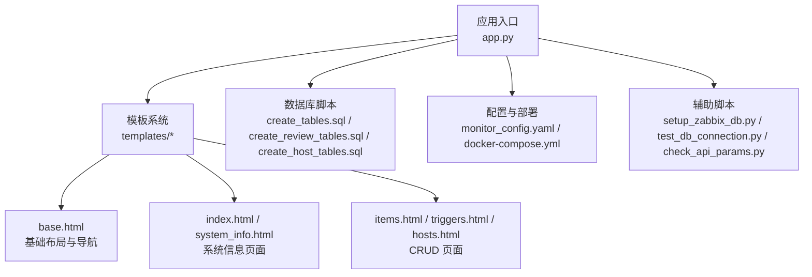
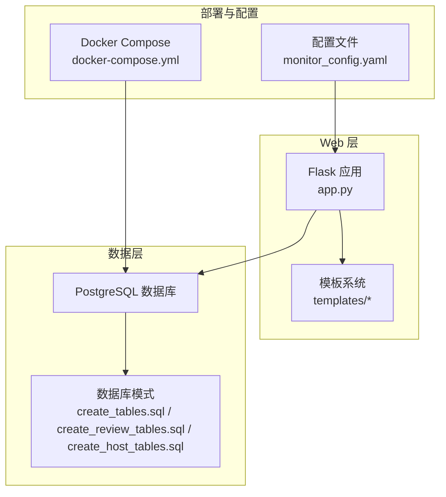
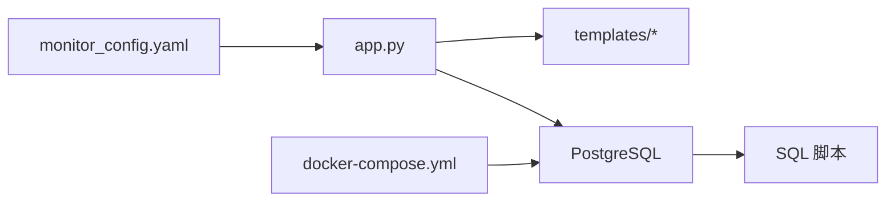
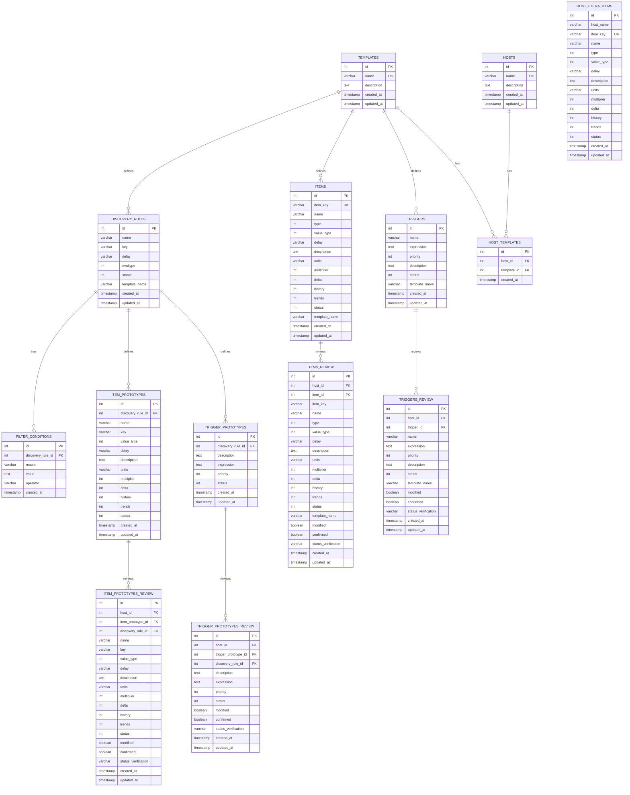

# Flask应用架构

<cite>
**本文档引用的文件**
- [app.py](file://app.py)
- [templates/base.html](file://templates/base.html)
- [templates/index.html](file://templates/index.html)
- [templates/system_info.html](file://templates/system_info.html)
- [templates/items.html](file://templates/items.html)
- [templates/triggers.html](file://templates/triggers.html)
- [templates/hosts.html](file://templates/hosts.html)
- [docker-compose.yml](file://docker-compose.yml)
- [monitor_config.yaml](file://monitor_config.yaml)
- [CODE_WIKI.md](file://CODE_WIKI.md)
- [create_tables.sql](file://create_tables.sql)
- [create_review_tables.sql](file://create_review_tables.sql)
- [create_host_tables.sql](file://create_host_tables.sql)
- [setup_zabbix_db.py](file://setup_zabbix_db.py)
- [test_db_connection.py](file://test_db_connection.py)
- [check_api_params.py](file://check_api_params.py)
</cite>

## 目录
1. [简介](#简介)
2. [项目结构](#项目结构)
3. [核心组件](#核心组件)
4. [架构总览](#架构总览)
5. [详细组件分析](#详细组件分析)
6. [依赖关系分析](#依赖关系分析)
7. [性能考虑](#性能考虑)
8. [故障排除指南](#故障排除指南)
9. [结论](#结论)
10. [附录](#附录)

## 简介
本项目是一个基于 Flask 的 Web 管理界面，用于管理 PostgreSQL 中的 Zabbix 监控配置数据。系统采用“模板即代码”的理念，通过数据库驱动的配置管理，结合复核表机制实现监控配置的审核与确认，并提供 RESTful 风格的路由设计与模板继承体系，支撑从模板管理、监控项与触发器管理到复核表管理的完整工作流。

## 项目结构
项目采用按功能分层的组织方式：
- 应用入口与路由：app.py
- 模板系统：templates/ 下的 HTML 模板，其中 base.html 为基模板，各页面模板继承之
- 数据库脚本：SQL 初始化与复核表结构定义
- 配置与部署：monitor_config.yaml、docker-compose.yml
- 辅助脚本：数据库初始化、连接测试、Zabbix API 参数检查等

**图表来源**
- [app.py:1-774](file://app.py#L1-L774)
- [templates/base.html:1-73](file://templates/base.html#L1-L73)
- [templates/index.html:1-80](file://templates/index.html#L1-L80)
- [templates/system_info.html:1-164](file://templates/system_info.html#L1-L164)
- [templates/items.html:1-37](file://templates/items.html#L1-L37)
- [templates/triggers.html:1-37](file://templates/triggers.html#L1-L37)
- [templates/hosts.html:1-36](file://templates/hosts.html#L1-L36)
- [create_tables.sql:1-198](file://create_tables.sql#L1-L198)
- [create_review_tables.sql:1-201](file://create_review_tables.sql#L1-L201)
- [create_host_tables.sql:1-60](file://create_host_tables.sql#L1-L60)
- [monitor_config.yaml:1-20](file://monitor_config.yaml#L1-L20)
- [docker-compose.yml:1-76](file://docker-compose.yml#L1-L76)
- [setup_zabbix_db.py:1-85](file://setup_zabbix_db.py#L1-L85)
- [test_db_connection.py:1-34](file://test_db_connection.py#L1-L34)
- [check_api_params.py:1-42](file://check_api_params.py#L1-L42)

**章节来源**
- [CODE_WIKI.md:48-125](file://CODE_WIKI.md#L48-L125)
- [app.py:1-774](file://app.py#L1-L774)

## 核心组件
- Flask 应用与路由：集中定义系统所有页面路由，包括首页、系统信息、模板管理、监控项与触发器管理、主机管理以及复核表管理等。
- 数据库连接与访问：通过统一的连接配置与每次请求独立连接的方式访问 PostgreSQL，使用 DictCursor 实现字典形式的查询结果。
- 模板系统：基于 Jinja2 的模板继承，base.html 提供导航与消息提示，各页面模板仅关注自身内容区块。
- 配置与部署：monitor_config.yaml 提供监控配置示例；docker-compose.yml 定义容器化部署拓扑（PostgreSQL、Zabbix Server、Zabbix Web）。
- 辅助工具：数据库初始化脚本、连接测试脚本、Zabbix API 参数检查脚本，保障环境准备与集成验证。

**章节来源**
- [app.py:14-29](file://app.py#L14-L29)
- [app.py:31-771](file://app.py#L31-L771)
- [templates/base.html:1-73](file://templates/base.html#L1-L73)
- [monitor_config.yaml:1-20](file://monitor_config.yaml#L1-L20)
- [docker-compose.yml:1-76](file://docker-compose.yml#L1-L76)
- [setup_zabbix_db.py:7-81](file://setup_zabbix_db.py#L7-L81)
- [test_db_connection.py:10-33](file://test_db_connection.py#L10-L33)
- [check_api_params.py:4-41](file://check_api_params.py#L4-L41)

## 架构总览
Flask 应用作为 Web 层，负责渲染模板与处理用户交互；数据库层提供监控配置与复核表的数据存储；Zabbix 相关能力通过外部 API 与数据库脚本共同支撑。

**图表来源**
- [app.py:14-29](file://app.py#L14-L29)
- [templates/base.html:1-73](file://templates/base.html#L1-L73)
- [create_tables.sql:1-198](file://create_tables.sql#L1-L198)
- [create_review_tables.sql:1-201](file://create_review_tables.sql#L1-L201)
- [create_host_tables.sql:1-60](file://create_host_tables.sql#L1-L60)
- [docker-compose.yml:1-76](file://docker-compose.yml#L1-L76)
- [monitor_config.yaml:1-20](file://monitor_config.yaml#L1-L20)

## 详细组件分析

### 应用初始化与配置
- 应用实例创建与密钥设置：在应用初始化时创建 Flask 实例并设置 secret_key，用于会话与消息闪存的安全性。
- 数据库连接配置：集中定义数据库连接参数，便于后续统一获取连接。
- 连接工厂函数：提供 get_db_connection()，每次请求创建新的连接，确保线程安全与资源隔离。

最佳实践要点
- 将敏感配置放入环境变量或配置文件，避免硬编码。
- 在生产环境中启用连接池或使用连接池库以提升性能与稳定性。

**章节来源**
- [app.py:14-29](file://app.py#L14-L29)

### 路由系统设计
- 首页与系统信息：提供系统概览与详细统计页面，展示主机、模板、监控项、触发器、自动发现规则等计数。
- 模板管理：提供模板列表与详情入口。
- 监控项与触发器管理：支持列表展示、新增、编辑、删除等 CRUD 操作。
- 主机管理：支持主机列表、新增、编辑、删除。
- 复核表管理：针对监控项、触发器、监控项原型、触发器原型分别提供复核表的列表与编辑、确认/取消确认功能。

RESTful 设计原则
- 使用语义化的路径：如 /items、/item/add、/item/edit/<id>、/item/delete/<id>。
- 使用标准 HTTP 方法：GET 用于读取，POST 用于创建与更新。
- 使用路径参数传递资源标识符，保证 URL 的简洁与可读性。

URL 模式规范
- 列表页：/resource
- 新增页：/resource/add
- 编辑页：/resource/edit/<id>
- 删除操作：/resource/delete/<id>（通常配合确认）

**章节来源**
- [app.py:31-771](file://app.py#L31-L771)
- [CODE_WIKI.md:261-299](file://CODE_WIKI.md#L261-L299)

### 数据库连接与访问
- 连接配置：集中定义 host、port、database、user、password。
- 连接工厂：get_db_connection() 返回新连接，避免跨请求共享连接。
- 查询游标：使用 DictCursor 以便以字典形式访问查询结果，便于模板渲染。
- 事务控制：在写操作前后使用 commit/rollback，确保数据一致性。
- 连接关闭：在每个请求结束时显式关闭连接，防止连接泄漏。

优化建议
- 生产环境建议引入连接池（如 SQLAlchemy Engine Pool 或第三方连接池），以减少连接创建开销。
- 对高频查询建立合适索引，降低查询延迟。

**章节来源**
- [app.py:18-29](file://app.py#L18-L29)
- [app.py:96-101](file://app.py#L96-L101)
- [app.py:132-147](file://app.py#L132-L147)
- [app.py:212-221](file://app.py#L212-L221)
- [create_tables.sql:100-107](file://create_tables.sql#L100-L107)
- [create_review_tables.sql:104-119](file://create_review_tables.sql#L104-L119)
- [create_host_tables.sql:42-47](file://create_host_tables.sql#L42-L47)

### 模板继承系统
- 基模板 base.html：定义全局样式、导航菜单、消息提示区域与内容区块占位符。
- 子模板：index.html、system_info.html、items.html、triggers.html、hosts.html 等均通过 extends 'base.html' 继承，仅定义 content 区块。
- 导航与消息：导航菜单通过 url_for 生成链接；消息通过 get_flashed_messages 输出，实现用户反馈。

设计优势
- 代码复用：公共头部、导航、样式与脚本集中在基模板。
- 易维护：修改全局样式或导航只需改动 base.html。
- 可扩展：新增页面只需继承基模板并填充内容区块。

**章节来源**
- [templates/base.html:1-73](file://templates/base.html#L1-L73)
- [templates/index.html:1-80](file://templates/index.html#L1-L80)
- [templates/system_info.html:1-164](file://templates/system_info.html#L1-L164)
- [templates/items.html:1-37](file://templates/items.html#L1-L37)
- [templates/triggers.html:1-37](file://templates/triggers.html#L1-L37)
- [templates/hosts.html:1-36](file://templates/hosts.html#L1-L36)

### 错误处理机制
- 闪存消息：通过 flash() 输出操作结果（成功/失败），并在模板中统一渲染。
- 异常捕获：在写操作中使用 try/except 包裹数据库操作，出现异常时回滚事务并输出错误消息。
- 资源清理：在 finally 或使用 with 上下文管理器确保连接关闭。

最佳实践
- 对用户输入进行校验与清洗，避免注入与异常。
- 区分业务异常与系统异常，提供友好的错误提示。

**章节来源**
- [app.py:143-145](file://app.py#L143-L145)
- [app.py:201-203](file://app.py#L201-L203)
- [app.py:264-266](file://app.py#L264-L266)
- [app.py:356-358](file://app.py#L356-L358)
- [app.py:389-391](file://app.py#L389-L391)
- [app.py:475-477](file://app.py#L475-L477)
- [app.py:560-562](file://app.py#L560-L562)
- [app.py:653-655](file://app.py#L653-L655)
- [app.py:737-739](file://app.py#L737-L739)

### 会话管理与安全配置
- 会话与消息：通过 Flask 的 session 与 flash 机制实现用户状态与提示信息的传递。
- 安全密钥：设置 secret_key 以保护会话数据完整性。
- CSRF 防护：建议在生产环境中引入 CSRF 保护（如 Flask-WTF），并对敏感操作增加二次确认。

注意
- 当前代码未显式使用 Flask session 存储用户状态，主要依赖闪存消息与 URL 跳转。

**章节来源**
- [app.py:15](file://app.py#L15)
- [templates/base.html:57-65](file://templates/base.html#L57-L65)

### 复核表功能与审核流程
- 复核表结构：针对监控项、触发器、监控项原型、触发器原型分别建立复核表，包含 host_ip、modified、confirmed 等字段。
- 审核流程：支持编辑复核记录、标记修改状态、确认/取消确认，通过 confirmed 字段控制同步行为。
- 数据初始化：通过 SQL 脚本将模板数据映射到各主机的复核表。

**章节来源**
- [create_review_tables.sql:4-102](file://create_review_tables.sql#L4-L102)
- [app.py:413-511](file://app.py#L413-L511)
- [app.py:597-699](file://app.py#L597-L699)

### 部署与环境配置
- Docker Compose：定义 PostgreSQL、Zabbix Server、Zabbix Web 的容器编排，暴露必要端口并设置环境变量。
- 监控配置：monitor_config.yaml 提供示例配置，展示如何为主机指定模板与额外监控项。
- 数据库初始化：setup_zabbix_db.py 自动创建数据库用户与数据库并授予权限；test_db_connection.py 用于验证连接；check_api_params.py 用于检查 Zabbix API 方法参数。

**章节来源**
- [docker-compose.yml:1-76](file://docker-compose.yml#L1-L76)
- [monitor_config.yaml:1-20](file://monitor_config.yaml#L1-L20)
- [setup_zabbix_db.py:7-81](file://setup_zabbix_db.py#L7-L81)
- [test_db_connection.py:10-33](file://test_db_connection.py#L10-L33)
- [check_api_params.py:4-41](file://check_api_params.py#L4-L41)

## 依赖关系分析
- Flask 应用依赖模板系统与数据库连接工厂。
- 模板系统依赖 Bootstrap 样式与导航链接。
- 数据库层依赖 SQL 脚本定义的表结构与索引。
- 部署层依赖 Docker Compose 与配置文件。

**图表来源**
- [app.py:14-29](file://app.py#L14-L29)
- [templates/base.html:1-73](file://templates/base.html#L1-L73)
- [create_tables.sql:1-198](file://create_tables.sql#L1-L198)
- [create_review_tables.sql:1-201](file://create_review_tables.sql#L1-L201)
- [create_host_tables.sql:1-60](file://create_host_tables.sql#L1-L60)
- [docker-compose.yml:1-76](file://docker-compose.yml#L1-L76)
- [monitor_config.yaml:1-20](file://monitor_config.yaml#L1-L20)

**章节来源**
- [CODE_WIKI.md:402-411](file://CODE_WIKI.md#L402-L411)

## 性能考虑
- 连接管理：当前每次请求创建新连接，简单但可能带来连接开销。建议在生产环境引入连接池。
- 查询优化：为高频查询建立索引（如 items、triggers、discovery_rules、filter_conditions、item_prototypes、trigger_prototypes 等）。
- 模板渲染：避免在模板中进行复杂计算，尽量在视图函数中完成数据聚合。
- 静态资源：使用 CDN 加速样式与脚本加载（当前模板已引用 Bootstrap CDN）。

[本节为通用指导，无需列出具体文件来源]

## 故障排除指南
- 数据库连接失败：检查 DB_CONFIG 与数据库服务状态；使用 test_db_connection.py 验证连接。
- Zabbix API 连接失败：确认 Zabbix Web 容器已启动且 API 地址正确；使用 check_api_params.py 检查方法参数。
- 权限问题：使用 setup_zabbix_db.py 初始化数据库用户与权限。
- 页面空白或报错：检查模板继承语法与上下文变量是否匹配；确认数据库表结构与索引是否存在。

**章节来源**
- [test_db_connection.py:10-33](file://test_db_connection.py#L10-L33)
- [check_api_params.py:4-41](file://check_api_params.py#L4-L41)
- [setup_zabbix_db.py:7-81](file://setup_zabbix_db.py#L7-L81)
- [create_tables.sql:100-107](file://create_tables.sql#L100-L107)
- [create_review_tables.sql:104-119](file://create_review_tables.sql#L104-L119)
- [create_host_tables.sql:42-47](file://create_host_tables.sql#L42-L47)

## 结论
本 Flask 应用通过清晰的路由设计、模板继承体系与数据库驱动的配置管理，构建了一个完整的 Zabbix 监控配置管理与审核平台。结合 Docker 部署与辅助脚本，能够快速搭建开发与测试环境。建议在生产环境中引入连接池、CSRF 保护与更完善的日志与监控，以进一步提升性能与安全性。

[本节为总结性内容，无需列出具体文件来源]

## 附录

### 数据库表结构概览

**图表来源**
- [create_tables.sql:4-89](file://create_tables.sql#L4-L89)
- [create_host_tables.sql:3-39](file://create_host_tables.sql#L3-L39)
- [create_review_tables.sql:4-102](file://create_review_tables.sql#L4-L102)