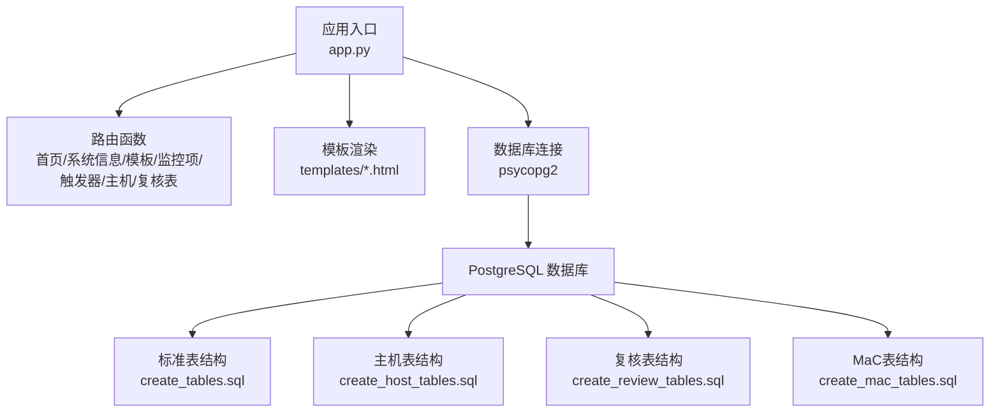
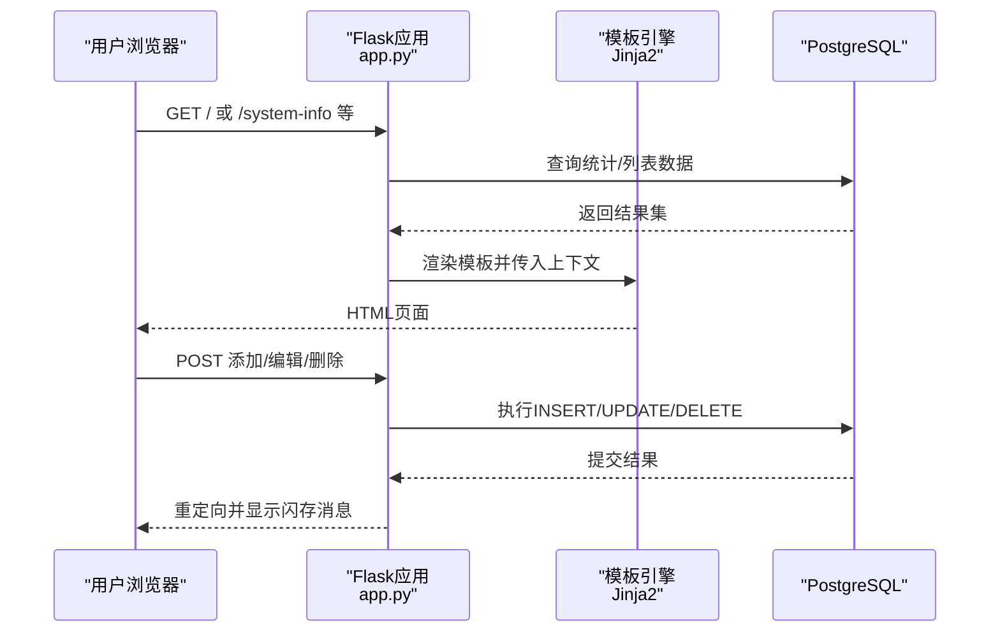
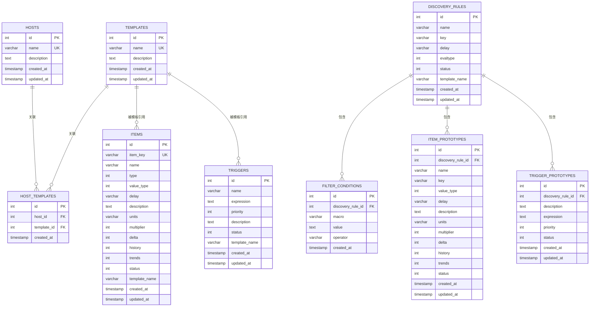
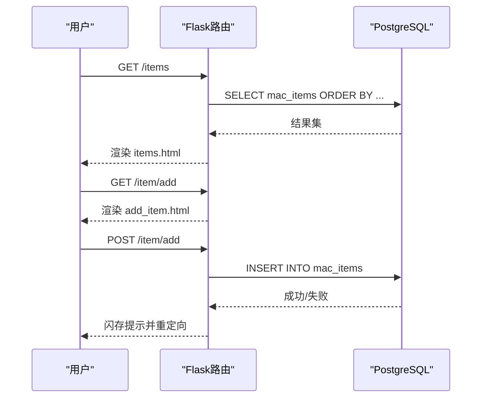
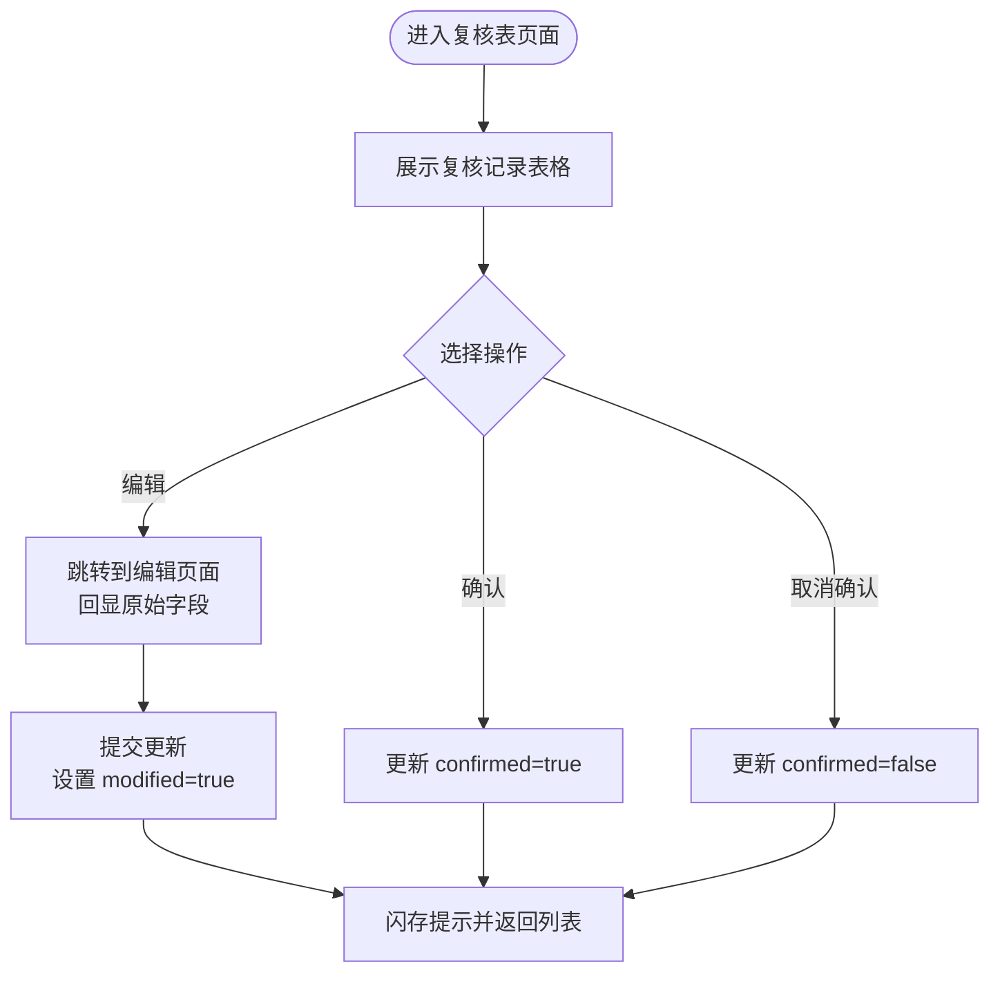
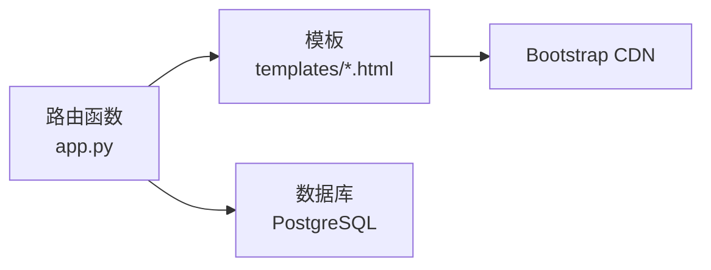

# Web管理界面

<cite>
**本文引用的文件**
- [app.py](file://app.py)
- [base.html](file://templates/base.html)
- [index.html](file://templates/index.html)
- [system_info.html](file://templates/system_info.html)
- [templates.html](file://templates/templates.html)
- [items.html](file://templates/items.html)
- [triggers.html](file://templates/triggers.html)
- [hosts.html](file://templates/hosts.html)
- [items_review.html](file://templates/items_review.html)
- [triggers_review.html](file://templates/triggers_review.html)
- [item_prototypes_review.html](file://templates/item_prototypes_review.html)
- [trigger_prototypes_review.html](file://templates/trigger_prototypes_review.html)
- [create_tables.sql](file://create_tables.sql)
- [create_host_tables.sql](file://create_host_tables.sql)
- [create_review_tables.sql](file://create_review_tables.sql)
- [create_mac_tables.sql](file://create_mac_tables.sql)
</cite>

## 目录
1. [简介](#简介)
2. [项目结构](#项目结构)
3. [核心组件](#核心组件)
4. [架构总览](#架构总览)
5. [详细组件分析](#详细组件分析)
6. [依赖分析](#依赖分析)
7. [性能考虑](#性能考虑)
8. [故障排查指南](#故障排查指南)
9. [结论](#结论)
10. [附录](#附录)

## 简介
本文件面向“Zabbix监控审核与自动化控制中心”的Web管理界面，基于Flask框架实现。文档覆盖应用架构、路由配置、模板系统、数据处理逻辑、页面功能与使用方法、CRUD操作流程、用户交互指南、前端模板结构与Bootstrap样式、响应式设计考虑以及安全与权限控制建议。

## 项目结构
该Web应用采用经典的Flask分层组织方式：应用入口负责路由与业务逻辑，模板目录提供HTML页面与Bootstrap样式，SQL脚本定义数据库表结构与初始化数据。

图表来源
- [app.py:1-774](file://app.py#L1-L774)
- [create_tables.sql:1-198](file://create_tables.sql#L1-L198)
- [create_host_tables.sql:1-60](file://create_host_tables.sql#L1-L60)
- [create_review_tables.sql:1-201](file://create_review_tables.sql#L1-L201)
- [create_mac_tables.sql:1-252](file://create_mac_tables.sql#L1-L252)

章节来源
- [app.py:1-774](file://app.py#L1-L774)

## 核心组件
- 路由与控制器：集中于app.py，包含首页、系统信息、模板、监控项、触发器、主机、复核表等路由，以及对应的CRUD处理逻辑。
- 模板系统：基于Jinja2，通过base.html提供导航栏、消息提示与Bootstrap样式，各页面继承基础模板并填充内容区块。
- 数据访问：使用psycopg2连接PostgreSQL，通过DictCursor读取结果集，支持参数化SQL防止注入。
- 复核机制：提供items_review、triggers_review、item_prototypes_review、trigger_prototypes_review四类复核表，支持“修改标记”“确认标记”等状态字段。

章节来源
- [app.py:31-771](file://app.py#L31-L771)
- [base.html:1-73](file://templates/base.html#L1-L73)

## 架构总览
下图展示了从浏览器到数据库的数据流与控制流：

图表来源
- [app.py:31-771](file://app.py#L31-L771)
- [base.html:57-69](file://templates/base.html#L57-L69)

## 详细组件分析

### 路由与页面功能概览
- 首页与系统信息
  - 首页：展示基础统计卡片与主机列表占位。
  - 系统信息：展示更全面的统计与列表。
- 模板管理
  - 列出模板，提供跳转到详情的入口（当前为空数据）。
- 监控项管理
  - 列表展示、添加、编辑、删除。
- 触发器管理
  - 列表展示、添加、编辑、删除。
- 主机管理
  - 列表展示、添加、编辑、删除（当前为空数据）。
- 复核表管理
  - 监控项复核、触发器复核、监控项原型复核、触发器原型复核。
  - 支持“编辑”“确认/取消确认”等操作。

章节来源
- [app.py:31-409](file://app.py#L31-L409)
- [app.py:411-771](file://app.py#L411-L771)

### 页面与模板结构
- 基础模板base.html
  - 导航栏：首页、系统信息、模板管理、监控项管理、触发器管理、监控项原型、触发器原型、主机管理、复核表管理下拉菜单。
  - 闪存消息：使用Flask的get_flashed_messages渲染提示信息。
  - Bootstrap集成：引入CDN样式与脚本，确保响应式布局。
- 具体页面模板
  - index.html：首页统计与主机表格。
  - system_info.html：系统详情统计与监控项/触发器列表。
  - templates.html：模板列表。
  - items.html：监控项列表与操作按钮。
  - triggers.html：触发器列表与操作按钮。
  - hosts.html：主机列表与操作按钮。
  - 复核表页面：统一采用表格+操作列，支持编辑与确认切换。

章节来源
- [base.html:1-73](file://templates/base.html#L1-L73)
- [index.html:1-80](file://templates/index.html#L1-L80)
- [system_info.html:1-164](file://templates/system_info.html#L1-L164)
- [templates.html:1-31](file://templates/templates.html#L1-L31)
- [items.html:1-37](file://templates/items.html#L1-L37)
- [triggers.html:1-37](file://templates/triggers.html#L1-L37)
- [hosts.html:1-36](file://templates/hosts.html#L1-L36)
- [items_review.html:1-46](file://templates/items_review.html#L1-L46)
- [triggers_review.html:1-42](file://templates/triggers_review.html#L1-L42)
- [item_prototypes_review.html:1-42](file://templates/item_prototypes_review.html#L1-L42)
- [trigger_prototypes_review.html:1-40](file://templates/trigger_prototypes_review.html#L1-L40)

### 数据模型与表结构
- 标准表结构（create_tables.sql）
  - items、triggers、discovery_rules、filter_conditions、item_prototypes、trigger_prototypes、templates。
  - 包含索引优化与示例数据插入。
- 主机表结构（create_host_tables.sql）
  - hosts、host_templates、host_extra_items；示例主机与关联。
- 复核表结构（create_review_tables.sql）
  - items_review、triggers_review、item_prototypes_review、trigger_prototypes_review。
  - 每张表均包含modified、confirmed等复核字段与唯一约束。
- MaC表结构（create_mac_tables.sql）
  - 与标准表结构类似，但表名以mac_前缀命名，用于MaC工作流。

图表来源
- [create_tables.sql:4-98](file://create_tables.sql#L4-L98)
- [create_host_tables.sql:3-47](file://create_host_tables.sql#L3-L47)

章节来源
- [create_tables.sql:1-198](file://create_tables.sql#L1-L198)
- [create_host_tables.sql:1-60](file://create_host_tables.sql#L1-L60)
- [create_review_tables.sql:4-120](file://create_review_tables.sql#L4-L120)
- [create_mac_tables.sql:4-151](file://create_mac_tables.sql#L4-L151)

### CRUD操作流程与用户交互

#### 监控项管理
- 列表页：展示键值、名称、模板、更新间隔、状态与操作按钮。
- 添加：GET显示表单，POST提交后插入mac_items，成功后闪存提示并重定向。
- 编辑：GET加载原数据，POST更新对应记录。
- 删除：GET执行删除并回滚/提交，闪存提示后重定向。

图表来源
- [app.py:93-148](file://app.py#L93-L148)

章节来源
- [app.py:93-221](file://app.py#L93-L221)
- [items.html:1-37](file://templates/items.html#L1-L37)

#### 触发器管理
- 列表页：展示名称、表达式、优先级、模板、状态与操作按钮。
- 添加/编辑/删除流程与监控项一致，使用mac_triggers表。

章节来源
- [app.py:223-332](file://app.py#L223-L332)
- [triggers.html:1-37](file://templates/triggers.html#L1-L37)

#### 主机管理
- 列表页：展示名称、关联模板、描述、创建时间与操作按钮。
- 添加/编辑/删除流程使用mac_hosts表。

章节来源
- [app.py:334-409](file://app.py#L334-L409)
- [hosts.html:1-36](file://templates/hosts.html#L1-L36)

#### 复核表管理
- 监控项复核：items_review，支持编辑字段与确认/取消确认。
- 触发器复核：triggers_review，支持编辑字段与确认/取消确认。
- 监控项原型复核：item_prototypes_review，支持编辑字段与确认/取消确认。
- 触发器原型复核：trigger_prototypes_review，支持编辑字段与确认/取消确认。

图表来源
- [app.py:411-771](file://app.py#L411-L771)
- [items_review.html:1-46](file://templates/items_review.html#L1-L46)
- [triggers_review.html:1-42](file://templates/triggers_review.html#L1-L42)
- [item_prototypes_review.html:1-42](file://templates/item_prototypes_review.html#L1-L42)
- [trigger_prototypes_review.html:1-40](file://templates/trigger_prototypes_review.html#L1-L40)

### 安全机制与权限控制
- 当前实现
  - 使用Flask内置的闪存消息进行用户反馈。
  - 路由中对不存在资源进行友好提示并重定向。
- 建议增强
  - 认证与会话：引入登录/登出流程与会话管理。
  - 授权：基于角色的访问控制（RBAC），限制对敏感页面与操作的访问。
  - 输入校验：在表单提交时进行参数校验与清理。
  - CSRF防护：为POST表单添加CSRF令牌。
  - HTTPS与安全头部：生产环境启用HTTPS与安全响应头。
  - 日志审计：记录关键操作与异常事件。

章节来源
- [app.py:103-148](file://app.py#L103-L148)
- [app.py:233-269](file://app.py#L233-L269)
- [app.py:341-362](file://app.py#L341-L362)
- [app.py:423-495](file://app.py#L423-L495)

## 依赖分析
- 组件耦合
  - 路由函数与模板强绑定，通过render_template传递上下文变量。
  - 数据访问集中在app.py中，便于统一错误处理与事务控制。
- 外部依赖
  - Flask：Web框架与模板系统。
  - psycopg2：PostgreSQL驱动，使用DictCursor提升可读性。
  - Bootstrap：前端UI框架，提供响应式布局与组件。

图表来源
- [app.py:9-29](file://app.py#L9-L29)
- [base.html:7-71](file://templates/base.html#L7-L71)

章节来源
- [app.py:9-29](file://app.py#L9-L29)
- [base.html:7-71](file://templates/base.html#L7-L71)

## 性能考虑
- 数据库层面
  - 已为关键表建立索引，如items、triggers、discovery_rules等，有助于查询性能。
  - 使用参数化SQL避免重复解析与注入风险。
- 应用层面
  - DictCursor便于按字段名访问结果，但注意内存占用；大数据量时可考虑分页或游标查询。
  - 闪存消息仅在一次请求内有效，避免持久化存储。
- 前端层面
  - Bootstrap CDN引入外部资源，建议在生产环境替换为本地或CDN缓存版本以降低延迟。

章节来源
- [create_tables.sql:100-107](file://create_tables.sql#L100-L107)
- [app.py:26-29](file://app.py#L26-L29)

## 故障排查指南
- 页面空白或报错
  - 检查数据库连接配置是否正确。
  - 确认目标表是否存在且有数据。
- 无法提交表单
  - 查看服务器日志中的异常堆栈。
  - 确认表单字段与数据库字段匹配。
- 闪存消息不显示
  - 确保模板中包含闪存消息渲染区域。
  - 检查Flask secret_key是否设置。

章节来源
- [app.py:18-24](file://app.py#L18-L24)
- [base.html:57-69](file://templates/base.html#L57-L69)

## 结论
该Web管理界面以Flask为核心，结合Bootstrap实现了清晰的导航与响应式布局；通过标准化的模板系统与参数化数据库访问，提供了监控项、触发器、主机及复核表的完整管理能力。建议后续增强认证授权、CSRF防护与日志审计，以满足生产环境的安全与合规要求。

## 附录
- 快速启动
  - 确保PostgreSQL运行并创建数据库。
  - 执行SQL脚本初始化表结构与示例数据。
  - 运行Flask应用并在浏览器打开根路径。
- 常用URL
  - 首页：/
  - 系统信息：/system-info
  - 模板管理：/templates
  - 监控项管理：/items
  - 触发器管理：/triggers
  - 主机管理：/hosts
  - 复核表管理：/items-review、/triggers-review、/item-prototypes-review、/trigger-prototypes-review