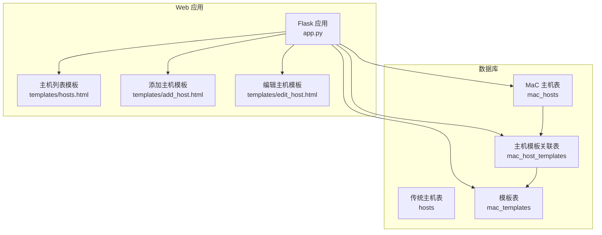
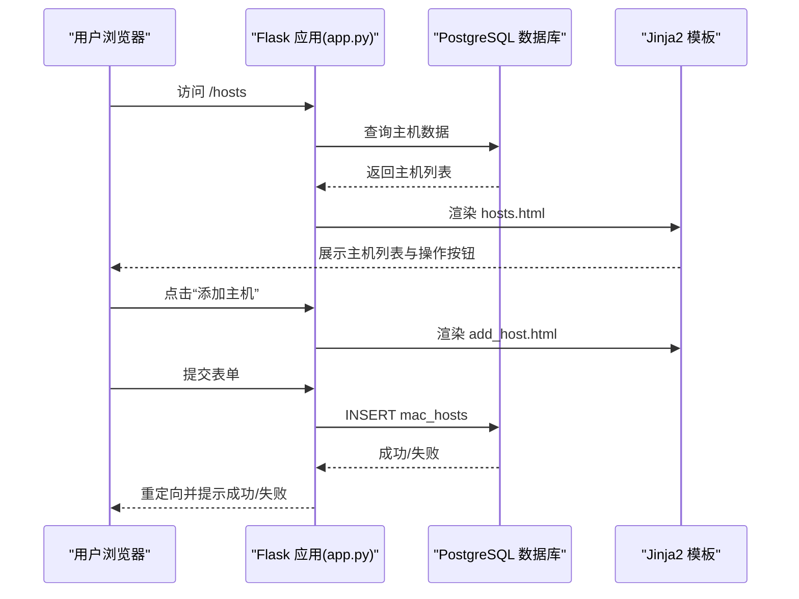
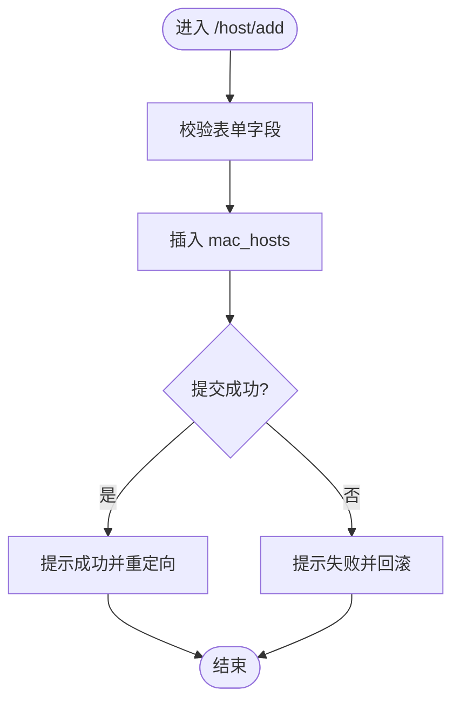
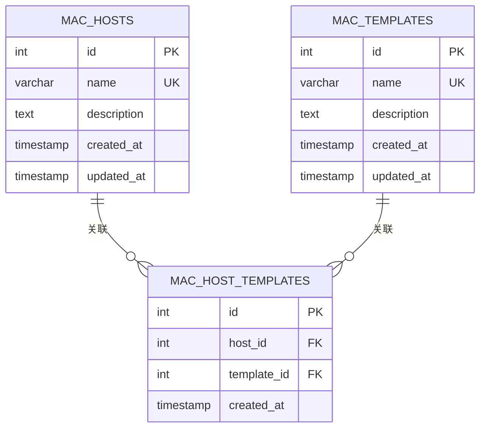
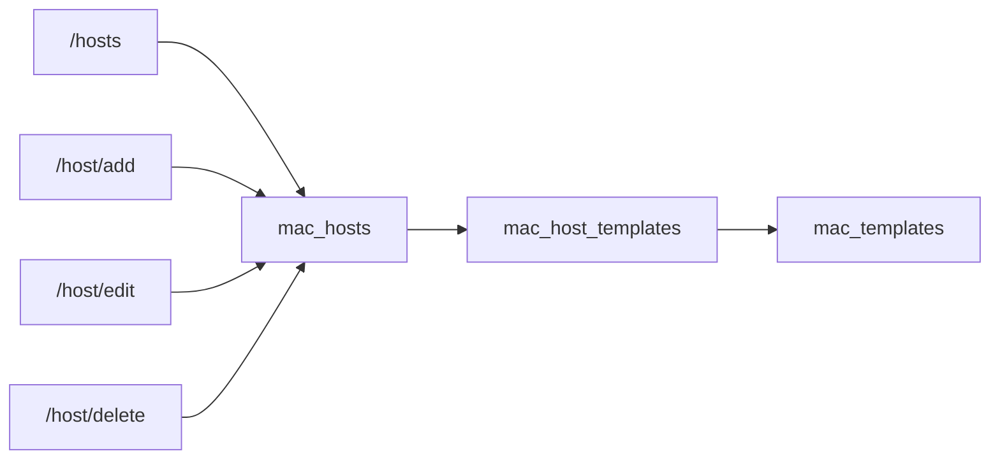

# 主机管理

<cite>
**本文引用的文件**
- [app.py](file://app.py)
- [hosts.html](file://templates/hosts.html)
- [add_host.html](file://templates/add_host.html)
- [edit_host.html](file://templates/edit_host.html)
- [create_mac_tables.sql](file://create_mac_tables.sql)
- [create_host_tables.sql](file://create_host_tables.sql)
- [update_database_schema.sql](file://update_database_schema.sql)
- [monitor_config.yaml](file://monitor_config.yaml)
- [CODE_WIKI.md](file://CODE_WIKI.md)
- [check_host.py](file://check_host.py)
</cite>

## 目录
1. [简介](#简介)
2. [项目结构](#项目结构)
3. [核心组件](#核心组件)
4. [架构总览](#架构总览)
5. [详细组件分析](#详细组件分析)
6. [依赖关系分析](#依赖关系分析)
7. [性能考虑](#性能考虑)
8. [故障排除指南](#故障排除指南)
9. [结论](#结论)
10. [附录](#附录)

## 简介
本章节面向“主机管理”功能，系统性地阐述主机的 CRUD 操作流程、数据模型、与监控模板的关联关系、界面使用指南、配置最佳实践以及常见使用场景与故障排除方法。文档严格基于仓库中的源码与模板文件进行分析，避免臆测，确保读者能够准确理解当前实现与使用方式。

## 项目结构
主机管理功能位于基于 Flask 的 Web 应用中，路由与模板共同构成完整的主机管理界面与后端逻辑。数据库层面提供了两类主机相关表结构：一类是传统 hosts 表（用于系统信息展示），另一类是 MaC（Monitor as Code）风格的 mac_hosts 表（用于实际的主机管理与模板关联）。两者在当前应用中存在差异，需要特别注意。

图表来源
- [app.py](file://app.py)
- [hosts.html](file://templates/hosts.html)
- [add_host.html](file://templates/add_host.html)
- [edit_host.html](file://templates/edit_host.html)
- [create_mac_tables.sql](file://create_mac_tables.sql)

章节来源
- [app.py](file://app.py)
- [hosts.html](file://templates/hosts.html)
- [add_host.html](file://templates/add_host.html)
- [edit_host.html](file://templates/edit_host.html)
- [create_mac_tables.sql](file://create_mac_tables.sql)

## 核心组件
- Web 路由与控制器
  - 主机列表：/hosts
  - 添加主机：/host/add（GET/POST）
  - 编辑主机：/host/edit/<int:host_id>（GET/POST）
  - 删除主机：/host/delete/<int:host_id>（GET）

- 模板页面
  - 主机列表页：展示主机基本信息与操作按钮
  - 添加主机页：表单输入 name、template_name、description
  - 编辑主机页：表单回显并允许更新上述字段

- 数据模型
  - 传统 hosts 表：name 唯一、带创建/更新时间戳
  - MaC mac_hosts 表：name 唯一、带描述与时间戳
  - 模板关联：mac_host_templates 将主机与模板建立多对多关系

章节来源
- [app.py](file://app.py)
- [hosts.html](file://templates/hosts.html)
- [add_host.html](file://templates/add_host.html)
- [edit_host.html](file://templates/edit_host.html)
- [create_mac_tables.sql](file://create_mac_tables.sql)

## 架构总览
主机管理的前端界面由 Flask 路由渲染 Jinja2 模板；后端通过数据库连接执行 CRUD 操作。模板中包含主机列表、搜索过滤、排序与批量操作的 UI 结构，但当前路由实现并未直接使用这些功能，而是返回空列表或简单页面。

图表来源
- [app.py](file://app.py)
- [hosts.html](file://templates/hosts.html)
- [add_host.html](file://templates/add_host.html)
- [create_mac_tables.sql](file://create_mac_tables.sql)

## 详细组件分析

### 主机数据模型与约束
- 传统 hosts 表
  - 字段：id（主键）、name（唯一）、description、created_at、updated_at
  - 约束：name 唯一
- MaC mac_hosts 表
  - 字段：id（主键）、name（唯一）、description、created_at、updated_at
  - 约束：name 唯一
- 模板关联
  - mac_host_templates：host_id 与 template_id 的外键约束，唯一性约束保证一对一或多对多关系的去重
- 与监控模板的关联
  - 当前路由层未直接使用 template_name 字段；模板选择机制与验证规则由数据库层约束体现（模板存在性、唯一性）

章节来源
- [create_mac_tables.sql](file://create_mac_tables.sql)
- [create_host_tables.sql](file://create_host_tables.sql)

### 主机 CRUD 流程
- 创建主机
  - 路由：/host/add（POST）
  - 表单字段：name、template_name、description
  - 数据库：INSERT INTO mac_hosts
  - 结果：成功提示并跳转至主机列表
- 读取主机
  - 路由：/hosts（当前返回空列表）
  - 列表页：hosts.html 展示主机信息与操作按钮
- 更新主机
  - 路由：/host/edit/<int:host_id>（GET/POST）
  - 表单字段：name、template_name、description
  - 数据库：UPDATE mac_hosts
  - 结果：成功提示并跳转至主机列表
- 删除主机
  - 路由：/host/delete/<int:host_id>
  - 数据库：DELETE FROM mac_hosts
  - 结果：成功提示并跳转至主机列表

图表来源
- [app.py](file://app.py)
- [add_host.html](file://templates/add_host.html)
- [create_mac_tables.sql](file://create_mac_tables.sql)

章节来源
- [app.py](file://app.py)
- [add_host.html](file://templates/add_host.html)
- [edit_host.html](file://templates/edit_host.html)
- [create_mac_tables.sql](file://create_mac_tables.sql)

### 主机与监控模板的关联关系
- 关系模型
  - 主机与模板通过 mac_host_templates 建立关联，支持多对多关系
  - 模板表 mac_templates 提供模板的唯一标识与描述
- 模板选择机制
  - 当前 Web 表单未提供模板下拉选择；template_name 字段作为文本输入
  - 实际模板选择与验证依赖数据库约束（模板存在性、唯一性）
- 模板验证规则
  - 唯一性：模板名称唯一
  - 关联唯一性：同一主机与模板组合唯一
  - 外键约束：mac_host_templates 的 host_id 与 template_id 引用对应主表

图表来源
- [create_mac_tables.sql](file://create_mac_tables.sql)

章节来源
- [create_mac_tables.sql](file://create_mac_tables.sql)

### 主机管理界面使用指南
- 列表显示
  - 页面展示主机 ID、名称、关联模板、描述、创建时间与操作按钮
- 搜索过滤
  - 模板中包含搜索框与过滤按钮，但当前 /hosts 路由返回空列表，未实现后端过滤
- 排序功能
  - 模板中包含排序按钮，但当前 /hosts 路由未实现排序逻辑
- 批量操作
  - 模板中包含批量勾选与批量删除按钮，但当前 /hosts 路由未实现批量处理逻辑

章节来源
- [hosts.html](file://templates/hosts.html)
- [app.py](file://app.py)

### 主机配置的基本概念与最佳实践
- 配置文件中的主机配置
  - monitor_config.yaml 中定义了主机名、引用模板与额外监控项
  - 额外监控项具有最高优先级，覆盖模板中的同名项
- 最佳实践
  - 为不同业务场景创建专用模板，便于统一管理
  - 使用额外监控项进行差异化配置，避免直接修改模板
  - 通过复核表机制对配置变更进行审核与确认

章节来源
- [monitor_config.yaml](file://monitor_config.yaml)
- [CODE_WIKI.md](file://CODE_WIKI.md)

### 常见使用场景
- 新增主机并绑定模板
  - 在“添加主机”页面填写 name、template_name、description
  - 确保模板存在且唯一，否则插入会失败
- 更新主机描述或模板
  - 在“编辑主机”页面更新相应字段
  - 注意模板名称的唯一性与存在性
- 删除主机
  - 确认不再需要该主机时，点击“删除”按钮
  - 删除后无法恢复，请谨慎操作

章节来源
- [app.py](file://app.py)
- [add_host.html](file://templates/add_host.html)
- [edit_host.html](file://templates/edit_host.html)

## 依赖关系分析
- 路由依赖
  - /hosts 依赖数据库中的 mac_hosts 与 mac_host_templates
  - /host/add、/host/edit、/host/delete 依赖 mac_hosts 的 CRUD
- 模板依赖
  - hosts.html 依赖 hosts 路由返回的主机数据
  - add_host.html 与 edit_host.html 依赖表单提交与路由处理
- 数据库依赖
  - mac_hosts 与 mac_host_templates 的外键与唯一性约束保证数据一致性

图表来源
- [app.py](file://app.py)
- [create_mac_tables.sql](file://create_mac_tables.sql)

章节来源
- [app.py](file://app.py)
- [create_mac_tables.sql](file://create_mac_tables.sql)

## 性能考虑
- 索引优化
  - mac_hosts、mac_host_templates、mac_host_extra_items 等表均建立了索引，提升查询效率
- 并发与事务
  - 路由层使用单事务提交，异常时回滚，保证数据一致性
- 建议
  - 对于大量主机的场景，建议在数据库层面增加合适的索引与分区策略
  - 控制单次批量操作的数量，避免长时间锁表

章节来源
- [create_mac_tables.sql](file://create_mac_tables.sql)
- [app.py](file://app.py)

## 故障排除指南
- 无法连接 Zabbix API
  - 现象：Zabbix API 连接失败
  - 排查：检查 URL、用户名与密码是否正确
  - 参考：[check_host.py](file://check_host.py)
- 主机添加失败
  - 现象：提示添加失败
  - 排查：检查 name 是否唯一、template_name 是否存在
  - 参考：[app.py](file://app.py)、[create_mac_tables.sql](file://create_mac_tables.sql)
- 主机列表为空
  - 现象：/hosts 页面显示空列表
  - 排查：确认数据库中是否已插入示例数据或自定义数据
  - 参考：[app.py](file://app.py)
- 模板选择无效
  - 现象：template_name 输入无效
  - 排查：确认模板名称唯一且存在
  - 参考：[create_mac_tables.sql](file://create_mac_tables.sql)

章节来源
- [check_host.py](file://check_host.py)
- [app.py](file://app.py)
- [create_mac_tables.sql](file://create_mac_tables.sql)

## 结论
主机管理功能在当前版本中提供了基本的 CRUD 能力与界面交互，但部分前端特性（搜索、排序、批量操作）尚未与后端实现对接。数据模型清晰，模板关联通过数据库约束保障一致性。建议后续完善后端逻辑以充分利用前端模板提供的交互能力，并在模板选择与验证方面增强用户体验与安全性。

## 附录
- 数据库初始化与迁移
  - create_tables.sql：标准模板表结构
  - create_mac_tables.sql：MaC 主机与模板相关表结构
  - create_host_tables.sql：传统主机表结构
  - update_database_schema.sql：扩展字段与新增额外项表
- 相关文档
  - CODE_WIKI.md：项目整体架构与功能说明

章节来源
- [create_tables.sql](file://create_tables.sql)
- [create_mac_tables.sql](file://create_mac_tables.sql)
- [create_host_tables.sql](file://create_host_tables.sql)
- [update_database_schema.sql](file://update_database_schema.sql)
- [CODE_WIKI.md](file://CODE_WIKI.md)