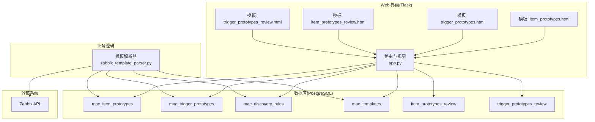
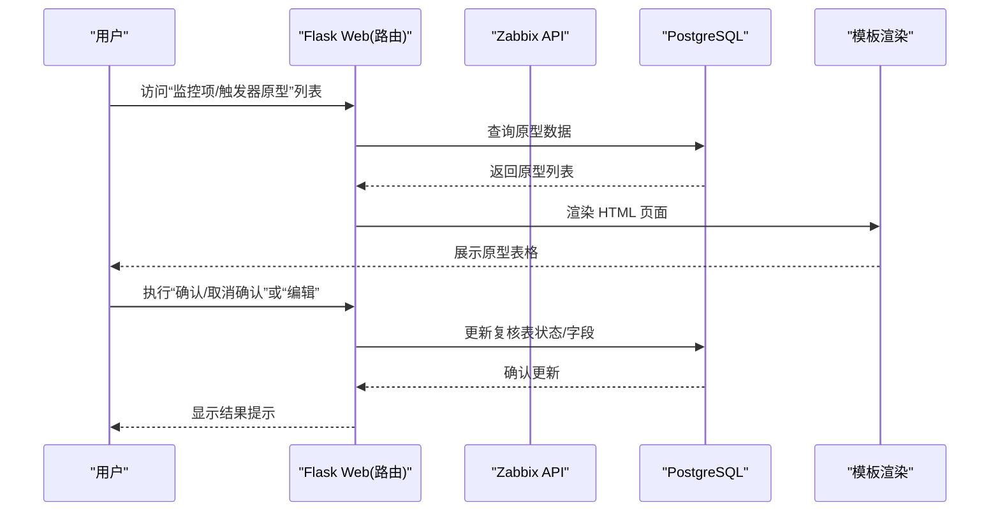
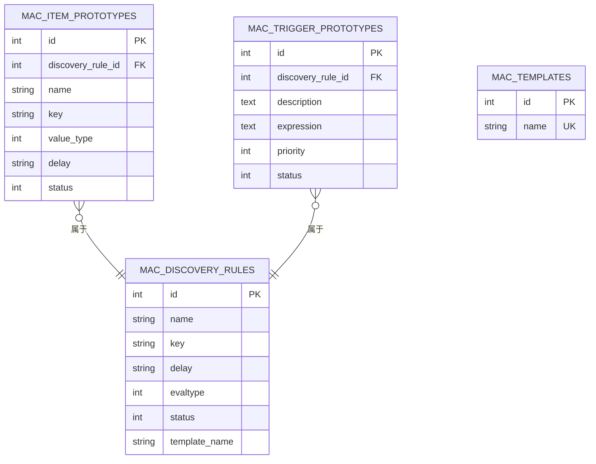
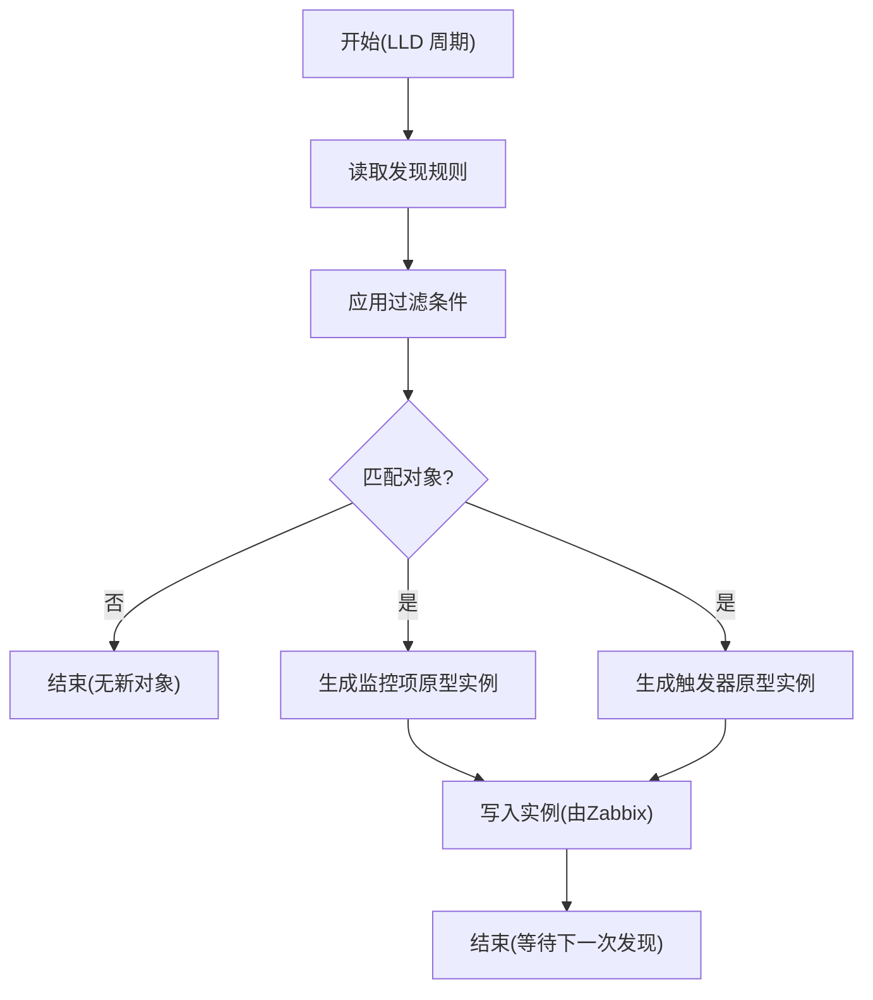
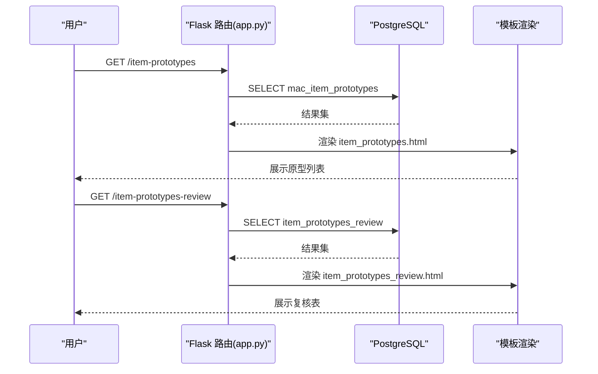
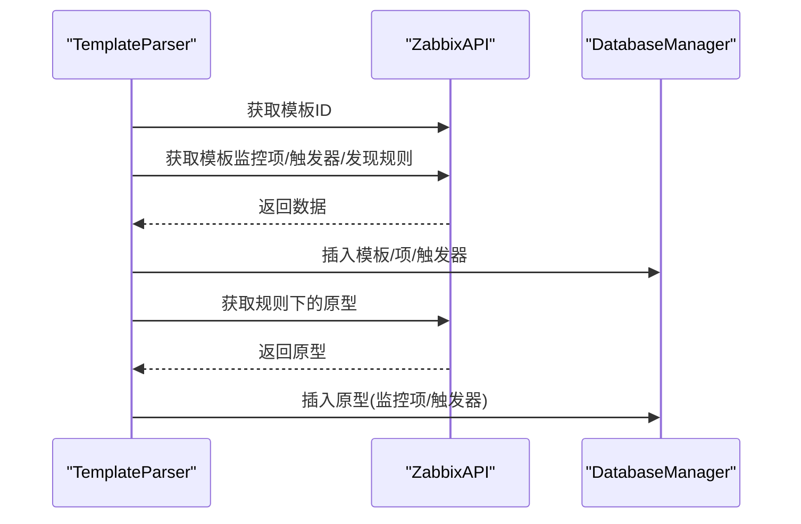
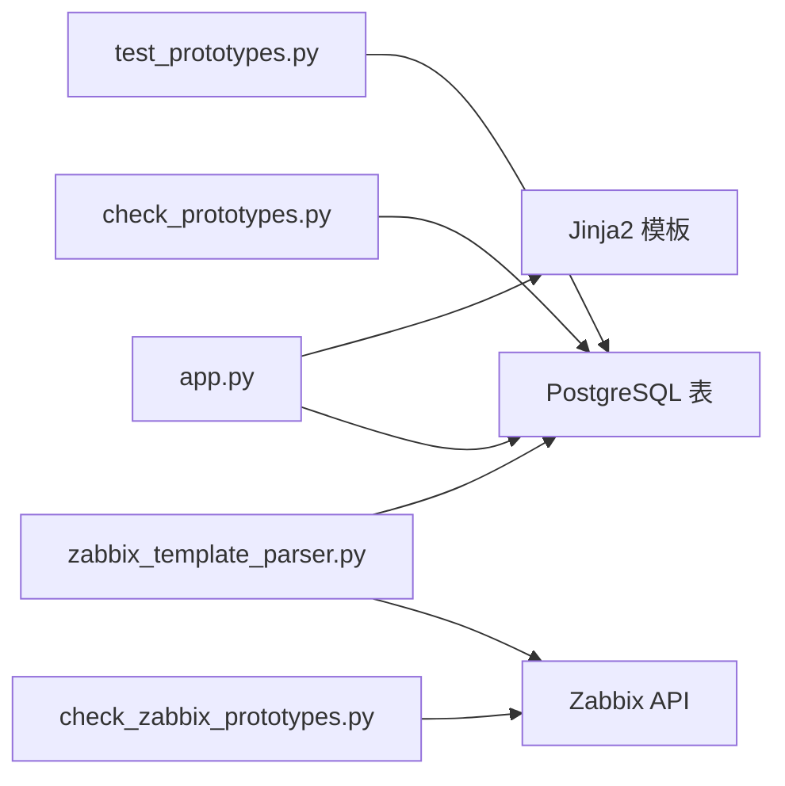

# 原型管理

<cite>
**本文引用的文件**
- [app.py](file://app.py)
- [zabbix_template_parser.py](file://zabbix_template_parser.py)
- [check_prototypes.py](file://check_prototypes.py)
- [check_zabbix_prototypes.py](file://check_zabbix_prototypes.py)
- [test_prototypes.py](file://test_prototypes.py)
- [check_trigger_prototypes.py](file://check_trigger_prototypes.py)
- [check_item_prototypes_delay.py](file://check_item_prototypes_delay.py)
- [create_mac_tables.sql](file://create_mac_tables.sql)
- [create_tables.sql](file://create_tables.sql)
- [create_review_tables.sql](file://create_review_tables.sql)
- [monitor_config.yaml](file://monitor_config.yaml)
- [templates/item_prototypes.html](file://templates/item_prototypes.html)
- [templates/trigger_prototypes.html](file://templates/trigger_prototypes.html)
- [templates/item_prototypes_review.html](file://templates/item_prototypes_review.html)
- [templates/trigger_prototypes_review.html](file://templates/trigger_prototypes_review.html)
</cite>

## 目录
1. [简介](#简介)
2. [项目结构](#项目结构)
3. [核心组件](#核心组件)
4. [架构总览](#架构总览)
5. [详细组件分析](#详细组件分析)
6. [依赖分析](#依赖分析)
7. [性能考虑](#性能考虑)
8. [故障排查指南](#故障排查指南)
9. [结论](#结论)
10. [附录](#附录)

## 简介
本文件围绕“原型管理”主题，系统阐述监控项原型与触发器原型的管理能力与工作流，涵盖原型的创建、编辑、删除与复核流程；解释 LLD（低层发现，Low-Level Discovery）机制及原型在自动发现中的作用；对比原型与普通监控项/触发器的差异（继承关系与动态生成机制）；提供原型管理界面的使用指南与最佳实践，并总结大规模监控场景下的应用优势与常见问题处理方案。

## 项目结构
该项目采用“Flask Web 界面 + PostgreSQL 数据库 + Zabbix API 解析”的分层架构：
- Web 层：Flask 应用提供管理界面与 CRUD 操作入口
- 数据层：PostgreSQL 存储标准化的监控配置（含原型表）
- 集成层：Zabbix API 客户端负责从 Zabbix 服务器抓取模板、规则与原型数据

图表来源
- [app.py:1-774](file://app.py#L1-L774)
- [zabbix_template_parser.py:1-834](file://zabbix_template_parser.py#L1-L834)
- [create_mac_tables.sql:1-252](file://create_mac_tables.sql#L1-L252)
- [create_review_tables.sql:1-201](file://create_review_tables.sql#L1-L201)

章节来源
- [app.py:1-774](file://app.py#L1-L774)
- [zabbix_template_parser.py:1-834](file://zabbix_template_parser.py#L1-L834)
- [create_mac_tables.sql:1-252](file://create_mac_tables.sql#L1-L252)
- [create_review_tables.sql:1-201](file://create_review_tables.sql#L1-L201)

## 核心组件
- 原型数据模型
  - 自动发现规则：mac_discovery_rules
  - 监控项原型：mac_item_prototypes
  - 触发器原型：mac_trigger_prototypes
- Web 管理界面
  - 原型列表页：监控项原型、触发器原型
  - 原型复核表：item_prototypes_review、trigger_prototypes_review
- 解析与同步
  - Zabbix API 客户端：获取模板、规则、原型
  - 数据库管理器：建表、插入/更新、冲突处理
- 工具脚本
  - 检查原型数据一致性与完整性
  - 验证 Zabbix 当前状态

章节来源
- [create_mac_tables.sql:69-98](file://create_mac_tables.sql#L69-L98)
- [create_review_tables.sql:55-102](file://create_review_tables.sql#L55-L102)
- [zabbix_template_parser.py:179-581](file://zabbix_template_parser.py#L179-L581)
- [check_prototypes.py:1-49](file://check_prototypes.py#L1-L49)
- [check_zabbix_prototypes.py:1-73](file://check_zabbix_prototypes.py#L1-L73)

## 架构总览
原型管理贯穿“采集—存储—展示—复核—发布”的闭环：
- 采集：通过 Zabbix API 抓取模板内的自动发现规则与原型
- 存储：写入 PostgreSQL 的原型表与复核表
- 展示：Flask 渲染 HTML 列表页，支持排序、筛选与状态标识
- 复核：复核表记录变更与确认状态，支持批量确认/取消确认
- 发布：经确认的原型可作为标准配置下发至主机模板

图表来源
- [app.py:79-91](file://app.py#L79-L91)
- [templates/item_prototypes.html:1-41](file://templates/item_prototypes.html#L1-L41)
- [templates/trigger_prototypes.html:1-51](file://templates/trigger_prototypes.html#L1-L51)
- [templates/item_prototypes_review.html:1-42](file://templates/item_prototypes_review.html#L1-L42)
- [templates/trigger_prototypes_review.html:1-40](file://templates/trigger_prototypes_review.html#L1-L40)

## 详细组件分析

### 组件A：原型数据模型与关系
- 表结构要点
  - 自动发现规则：包含名称、键、延迟、评估方式、状态等
  - 监控项原型：绑定规则ID，包含名称、键、值类型、延迟、历史/趋势等
  - 触发器原型：绑定规则ID，包含描述、表达式、优先级、状态等
  - 复核表：记录主机维度的原型变更与确认状态
- 关系图

图表来源
- [create_mac_tables.sql:46-98](file://create_mac_tables.sql#L46-L98)

章节来源
- [create_mac_tables.sql:46-98](file://create_mac_tables.sql#L46-L98)
- [create_tables.sql:37-89](file://create_tables.sql#L37-L89)
- [create_review_tables.sql:55-102](file://create_review_tables.sql#L55-L102)

### 组件B：LLD（低层发现）与原型机制
- LLD 触发条件
  - 自动发现规则定义发现键与评估方式
  - 过滤条件限制被发现对象集合（如块设备类型、文件系统类型）
- 原型的作用
  - 监控项原型：定义发现对象的采集项规范（键、值类型、延迟、历史/趋势等）
  - 触发器原型：定义针对发现对象的告警规则（表达式、优先级）
- 动态生成
  - Zabbix 在发现周期内根据规则与过滤条件生成具体监控项与触发器实例
  - 原型作为模板，实例化后与主机/项目标关联

图表来源
- [zabbix_template_parser.py:121-177](file://zabbix_template_parser.py#L121-L177)
- [create_mac_tables.sql:59-67](file://create_mac_tables.sql#L59-L67)

章节来源
- [zabbix_template_parser.py:121-177](file://zabbix_template_parser.py#L121-L177)
- [create_mac_tables.sql:59-67](file://create_mac_tables.sql#L59-L67)

### 组件C：Web 管理界面与操作流程
- 列表页
  - 监控项原型：展示规则名称、键、值类型、延迟、状态
  - 触发器原型：展示规则名称、描述、优先级、状态
- 复核表
  - 支持“已修改/未修改”“已确认/未确认”状态切换
  - 提供“编辑”入口，便于调整原型字段
- 典型操作序列

图表来源
- [app.py:79-91](file://app.py#L79-L91)
- [templates/item_prototypes.html:1-41](file://templates/item_prototypes.html#L1-L41)
- [templates/item_prototypes_review.html:1-42](file://templates/item_prototypes_review.html#L1-L42)

章节来源
- [app.py:79-91](file://app.py#L79-L91)
- [templates/item_prototypes.html:1-41](file://templates/item_prototypes.html#L1-L41)
- [templates/trigger_prototypes.html:1-51](file://templates/trigger_prototypes.html#L1-L51)
- [templates/item_prototypes_review.html:1-42](file://templates/item_prototypes_review.html#L1-L42)
- [templates/trigger_prototypes_review.html:1-40](file://templates/trigger_prototypes_review.html#L1-L40)

### 组件D：解析器与数据同步
- Zabbix API 客户端
  - 获取模板、模板下的监控项/触发器/发现规则
  - 获取规则下的监控项原型与触发器原型
- 数据库管理器
  - 建表、插入/更新、ON CONFLICT DO UPDATE 实现幂等
  - 写入中文注释（类型、值类型、单位等），提升可读性
- 同步流程

图表来源
- [zabbix_template_parser.py:37-177](file://zabbix_template_parser.py#L37-L177)
- [zabbix_template_parser.py:583-790](file://zabbix_template_parser.py#L583-L790)

章节来源
- [zabbix_template_parser.py:37-177](file://zabbix_template_parser.py#L37-L177)
- [zabbix_template_parser.py:583-790](file://zabbix_template_parser.py#L583-L790)

### 组件E：原型配置与验证工具
- 检查原型数据
  - 输出规则、原型数量与关键字段，便于快速核对
- 对比 Zabbix 当前状态
  - 从 Zabbix 侧读取规则与原型，辅助校验本地数据是否一致
- 延迟字段检查
  - 针对原型的 delay 字段进行专项核对

章节来源
- [check_prototypes.py:1-49](file://check_prototypes.py#L1-L49)
- [check_zabbix_prototypes.py:1-73](file://check_zabbix_prototypes.py#L1-L73)
- [test_prototypes.py:1-57](file://test_prototypes.py#L1-L57)
- [check_item_prototypes_delay.py:1-38](file://check_item_prototypes_delay.py#L1-L38)
- [check_trigger_prototypes.py:1-38](file://check_trigger_prototypes.py#L1-L38)

## 依赖分析
- 组件耦合
  - Flask 路由依赖数据库查询与模板渲染
  - 解析器依赖 Zabbix API 与数据库管理器
  - 复核表依赖原型表与主机模板关联
- 外部依赖
  - Zabbix API：用于获取真实环境中的规则与原型
  - PostgreSQL：持久化存储与索引优化

图表来源
- [app.py:1-774](file://app.py#L1-L774)
- [zabbix_template_parser.py:1-834](file://zabbix_template_parser.py#L1-L834)
- [check_prototypes.py:1-49](file://check_prototypes.py#L1-L49)
- [check_zabbix_prototypes.py:1-73](file://check_zabbix_prototypes.py#L1-L73)
- [test_prototypes.py:1-57](file://test_prototypes.py#L1-L57)

章节来源
- [app.py:1-774](file://app.py#L1-L774)
- [zabbix_template_parser.py:1-834](file://zabbix_template_parser.py#L1-L834)
- [check_prototypes.py:1-49](file://check_prototypes.py#L1-L49)
- [check_zabbix_prototypes.py:1-73](file://check_zabbix_prototypes.py#L1-L73)
- [test_prototypes.py:1-57](file://test_prototypes.py#L1-L57)

## 性能考虑
- 索引策略
  - 在原型表与规则表上建立索引，加速按规则ID与模板名的查询
- 幂等写入
  - 使用 ON CONFLICT DO UPDATE，避免重复导入导致的性能与一致性问题
- 分页与筛选
  - 列表页支持按模板名、状态等筛选，减少前端渲染压力
- 批量复核
  - 复核表支持批量确认/取消确认，降低人工操作成本

章节来源
- [create_mac_tables.sql:139-151](file://create_mac_tables.sql#L139-L151)
- [zabbix_template_parser.py:340-581](file://zabbix_template_parser.py#L340-L581)

## 故障排查指南
- 数据库连接失败
  - 检查数据库配置与网络连通性
  - 使用独立脚本验证连接
- 原型缺失或不一致
  - 使用检查脚本输出规则与原型数量与关键字段
  - 对比 Zabbix 当前状态，定位差异
- 延迟字段异常
  - 使用延迟检查脚本逐条核对原型的 delay 字段
- Web 页面空白或数据为空
  - 确认数据库中是否存在原型数据
  - 检查路由与模板渲染是否正确

章节来源
- [check_prototypes.py:14-49](file://check_prototypes.py#L14-L49)
- [check_zabbix_prototypes.py:14-73](file://check_zabbix_prototypes.py#L14-L73)
- [check_item_prototypes_delay.py:14-38](file://check_item_prototypes_delay.py#L14-L38)
- [app.py:79-91](file://app.py#L79-L91)

## 结论
本项目通过“解析器 + Web 界面 + 复核表 + 数据库”的组合，实现了对 Zabbix 原型的全生命周期管理。原型在 LLD 场景中承担模板职责，驱动大规模动态监控实例的生成；Web 界面与复核机制确保配置变更的可控与可追溯；工具链保障数据一致性与可验证性。该方案适用于需要标准化、可审计、可复用的大型监控体系。

## 附录

### 原型管理界面使用指南
- 访问路径
  - 监控项原型列表：/item-prototypes
  - 触发器原型列表：/trigger-prototypes
  - 原型复核表：/item-prototypes-review、/trigger-prototypes-review
- 常用操作
  - 查看：浏览列表，核对规则、键、延迟、优先级、状态
  - 编辑：进入复核表页面，点击“编辑”，调整字段后保存
  - 确认：在复核表中选择“确认”，标记为已确认；若需回退，可“取消确认”

章节来源
- [app.py:79-91](file://app.py#L79-L91)
- [templates/item_prototypes.html:1-41](file://templates/item_prototypes.html#L1-L41)
- [templates/trigger_prototypes.html:1-51](file://templates/trigger_prototypes.html#L1-L51)
- [templates/item_prototypes_review.html:1-42](file://templates/item_prototypes_review.html#L1-L42)
- [templates/trigger_prototypes_review.html:1-40](file://templates/trigger_prototypes_review.html#L1-L40)

### 最佳实践
- 规范命名与键值
  - 使用清晰的原型键，便于后续维护与自动化处理
- 合理设置延迟
  - 根据数据波动性与采集成本平衡 delay 设置
- 优先级与表达式
  - 触发器原型表达式应明确阈值与时间窗口，避免误报
- 复核与确认
  - 所有变更均通过复核表流转，确认后再纳入发布清单
- LLD 过滤条件
  - 严格定义过滤条件，避免发现过多无关对象

### 常见问题与解决方案
- 问题：Zabbix 与本地原型不一致
  - 方案：使用检查脚本与 Zabbix API 对比，定位差异并修正
- 问题：原型列表为空
  - 方案：确认解析器是否成功执行，数据库中是否存在原型数据
- 问题：编辑后状态未生效
  - 方案：检查复核表状态，确保已“确认”；必要时重新“取消确认”再编辑