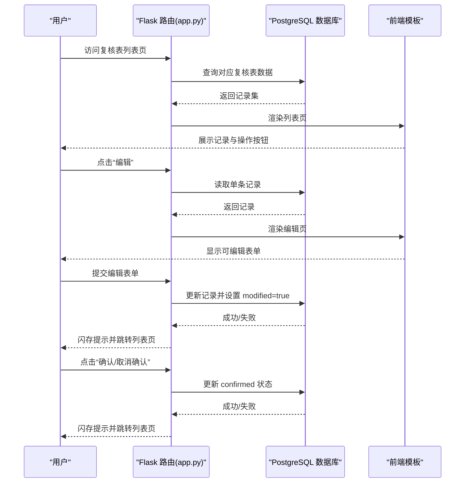
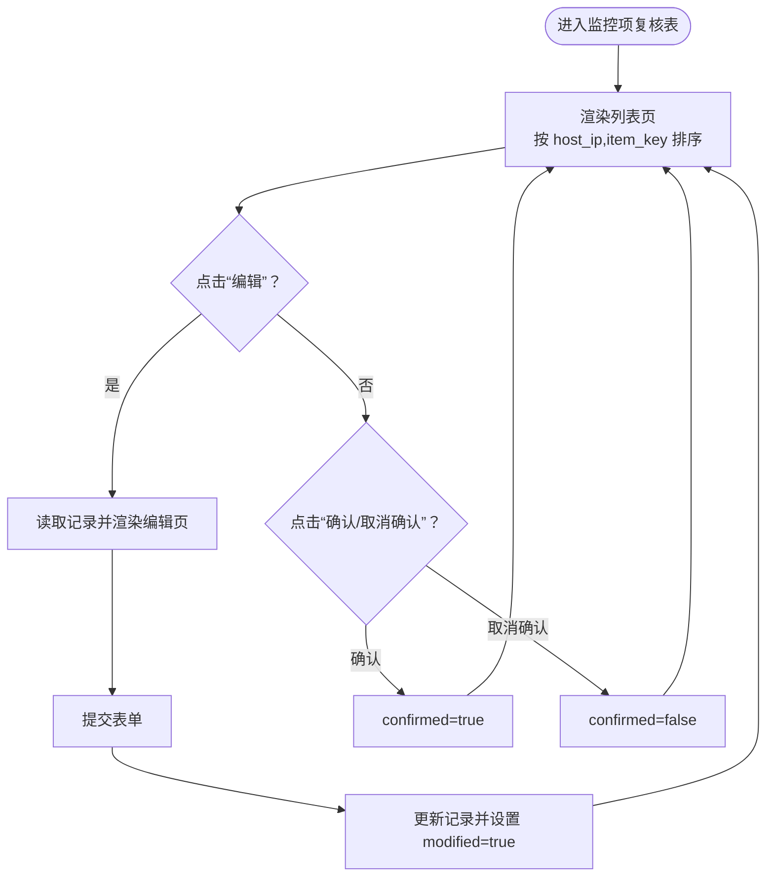
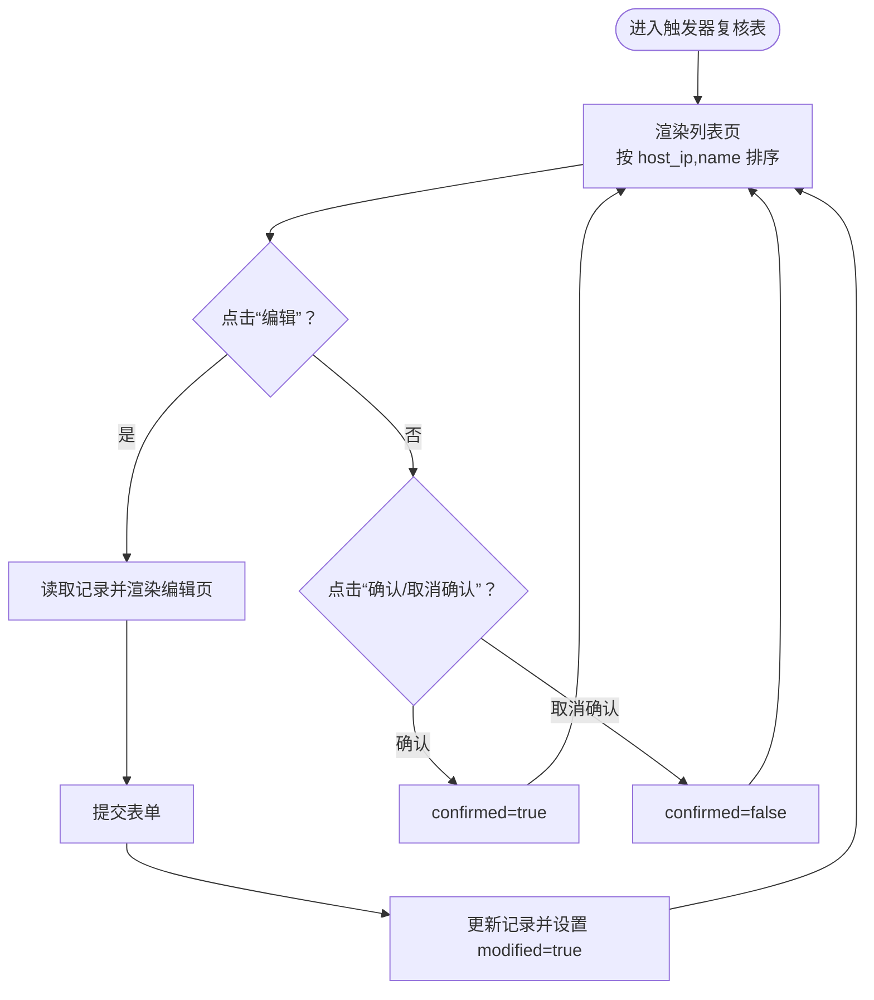
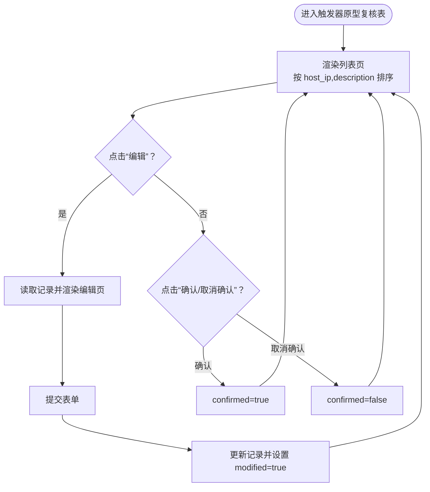
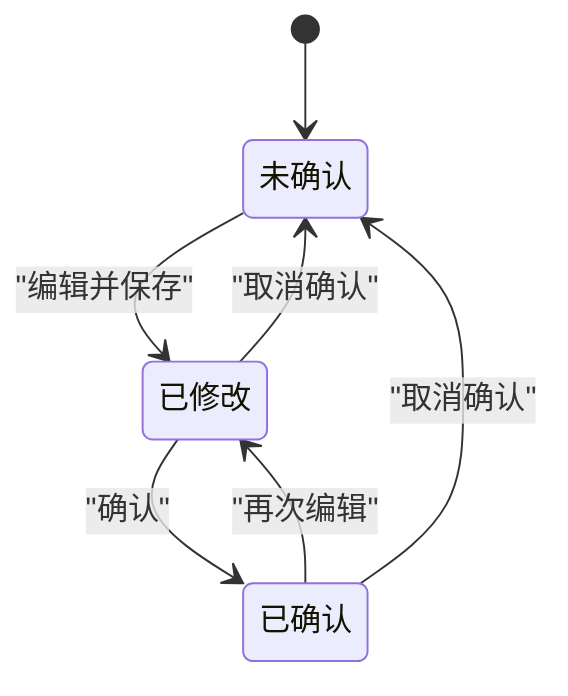
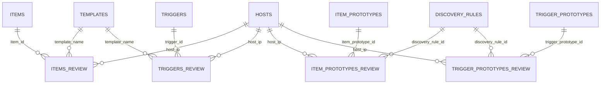

# 复核表管理

<cite>
**本文档引用的文件**
- [app.py](file://app.py)
- [create_review_tables.sql](file://create_review_tables.sql)
- [update_review_tables.sql](file://update_review_tables.sql)
- [update_items_tables.sql](file://update_items_tables.sql)
- [items_review.html](file://templates/items_review.html)
- [triggers_review.html](file://templates/triggers_review.html)
- [item_prototypes_review.html](file://templates/item_prototypes_review.html)
- [trigger_prototypes_review.html](file://templates/trigger_prototypes_review.html)
- [edit_item_review.html](file://templates/edit_item_review.html)
- [edit_trigger_review.html](file://templates/edit_trigger_review.html)
- [edit_item_prototype_review.html](file://templates/edit_item_prototype_review.html)
- [edit_trigger_prototype_review.html](file://templates/edit_trigger_prototype_review.html)
- [zabbix_mac.py](file://zabbix_mac.py)
</cite>

## 目录
1. [简介](#简介)
2. [项目结构](#项目结构)
3. [核心组件](#核心组件)
4. [架构总览](#架构总览)
5. [详细组件分析](#详细组件分析)
6. [依赖分析](#依赖分析)
7. [性能考虑](#性能考虑)
8. [故障排查指南](#故障排查指南)
9. [结论](#结论)
10. [附录](#附录)

## 简介
本文件面向“复核表管理”功能，系统化阐述复核表的审核流程与数据模型，覆盖监控项复核表、触发器复核表、监控项原型复核表与触发器原型复核表。文档重点说明：
- 复核记录的创建、编辑、确认与取消确认流程
- 不同类型复核表的数据模型与字段含义
- 复核状态管理机制（confirmed 与 modified 字段）及状态转换规则
- 复核表管理界面的使用方法（筛选、排序与批量操作建议）
- 复核流程在监控配置管理中的作用与重要性
- 最佳实践与常见问题解决方案

## 项目结构
该系统采用 Flask Web 应用 + PostgreSQL 数据库存储的架构。复核表管理功能由后端路由控制器与前端模板共同实现，并通过 SQL 脚本初始化与演进复核表结构。

```mermaid
graph TB
subgraph "Web 应用(Flask)"
A["路由控制器<br/>app.py"]
T1["模板：监控项复核表<br/>templates/items_review.html"]
T2["模板：触发器复核表<br/>templates/triggers_review.html"]
T3["模板：监控项原型复核表<br/>templates/item_prototypes_review.html"]
T4["模板：触发器原型复核表<br/>templates/trigger_prototypes_review.html"]
E1["编辑模板：监控项<br/>templates/edit_item_review.html"]
E2["编辑模板：触发器<br/>templates/edit_trigger_review.html"]
E3["编辑模板：原型-监控项<br/>templates/edit_item_prototype_review.html"]
E4["编辑模板：原型-触发器<br/>templates/edit_trigger_prototype_review.html"]
end
subgraph "数据库(PostgreSQL)"
D1["items_review"]
D2["triggers_review"]
D3["item_prototypes_review"]
D4["trigger_prototypes_review"]
end
A --> T1
A --> T2
A --> T3
A --> T4
A --> E1
A --> E2
A --> E3
A --> E4
A --> D1
A --> D2
A --> D3
A --> D4
```

图表来源
- [app.py:411-771](file://app.py#L411-L771)
- [create_review_tables.sql:4-102](file://create_review_tables.sql#L4-L102)

章节来源
- [app.py:411-771](file://app.py#L411-L771)
- [create_review_tables.sql:4-102](file://create_review_tables.sql#L4-L102)

## 核心组件
- 路由控制器：提供复核表列表页、编辑页、确认/取消确认等接口，负责数据读取与写入。
- 数据模型：四类复核表（items_review、triggers_review、item_prototypes_review、trigger_prototypes_review），包含基础配置字段与复核状态字段。
- 前端模板：展示复核记录、提供编辑入口与确认/取消确认按钮。
- 配置加载：在模板导出/生成时，优先从复核表中读取已确认的记录，确保发布配置的准确性。

章节来源
- [app.py:411-771](file://app.py#L411-L771)
- [create_review_tables.sql:4-102](file://create_review_tables.sql#L4-L102)
- [zabbix_mac.py:1190-1389](file://zabbix_mac.py#L1190-L1389)

## 架构总览
复核表管理的端到端流程如下：

图表来源
- [app.py:413-511](file://app.py#L413-L511)
- [app.py:512-595](file://app.py#L512-L595)
- [app.py:597-688](file://app.py#L597-L688)
- [app.py:690-771](file://app.py#L690-L771)

## 详细组件分析

### 监控项复核表(items_review)
- 数据模型要点
  - 关联字段：host_ip、item_id、template_name
  - 基础配置字段：item_key、name、type、value_type、delay、description、units、multiplier、delta、history、trends、status
  - 复核状态字段：modified（是否已修改）、confirmed（是否已确认）、status_verification（状态核验）
  - 时间戳：created_at、updated_at
  - 唯一约束：(host_ip, item_id)
- 审核流程
  - 列表页：按 host_ip、item_key 排序展示，显示 confirmed 与 modified 状态
  - 编辑：提交后更新记录并设置 modified=true
  - 确认/取消确认：切换 confirmed 状态
- 前端交互
  - 列表页支持按 host_ip、item_key 排序；编辑页支持多字段输入，含 master_item 与 preprocessing（来自扩展列）

图表来源
- [app.py:413-511](file://app.py#L413-L511)
- [create_review_tables.sql:4-31](file://create_review_tables.sql#L4-L31)
- [update_review_tables.sql:1-78](file://update_review_tables.sql#L1-L78)
- [update_items_tables.sql:1-16](file://update_items_tables.sql#L1-L16)

章节来源
- [app.py:413-511](file://app.py#L413-L511)
- [create_review_tables.sql:4-31](file://create_review_tables.sql#L4-L31)
- [update_review_tables.sql:1-78](file://update_review_tables.sql#L1-L78)
- [update_items_tables.sql:1-16](file://update_items_tables.sql#L1-L16)
- [items_review.html:1-46](file://templates/items_review.html#L1-L46)
- [edit_item_review.html:1-73](file://templates/edit_item_review.html#L1-L73)

### 触发器复核表(triggers_review)
- 数据模型要点
  - 关联字段：host_ip、trigger_id、template_name
  - 基础配置字段：name、expression、priority、description、status
  - 复核状态字段：modified、confirmed、status_verification
  - 唯一约束：(host_ip, trigger_id)
- 审核流程
  - 列表页：按 host_ip、name 排序展示，显示 confirmed 与 modified 状态
  - 编辑：提交后更新记录并设置 modified=true
  - 确认/取消确认：切换 confirmed 状态

图表来源
- [app.py:512-595](file://app.py#L512-L595)
- [create_review_tables.sql:33-53](file://create_review_tables.sql#L33-L53)
- [update_review_tables.sql:1-78](file://update_review_tables.sql#L1-L78)

章节来源
- [app.py:512-595](file://app.py#L512-L595)
- [create_review_tables.sql:33-53](file://create_review_tables.sql#L33-L53)
- [update_review_tables.sql:1-78](file://update_review_tables.sql#L1-L78)
- [triggers_review.html:1-42](file://templates/triggers_review.html#L1-L42)
- [edit_trigger_review.html:1-37](file://templates/edit_trigger_review.html#L1-L37)

### 监控项原型复核表(item_prototypes_review)
- 数据模型要点
  - 关联字段：host_ip、item_prototype_id、discovery_rule_id
  - 基础配置字段：name、key、value_type、delay、description、units、multiplier、delta、history、trends、status
  - 复核状态字段：modified、confirmed、status_verification
  - 唯一约束：(host_ip, item_prototype_id)
- 审核流程
  - 列表页：按 host_ip、name 排序展示，显示 confirmed 与 modified 状态
  - 编辑：提交后更新记录并设置 modified=true
  - 确认/取消确认：切换 confirmed 状态

图表来源
- [app.py:597-688](file://app.py#L597-L688)
- [create_review_tables.sql:55-81](file://create_review_tables.sql#L55-L81)
- [update_review_tables.sql:1-78](file://update_review_tables.sql#L1-L78)

章节来源
- [app.py:597-688](file://app.py#L597-L688)
- [create_review_tables.sql:55-81](file://create_review_tables.sql#L55-L81)
- [update_review_tables.sql:1-78](file://update_review_tables.sql#L1-L78)
- [item_prototypes_review.html:1-42](file://templates/item_prototypes_review.html#L1-L42)
- [edit_item_prototype_review.html:1-57](file://templates/edit_item_prototype_review.html#L1-L57)

### 触发器原型复核表(trigger_prototypes_review)
- 数据模型要点
  - 关联字段：host_ip、trigger_prototype_id、discovery_rule_id
  - 基础配置字段：description、expression、priority、status
  - 复核状态字段：modified、confirmed、status_verification
  - 唯一约束：(host_ip, trigger_prototype_id)
- 审核流程
  - 列表页：按 host_ip、description 排序展示，显示 confirmed 与 modified 状态
  - 编辑：提交后更新记录并设置 modified=true
  - 确认/取消确认：切换 confirmed 状态

图表来源
- [app.py:690-771](file://app.py#L690-L771)
- [create_review_tables.sql:83-102](file://create_review_tables.sql#L83-L102)
- [update_review_tables.sql:1-78](file://update_review_tables.sql#L1-L78)

章节来源
- [app.py:690-771](file://app.py#L690-L771)
- [create_review_tables.sql:83-102](file://create_review_tables.sql#L83-L102)
- [update_review_tables.sql:1-78](file://update_review_tables.sql#L1-L78)
- [trigger_prototypes_review.html:1-40](file://templates/trigger_prototypes_review.html#L1-L40)
- [edit_trigger_prototype_review.html:1-29](file://templates/edit_trigger_prototype_review.html#L1-L29)

### 复核状态管理机制
- confirmed 字段
  - 含义：表示该条复核记录已通过审核，可用于导出/发布配置
  - 影响：在模板加载时，优先从复核表中读取 confirmed=true 的记录
- modified 字段
  - 含义：表示该条复核记录已被编辑过，便于追踪变更
  - 影响：每次编辑都会将 modified 设为 true，直到再次被确认
- 状态转换规则
  - 初始：modified=false，confirmed=false
  - 编辑：提交后 modified=true
  - 确认：confirmed=true
  - 取消确认：confirmed=false（同时保持 modified=true）

图表来源
- [create_review_tables.sql:22-24](file://create_review_tables.sql#L22-L24)
- [app.py:482-510](file://app.py#L482-L510)
- [app.py:567-595](file://app.py#L567-L595)
- [app.py:660-688](file://app.py#L660-L688)
- [app.py:743-771](file://app.py#L743-L771)

章节来源
- [create_review_tables.sql:22-24](file://create_review_tables.sql#L22-L24)
- [app.py:482-510](file://app.py#L482-L510)
- [app.py:567-595](file://app.py#L567-L595)
- [app.py:660-688](file://app.py#L660-L688)
- [app.py:743-771](file://app.py#L743-L771)

### 复核表管理界面使用指南
- 列表页
  - 排序：默认按 host_ip 与关键字段排序（如 item_key、name、description）
  - 筛选：当前模板未内置搜索框，可通过浏览器地址栏参数或二次开发增加筛选
- 操作
  - 编辑：点击“编辑”进入表单，修改后保存会自动标记 modified=true
  - 确认/取消确认：根据当前状态显示不同按钮，点击切换 confirmed 状态
- 批量操作
  - 当前未提供批量勾选与批量操作功能，可在前端模板中扩展（例如增加全选复选框与批量确认/取消确认按钮）

章节来源
- [items_review.html:1-46](file://templates/items_review.html#L1-L46)
- [triggers_review.html:1-42](file://templates/triggers_review.html#L1-L42)
- [item_prototypes_review.html:1-42](file://templates/item_prototypes_review.html#L1-L42)
- [trigger_prototypes_review.html:1-40](file://templates/trigger_prototypes_review.html#L1-L40)

### 复核流程在监控配置管理中的作用与重要性
- 发布治理
  - 通过 confirmed=true 的记录作为最终发布源，避免误用未审核配置
- 变更追踪
  - modified=true 标记帮助识别哪些记录最近被编辑过，便于审计与回溯
- 自动化导出
  - 在模板导出/生成过程中，优先从复核表读取已确认记录，确保导出配置的稳定性与一致性

章节来源
- [zabbix_mac.py:1190-1389](file://zabbix_mac.py#L1190-L1389)

## 依赖分析
- 表间依赖
  - items_review、triggers_review、item_prototypes_review、trigger_prototypes_review 分别关联 items、triggers、item_prototypes、trigger_prototypes
  - 结构演进：host_id → host_ip，同时更新唯一约束与索引
- 前后端依赖
  - 路由控制器依赖数据库表结构与索引
  - 前端模板依赖路由提供的数据字段与操作链接

图表来源
- [create_review_tables.sql:4-102](file://create_review_tables.sql#L4-L102)
- [update_review_tables.sql:1-78](file://update_review_tables.sql#L1-L78)

章节来源
- [create_review_tables.sql:4-102](file://create_review_tables.sql#L4-L102)
- [update_review_tables.sql:1-78](file://update_review_tables.sql#L1-L78)

## 性能考虑
- 索引优化
  - 已为各复核表的 confirmed 字段建立索引，提升筛选与导出性能
  - host_ip 字段索引随 host_id → host_ip 的迁移同步更新
- 查询策略
  - 列表页按 host_ip 与关键字段排序，有利于前端分页与筛选
  - 导出/加载时优先使用 confirmed=true 过滤，减少无效数据扫描

章节来源
- [create_review_tables.sql:104-119](file://create_review_tables.sql#L104-L119)
- [update_review_tables.sql:51-62](file://update_review_tables.sql#L51-L62)
- [zabbix_mac.py:1190-1389](file://zabbix_mac.py#L1190-L1389)

## 故障排查指南
- 确认/取消确认失败
  - 检查数据库连接与事务状态，确保路由层捕获异常并回滚
  - 查看闪存消息提示，定位具体错误原因
- 编辑后未生效
  - 确认提交后 modified=true 是否正确更新
  - 检查表单字段映射与路由更新语句
- 导出配置为空
  - 检查是否存在 confirmed=true 的记录
  - 若无确认记录，系统会回退到原始表加载，确认模板/规则是否匹配

章节来源
- [app.py:482-510](file://app.py#L482-L510)
- [app.py:567-595](file://app.py#L567-L595)
- [app.py:660-688](file://app.py#L660-L688)
- [app.py:743-771](file://app.py#L743-L771)
- [zabbix_mac.py:1190-1389](file://zabbix_mac.py#L1190-L1389)

## 结论
复核表管理通过标准化的“编辑-修改标记-确认/取消确认”流程，实现了对监控配置的可控发布与变更追踪。结合数据库索引与前端模板，系统在可用性与性能之间取得平衡。建议后续增强批量操作与筛选能力，进一步提升运维效率。

## 附录
- 最佳实践
  - 新增/变更配置后及时在复核表中编辑并设置 modified=true
  - 审核完成后进行确认，导出/发布前再次核对 confirmed 状态
  - 对历史记录定期清理未确认且长期未修改的条目，保持复核表整洁
- 常见问题
  - 误将未审核配置导出：确保导出前复核表中存在 confirmed=true 的记录
  - 编辑后状态未更新：检查路由更新逻辑与数据库权限
  - 主机标识变化：host_id → host_ip 的迁移需同步更新唯一约束与索引