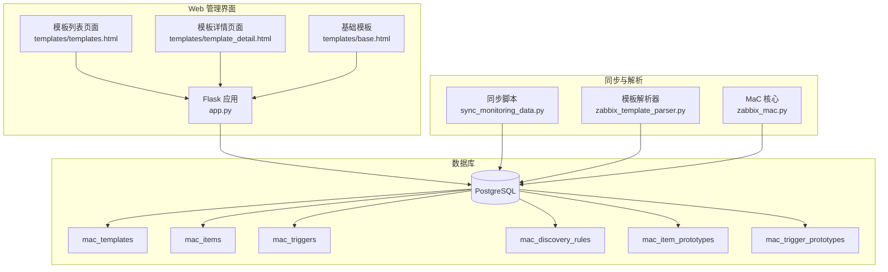
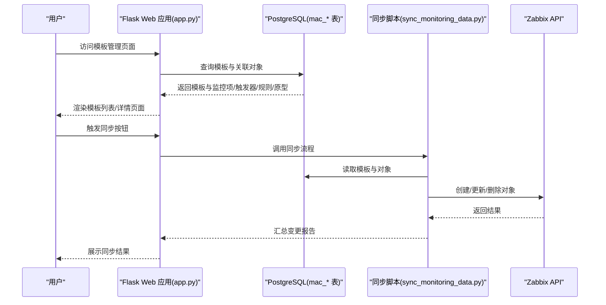
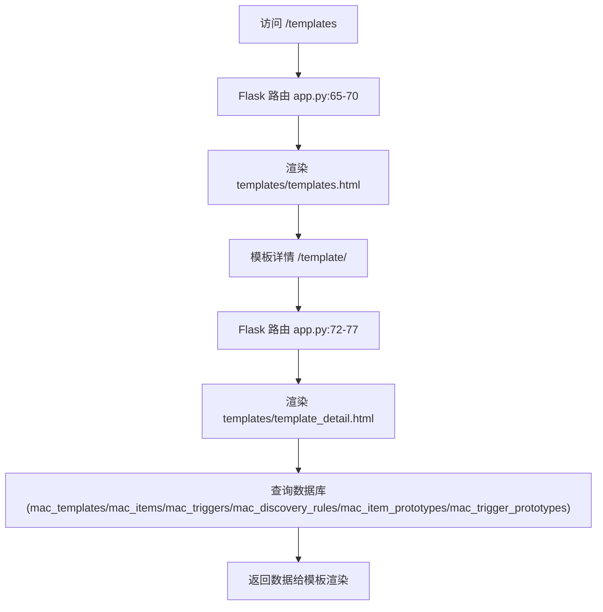
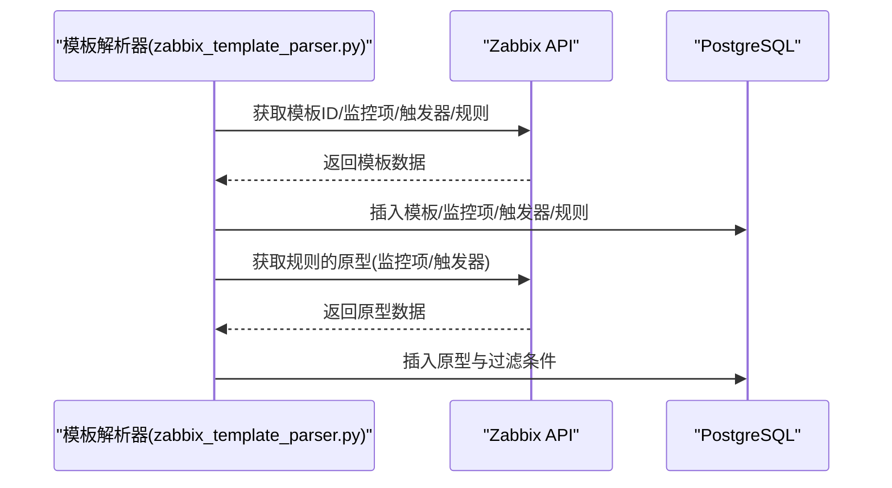
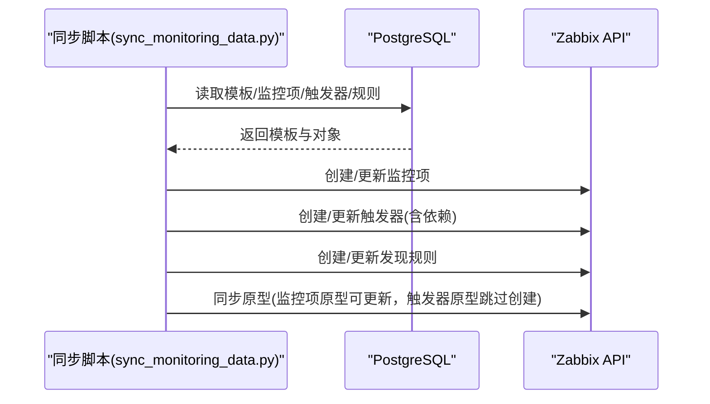
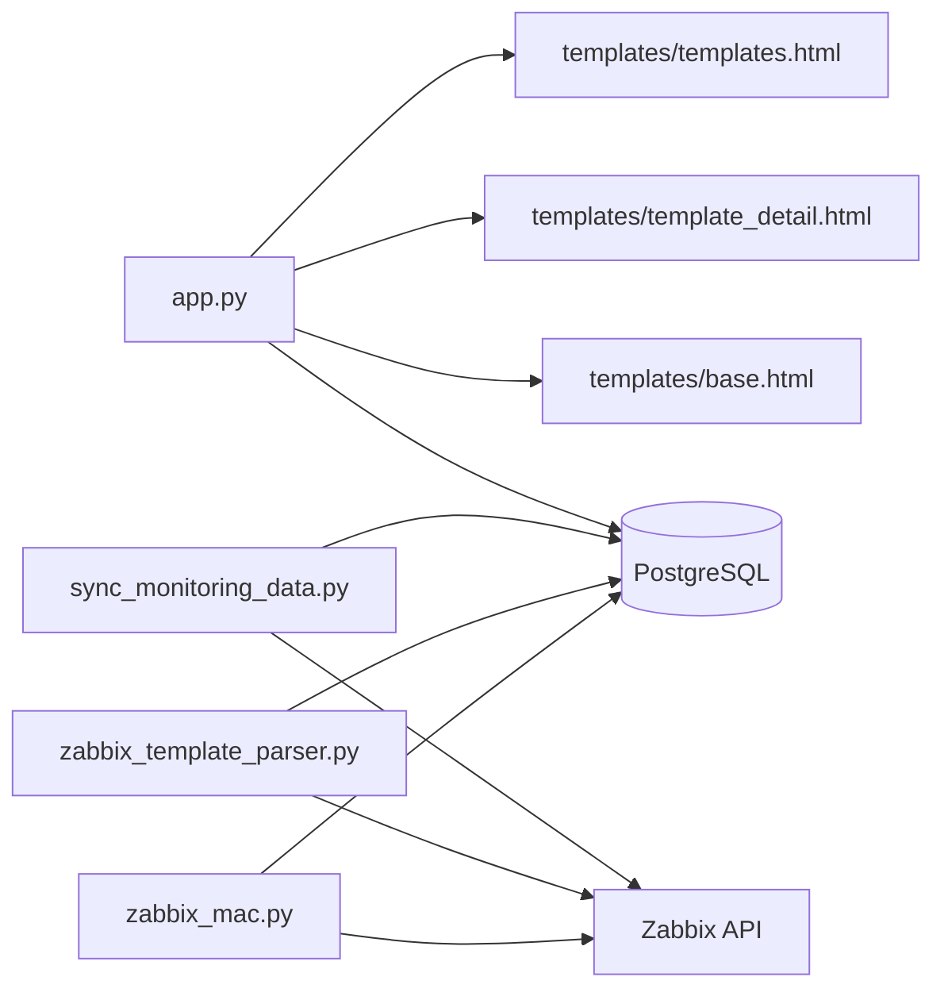

# 模板管理

<cite>
**本文引用的文件**
- [app.py](file://app.py)
- [zabbix_template_parser.py](file://zabbix_template_parser.py)
- [zabbix_mac.py](file://zabbix_mac.py)
- [templates/templates.html](file://templates/templates.html)
- [templates/template_detail.html](file://templates/template_detail.html)
- [templates/base.html](file://templates/base.html)
- [create_mac_tables.sql](file://create_mac_tables.sql)
- [monitor_config.yaml](file://monitor_config.yaml)
- [sync_monitoring_data.py](file://sync_monitoring_data.py)
- [CODE_WIKI.md](file://CODE_WIKI.md)
- [ZABBIX_SETUP_GUIDE.md](file://ZABBIX_SETUP_GUIDE.md)
</cite>

## 目录
1. [简介](#简介)
2. [项目结构](#项目结构)
3. [核心组件](#核心组件)
4. [架构总览](#架构总览)
5. [详细组件分析](#详细组件分析)
6. [依赖分析](#依赖分析)
7. [性能考虑](#性能考虑)
8. [故障排除指南](#故障排除指南)
9. [结论](#结论)
10. [附录](#附录)

## 简介
本文件面向“模板管理”功能，围绕 Zabbix Monitor as Code（MaC）体系下的模板管理能力进行系统化说明。内容涵盖模板的浏览、搜索与管理操作，模板在监控配置管理中的作用与重要性，模板与监控项、触发器、自动发现规则（LLD）及触发器原型之间的关联关系，模板管理界面的使用指南与最佳实践，以及在 MaC 理念下的应用与优势。同时提供常见使用场景与故障排除方法，帮助读者快速上手并稳定运行。

## 项目结构
本项目采用“Web 管理界面 + 数据库 + 同步脚本”的分层架构：
- Web 管理界面：基于 Flask 提供模板、监控项、触发器、原型、主机与复核表的可视化管理。
- 数据库层：PostgreSQL 存储模板与各类监控对象的结构化数据，支持模板与主机的关联。
- 同步脚本：将数据库中的模板同步到 Zabbix，或从 Zabbix 解析模板入库。
- 文档与配置：提供 Wiki、安装指南、配置样例与 SQL 脚本。

图表来源
- [app.py:1-774](file://app.py#L1-L774)
- [templates/templates.html:1-31](file://templates/templates.html#L1-L31)
- [templates/template_detail.html:1-206](file://templates/template_detail.html#L1-L206)
- [templates/base.html:1-73](file://templates/base.html#L1-L73)
- [sync_monitoring_data.py:1-467](file://sync_monitoring_data.py#L1-L467)
- [zabbix_template_parser.py:1-834](file://zabbix_template_parser.py#L1-L834)
- [zabbix_mac.py:1-2733](file://zabbix_mac.py#L1-L2733)

章节来源
- [app.py:1-774](file://app.py#L1-L774)
- [CODE_WIKI.md:1-481](file://CODE_WIKI.md#L1-L481)

## 核心组件
- Flask Web 应用：提供模板管理、监控项、触发器、原型、主机与复核表的增删改查与详情展示。
- 数据库表结构：以 mac_* 前缀的表承载模板、监控项、触发器、自动发现规则、原型等数据。
- 同步与解析：将数据库模板同步到 Zabbix，或将 Zabbix 模板解析入库；支持触发器依赖与 LLD 原型的双向管理。
- 配置与文档：monitor_config.yaml 提供主机与模板映射示例；Wiki 与安装指南提供运行与排障参考。

章节来源
- [app.py:65-77](file://app.py#L65-L77)
- [create_mac_tables.sql:1-252](file://create_mac_tables.sql#L1-L252)
- [sync_monitoring_data.py:63-177](file://sync_monitoring_data.py#L63-L177)
- [zabbix_template_parser.py:583-790](file://zabbix_template_parser.py#L583-L790)
- [monitor_config.yaml:1-20](file://monitor_config.yaml#L1-L20)

## 架构总览
模板管理贯穿“数据模型—Web 界面—同步/解析—Zabbix”的闭环：
- 数据模型：模板表与各对象表通过外键关联，形成模板为中心的监控配置图谱。
- Web 界面：提供模板列表与详情视图，展示模板内监控项、触发器、自动发现规则、原型等。
- 同步/解析：从数据库向 Zabbix 同步，或从 Zabbix 解析模板入库，保证配置一致性。
- MaC 理念：模板即代码，版本化管理，声明式同步，配合复核表实现变更审计与确认。

图表来源
- [app.py:65-101](file://app.py#L65-L101)
- [sync_monitoring_data.py:415-467](file://sync_monitoring_data.py#L415-L467)

章节来源
- [app.py:65-101](file://app.py#L65-L101)
- [sync_monitoring_data.py:415-467](file://sync_monitoring_data.py#L415-L467)

## 详细组件分析

### 模板管理页面与数据流
- 模板列表页：展示模板基本信息与操作入口（查看详情）。
- 模板详情页：按模板聚合展示监控项、触发器、自动发现规则、监控项原型、触发器原型，并标注状态与优先级。
- 数据来源：Web 路由从数据库读取模板与关联对象，渲染至模板页面。

图表来源
- [app.py:65-77](file://app.py#L65-L77)
- [templates/templates.html:1-31](file://templates/templates.html#L1-L31)
- [templates/template_detail.html:1-206](file://templates/template_detail.html#L1-L206)

章节来源
- [app.py:65-77](file://app.py#L65-L77)
- [templates/templates.html:1-31](file://templates/templates.html#L1-L31)
- [templates/template_detail.html:1-206](file://templates/template_detail.html#L1-L206)

### 数据模型与关联关系
- 模板表：mac_templates，作为监控配置的根节点。
- 监控项表：mac_items，通过 template_name 关联模板。
- 触发器表：mac_triggers，通过 template_name 关联模板。
- 自动发现规则表：mac_discovery_rules，通过 template_name 关联模板。
- 过滤条件表：mac_filter_conditions，通过 discovery_rule_id 关联规则。
- 监控项原型表：mac_item_prototypes，通过 discovery_rule_id 关联规则。
- 触发器原型表：mac_trigger_prototypes，通过 discovery_rule_id 关联规则。

```mermaid
erDiagram
MAC_TEMPLATES {
int id PK
varchar name UK
text description
timestamp created_at
timestamp updated_at
}
MAC_ITEMS {
int id PK
varchar item_key UK
varchar name
int type
int value_type
varchar delay
text description
varchar units
int multiplier
int delta
int history
int trends
int status
varchar template_name FK
timestamp created_at
timestamp updated_at
}
MAC_TRIGGERS {
int id PK
varchar name
text expression
int priority
text description
int status
varchar template_name FK
timestamp created_at
timestamp updated_at
}
MAC_DISCOVERY_RULES {
int id PK
varchar name
varchar key
varchar delay
int evaltype
int status
varchar template_name FK
timestamp created_at
timestamp updated_at
}
MAC_FILTER_CONDITIONS {
int id PK
int discovery_rule_id FK
varchar macro
text value
varchar operator
timestamp created_at
}
MAC_ITEM_PROTOTYPES {
int id PK
int discovery_rule_id FK
varchar name
varchar key
int value_type
varchar delay
text description
varchar units
int multiplier
int delta
int history
int trends
int status
timestamp created_at
timestamp updated_at
}
MAC_TRIGGER_PROTOTYPES {
int id PK
int discovery_rule_id FK
text description
text expression
int priority
int status
timestamp created_at
timestamp updated_at
}
MAC_TEMPLATES ||--o{ MAC_ITEMS : "模板包含监控项"
MAC_TEMPLATES ||--o{ MAC_TRIGGERS : "模板包含触发器"
MAC_TEMPLATES ||--o{ MAC_DISCOVERY_RULES : "模板包含发现规则"
MAC_DISCOVERY_RULES ||--o{ MAC_FILTER_CONDITIONS : "规则包含过滤条件"
MAC_DISCOVERY_RULES ||--o{ MAC_ITEM_PROTOTYPES : "规则包含监控项原型"
MAC_DISCOVERY_RULES ||--o{ MAC_TRIGGER_PROTOTYPES : "规则包含触发器原型"
```

图表来源
- [create_mac_tables.sql:4-98](file://create_mac_tables.sql#L4-L98)

章节来源
- [create_mac_tables.sql:4-98](file://create_mac_tables.sql#L4-L98)

### 模板解析与同步流程
- 模板解析：从 Zabbix 读取模板的监控项、触发器、自动发现规则、原型，写入数据库。
- 模板同步：从数据库读取模板与对象，同步到 Zabbix，处理依赖关系与原型字段限制。
- 触发器依赖：解析时转换依赖描述，同步时先创建后更新依赖。
- 原型同步：监控项原型可更新，触发器原型因表达式格式限制通常跳过创建。

图表来源
- [zabbix_template_parser.py:596-694](file://zabbix_template_parser.py#L596-L694)

图表来源
- [sync_monitoring_data.py:208-413](file://sync_monitoring_data.py#L208-L413)

章节来源
- [zabbix_template_parser.py:596-694](file://zabbix_template_parser.py#L596-L694)
- [sync_monitoring_data.py:208-413](file://sync_monitoring_data.py#L208-L413)

### 模板与监控项、触发器、原型的关系
- 模板是监控配置的根，监控项与触发器通过 template_name 关联模板。
- 自动发现规则与原型属于模板的扩展能力，规则通过 discovery_rule_id 关联模板，原型通过 discovery_rule_id 关联规则。
- 优先级与状态：触发器具有优先级（未分类/信息/警告/严重/灾难），状态用于启用/禁用；监控项与原型同样具备状态字段。

章节来源
- [create_mac_tables.sql:14-98](file://create_mac_tables.sql#L14-L98)
- [templates/template_detail.html:66-78](file://templates/template_detail.html#L66-L78)

### 模板管理界面使用指南
- 导航：通过顶部导航栏进入“模板管理”，查看模板列表；点击“查看”进入模板详情。
- 列表页：显示模板基本信息与操作入口。
- 详情页：按模板聚合展示监控项、触发器、自动发现规则、监控项原型、触发器原型，便于整体审视与对比。
- 最佳实践：
  - 使用模板统一管理同类主机的监控配置。
  - 通过原型减少重复配置，提升可维护性。
  - 结合复核表对变更进行审核与确认，确保变更可控。

章节来源
- [templates/base.html:10-54](file://templates/base.html#L10-L54)
- [templates/templates.html:1-31](file://templates/templates.html#L1-L31)
- [templates/template_detail.html:1-206](file://templates/template_detail.html#L1-L206)

### Monitor as Code（MaC）理念与优势
- 模板即代码：模板以结构化方式存储在数据库中，支持版本控制与变更审计。
- 声明式同步：通过同步脚本将数据库中的模板声明式地应用到 Zabbix，避免手工配置带来的不一致。
- 可复现与可追溯：所有变更均有记录，便于回滚与审计。
- 协作与复核：结合复核表，多人协作时可进行审核与确认，降低误操作风险。

章节来源
- [CODE_WIKI.md:1-481](file://CODE_WIKI.md#L1-L481)

## 依赖分析
- Web 应用依赖数据库表结构与模板渲染页面。
- 同步脚本依赖数据库表结构与 Zabbix API。
- 模板解析器依赖 Zabbix API 与数据库表结构。
- 前端依赖 Bootstrap，提供响应式界面与导航菜单。

图表来源
- [app.py:1-774](file://app.py#L1-L774)
- [sync_monitoring_data.py:1-467](file://sync_monitoring_data.py#L1-L467)
- [zabbix_template_parser.py:1-834](file://zabbix_template_parser.py#L1-L834)
- [zabbix_mac.py:1-2733](file://zabbix_mac.py#L1-L2733)

章节来源
- [app.py:1-774](file://app.py#L1-L774)
- [sync_monitoring_data.py:1-467](file://sync_monitoring_data.py#L1-L467)
- [zabbix_template_parser.py:1-834](file://zabbix_template_parser.py#L1-L834)
- [zabbix_mac.py:1-2733](file://zabbix_mac.py#L1-L2733)

## 性能考虑
- 数据库索引：为关键字段（如 item_key、template_name、discovery_rule_id 等）建立索引，提升查询与去重效率。
- 并发同步：在大规模主机场景下，可通过并发线程提升同步吞吐量（参考 MaC 核心脚本的并发设计思路）。
- 增量同步：优先比较指纹或时间戳，仅同步变更对象，减少不必要的 API 调用。
- 原型同步策略：触发器原型表达式格式限制导致创建失败，应采用“跳过创建、仅更新可修改字段”的策略。

章节来源
- [create_mac_tables.sql:139-151](file://create_mac_tables.sql#L139-L151)
- [zabbix_mac.py:16-17](file://zabbix_mac.py#L16-L17)
- [sync_monitoring_data.py:389-413](file://sync_monitoring_data.py#L389-L413)

## 故障排除指南
- Web 页面为空或模板列表为空：检查数据库连接与表结构是否创建成功，确认模板数据是否导入。
- 同步失败：检查 Zabbix API 连接参数、用户权限与网络连通性；查看同步脚本日志定位具体失败步骤。
- 原型同步异常：触发器原型表达式格式不正确时会跳过创建，需修正表达式或通过其他方式更新。
- 数据库连接失败：检查数据库配置、端口与服务状态；参考安装指南中的网络与认证配置。
- Docker 环境问题：若使用 Docker Compose，检查容器状态、端口占用与日志输出。

章节来源
- [app.py:65-77](file://app.py#L65-L77)
- [sync_monitoring_data.py:458-467](file://sync_monitoring_data.py#L458-L467)
- [ZABBIX_SETUP_GUIDE.md:106-138](file://ZABBIX_SETUP_GUIDE.md#L106-L138)

## 结论
模板管理是 MaC 体系的核心抓手：通过数据库化的模板与 Web 界面，实现模板的浏览、搜索与管理；借助解析与同步脚本，将模板声明式地应用到 Zabbix，保障配置一致性与可追溯性。结合原型与复核表，模板管理不仅提升了运维效率，也强化了变更治理与风险控制。建议在生产环境中配合版本控制、复核确认与定期同步策略，持续优化模板质量与同步性能。

## 附录
- 常见使用场景
  - 新建模板：在数据库中新增模板记录，导入监控项、触发器、规则与原型，通过 Web 界面预览与复核。
  - 模板升级：修改模板中的监控项与触发器，通过同步脚本增量更新到 Zabbix。
  - LLD 原型维护：通过规则与原型表管理自动发现的监控项与触发器，减少手工配置。
- 配置参考
  - 监控配置示例：monitor_config.yaml 提供主机与模板映射的参考格式。
  - 数据库初始化：create_mac_tables.sql 提供完整的表结构与示例数据。

章节来源
- [monitor_config.yaml:1-20](file://monitor_config.yaml#L1-L20)
- [create_mac_tables.sql:153-252](file://create_mac_tables.sql#L153-L252)