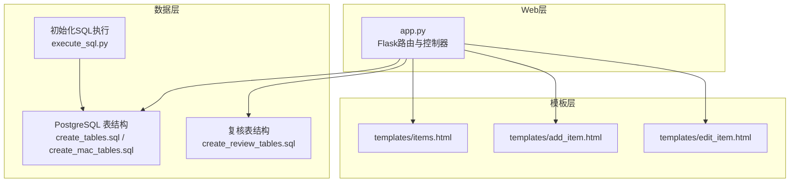
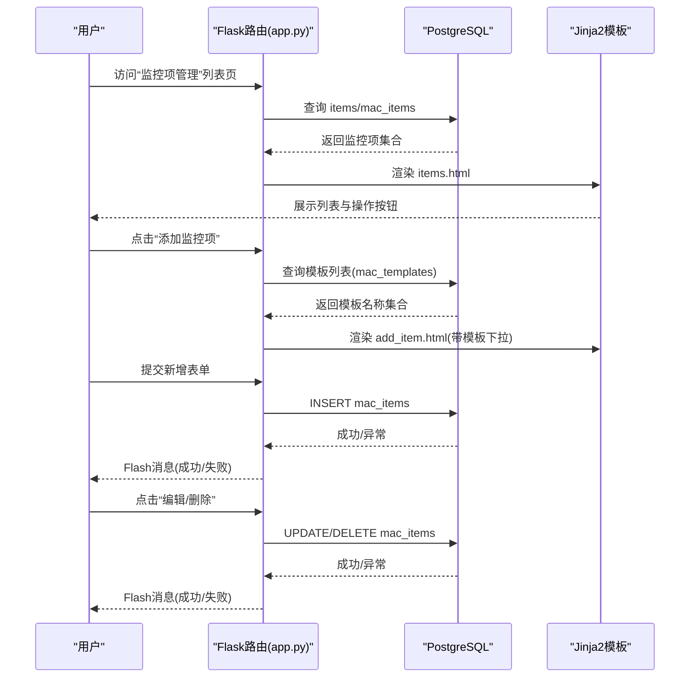
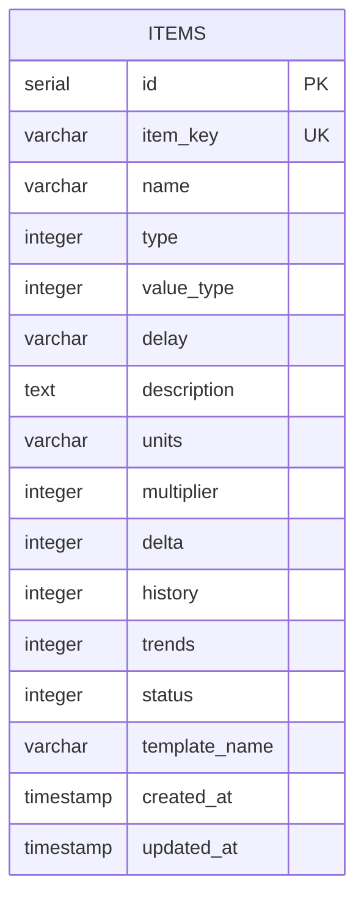
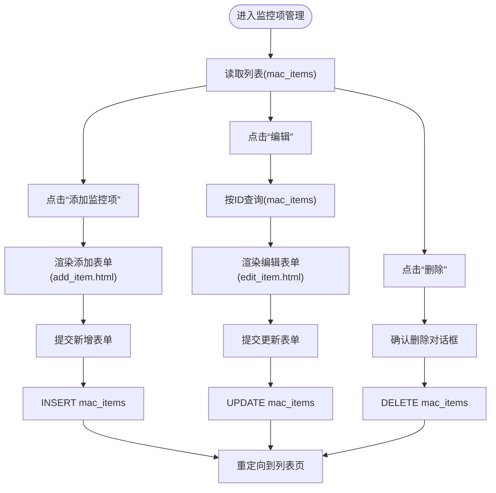
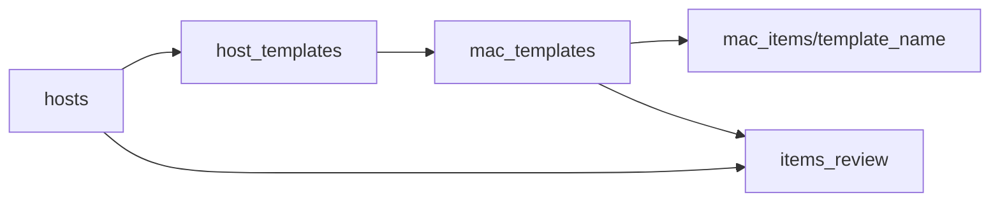
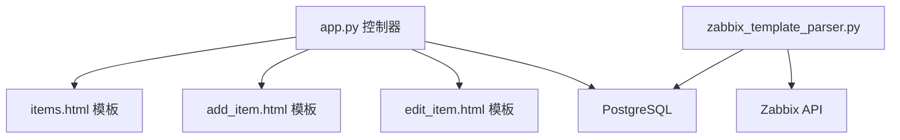

# 监控项管理

<cite>
**本文引用的文件**
- [app.py](file://app.py)
- [items.html](file://templates/items.html)
- [add_item.html](file://templates/add_item.html)
- [edit_item.html](file://templates/edit_item.html)
- [create_tables.sql](file://create_tables.sql)
- [create_mac_tables.sql](file://create_mac_tables.sql)
- [create_review_tables.sql](file://create_review_tables.sql)
- [check_item_prototypes_delay.py](file://check_item_prototypes_delay.py)
- [execute_sql.py](file://execute_sql.py)
- [zabbix_template_parser.py](file://zabbix_template_parser.py)
- [zabbix_template_parser_debug.py](file://zabbix_template_parser_debug.py)
- [read_template_from_zabbix.py](file://read_template_from_zabbix.py)
- [zabbix_mac.py](file://zabbix_mac.py)
</cite>

## 目录
1. [简介](#简介)
2. [项目结构](#项目结构)
3. [核心组件](#核心组件)
4. [架构总览](#架构总览)
5. [详细组件分析](#详细组件分析)
6. [依赖分析](#依赖分析)
7. [性能考虑](#性能考虑)
8. [故障排查指南](#故障排查指南)
9. [结论](#结论)
10. [附录](#附录)

## 简介
本文件面向“监控项管理”功能，围绕监控项的创建、读取、更新、删除（CRUD）进行系统化说明；阐述监控项数据模型及字段约束；解释表单验证与数据处理逻辑；给出界面使用指南（列表、搜索、排序、批量操作思路）；说明监控项与模板的关联关系与模板选择机制；并提供常见问题排查与性能优化建议。

## 项目结构
本项目采用Flask Web应用 + PostgreSQL数据库的典型分层结构：
- Web层：路由与控制器集中在应用入口文件，负责请求处理、模板渲染与数据库交互。
- 模板层：Jinja2模板用于展示列表、表单与复核界面。
- 数据层：SQL脚本定义表结构、索引与示例数据；Python脚本负责数据库初始化与数据导入。

图表来源
- [app.py](file://app.py)
- [items.html](file://templates/items.html)
- [add_item.html](file://templates/add_item.html)
- [edit_item.html](file://templates/edit_item.html)
- [create_tables.sql](file://create_tables.sql)
- [create_mac_tables.sql](file://create_mac_tables.sql)
- [create_review_tables.sql](file://create_review_tables.sql)
- [execute_sql.py](file://execute_sql.py)

章节来源
- [app.py](file://app.py)
- [create_tables.sql](file://create_tables.sql)
- [create_mac_tables.sql](file://create_mac_tables.sql)
- [create_review_tables.sql](file://create_review_tables.sql)
- [execute_sql.py](file://execute_sql.py)

## 核心组件
- 监控项CRUD路由与控制器：在应用入口中定义监控项的增删改查路由，负责接收表单数据、调用数据库操作、渲染模板与消息提示。
- 监控项列表与表单模板：提供列表展示、添加与编辑表单，包含必填字段、下拉选项与可选字段。
- 数据模型与约束：PostgreSQL表结构定义了监控项字段、默认值、唯一性与索引。
- 复核表与模板关联：通过复核表与模板/主机关联，支撑“模板驱动”的监控项下发与复核流程。

章节来源
- [app.py](file://app.py)
- [items.html](file://templates/items.html)
- [add_item.html](file://templates/add_item.html)
- [edit_item.html](file://templates/edit_item.html)
- [create_tables.sql](file://create_tables.sql)
- [create_mac_tables.sql](file://create_mac_tables.sql)
- [create_review_tables.sql](file://create_review_tables.sql)

## 架构总览
监控项管理的端到端流程如下：

图表来源
- [app.py](file://app.py)
- [items.html](file://templates/items.html)
- [add_item.html](file://templates/add_item.html)
- [edit_item.html](file://templates/edit_item.html)
- [create_mac_tables.sql](file://create_mac_tables.sql)

## 详细组件分析

### 监控项数据模型与字段约束
- 表结构：监控项数据存储于 items 或 mac_items 表（根据部署阶段不同），字段覆盖键值、名称、类型、值类型、更新间隔、描述、单位、乘数、Delta、历史/趋势保留天数、状态、模板名等。
- 唯一性与索引：键值唯一、按模板名与键值建立索引，提升查询效率。
- 默认值：未显式提供的数值类字段采用默认值（如乘数/Delta为0，历史/趋势默认天数等）。

图表来源
- [create_tables.sql](file://create_tables.sql)
- [create_mac_tables.sql](file://create_mac_tables.sql)

章节来源
- [create_tables.sql](file://create_tables.sql)
- [create_mac_tables.sql](file://create_mac_tables.sql)

### 监控项CRUD流程
- 列表读取：按模板名与键值排序展示监控项。
- 新增：从模板表获取模板列表，提交表单后写入 mac_items。
- 编辑：按ID查询监控项，回显表单，提交后更新。
- 删除：按ID删除记录。

图表来源
- [app.py](file://app.py)
- [add_item.html](file://templates/add_item.html)
- [edit_item.html](file://templates/edit_item.html)
- [create_mac_tables.sql](file://create_mac_tables.sql)

章节来源
- [app.py](file://app.py)
- [items.html](file://templates/items.html)
- [add_item.html](file://templates/add_item.html)
- [edit_item.html](file://templates/edit_item.html)

### 表单验证与数据处理逻辑
- 必填字段：表单模板中对键值、名称、类型、值类型、更新间隔、模板等设置为必填。
- 数据类型：数值类字段（乘数、Delta、历史、趋势、状态）在表单中以数字输入或下拉选择呈现；后端接收后转换为整数。
- 业务规则：
  - 历史与趋势天数默认值处理：若传入值为非正值，后端脚本中会回退为默认值（例如历史=7，趋势=365）。
  - 模板选择：模板列表来自 mac_templates，确保监控项与有效模板关联。
  - 写入策略：新增与更新均通过参数化SQL执行，避免注入风险；错误时回滚并提示。

章节来源
- [add_item.html](file://templates/add_item.html)
- [edit_item.html](file://templates/edit_item.html)
- [app.py](file://app.py)
- [zabbix_template_parser.py](file://zabbix_template_parser.py)
- [zabbix_template_parser_debug.py](file://zabbix_template_parser_debug.py)
- [read_template_from_zabbix.py](file://read_template_from_zabbix.py)

### 监控项与模板的关联关系与模板选择机制
- 直接关联：监控项记录包含 template_name 字段，用于标识所属模板。
- 模板来源：模板列表来源于 mac_templates，新增/编辑时从该表读取并填充下拉框。
- 复核与下发：复核表 items_review 通过 hosts 与 templates 的关联生成初始记录，支持后续确认与修改；模板解析脚本可将Zabbix模板导出到数据库，形成标准化的监控项与触发器集合。

图表来源
- [create_mac_tables.sql](file://create_mac_tables.sql)
- [create_review_tables.sql](file://create_review_tables.sql)
- [zabbix_template_parser.py](file://zabbix_template_parser.py)

章节来源
- [create_mac_tables.sql](file://create_mac_tables.sql)
- [create_review_tables.sql](file://create_review_tables.sql)
- [zabbix_template_parser.py](file://zabbix_template_parser.py)

### 界面使用指南
- 列表显示：展示监控项ID、键值、名称、模板、更新间隔、状态与操作按钮（编辑/删除）。
- 搜索与排序：当前列表页未内置前端搜索/排序，但后端查询已按模板名与键值排序，可在模板筛选基础上手动定位。
- 批量操作：当前未提供批量勾选与批量操作功能，建议在前端扩展时结合模板筛选与全选逻辑实现。

章节来源
- [items.html](file://templates/items.html)
- [app.py](file://app.py)

### 与原型的关系与差异
- 原型表：项目中存在 item_prototypes 与 trigger_prototypes，用于自动发现场景下的“模板内原型”；而监控项管理主要针对直接绑定到主机的监控项。
- 原型字段校验：原型的 delay 字段在解析脚本中有专门检查，确保其格式与语义正确。

章节来源
- [check_item_prototypes_delay.py](file://check_item_prototypes_delay.py)
- [create_mac_tables.sql](file://create_mac_tables.sql)

## 依赖分析
- 组件耦合：
  - 控制器与模板强耦合：列表与表单模板依赖后端渲染。
  - 控制器与数据库弱耦合：通过统一的数据库连接函数与参数化SQL访问。
- 外部依赖：
  - Flask：Web框架与模板引擎。
  - psycopg2：PostgreSQL驱动。
  - Zabbix API：模板解析脚本用于从Zabbix同步数据。

图表来源
- [app.py](file://app.py)
- [items.html](file://templates/items.html)
- [add_item.html](file://templates/add_item.html)
- [edit_item.html](file://templates/edit_item.html)
- [zabbix_template_parser.py](file://zabbix_template_parser.py)

章节来源
- [app.py](file://app.py)
- [zabbix_template_parser.py](file://zabbix_template_parser.py)

## 性能考虑
- 索引优化：已在 items/mac_items 上建立 item_key 与 template_name 索引，建议在高频查询字段上保持索引策略。
- SQL参数化：控制器与解析脚本均使用参数化SQL，降低注入风险并利于计划缓存。
- 批量导入：模板解析脚本采用批量写入与冲突更新策略，减少重复写入成本。
- 建议：
  - 在大规模数据场景下，考虑对常用过滤字段（如 status、template_name）增加复合索引。
  - 对列表页增加分页与前端搜索/排序能力，减轻一次性渲染压力。
  - 对历史/趋势天数等数值字段，建议在表单层增加范围校验与默认值提示。

[本节为通用性能建议，不直接分析具体文件]

## 故障排查指南
- 数据库连接失败：
  - 检查数据库配置与网络连通性；确认数据库服务运行正常。
- 插入/更新失败：
  - 查看Flash错误消息；检查必填字段是否完整、模板名是否存在、键值是否唯一。
- 原型delay字段异常：
  - 使用原型检查脚本核对 mac_item_prototypes 的 delay 字段值，确保符合预期。
- 模板解析异常：
  - 确认Zabbix API地址、凭据正确；检查模板名称是否匹配；关注解析脚本日志输出。

章节来源
- [app.py](file://app.py)
- [check_item_prototypes_delay.py](file://check_item_prototypes_delay.py)
- [zabbix_template_parser.py](file://zabbix_template_parser.py)

## 结论
监控项管理功能以Flask+PostgreSQL为基础，提供了完整的CRUD体验与模板驱动的关联机制。通过明确的数据模型、参数化SQL与模板化表单，系统具备良好的可维护性与扩展性。建议在后续迭代中增强前端搜索/排序/批量操作能力，并持续完善字段校验与性能索引策略。

[本节为总结性内容，不直接分析具体文件]

## 附录

### 字段说明与约束清单
- item_key：监控项键值，唯一；作为主键或唯一约束的一部分。
- name：监控项名称，必填。
- type：监控项类型，整数枚举（由表单下拉提供），必填。
- value_type：值类型，整数枚举（由表单下拉提供），必填。
- delay：更新间隔，字符串形式（如“1m”），必填。
- description：描述，可选。
- units：单位，可选。
- multiplier/delta：乘数与Delta，整数，默认0。
- history/trends：历史与趋势保留天数，整数，默认7/365。
- status：状态，整数（0启用/1禁用），默认0。
- template_name：模板名称，字符串，必填且需存在于模板表中。
- created_at/updated_at：时间戳，默认当前时间。

章节来源
- [create_tables.sql](file://create_tables.sql)
- [create_mac_tables.sql](file://create_mac_tables.sql)
- [add_item.html](file://templates/add_item.html)
- [edit_item.html](file://templates/edit_item.html)