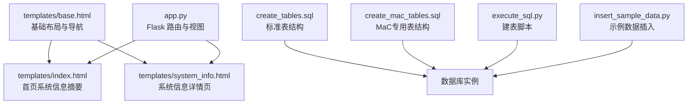
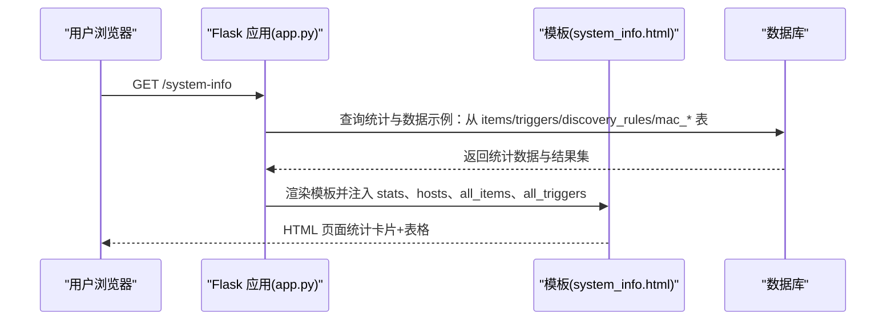
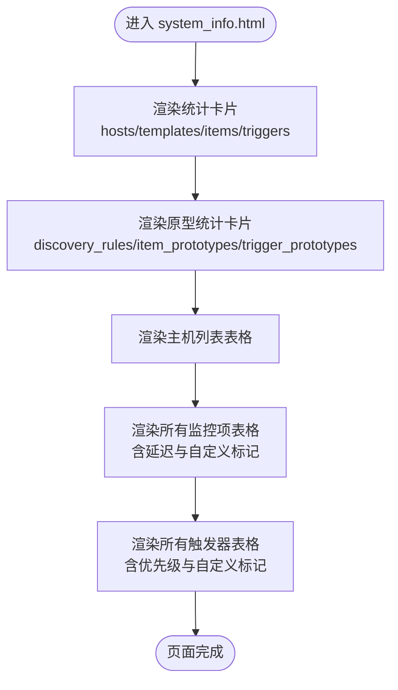
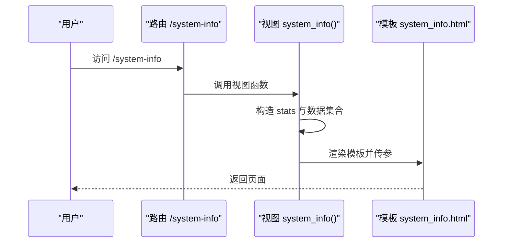
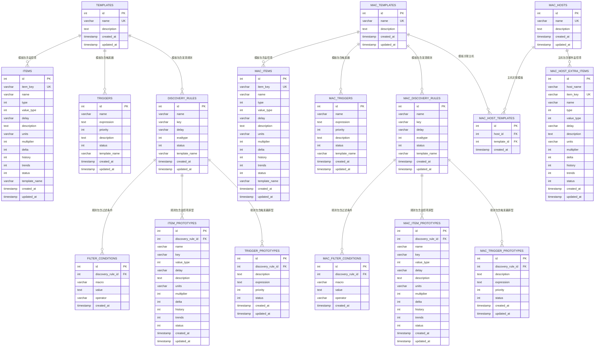
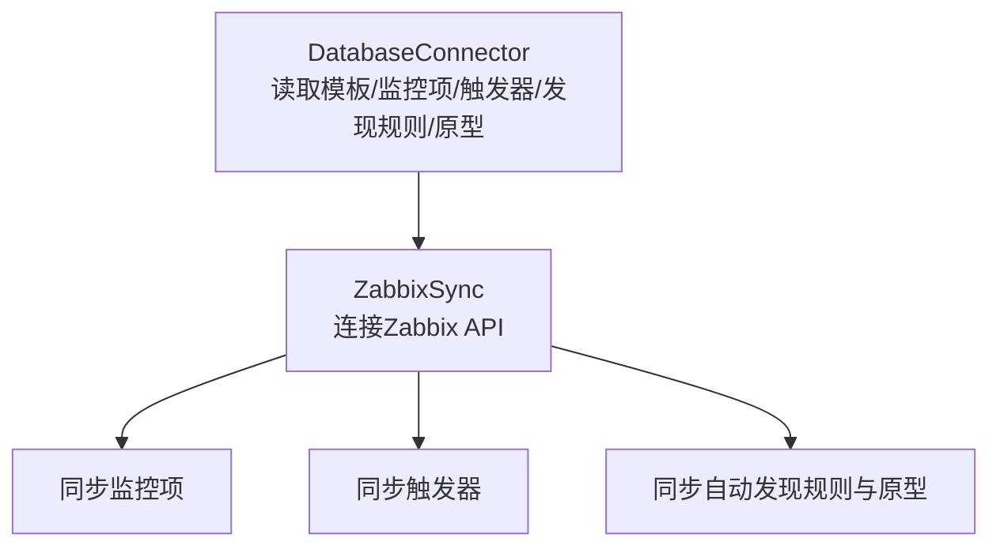
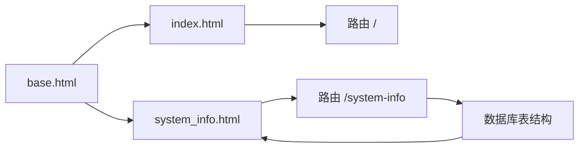

# 系统信息

<cite>
**本文引用的文件**
- [templates/system_info.html](file://templates/system_info.html)
- [app.py](file://app.py)
- [templates/base.html](file://templates/base.html)
- [templates/index.html](file://templates/index.html)
- [create_tables.sql](file://create_tables.sql)
- [create_mac_tables.sql](file://create_mac_tables.sql)
- [execute_sql.py](file://execute_sql.py)
- [insert_sample_data.py](file://insert_sample_data.py)
- [sync_monitoring_data.py](file://sync_monitoring_data.py)
</cite>

## 目录
1. [简介](#简介)
2. [项目结构](#项目结构)
3. [核心组件](#核心组件)
4. [架构总览](#架构总览)
5. [详细组件分析](#详细组件分析)
6. [依赖分析](#依赖分析)
7. [性能考虑](#性能考虑)
8. [故障排查指南](#故障排查指南)
9. [结论](#结论)
10. [附录](#附录)

## 简介
系统信息页面是本项目的监控配置管理界面中的关键仪表盘，用于集中展示当前监控系统的整体状态与配置规模。它提供主机数量、模板数量、监控项数量、触发器数量等核心统计，并进一步细化到自动发现规则、监控项原型、触发器原型等维度。页面还包含主机列表、所有监控项与触发器的汇总表格，帮助用户快速掌握监控配置的整体情况与潜在差异（如自定义修改标记）。

该页面在监控配置管理中的价值体现在：
- 快速评估监控覆盖范围与复杂度
- 发现异常或冗余配置（例如大量自定义修改）
- 支持审计与合规性检查（通过对比“所有监控项/触发器”与模板基线）
- 作为系统健康度与一致性的重要观测入口

## 项目结构
系统信息功能由前端模板、Flask 路由与数据库表结构共同构成，采用“模板渲染 + 路由参数”的方式输出页面内容。

图表来源
- [templates/base.html:1-73](file://templates/base.html#L1-L73)
- [templates/index.html:1-79](file://templates/index.html#L1-L79)
- [templates/system_info.html:1-164](file://templates/system_info.html#L1-L164)
- [app.py:31-63](file://app.py#L31-L63)
- [create_tables.sql:1-198](file://create_tables.sql#L1-L198)
- [create_mac_tables.sql:1-252](file://create_mac_tables.sql#L1-L252)
- [execute_sql.py:1-170](file://execute_sql.py#L1-L170)
- [insert_sample_data.py:1-240](file://insert_sample_data.py#L1-L240)

章节来源
- [templates/base.html:1-73](file://templates/base.html#L1-L73)
- [templates/index.html:1-79](file://templates/index.html#L1-L79)
- [templates/system_info.html:1-164](file://templates/system_info.html#L1-L164)
- [app.py:31-63](file://app.py#L31-L63)

## 核心组件
- 系统信息路由与视图
  - 路由：/system-info
  - 视图：返回系统信息详情页模板，传入统计字典与数据集合
- 前端模板
  - system_info.html：展示统计卡片与三张表格（主机列表、所有监控项、所有触发器）
  - base.html：提供导航栏与全局样式
  - index.html：首页摘要，包含部分统计与“查看完整系统详情”的跳转
- 数据来源
  - 数据库表：标准表结构与 MaC 专用表结构
  - 示例数据：insert_sample_data.py 提供初始数据
  - 同步脚本：sync_monitoring_data.py 展示如何从数据库读取并同步到 Zabbix

章节来源
- [app.py:46-63](file://app.py#L46-L63)
- [templates/system_info.html:1-164](file://templates/system_info.html#L1-L164)
- [templates/base.html:10-54](file://templates/base.html#L10-L54)
- [templates/index.html:1-79](file://templates/index.html#L1-L79)
- [create_tables.sql:1-198](file://create_tables.sql#L1-L198)
- [create_mac_tables.sql:1-252](file://create_mac_tables.sql#L1-L252)
- [insert_sample_data.py:1-240](file://insert_sample_data.py#L1-L240)
- [sync_monitoring_data.py:1-467](file://sync_monitoring_data.py#L1-L467)

## 架构总览
系统信息页面的请求-响应流程如下：

图表来源
- [app.py:46-63](file://app.py#L46-L63)
- [templates/system_info.html:1-164](file://templates/system_info.html#L1-L164)

## 详细组件分析

### 组件A：系统信息页面（system_info.html）
- 功能概述
  - 展示四大类统计卡片：主机数、模板数、监控项、触发器
  - 展示三大类统计卡片：自动发现规则、监控项原型、触发器原型
  - 展示主机列表（含模板关联、监控项数量、触发器数量）
  - 展示“所有监控项”与“所有触发器”列表，包含延迟、优先级、自定义修改标记等
- 数据绑定
  - stats：包含 hosts、templates、items、triggers、discovery_rules、item_prototypes、trigger_prototypes
  - hosts：主机列表，包含 id、name、template_name、item_count、trigger_count
  - all_items：监控项列表，包含 host_name、item_key、name、delay、has_custom_modification
  - all_triggers：触发器列表，包含 host_name、trigger_name、priority、has_custom_modification
- 设计要点
  - 使用 Bootstrap 卡片与表格样式，便于快速浏览
  - 对优先级进行可视化徽章映射，便于识别严重程度
  - 自定义修改标记用于提示人工干预或审计需求

图表来源
- [templates/system_info.html:6-162](file://templates/system_info.html#L6-L162)

章节来源
- [templates/system_info.html:1-164](file://templates/system_info.html#L1-L164)

### 组件B：系统信息路由与视图（app.py）
- 路由定义
  - /system-info：调用 system_info() 视图函数
- 视图逻辑
  - 构造 stats 字典（包含 hosts、templates、items、triggers、discovery_rules、item_prototypes、trigger_prototypes）
  - 准备 hosts、all_items、all_triggers 列表（当前为空，便于后续扩展）
  - 渲染 system_info.html 并传递上下文
- 与首页的关系
  - index.html 提供简要统计与“查看完整系统详情”按钮，跳转至 /system-info

图表来源
- [app.py:46-63](file://app.py#L46-L63)
- [templates/index.html:76-78](file://templates/index.html#L76-L78)

章节来源
- [app.py:46-63](file://app.py#L46-L63)
- [templates/index.html:1-79](file://templates/index.html#L1-L79)

### 组件C：数据模型与来源（数据库表结构）
- 标准表结构（create_tables.sql）
  - items、triggers、discovery_rules、filter_conditions、item_prototypes、trigger_prototypes、templates
  - 包含索引以优化查询性能
- MaC 专用表结构（create_mac_tables.sql）
  - mac_items、mac_triggers、mac_discovery_rules、mac_filter_conditions、mac_item_prototypes、mac_trigger_prototypes、mac_templates、mac_hosts、mac_host_templates、mac_host_extra_items
  - 用于存储监控配置数据（Monitor as Code），支持主机与模板的关联及主机额外监控项
- 示例数据（insert_sample_data.py）
  - 向标准表结构插入示例数据，便于演示系统信息页面的展示效果
- 建表脚本（execute_sql.py）
  - 提供统一的建表与索引创建流程

图表来源
- [create_tables.sql:1-198](file://create_tables.sql#L1-L198)
- [create_mac_tables.sql:1-252](file://create_mac_tables.sql#L1-L252)

章节来源
- [create_tables.sql:1-198](file://create_tables.sql#L1-L198)
- [create_mac_tables.sql:1-252](file://create_mac_tables.sql#L1-L252)
- [execute_sql.py:1-170](file://execute_sql.py#L1-L170)
- [insert_sample_data.py:1-240](file://insert_sample_data.py#L1-L240)

### 组件D：数据同步与来源（sync_monitoring_data.py）
- 功能概述
  - 从数据库读取模板、监控项、触发器、自动发现规则及其原型
  - 连接 Zabbix API，将配置同步到 Zabbix
- 与系统信息的关系
  - 该脚本展示了如何从数据库表中提取监控配置数据，这些数据正是系统信息页面所依赖的统计来源之一
  - 通过该脚本可以理解“监控项/触发器/发现规则/原型”的组织方式，从而更好地解读系统信息页面中的各项指标

图表来源
- [sync_monitoring_data.py:41-178](file://sync_monitoring_data.py#L41-L178)
- [sync_monitoring_data.py:179-414](file://sync_monitoring_data.py#L179-L414)

章节来源
- [sync_monitoring_data.py:1-467](file://sync_monitoring_data.py#L1-L467)

## 依赖分析
- 模板依赖
  - system_info.html 依赖 base.html 提供的导航与样式
  - index.html 依赖 base.html，并通过链接跳转到 system_info.html
- 路由依赖
  - /system-info 路由依赖 system_info.html 模板
  - / 路由依赖 index.html 模板
- 数据依赖
  - system_info.html 展示的数据来源于数据库表（标准表与 MaC 专用表）
  - 示例数据脚本 insert_sample_data.py 为演示提供初始数据

图表来源
- [templates/base.html:1-73](file://templates/base.html#L1-L73)
- [templates/index.html:1-79](file://templates/index.html#L1-L79)
- [templates/system_info.html:1-164](file://templates/system_info.html#L1-L164)
- [app.py:31-63](file://app.py#L31-L63)

章节来源
- [templates/base.html:1-73](file://templates/base.html#L1-L73)
- [templates/index.html:1-79](file://templates/index.html#L1-L79)
- [templates/system_info.html:1-164](file://templates/system_info.html#L1-L164)
- [app.py:31-63](file://app.py#L31-L63)

## 性能考虑
- 数据库索引
  - 标准表与 MaC 专用表均创建了针对常用查询字段的索引，有助于提升统计查询性能
- 查询优化建议
  - 在系统信息页面中，若未来需要实时统计大量主机/模板/监控项/触发器，建议：
    - 使用数据库聚合查询一次性获取多维统计
    - 对高频访问的统计字段建立物化视图或缓存层
    - 分页展示“所有监控项/触发器”列表，避免一次性渲染过多数据
- 前端渲染
  - 使用分页或虚拟滚动技术处理大型表格
  - 对优先级徽章与自定义标记进行轻量级前端处理，减少不必要的计算

## 故障排查指南
- 页面空白或统计为零
  - 检查数据库连接配置与表结构是否正确创建
  - 确认示例数据是否已插入（insert_sample_data.py）
- 导航无法跳转
  - 检查 base.html 中的导航链接是否正确指向对应路由
- 数据不同步
  - 若需从 Zabbix 同步配置，请参考 sync_monitoring_data.py 的实现思路
- 权限与认证
  - 确保数据库与 Zabbix API 的访问权限配置正确

章节来源
- [execute_sql.py:1-170](file://execute_sql.py#L1-L170)
- [insert_sample_data.py:1-240](file://insert_sample_data.py#L1-L240)
- [sync_monitoring_data.py:1-467](file://sync_monitoring_data.py#L1-L467)

## 结论
系统信息页面通过简洁直观的统计卡片与表格，为监控配置管理提供了全面的概览能力。结合数据库表结构与示例数据，用户可以快速了解当前监控体系的规模与组成；结合同步脚本，可以进一步理解数据来源与更新机制。未来可在保持现有结构的基础上，引入更丰富的统计维度与可视化图表，以满足更复杂的审计与治理需求。

## 附录

### 系统信息页面指标说明
- 主机数：当前注册的主机总数
- 模板数：监控模板总数
- 监控项：模板与主机上监控项总数
- 触发器：模板与主机上触发器总数
- 自动发现规则：模板上配置的自动发现规则数量
- 监控项原型：自动发现规则下的监控项原型数量
- 触发器原型：自动发现规则下的触发器原型数量

章节来源
- [templates/system_info.html:6-66](file://templates/system_info.html#L6-L66)

### 使用指南与解读方法
- 快速定位异常
  - 查看“所有监控项/触发器”表格中的自定义修改标记，识别人工干预或风险点
  - 通过优先级徽章快速识别高危触发器
- 审计与合规
  - 对比“所有监控项/触发器”与模板基线，识别偏离配置
- 扩展与定制
  - 在 app.py 中扩展 stats 字典，增加新的统计维度
  - 在 system_info.html 中新增卡片或表格，补充业务关注指标

章节来源
- [templates/system_info.html:68-162](file://templates/system_info.html#L68-L162)
- [app.py:46-63](file://app.py#L46-L63)

### 数据来源与更新机制
- 数据来源
  - 标准表结构与 MaC 专用表结构
  - 示例数据脚本插入的初始数据
- 更新机制
  - 通过同步脚本将数据库中的配置同步到 Zabbix
  - 系统信息页面当前为静态展示，未来可接入实时统计与缓存策略

章节来源
- [create_tables.sql:1-198](file://create_tables.sql#L1-L198)
- [create_mac_tables.sql:1-252](file://create_mac_tables.sql#L1-L252)
- [insert_sample_data.py:1-240](file://insert_sample_data.py#L1-L240)
- [sync_monitoring_data.py:1-467](file://sync_monitoring_data.py#L1-L467)