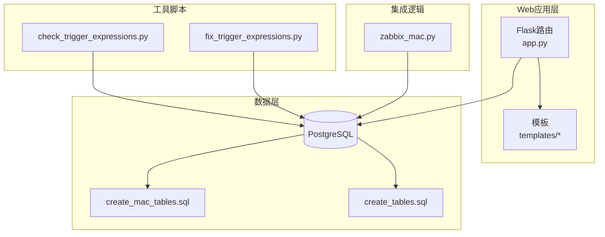
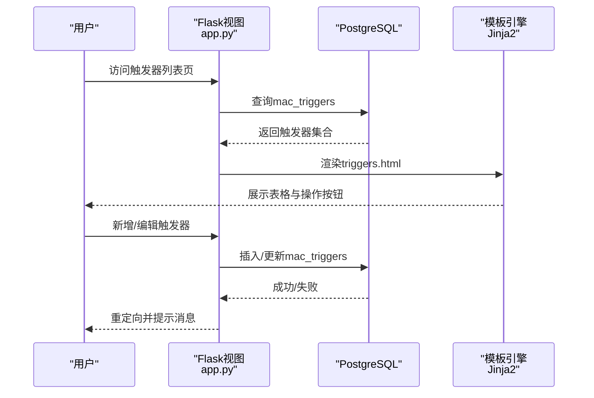
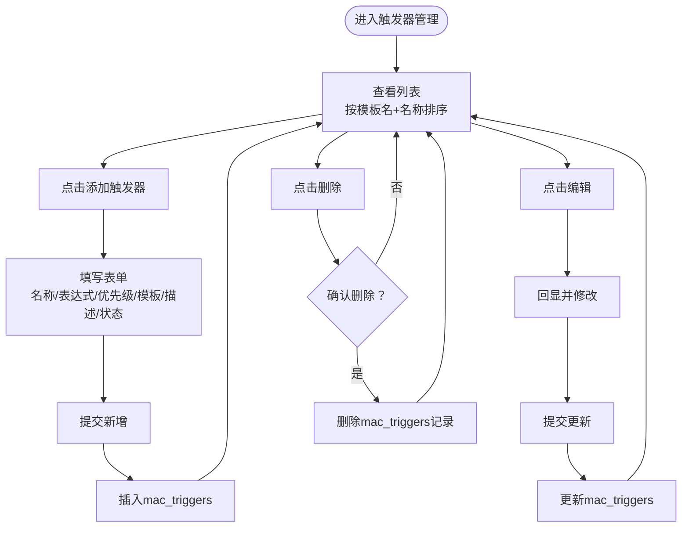
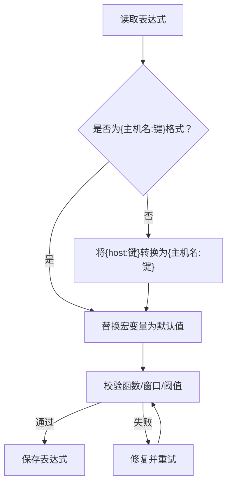
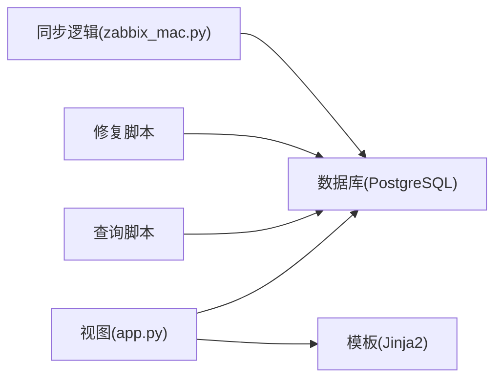

# 触发器管理

<cite>
**本文档引用的文件**
- [app.py](file://app.py)
- [create_mac_tables.sql](file://create_mac_tables.sql)
- [create_tables.sql](file://create_tables.sql)
- [templates/triggers.html](file://templates/triggers.html)
- [templates/add_trigger.html](file://templates/add_trigger.html)
- [templates/edit_trigger.html](file://templates/edit_trigger.html)
- [templates/base.html](file://templates/base.html)
- [check_trigger_expressions.py](file://check_trigger_expressions.py)
- [fix_trigger_expressions.py](file://fix_trigger_expressions.py)
- [zabbix_mac.py](file://zabbix_mac.py)
</cite>

## 目录
1. [简介](#简介)
2. [项目结构](#项目结构)
3. [核心组件](#核心组件)
4. [架构总览](#架构总览)
5. [详细组件分析](#详细组件分析)
6. [依赖分析](#依赖分析)
7. [性能考虑](#性能考虑)
8. [故障排查指南](#故障排查指南)
9. [结论](#结论)
10. [附录](#附录)

## 简介
本文件面向“触发器管理”功能，系统性地阐述触发器的CRUD操作流程、数据模型、表达式语法与验证机制、管理界面使用指南、与模板的关联关系以及表达式编写示例与常见问题排查方法。该系统基于Flask Web应用与PostgreSQL数据库，提供触发器的增删改查、与模板的绑定、以及触发器表达式的修复与校验能力。

## 项目结构
触发器管理功能由以下部分组成：
- Web应用层：Flask路由与视图，负责触发器的增删改查与模板选择。
- 模板层：Jinja2模板渲染列表页、新增页、编辑页。
- 数据层：PostgreSQL表结构定义与数据访问。
- 工具脚本：触发器表达式检查与修复脚本。
- 同步与解析：与Zabbix集成的模板解析与同步逻辑。

图表来源
- [app.py:223-332](file://app.py#L223-L332)
- [templates/triggers.html:1-37](file://templates/triggers.html#L1-L37)
- [templates/add_trigger.html:1-50](file://templates/add_trigger.html#L1-L50)
- [templates/edit_trigger.html:1-50](file://templates/edit_trigger.html#L1-L50)
- [create_mac_tables.sql:33-44](file://create_mac_tables.sql#L33-L44)
- [create_tables.sql:24-35](file://create_tables.sql#L24-L35)
- [check_trigger_expressions.py:14-44](file://check_trigger_expressions.py#L14-L44)
- [fix_trigger_expressions.py:61-169](file://fix_trigger_expressions.py#L61-L169)
- [zabbix_mac.py:1900-2099](file://zabbix_mac.py#L1900-L2099)

章节来源
- [app.py:223-332](file://app.py#L223-L332)
- [create_mac_tables.sql:33-44](file://create_mac_tables.sql#L33-L44)
- [create_tables.sql:24-35](file://create_tables.sql#L24-L35)
- [templates/triggers.html:1-37](file://templates/triggers.html#L1-L37)
- [templates/add_trigger.html:1-50](file://templates/add_trigger.html#L1-L50)
- [templates/edit_trigger.html:1-50](file://templates/edit_trigger.html#L1-L50)
- [check_trigger_expressions.py:14-44](file://check_trigger_expressions.py#L14-L44)
- [fix_trigger_expressions.py:61-169](file://fix_trigger_expressions.py#L61-L169)
- [zabbix_mac.py:1900-2099](file://zabbix_mac.py#L1900-L2099)

## 核心组件
- 触发器数据模型：包含名称、表达式、优先级、描述、状态、模板名等字段。
- CRUD路由：提供触发器列表、新增、编辑、删除接口。
- 模板关联：通过模板名字段将触发器与模板关联。
- 表达式修复与校验：提供表达式格式修复与查询脚本。
- 同步与依赖：在与Zabbix集成时，支持触发器表达式格式转换与依赖关系处理。

章节来源
- [app.py:223-332](file://app.py#L223-L332)
- [create_mac_tables.sql:33-44](file://create_mac_tables.sql#L33-L44)
- [create_tables.sql:24-35](file://create_tables.sql#L24-L35)
- [check_trigger_expressions.py:14-44](file://check_trigger_expressions.py#L14-L44)
- [fix_trigger_expressions.py:61-169](file://fix_trigger_expressions.py#L61-L169)
- [zabbix_mac.py:1900-2099](file://zabbix_mac.py#L1900-L2099)

## 架构总览
触发器管理采用经典的三层架构：
- 表现层：Flask路由渲染模板，提供表格展示、表单输入、批量操作入口。
- 业务层：路由处理请求，进行参数校验、模板下拉加载、数据库写入与更新。
- 数据层：PostgreSQL存储触发器元数据；同时提供触发器原型与模板等扩展表。

图表来源
- [app.py:223-332](file://app.py#L223-L332)
- [templates/triggers.html:1-37](file://templates/triggers.html#L1-L37)
- [templates/add_trigger.html:1-50](file://templates/add_trigger.html#L1-L50)
- [templates/edit_trigger.html:1-50](file://templates/edit_trigger.html#L1-L50)

## 详细组件分析

### 数据模型与约束
触发器表字段说明（来自数据库定义）：
- id：自增主键
- name：字符串，必填，触发器名称
- expression：文本，必填，触发器表达式
- priority：整数，必填，优先级（对应Zabbix级别）
- description：文本，可选，描述
- status：整数，默认0，启用/禁用状态
- template_name：字符串，必填，所属模板名
- created_at/updated_at：时间戳，默认当前时间

约束与索引：
- 唯一性：无显式唯一约束（但模板+名称组合通常用于业务唯一性）
- 索引：按template_name建立索引，便于按模板筛选与排序

章节来源
- [create_mac_tables.sql:33-44](file://create_mac_tables.sql#L33-L44)
- [create_tables.sql:24-35](file://create_tables.sql#L24-L35)

### CRUD操作流程
- 列表页：从mac_triggers按模板名与名称排序，渲染表格，提供编辑与删除操作。
- 新增：加载模板列表，提交表单后插入数据库。
- 编辑：加载模板列表，回显当前触发器信息，提交后更新数据库。
- 删除：根据ID删除记录。

图表来源
- [app.py:223-332](file://app.py#L223-L332)
- [templates/triggers.html:1-37](file://templates/triggers.html#L1-L37)
- [templates/add_trigger.html:1-50](file://templates/add_trigger.html#L1-L50)
- [templates/edit_trigger.html:1-50](file://templates/edit_trigger.html#L1-L50)

章节来源
- [app.py:223-332](file://app.py#L223-L332)
- [templates/triggers.html:1-37](file://templates/triggers.html#L1-L37)
- [templates/add_trigger.html:1-50](file://templates/add_trigger.html#L1-L50)
- [templates/edit_trigger.html:1-50](file://templates/edit_trigger.html#L1-L50)

### 触发器表达式语法与验证
- 语法要点
  - 使用Zabbix触发器表达式语法，形如：{主机名:监控项键}.函数(窗口)=阈值
  - 支持宏变量，如{$VAR}，可在同步或修复时替换为具体数值
  - 支持逻辑运算符与函数组合
- 验证与修复
  - 查询脚本：从数据库读取触发器表达式，便于人工核对
  - 修复脚本：将旧格式（如{host:...}）转换为{主机名:...}，并替换常用宏变量为默认值
  - 同步逻辑：在与Zabbix集成时，统一将表达式格式规范化，避免{itemid}与{主机名:键}混用导致界面读取异常

图表来源
- [check_trigger_expressions.py:14-44](file://check_trigger_expressions.py#L14-L44)
- [fix_trigger_expressions.py:61-169](file://fix_trigger_expressions.py#L61-L169)
- [zabbix_mac.py:1900-2099](file://zabbix_mac.py#L1900-L2099)

章节来源
- [check_trigger_expressions.py:14-44](file://check_trigger_expressions.py#L14-L44)
- [fix_trigger_expressions.py:61-169](file://fix_trigger_expressions.py#L61-L169)
- [zabbix_mac.py:1900-2099](file://zabbix_mac.py#L1900-L2099)

### 管理界面使用指南
- 列表显示
  - 展示ID、名称、表达式、优先级、模板、状态与操作按钮
  - 支持按模板名与名称排序
- 搜索与过滤
  - 当前模板未提供前端搜索/过滤功能，可通过数据库层面增加WHERE条件或在模板中添加搜索输入框
- 排序
  - 默认按template_name与name排序
- 批量操作
  - 当前模板未提供批量勾选与批量删除功能，可在列表页增加全选与批量操作按钮
- 模板选择
  - 新增/编辑时，模板下拉列表来源于mac_templates，确保触发器与模板正确关联

章节来源
- [templates/triggers.html:1-37](file://templates/triggers.html#L1-L37)
- [templates/add_trigger.html:1-50](file://templates/add_trigger.html#L1-L50)
- [templates/edit_trigger.html:1-50](file://templates/edit_trigger.html#L1-L50)
- [app.py:238-241](file://app.py#L238-L241)
- [app.py:285-288](file://app.py#L285-L288)

### 与模板的关联关系与模板选择机制
- 关联字段：template_name
- 模板来源：mac_templates表
- 选择机制：新增/编辑页面从mac_templates读取模板名列表，作为下拉选项
- 影响：同一模板下的触发器可统一管理与部署

章节来源
- [create_mac_tables.sql:5-11](file://create_mac_tables.sql#L5-L11)
- [app.py:238-241](file://app.py#L238-L241)
- [app.py:285-288](file://app.py#L285-L288)

### 触发器表达式编写示例与常见错误排查
- 示例参考
  - 高CPU利用率：{主机名:system.cpu.util.last()}>阈值
  - 文件变更检测：{主机名:vfs.file.cksum[路径].diff()}>0
  - 宏变量使用：{$VAR}，在修复/同步时替换为具体值
- 常见错误
  - 表达式格式不规范：使用{host:键}而非{主机名:键}
  - 宏变量未替换：导致表达式不可读或不可执行
  - 优先级设置不当：与业务告警级别不匹配
  - 模板名不一致：导致触发器无法归属到正确模板
- 排查方法
  - 使用查询脚本导出表达式进行核对
  - 使用修复脚本统一格式并替换宏变量
  - 在同步逻辑中检查表达式指纹变化，避免无效更新

章节来源
- [check_trigger_expressions.py:14-44](file://check_trigger_expressions.py#L14-L44)
- [fix_trigger_expressions.py:61-169](file://fix_trigger_expressions.py#L61-L169)
- [zabbix_mac.py:1900-2099](file://zabbix_mac.py#L1900-L2099)

## 依赖分析
- 组件耦合
  - 视图与模板：紧密耦合，模板依赖视图传入的triggers与templates
  - 视图与数据库：通过SQL查询与写入，依赖mac_triggers与mac_templates
  - 工具脚本与数据库：直接读写数据库，用于表达式修复与查询
- 外部依赖
  - Flask与Jinja2：Web框架与模板渲染
  - PostgreSQL：数据持久化
  - Zabbix API：在集成场景中用于表达式格式转换与依赖处理

图表来源
- [app.py:223-332](file://app.py#L223-L332)
- [check_trigger_expressions.py:14-44](file://check_trigger_expressions.py#L14-L44)
- [fix_trigger_expressions.py:61-169](file://fix_trigger_expressions.py#L61-L169)
- [zabbix_mac.py:1900-2099](file://zabbix_mac.py#L1900-L2099)

章节来源
- [app.py:223-332](file://app.py#L223-L332)
- [check_trigger_expressions.py:14-44](file://check_trigger_expressions.py#L14-L44)
- [fix_trigger_expressions.py:61-169](file://fix_trigger_expressions.py#L61-L169)
- [zabbix_mac.py:1900-2099](file://zabbix_mac.py#L1900-L2099)

## 性能考虑
- 查询优化
  - 按template_name建立索引，有利于按模板筛选与排序
  - 列表页按模板名+名称排序，建议在数据库层面添加复合索引以提升排序性能
- 写入优化
  - 批量插入/更新时使用事务，减少往返开销
- 表达式处理
  - 宏变量替换与格式转换应尽量在服务端一次性完成，避免多次往返

章节来源
- [create_mac_tables.sql:103](file://create_mac_tables.sql#L103)
- [create_tables.sql:103](file://create_tables.sql#L103)

## 故障排查指南
- 页面无法显示触发器
  - 检查数据库连接配置与表是否存在
  - 确认mac_triggers是否有数据
- 新增/编辑失败
  - 查看Flash消息提示，确认必填字段是否完整
  - 检查数据库约束（如template_name是否存在于mac_templates）
- 表达式异常
  - 使用查询脚本导出表达式核对
  - 使用修复脚本统一格式并替换宏变量
- 同步到Zabbix失败
  - 检查表达式指纹计算与依赖关系处理逻辑
  - 确认主机名与监控项键是否正确

章节来源
- [app.py:223-332](file://app.py#L223-L332)
- [check_trigger_expressions.py:14-44](file://check_trigger_expressions.py#L14-L44)
- [fix_trigger_expressions.py:61-169](file://fix_trigger_expressions.py#L61-L169)
- [zabbix_mac.py:1900-2099](file://zabbix_mac.py#L1900-L2099)

## 结论
触发器管理功能提供了完整的CRUD能力与模板关联机制，并通过工具脚本实现了表达式的查询与修复。结合数据库索引与同步逻辑，系统能够稳定地维护触发器配置。建议后续增强前端搜索/过滤与批量操作能力，进一步提升用户体验。

## 附录
- 优先级对照（来自编辑表单）
  - 0: Not classified
  - 1: Information
  - 2: Warning
  - 3: Average
  - 4: High
  - 5: Disaster

章节来源
- [templates/edit_trigger.html:18-25](file://templates/edit_trigger.html#L18-L25)