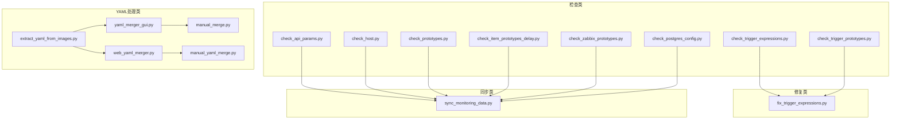
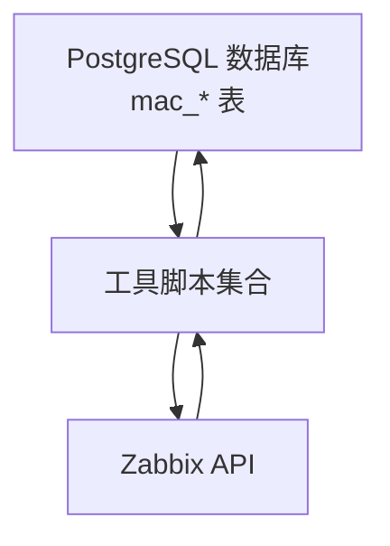
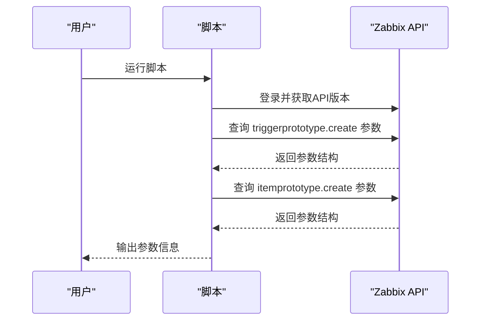
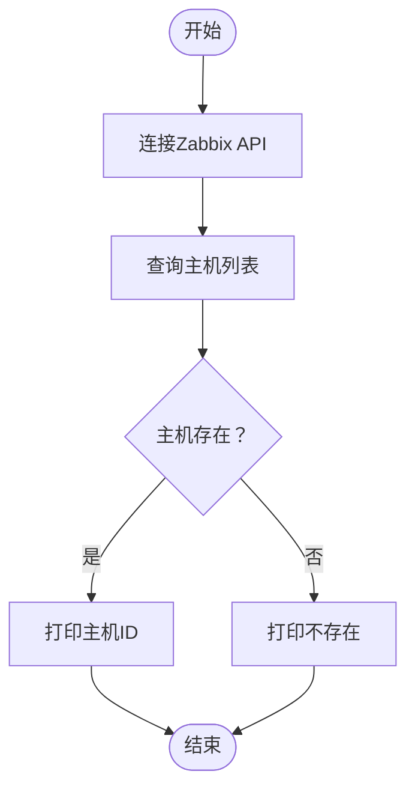
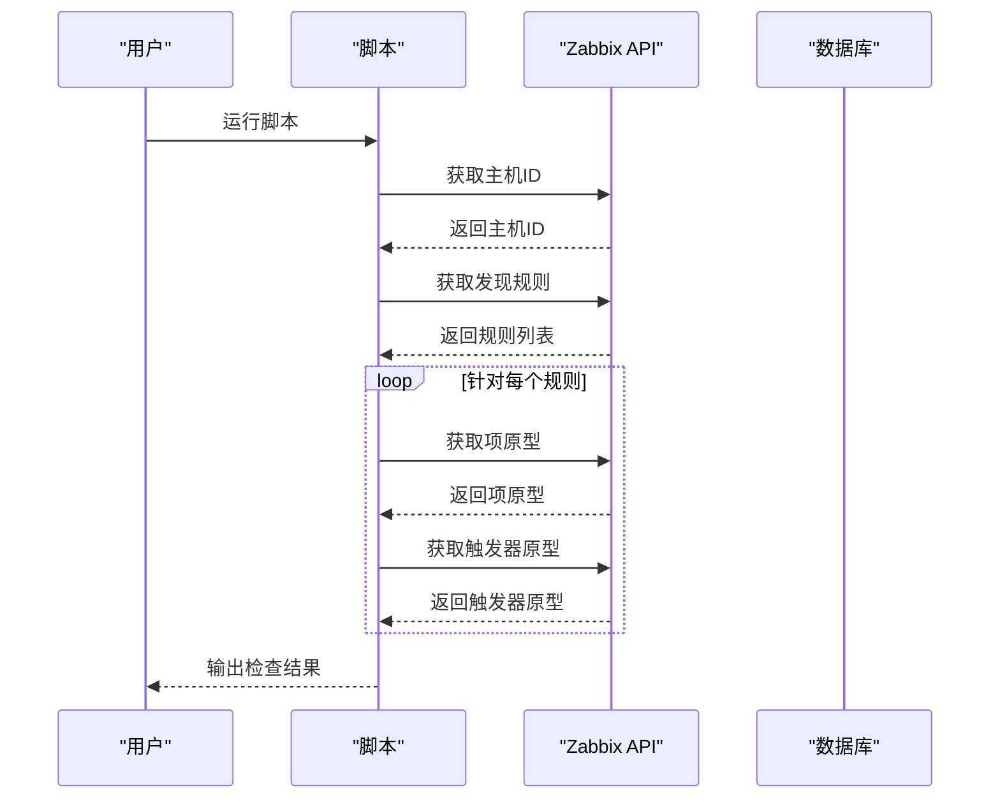
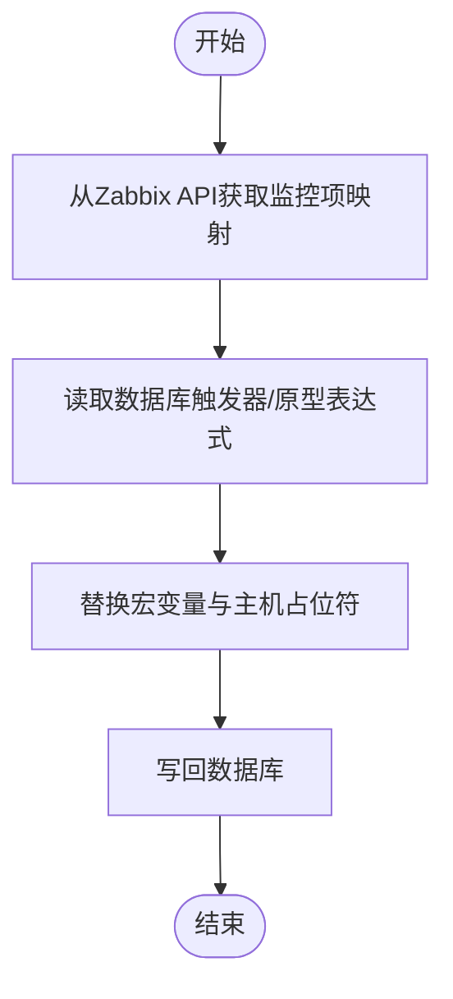
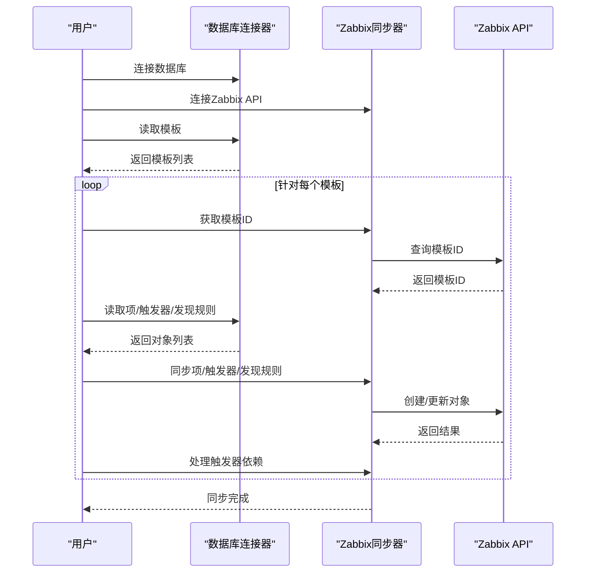
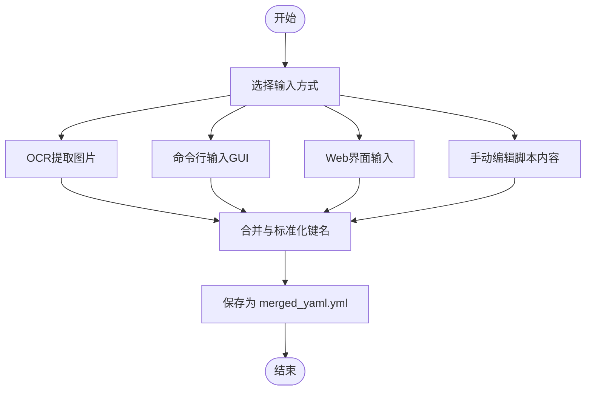
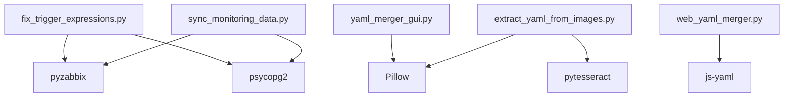

# 工具脚本

<cite>
**本文引用的文件**
- [check_api_params.py](file://check_api_params.py)
- [check_host.py](file://check_host.py)
- [check_item_prototypes_delay.py](file://check_item_prototypes_delay.py)
- [check_postgres_config.py](file://check_postgres_config.py)
- [check_prototypes.py](file://check_prototypes.py)
- [check_trigger_expressions.py](file://check_trigger_expressions.py)
- [check_trigger_prototypes.py](file://check_trigger_prototypes.py)
- [check_zabbix_prototypes.py](file://check_zabbix_prototypes.py)
- [fix_trigger_expressions.py](file://fix_trigger_expressions.py)
- [sync_monitoring_data.py](file://sync_monitoring_data.py)
- [manual_merge.py](file://manual_merge.py)
- [manual_yaml_merge.py](file://manual_yaml_merge.py)
- [web_yaml_merger.py](file://web_yaml_merger.py)
- [yaml_merger_gui.py](file://yaml_merger_gui.py)
- [extract_yaml_from_images.py](file://extract_yaml_from_images.py)
</cite>

## 目录
1. [简介](#简介)
2. [项目结构](#项目结构)
3. [核心组件](#核心组件)
4. [架构总览](#架构总览)
5. [详细组件分析](#详细组件分析)
6. [依赖分析](#依赖分析)
7. [性能考虑](#性能考虑)
8. [故障排查指南](#故障排查指南)
9. [结论](#结论)
10. [附录](#附录)

## 简介
本文件面向“Zabbix监控审核与自动化控制中心”仓库，系统性梳理各类辅助工具脚本的功能、参数、使用方式与执行流程，覆盖API参数检查、配置验证、数据同步、系统维护、YAML提取与合并等场景。文档同时提供最佳实践、注意事项以及扩展开发指南，帮助读者快速上手并安全地进行故障诊断、性能优化与日常维护。

## 项目结构
该仓库围绕Zabbix的模板、监控项、触发器、自动发现规则及原型展开，配套数据库校验、Zabbix API交互、YAML内容提取与合并等工具脚本。主要模块如下：
- API与配置检查类：用于验证Zabbix API连通性、主机存在性、原型数据一致性、PostgreSQL配置等
- 数据修复类：针对触发器表达式格式问题进行修复
- 数据同步类：将数据库中的模板/项/触发器/发现规则同步至Zabbix
- YAML处理类：从图片OCR提取YAML、GUI/网页界面合并YAML、手动合并YAML

图表来源
- [check_api_params.py](file://check_api_params.py)
- [check_host.py](file://check_host.py)
- [check_prototypes.py](file://check_prototypes.py)
- [check_item_prototypes_delay.py](file://check_item_prototypes_delay.py)
- [check_trigger_expressions.py](file://check_trigger_expressions.py)
- [check_trigger_prototypes.py](file://check_trigger_prototypes.py)
- [check_zabbix_prototypes.py](file://check_zabbix_prototypes.py)
- [check_postgres_config.py](file://check_postgres_config.py)
- [fix_trigger_expressions.py](file://fix_trigger_expressions.py)
- [sync_monitoring_data.py](file://sync_monitoring_data.py)
- [extract_yaml_from_images.py](file://extract_yaml_from_images.py)
- [yaml_merger_gui.py](file://yaml_merger_gui.py)
- [web_yaml_merger.py](file://web_yaml_merger.py)
- [manual_merge.py](file://manual_merge.py)
- [manual_yaml_merge.py](file://manual_yaml_merge.py)

章节来源
- [check_api_params.py](file://check_api_params.py)
- [check_host.py](file://check_host.py)
- [check_prototypes.py](file://check_prototypes.py)
- [check_item_prototypes_delay.py](file://check_item_prototypes_delay.py)
- [check_trigger_expressions.py](file://check_trigger_expressions.py)
- [check_trigger_prototypes.py](file://check_trigger_prototypes.py)
- [check_zabbix_prototypes.py](file://check_zabbix_prototypes.py)
- [check_postgres_config.py](file://check_postgres_config.py)
- [fix_trigger_expressions.py](file://fix_trigger_expressions.py)
- [sync_monitoring_data.py](file://sync_monitoring_data.py)
- [extract_yaml_from_images.py](file://extract_yaml_from_images.py)
- [yaml_merger_gui.py](file://yaml_merger_gui.py)
- [web_yaml_merger.py](file://web_yaml_merger.py)
- [manual_merge.py](file://manual_merge.py)
- [manual_yaml_merge.py](file://manual_yaml_merge.py)

## 核心组件
- API参数检查：通过Zabbix API查询特定方法的参数签名，辅助模板/原型创建时的参数校验
- 主机存在性检查：验证目标主机是否存在于Zabbix中
- 原型与延迟检查：读取数据库中mac_item_prototypes/mac_trigger_prototypes表，核对delay、表达式等字段
- 触发器表达式检查：读取数据库中触发器与触发器原型的表达式，便于比对与修复
- Zabbix原型状态检查：通过Zabbix API获取自动发现规则、项原型、触发器原型的当前状态
- PostgreSQL配置检查：读取PostgreSQL配置参数，给出监听地址等建议
- 触发器表达式修复：结合Zabbix API与数据库，修复表达式格式与宏变量
- 监控数据同步：从数据库读取模板/项/触发器/发现规则，同步到Zabbix，处理依赖关系
- YAML提取与合并：支持OCR提取、GUI/网页界面交互、手动输入等多种方式合并YAML

章节来源
- [check_api_params.py](file://check_api_params.py)
- [check_host.py](file://check_host.py)
- [check_item_prototypes_delay.py](file://check_item_prototypes_delay.py)
- [check_postgres_config.py](file://check_postgres_config.py)
- [check_prototypes.py](file://check_prototypes.py)
- [check_trigger_expressions.py](file://check_trigger_expressions.py)
- [check_trigger_prototypes.py](file://check_trigger_prototypes.py)
- [check_zabbix_prototypes.py](file://check_zabbix_prototypes.py)
- [fix_trigger_expressions.py](file://fix_trigger_expressions.py)
- [sync_monitoring_data.py](file://sync_monitoring_data.py)
- [extract_yaml_from_images.py](file://extract_yaml_from_images.py)
- [yaml_merger_gui.py](file://yaml_merger_gui.py)
- [web_yaml_merger.py](file://web_yaml_merger.py)
- [manual_merge.py](file://manual_merge.py)
- [manual_yaml_merge.py](file://manual_yaml_merge.py)

## 架构总览
整体架构由“检查/修复/同步/合并”四类工具组成，数据流从数据库与Zabbix API出发，经由脚本处理后回写至Zabbix或生成标准化YAML输出。

图表来源
- [sync_monitoring_data.py](file://sync_monitoring_data.py)
- [fix_trigger_expressions.py](file://fix_trigger_expressions.py)
- [check_zabbix_prototypes.py](file://check_zabbix_prototypes.py)
- [check_postgres_config.py](file://check_postgres_config.py)

## 详细组件分析

### API参数检查工具（check_api_params.py）
- 设计目的：在创建/更新模板原型前，确认Zabbix API方法的参数签名，避免因参数缺失或类型错误导致失败
- 关键流程：
  - 连接Zabbix API并获取版本
  - 查询triggerprototype.create与itemprototype.create的参数信息
  - 输出参数结构，供后续创建/更新逻辑参考
- 使用建议：
  - 在批量创建模板原型前执行，确保参数一致
  - 若API版本变更，需重新拉取参数清单

图表来源
- [check_api_params.py](file://check_api_params.py)

章节来源
- [check_api_params.py](file://check_api_params.py)

### 主机存在性检查（check_host.py）
- 设计目的：在执行模板同步或原型关联前，确认目标主机存在，避免因主机缺失导致同步失败
- 关键流程：
  - 连接Zabbix API
  - 查询指定主机（如Zabbix server、Test Host 1）
  - 输出主机存在性与ID
- 使用建议：
  - 在同步前先执行主机检查
  - 如主机不存在，先在Zabbix中创建主机

图表来源
- [check_host.py](file://check_host.py)

章节来源
- [check_host.py](file://check_host.py)

### 原型与延迟检查（check_prototypes.py、check_item_prototypes_delay.py）
- 设计目的：核对mac_discovery_rules、mac_item_prototypes、mac_trigger_prototypes表中的字段完整性，特别是delay与表达式
- 关键流程：
  - 连接PostgreSQL
  - 读取各表记录并逐条打印关键字段
  - 便于人工复核与后续修复
- 使用建议：
  - 定期巡检，确保delay与表达式合理
  - 发现异常后结合Zabbix原型检查工具定位差异

章节来源
- [check_prototypes.py](file://check_prototypes.py)
- [check_item_prototypes_delay.py](file://check_item_prototypes_delay.py)

### 触发器表达式检查（check_trigger_expressions.py、check_trigger_prototypes.py）
- 设计目的：读取数据库中触发器与触发器原型的表达式，便于对比与修复
- 关键流程：
  - 连接PostgreSQL
  - 分别查询mac_triggers与mac_trigger_prototypes的表达式
  - 输出前若干条记录，便于审阅
- 使用建议：
  - 与Zabbix原型检查配合，确认表达式在Zabbix侧是否生效
  - 修复前先备份相关记录

章节来源
- [check_trigger_expressions.py](file://check_trigger_expressions.py)
- [check_trigger_prototypes.py](file://check_trigger_prototypes.py)

### Zabbix原型状态检查（check_zabbix_prototypes.py）
- 设计目的：获取Zabbix中自动发现规则、项原型、触发器原型的当前状态，与数据库中的设计进行比对
- 关键流程：
  - 连接Zabbix API并获取主机ID
  - 获取发现规则列表
  - 针对每个规则获取项原型与触发器原型
- 使用建议：
  - 用于审计模板同步前后的一致性
  - 发现差异时，结合数据库检查与修复脚本

图表来源
- [check_zabbix_prototypes.py](file://check_zabbix_prototypes.py)

章节来源
- [check_zabbix_prototypes.py](file://check_zabbix_prototypes.py)

### PostgreSQL配置检查（check_postgres_config.py）
- 设计目的：检查PostgreSQL关键配置参数，确保容器网络与访问策略满足需求
- 关键流程：
  - 连接PostgreSQL
  - 查询listen_addresses、port、data_directory、config_file、hba_file
  - 给出建议（如listen_addresses应设为*以允许容器访问）
- 使用建议：
  - Docker部署时重点关注listen_addresses与端口
  - 修改配置后重启服务并验证连通性

章节来源
- [check_postgres_config.py](file://check_postgres_config.py)

### 触发器表达式修复（fix_trigger_expressions.py）
- 设计目的：修复数据库中触发器与触发器原型的表达式格式问题，统一为Zabbix可识别的格式
- 关键流程：
  - 通过Zabbix API获取监控项ID到键名的映射
  - 读取数据库中触发器与触发器原型表达式
  - 替换宏变量与主机占位符，必要时修正特殊表达式
  - 写回数据库
- 使用建议：
  - 修复前备份相关记录
  - 修复后使用Zabbix原型检查工具验证效果

图表来源
- [fix_trigger_expressions.py](file://fix_trigger_expressions.py)

章节来源
- [fix_trigger_expressions.py](file://fix_trigger_expressions.py)

### 监控数据同步（sync_monitoring_data.py）
- 设计目的：将数据库中的模板、监控项、触发器、自动发现规则及原型同步到Zabbix，保持一致性
- 关键流程：
  - 数据库连接器：读取模板、项、触发器、发现规则、原型及依赖
  - Zabbix同步器：连接Zabbix API，按模板ID查找/创建/更新对象；处理触发器依赖
- 使用建议：
  - 先在数据库中完善设计，再执行同步
  - 注意触发器依赖的顺序与完整性
  - 建议在非业务高峰期执行

图表来源
- [sync_monitoring_data.py](file://sync_monitoring_data.py)

章节来源
- [sync_monitoring_data.py](file://sync_monitoring_data.py)

### YAML提取与合并工具链
- 提取（extract_yaml_from_images.py）：从图片OCR提取文本并解析为YAML，若失败则回落到手动输入
- GUI（yaml_merger_gui.py）：命令行交互式输入多张图片的YAML内容，合并并输出
- 网页（web_yaml_merger.py）：提供Web界面，支持浏览图片、粘贴YAML、合并下载
- 手动（manual_merge.py、manual_yaml_merge.py）：直接在脚本中填入YAML内容进行合并

图表来源
- [extract_yaml_from_images.py](file://extract_yaml_from_images.py)
- [yaml_merger_gui.py](file://yaml_merger_gui.py)
- [web_yaml_merger.py](file://web_yaml_merger.py)
- [manual_merge.py](file://manual_merge.py)
- [manual_yaml_merge.py](file://manual_yaml_merge.py)

章节来源
- [extract_yaml_from_images.py](file://extract_yaml_from_images.py)
- [yaml_merger_gui.py](file://yaml_merger_gui.py)
- [web_yaml_merger.py](file://web_yaml_merger.py)
- [manual_merge.py](file://manual_merge.py)
- [manual_yaml_merge.py](file://manual_yaml_merge.py)

## 依赖分析
- 外部依赖
  - pyzabbix：Zabbix API客户端
  - psycopg2：PostgreSQL数据库驱动
  - Pillow（PIL）：图片处理（GUI与OCR）
  - pytesseract：OCR引擎（图片转文本）
  - js-yaml（网页端）：前端YAML解析
- 内部耦合
  - 同步脚本依赖数据库schema（mac_*表）与Zabbix API
  - 修复脚本依赖Zabbix API与数据库
  - YAML工具链之间相互独立，但共享“标准化键名”与“合并策略”的通用逻辑

图表来源
- [sync_monitoring_data.py](file://sync_monitoring_data.py)
- [fix_trigger_expressions.py](file://fix_trigger_expressions.py)
- [extract_yaml_from_images.py](file://extract_yaml_from_images.py)
- [yaml_merger_gui.py](file://yaml_merger_gui.py)
- [web_yaml_merger.py](file://web_yaml_merger.py)

章节来源
- [sync_monitoring_data.py](file://sync_monitoring_data.py)
- [fix_trigger_expressions.py](file://fix_trigger_expressions.py)
- [extract_yaml_from_images.py](file://extract_yaml_from_images.py)
- [yaml_merger_gui.py](file://yaml_merger_gui.py)
- [web_yaml_merger.py](file://web_yaml_merger.py)

## 性能考虑
- 数据库查询
  - 合理使用LIMIT与分页，避免一次性读取大量记录
  - 对频繁查询的表建立必要索引（如模板名、规则ID、键名等）
- API调用
  - 批量创建/更新时注意Zabbix API的速率限制，必要时增加重试与退避
  - 同步触发器依赖时先创建后更新，减少重复查询
- YAML处理
  - 大量图片OCR时建议离线处理或分批执行，避免阻塞UI
  - 合并策略采用递归合并字典与列表拼接，减少内存占用

## 故障排查指南
- API连接失败
  - 检查Zabbix URL、用户名、密码是否正确
  - 确认Zabbix服务可用与网络连通
- 数据库连接失败
  - 核对主机、端口、数据库名、用户与密码
  - 检查PostgreSQL配置（如listen_addresses）与防火墙
- 同步失败
  - 检查模板是否存在、主机是否存在
  - 核对触发器表达式格式与宏变量
  - 关注依赖关系是否完整
- YAML合并失败
  - 确认输入的YAML语法正确
  - 若使用OCR，检查图片清晰度与语言模型设置

章节来源
- [check_api_params.py](file://check_api_params.py)
- [check_host.py](file://check_host.py)
- [check_postgres_config.py](file://check_postgres_config.py)
- [sync_monitoring_data.py](file://sync_monitoring_data.py)
- [extract_yaml_from_images.py](file://extract_yaml_from_images.py)

## 结论
本工具集覆盖了Zabbix模板与原型的全生命周期管理：从设计、校验、修复到同步与审计，并提供多种YAML处理方案。通过规范的参数检查、配置验证与数据同步流程，可显著降低运维风险，提升模板质量与一致性。建议在生产环境中遵循“先检查、后修复、再同步”的原则，并定期执行审计与巡检。

## 附录
- 最佳实践
  - 在非业务高峰期执行大规模同步
  - 同步前备份数据库与Zabbix配置
  - 使用API参数检查与原型状态检查双保险
  - YAML处理建议先OCR后校验，再合并导出
- 扩展开发指南
  - 新增检查脚本：遵循“连接→查询→输出→异常处理”的模式
  - 新增同步脚本：抽象出“数据库读取→Zabbix写入→依赖处理”的通用流程
  - 新增YAML工具：统一“标准化键名→合并策略→输出文件”的接口
- 注意事项
  - 修复表达式前务必备份
  - Docker环境需确保PostgreSQL监听地址允许外部访问
  - 网页端需保证图片目录存在且可读