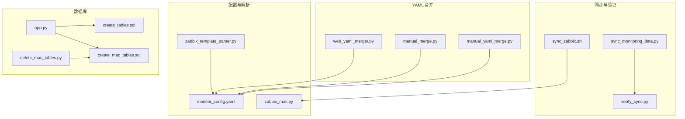
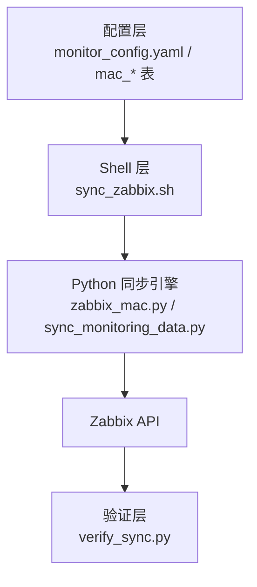
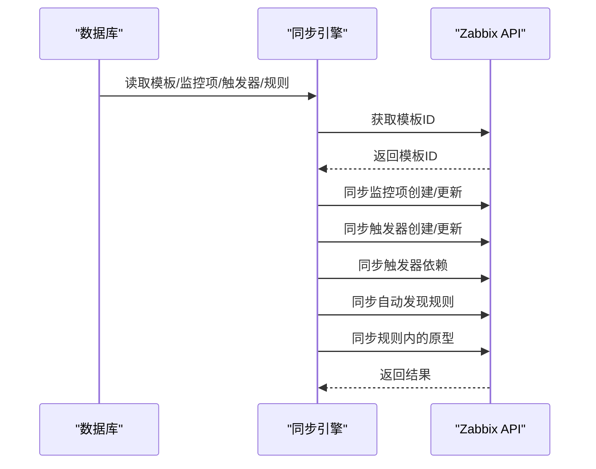
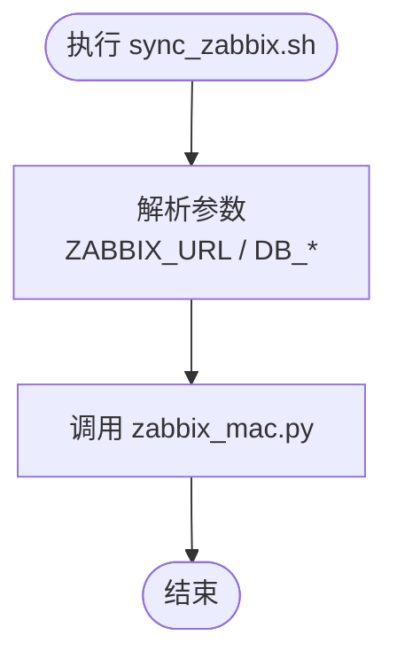
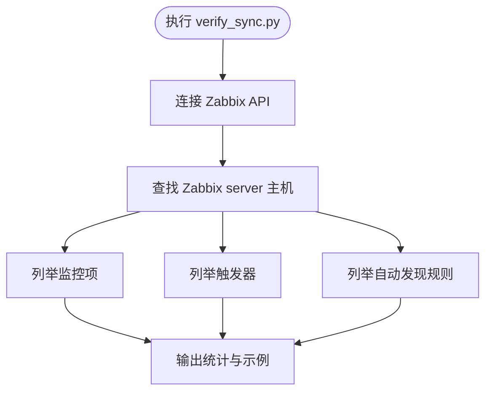
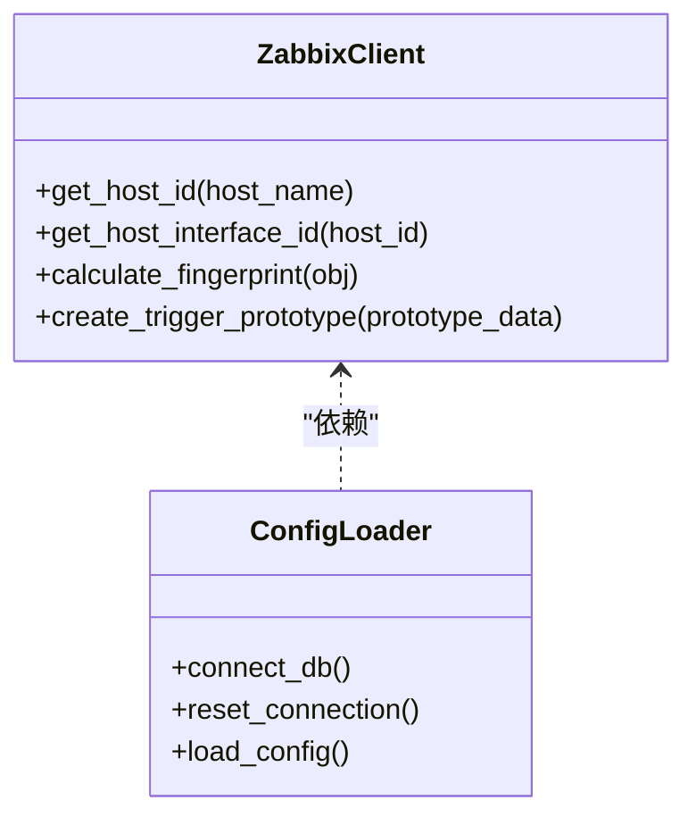
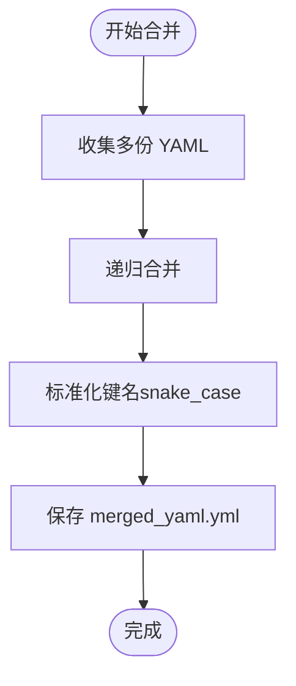
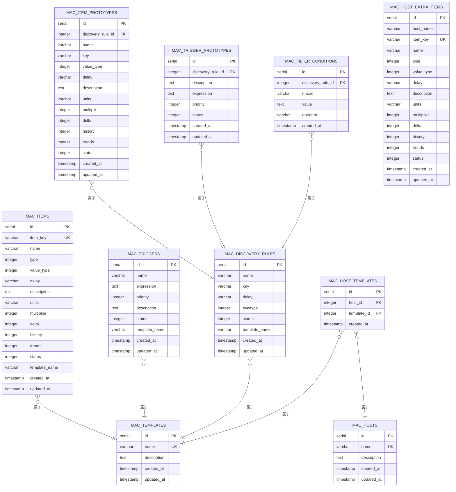
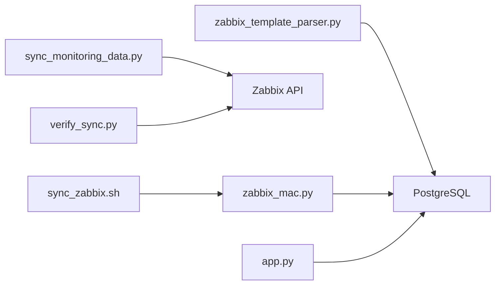

# 数据同步工具

<cite>
**本文引用的文件**
- [sync_monitoring_data.py](file://sync_monitoring_data.py)
- [sync_zabbix.sh](file://sync_zabbix.sh)
- [verify_sync.py](file://verify_sync.py)
- [monitor_config.yaml](file://monitor_config.yaml)
- [app.py](file://app.py)
- [zabbix_template_parser.py](file://zabbix_template_parser.py)
- [web_yaml_merger.py](file://web_yaml_merger.py)
- [manual_merge.py](file://manual_merge.py)
- [manual_yaml_merge.py](file://manual_yaml_merge.py)
- [create_tables.sql](file://create_tables.sql)
- [create_mac_tables.sql](file://create_mac_tables.sql)
- [delete_mac_tables.py](file://delete_mac_tables.py)
- [zabbix_mac.py](file://zabbix_mac.py)
</cite>

## 目录
1. [简介](#简介)
2. [项目结构](#项目结构)
3. [核心组件](#核心组件)
4. [架构总览](#架构总览)
5. [详细组件分析](#详细组件分析)
6. [依赖分析](#依赖分析)
7. [性能考虑](#性能考虑)
8. [故障排除指南](#故障排除指南)
9. [结论](#结论)
10. [附录](#附录)

## 简介
本项目是一套面向 Zabbix 的“监控即代码”（Monitor as Code, MaC）自动化同步与管理工具集，覆盖以下能力：
- 从数据库读取标准化的监控配置，同步至 Zabbix（监控项、触发器、自动发现规则及其原型）
- 通过 Shell 脚本统一调度同步流程
- 提供同步验证脚本，快速检查 Zabbix 中的监控项、触发器与自动发现规则
- 提供 YAML 合并工具，支持手动与 Web 两种方式，辅助生成标准化配置
- 提供数据库表结构定义与清理脚本，支撑本地开发与测试环境

该工具强调声明式配置、可重复执行、冲突处理与可观测性，适合在 CI/CD 中进行安全、可追溯的监控配置变更。

## 项目结构
项目采用“功能模块 + 脚本 + 配置”的组织方式，核心文件如下：
- 同步引擎与验证：sync_monitoring_data.py、sync_zabbix.sh、verify_sync.py
- 配置与模板解析：monitor_config.yaml、zabbix_template_parser.py、zabbix_mac.py
- YAML 合并工具：web_yaml_merger.py、manual_merge.py、manual_yaml_merge.py
- 数据库结构与清理：create_tables.sql、create_mac_tables.sql、delete_mac_tables.py
- Web 管理界面：app.py（用于维护数据库中的监控配置）

**图表来源**
- [sync_monitoring_data.py](file://sync_monitoring_data.py)
- [sync_zabbix.sh](file://sync_zabbix.sh)
- [verify_sync.py](file://verify_sync.py)
- [monitor_config.yaml](file://monitor_config.yaml)
- [zabbix_template_parser.py](file://zabbix_template_parser.py)
- [zabbix_mac.py](file://zabbix_mac.py)
- [web_yaml_merger.py](file://web_yaml_merger.py)
- [manual_merge.py](file://manual_merge.py)
- [manual_yaml_merge.py](file://manual_yaml_merge.py)
- [create_tables.sql](file://create_tables.sql)
- [create_mac_tables.sql](file://create_mac_tables.sql)
- [delete_mac_tables.py](file://delete_mac_tables.py)
- [app.py](file://app.py)

**章节来源**
- [sync_monitoring_data.py](file://sync_monitoring_data.py)
- [sync_zabbix.sh](file://sync_zabbix.sh)
- [verify_sync.py](file://verify_sync.py)
- [monitor_config.yaml](file://monitor_config.yaml)
- [zabbix_template_parser.py](file://zabbix_template_parser.py)
- [zabbix_mac.py](file://zabbix_mac.py)
- [web_yaml_merger.py](file://web_yaml_merger.py)
- [manual_merge.py](file://manual_merge.py)
- [manual_yaml_merge.py](file://manual_yaml_merge.py)
- [create_tables.sql](file://create_tables.sql)
- [create_mac_tables.sql](file://create_mac_tables.sql)
- [delete_mac_tables.py](file://delete_mac_tables.py)
- [app.py](file://app.py)

## 核心组件
- 同步引擎（Python）：负责从数据库读取监控配置，连接 Zabbix API，执行创建/更新操作，处理异常与重试。
- Shell 同步脚本：封装 Zabbix API 与数据库连接参数，统一入口调用 zabbix_mac.py。
- 验证脚本：连接 Zabbix API，列举主机下的监控项、触发器与自动发现规则，用于同步后快速校验。
- 配置与解析：monitor_config.yaml 作为声明式配置；zabbix_template_parser.py 用于从 Zabbix 模板导出并入库；zabbix_mac.py 支持 Dry Run、重试与指纹校验等高级特性。
- YAML 合并工具：提供 Web 界面与命令行两种方式，将多份 YAML 合并为统一配置并标准化键名。
- 数据库层：提供标准表结构与 mac 开头的 MaC 表结构，便于开发与生产环境切换。

**章节来源**
- [sync_monitoring_data.py](file://sync_monitoring_data.py)
- [sync_zabbix.sh](file://sync_zabbix.sh)
- [verify_sync.py](file://verify_sync.py)
- [monitor_config.yaml](file://monitor_config.yaml)
- [zabbix_template_parser.py](file://zabbix_template_parser.py)
- [zabbix_mac.py](file://zabbix_mac.py)
- [web_yaml_merger.py](file://web_yaml_merger.py)
- [manual_merge.py](file://manual_merge.py)
- [manual_yaml_merge.py](file://manual_yaml_merge.py)
- [create_tables.sql](file://create_tables.sql)
- [create_mac_tables.sql](file://create_mac_tables.sql)
- [delete_mac_tables.py](file://delete_mac_tables.py)
- [app.py](file://app.py)

## 架构总览
整体架构分为三层：
- 配置层：YAML/数据库配置（monitor_config.yaml、mac_* 表）
- 同步层：Shell 调度 + Python 同步引擎（zabbix_mac.py、sync_monitoring_data.py）
- 验证层：Zabbix API 校验（verify_sync.py）

**图表来源**
- [sync_zabbix.sh](file://sync_zabbix.sh)
- [zabbix_mac.py](file://zabbix_mac.py)
- [sync_monitoring_data.py](file://sync_monitoring_data.py)
- [verify_sync.py](file://verify_sync.py)
- [monitor_config.yaml](file://monitor_config.yaml)
- [create_mac_tables.sql](file://create_mac_tables.sql)

## 详细组件分析

### 组件一：同步引擎（Python）
- 功能职责
  - 从数据库读取模板、监控项、触发器、自动发现规则及其原型
  - 连接 Zabbix API，执行创建/更新操作
  - 处理触发器依赖关系（先创建后设置依赖）
  - 对原型同步进行兼容性处理（表达式格式不正确时跳过创建）
- 关键流程
  - 获取模板 ID
  - 同步监控项（按 key 去重）
  - 同步触发器（按 name 去重，再设置依赖）
  - 同步自动发现规则（含原型同步）
- 错误处理
  - 数据库连接失败、Zabbix API 异常均记录日志并继续后续流程
  - 模板不存在时跳过该模板

**图表来源**
- [sync_monitoring_data.py](file://sync_monitoring_data.py)

**章节来源**
- [sync_monitoring_data.py](file://sync_monitoring_data.py)

### 组件二：Shell 同步脚本
- 功能职责
  - 统一入口，传入 Zabbix API 与数据库连接参数
  - 调用 zabbix_mac.py 执行同步
- 使用方法
  - 修改脚本中的 URL、用户名、密码、数据库参数
  - 直接执行脚本即可触发同步

**图表来源**
- [sync_zabbix.sh](file://sync_zabbix.sh)

**章节来源**
- [sync_zabbix.sh](file://sync_zabbix.sh)

### 组件三：同步验证脚本
- 功能职责
  - 连接 Zabbix API，获取 Zabbix server 主机 ID
  - 列举监控项、触发器、自动发现规则数量与部分条目
- 使用方法
  - 直接运行脚本，输出验证结果

**图表来源**
- [verify_sync.py](file://verify_sync.py)

**章节来源**
- [verify_sync.py](file://verify_sync.py)

### 组件四：配置与模板解析
- monitor_config.yaml
  - 作为声明式配置示例，定义主机、模板引用与额外监控项
- zabbix_template_parser.py
  - 从 Zabbix 模板导出监控项、触发器、自动发现规则及其原型
  - 将导出数据写入数据库表（mac_*）
  - 为监控项与触发器添加中文注释
- zabbix_mac.py
  - 高级同步能力：重试、Dry Run、指纹校验、并发等
  - 适配 Zabbix 5.0 API 的原型创建参数

**图表来源**
- [zabbix_template_parser.py](file://zabbix_template_parser.py)
- [zabbix_mac.py](file://zabbix_mac.py)

**章节来源**
- [monitor_config.yaml](file://monitor_config.yaml)
- [zabbix_template_parser.py](file://zabbix_template_parser.py)
- [zabbix_mac.py](file://zabbix_mac.py)

### 组件五：YAML 合并工具
- web_yaml_merger.py
  - 提供 Web 界面，逐图输入 YAML，合并后标准化键名并下载
- manual_merge.py / manual_yaml_merge.py
  - 提供命令行方式，手动填入 YAML 内容后合并与保存

**图表来源**
- [web_yaml_merger.py](file://web_yaml_merger.py)
- [manual_merge.py](file://manual_merge.py)
- [manual_yaml_merge.py](file://manual_yaml_merge.py)

**章节来源**
- [web_yaml_merger.py](file://web_yaml_merger.py)
- [manual_merge.py](file://manual_merge.py)
- [manual_yaml_merge.py](file://manual_yaml_merge.py)

### 组件六：数据库层
- create_tables.sql / create_mac_tables.sql
  - 定义标准表与 MaC 表结构，包含索引与示例数据
- delete_mac_tables.py
  - 清理以 mac 开头的表，便于重置开发环境
- app.py
  - 提供 Web 界面，用于维护数据库中的监控配置（如 items、triggers、hosts 等）

**图表来源**
- [create_mac_tables.sql](file://create_mac_tables.sql)
- [create_tables.sql](file://create_tables.sql)
- [delete_mac_tables.py](file://delete_mac_tables.py)
- [app.py](file://app.py)

**章节来源**
- [create_tables.sql](file://create_tables.sql)
- [create_mac_tables.sql](file://create_mac_tables.sql)
- [delete_mac_tables.py](file://delete_mac_tables.py)
- [app.py](file://app.py)

## 依赖分析
- 组件耦合
  - sync_monitoring_data.py 与 zabbix_mac.py 在功能上互补：前者侧重简单同步，后者提供更丰富的同步能力（重试、Dry Run、指纹校验等）
  - sync_zabbix.sh 仅作为入口脚本，依赖 zabbix_mac.py
  - verify_sync.py 仅依赖 Zabbix API，独立于同步引擎
  - YAML 合并工具与配置层解耦，最终生成的 YAML 可被 zabbix_template_parser.py 或其他流程消费
- 外部依赖
  - Python 第三方库：psycopg2、pyzabbix、PyYAML、Flask（Web 界面）
  - 数据库：PostgreSQL
  - Zabbix：JSON-RPC API

**图表来源**
- [sync_zabbix.sh](file://sync_zabbix.sh)
- [zabbix_mac.py](file://zabbix_mac.py)
- [sync_monitoring_data.py](file://sync_monitoring_data.py)
- [verify_sync.py](file://verify_sync.py)
- [zabbix_template_parser.py](file://zabbix_template_parser.py)
- [app.py](file://app.py)

**章节来源**
- [sync_zabbix.sh](file://sync_zabbix.sh)
- [zabbix_mac.py](file://zabbix_mac.py)
- [sync_monitoring_data.py](file://sync_monitoring_data.py)
- [verify_sync.py](file://verify_sync.py)
- [zabbix_template_parser.py](file://zabbix_template_parser.py)
- [app.py](file://app.py)

## 性能考虑
- 并发与重试
  - zabbix_mac.py 支持重试与并发（ThreadPoolExecutor），提升大规模同步效率
- 数据库索引
  - 表结构定义包含常用查询索引，有助于加速读取与去重
- 同步粒度
  - 按模板维度同步，减少跨模板的复杂度
- 建议
  - 在高并发场景下，合理设置重试次数与延迟
  - 对大数据量的模板，分批处理或增加数据库连接池参数
  - 使用 Dry Run 预演大规模变更，降低风险

[本节为通用指导，无需特定文件引用]

## 故障排除指南
- 连接问题
  - Zabbix API 连接失败：检查 URL、用户名、密码；查看重试日志
  - 数据库连接失败：检查主机、端口、数据库名、用户、密码；必要时重置连接
- 同步异常
  - 模板不存在：跳过该模板；确认模板名称与 Zabbix 中一致
  - 触发器原型表达式格式不正确：跳过创建，修正表达式后再试
  - 触发器依赖设置失败：确认依赖项已存在且名称匹配
- 验证失败
  - Zabbix server 主机不存在：确认主机名与实际一致
  - 权限不足：确保使用具有足够权限的账户
- 环境清理
  - 需要重置开发环境：使用 delete_mac_tables.py 删除 mac_* 表

**章节来源**
- [sync_monitoring_data.py](file://sync_monitoring_data.py)
- [zabbix_mac.py](file://zabbix_mac.py)
- [verify_sync.py](file://verify_sync.py)
- [delete_mac_tables.py](file://delete_mac_tables.py)

## 结论
本工具通过“声明式配置 + 自动化同步 + 验证闭环”的方式，实现了对 Zabbix 监控配置的可审计、可重复、可回滚的管理。结合 Shell 脚本、Python 同步引擎、YAML 合并工具与数据库层，形成完整的 MaC 生态。建议在生产环境中配合 CI/CD 流水线使用，并开启 Dry Run 与充分的日志记录，以保障变更的安全与可控。

[本节为总结，无需特定文件引用]

## 附录

### 同步配置参数清单
- Zabbix API
  - URL、用户名、密码
- 数据库
  - 主机、端口、数据库名、用户、密码
- 模板与主机
  - 模板名称、主机名称、额外监控项（可选）

**章节来源**
- [sync_zabbix.sh](file://sync_zabbix.sh)
- [monitor_config.yaml](file://monitor_config.yaml)
- [zabbix_template_parser.py](file://zabbix_template_parser.py)

### 执行流程与最佳实践
- 执行流程
  - 准备 YAML/数据库配置 → 调用 Shell 脚本 → Python 同步引擎执行 → 验证脚本检查
- 最佳实践
  - 使用 Dry Run 预演
  - 分批同步大模板
  - 记录每次同步日志，保留备份
  - 在变更窗口内执行，避免业务高峰期

**章节来源**
- [sync_zabbix.sh](file://sync_zabbix.sh)
- [zabbix_mac.py](file://zabbix_mac.py)
- [verify_sync.py](file://verify_sync.py)