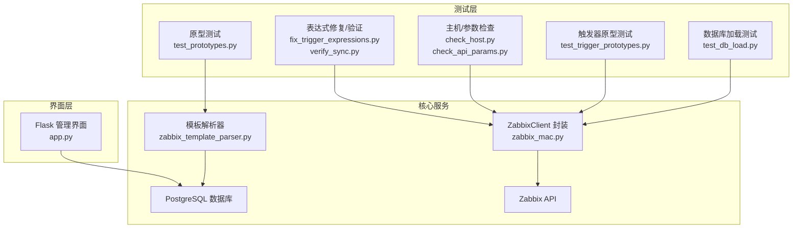
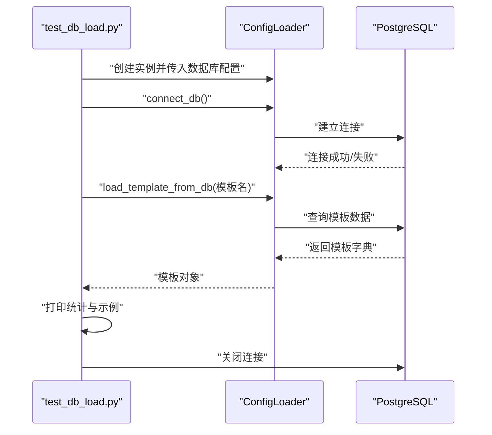
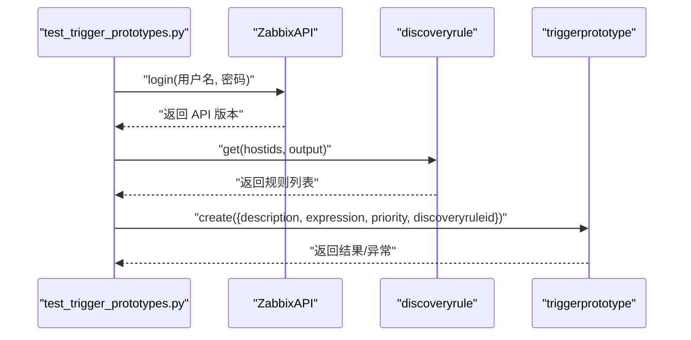
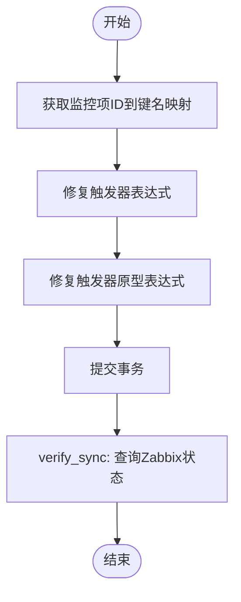
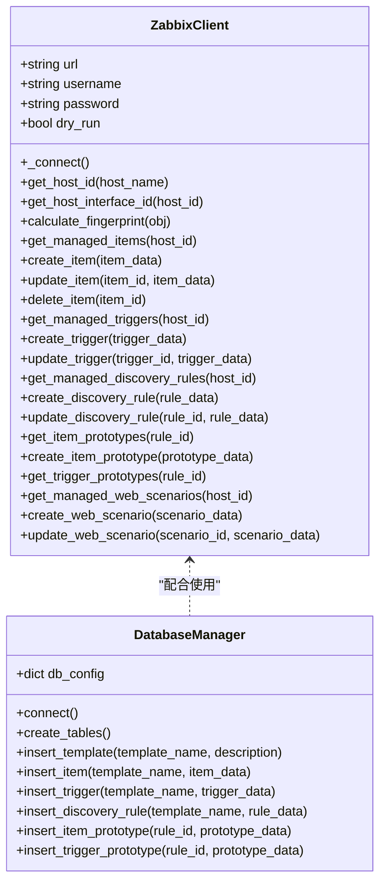
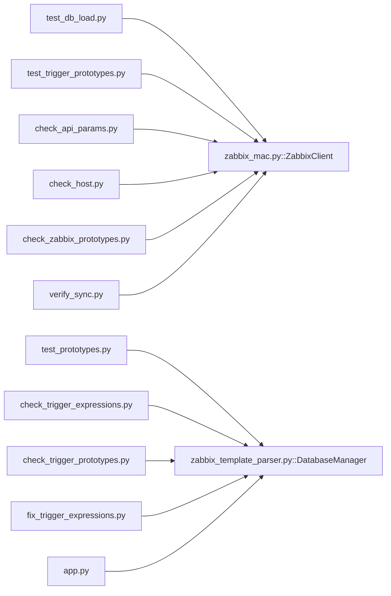

# 测试验证工具

<cite>
**本文档引用的文件**
- [test.py](file://test.py)
- [test_db_load.py](file://test_db_load.py)
- [test_prototypes.py](file://test_prototypes.py)
- [test_trigger_prototypes.py](file://test_trigger_prototypes.py)
- [check_prototypes.py](file://check_prototypes.py)
- [check_api_params.py](file://check_api_params.py)
- [check_host.py](file://check_host.py)
- [check_item_prototypes_delay.py](file://check_item_prototypes_delay.py)
- [check_trigger_expressions.py](file://check_trigger_expressions.py)
- [check_trigger_prototypes.py](file://check_trigger_prototypes.py)
- [check_zabbix_prototypes.py](file://check_zabbix_prototypes.py)
- [fix_trigger_expressions.py](file://fix_trigger_expressions.py)
- [verify_sync.py](file://verify_sync.py)
- [check_postgres_config.py](file://check_postgres_config.py)
- [zabbix_mac.py](file://zabbix_mac.py)
- [zabbix_template_parser.py](file://zabbix_template_parser.py)
- [app.py](file://app.py)
- [monitor_config.yaml](file://monitor_config.yaml)
</cite>

## 目录
1. [简介](#简介)
2. [项目结构](#项目结构)
3. [核心组件](#核心组件)
4. [架构总览](#架构总览)
5. [详细组件分析](#详细组件分析)
6. [依赖分析](#依赖分析)
7. [性能考虑](#性能考虑)
8. [故障排查指南](#故障排查指南)
9. [结论](#结论)
10. [附录](#附录)

## 简介
本文件系统性梳理该仓库中的测试与验证工具，覆盖单元测试、数据库加载测试、原型测试与触发器原型测试等模块，解释测试框架组织结构、测试用例设计与执行流程，并提供测试环境搭建、测试数据准备与结果分析方法。同时阐述这些工具在质量保证中的作用，以及如何扩展测试用例与新增测试场景。

## 项目结构
该仓库围绕“Zabbix 监控即代码（MaC）”主题，提供了多个独立的测试与验证脚本，分别针对数据库连接、Zabbix API 访问、原型数据校验、表达式修复与同步验证等场景。核心文件如下：
- 单元/集成测试脚本：test.py、test_db_load.py、test_prototypes.py、test_trigger_prototypes.py
- 数据校验脚本：check_prototypes.py、check_api_params.py、check_host.py、check_item_prototypes_delay.py、check_trigger_expressions.py、check_trigger_prototypes.py、check_zabbix_prototypes.py
- 同步与修复脚本：fix_trigger_expressions.py、verify_sync.py
- 环境与配置：check_postgres_config.py、monitor_config.yaml
- 核心业务与客户端：zabbix_mac.py、zabbix_template_parser.py
- Web 管理界面：app.py

```mermaid
graph TB
subgraph "测试与验证脚本"
T1["test.py"]
T2["test_db_load.py"]
T3["test_prototypes.py"]
T4["test_trigger_prototypes.py"]
C1["check_prototypes.py"]
C2["check_api_params.py"]
C3["check_host.py"]
C4["check_item_prototypes_delay.py"]
C5["check_trigger_expressions.py"]
C6["check_trigger_prototypes.py"]
C7["check_zabbix_prototypes.py"]
F1["fix_trigger_expressions.py"]
V1["verify_sync.py"]
P1["check_postgres_config.py"]
end
subgraph "核心模块"
Z1["zabbix_mac.py"]
Z2["zabbix_template_parser.py"]
A1["app.py"]
Y1["monitor_config.yaml"]
end
T2 --> Z1
T4 --> Z1
C1 --> Z2
C2 --> Z1
C3 --> Z1
C5 --> Z2
C6 --> Z2
C7 --> Z1
F1 --> Z2
V1 --> Z1
A1 --> Z2
```

**图表来源**
- [test_db_load.py:10-73](file://test_db_load.py#L10-L73)
- [test_trigger_prototypes.py:1-45](file://test_trigger_prototypes.py#L1-L45)
- [check_prototypes.py:1-49](file://check_prototypes.py#L1-L49)
- [check_api_params.py:1-42](file://check_api_params.py#L1-L42)
- [check_host.py:1-37](file://check_host.py#L1-L37)
- [check_trigger_expressions.py:1-48](file://check_trigger_expressions.py#L1-L48)
- [check_trigger_prototypes.py:1-38](file://check_trigger_prototypes.py#L1-L38)
- [check_zabbix_prototypes.py:1-73](file://check_zabbix_prototypes.py#L1-L73)
- [fix_trigger_expressions.py:1-174](file://fix_trigger_expressions.py#L1-L174)
- [verify_sync.py:1-56](file://verify_sync.py#L1-L56)
- [check_postgres_config.py:1-64](file://check_postgres_config.py#L1-L64)
- [zabbix_mac.py:1-800](file://zabbix_mac.py#L1-L800)
- [zabbix_template_parser.py:1-834](file://zabbix_template_parser.py#L1-L834)
- [app.py:1-774](file://app.py#L1-L774)
- [monitor_config.yaml:1-20](file://monitor_config.yaml#L1-L20)

**章节来源**
- [test.py:1-3](file://test.py#L1-L3)
- [test_db_load.py:1-74](file://test_db_load.py#L1-L74)
- [test_prototypes.py:1-57](file://test_prototypes.py#L1-L57)
- [test_trigger_prototypes.py:1-45](file://test_trigger_prototypes.py#L1-L45)
- [check_prototypes.py:1-49](file://check_prototypes.py#L1-L49)
- [check_api_params.py:1-42](file://check_api_params.py#L1-L42)
- [check_host.py:1-37](file://check_host.py#L1-L37)
- [check_item_prototypes_delay.py:1-38](file://check_item_prototypes_delay.py#L1-L38)
- [check_trigger_expressions.py:1-48](file://check_trigger_expressions.py#L1-L48)
- [check_trigger_prototypes.py:1-38](file://check_trigger_prototypes.py#L1-L38)
- [check_zabbix_prototypes.py:1-73](file://check_zabbix_prototypes.py#L1-L73)
- [fix_trigger_expressions.py:1-174](file://fix_trigger_expressions.py#L1-L174)
- [verify_sync.py:1-56](file://verify_sync.py#L1-L56)
- [check_postgres_config.py:1-64](file://check_postgres_config.py#L1-L64)
- [zabbix_mac.py:1-800](file://zabbix_mac.py#L1-L800)
- [zabbix_template_parser.py:1-834](file://zabbix_template_parser.py#L1-L834)
- [app.py:1-774](file://app.py#L1-L774)
- [monitor_config.yaml:1-20](file://monitor_config.yaml#L1-L20)

## 核心组件
- 测试入口与数据库加载测试：test_db_load.py 通过 ConfigLoader 连接数据库并加载模板，输出模板维度统计与示例数据，验证数据库连接与模板加载链路。
- 原型数据测试：test_prototypes.py 与 check_prototypes.py、check_trigger_prototypes.py、check_zabbix_prototypes.py 分别从不同角度检查 mac_* 原型表与 Zabbix 中的原型状态。
- 触发器原型测试：test_trigger_prototypes.py 通过 Zabbix API 尝试创建触发器原型，验证 API 参数与权限。
- API 参数与主机校验：check_api_params.py 获取 API 方法参数，check_host.py 校验目标主机存在性。
- 表达式修复与验证：fix_trigger_expressions.py 修复数据库中触发器与触发器原型表达式格式；verify_sync.py 验证同步后 Zabbix 中的监控项、触发器与自动发现规则。
- 环境检查：check_postgres_config.py 检查 PostgreSQL 关键配置项。
- 核心客户端：zabbix_mac.py 提供 ZabbixClient 封装与重试机制；zabbix_template_parser.py 提供模板解析与数据库持久化能力。
- Web 界面：app.py 提供基于 Flask 的管理界面，展示与编辑 mac_* 表数据。

**章节来源**
- [test_db_load.py:12-71](file://test_db_load.py#L12-L71)
- [test_prototypes.py:19-57](file://test_prototypes.py#L19-L57)
- [check_prototypes.py:14-49](file://check_prototypes.py#L14-L49)
- [check_trigger_prototypes.py:19-38](file://check_trigger_prototypes.py#L19-L38)
- [check_zabbix_prototypes.py:14-73](file://check_zabbix_prototypes.py#L14-L73)
- [test_trigger_prototypes.py:9-45](file://test_trigger_prototypes.py#L9-L45)
- [check_api_params.py:9-42](file://check_api_params.py#L9-L42)
- [check_host.py:14-37](file://check_host.py#L14-L37)
- [fix_trigger_expressions.py:61-174](file://fix_trigger_expressions.py#L61-L174)
- [verify_sync.py:14-56](file://verify_sync.py#L14-L56)
- [check_postgres_config.py:6-64](file://check_postgres_config.py#L6-L64)
- [zabbix_mac.py:39-83](file://zabbix_mac.py#L39-L83)
- [zabbix_template_parser.py:37-177](file://zabbix_template_parser.py#L37-L177)
- [app.py:26-774](file://app.py#L26-L774)

## 架构总览
测试验证工具围绕“数据库—Zabbix API—Web 界面”的三层结构展开，测试脚本通过直接调用数据库或 Zabbix API，验证数据一致性与流程正确性；核心客户端封装了连接、重试与指纹计算等通用能力，模板解析器负责将 Zabbix 模板数据落库并标准化。

**图表来源**
- [test_db_load.py:12-71](file://test_db_load.py#L12-L71)
- [test_prototypes.py:19-57](file://test_prototypes.py#L19-L57)
- [test_trigger_prototypes.py:9-45](file://test_trigger_prototypes.py#L9-L45)
- [check_host.py:14-37](file://check_host.py#L14-L37)
- [check_api_params.py:9-42](file://check_api_params.py#L9-L42)
- [fix_trigger_expressions.py:61-174](file://fix_trigger_expressions.py#L61-L174)
- [verify_sync.py:14-56](file://verify_sync.py#L14-L56)
- [zabbix_mac.py:39-83](file://zabbix_mac.py#L39-L83)
- [zabbix_template_parser.py:37-177](file://zabbix_template_parser.py#L37-L177)
- [app.py:26-774](file://app.py#L26-L774)

## 详细组件分析

### 数据库加载测试（test_db_load.py）
- 功能概述：验证数据库连接与模板加载流程，输出模板维度统计与示例数据。
- 关键步骤：
  1) 初始化 ConfigLoader 并连接数据库；
  2) 从数据库加载指定模板；
  3) 输出监控项、触发器、自动发现规则数量与示例；
  4) 关闭连接。
- 适用场景：快速验证数据库连通性与模板数据完整性。

**图表来源**
- [test_db_load.py:12-71](file://test_db_load.py#L12-L71)
- [zabbix_mac.py:39-83](file://zabbix_mac.py#L39-L83)

**章节来源**
- [test_db_load.py:12-71](file://test_db_load.py#L12-L71)

### 原型数据测试（test_prototypes.py）
- 功能概述：连接 PostgreSQL，查询 mac_discovery_rules、mac_item_prototypes、mac_trigger_prototypes，输出数量与示例。
- 关键步骤：
  1) 建立数据库连接；
  2) 查询三类原型表；
  3) 输出前若干条记录；
  4) 关闭连接。
- 适用场景：批量检查原型数据完整性与一致性。

**章节来源**
- [test_prototypes.py:19-57](file://test_prototypes.py#L19-L57)

### 触发器原型测试（test_trigger_prototypes.py）
- 功能概述：通过 Zabbix API 登录并尝试创建触发器原型，验证 API 权限与参数。
- 关键步骤：
  1) 连接 Zabbix API；
  2) 获取自动发现规则；
  3) 调用 triggerprototype.create；
  4) 捕获异常并输出结果。
- 适用场景：验证 API 可写性与权限配置。

**图表来源**
- [test_trigger_prototypes.py:9-45](file://test_trigger_prototypes.py#L9-L45)

**章节来源**
- [test_trigger_prototypes.py:9-45](file://test_trigger_prototypes.py#L9-L45)

### 原型数据校验（check_prototypes.py、check_trigger_prototypes.py、check_zabbix_prototypes.py）
- 功能概述：分别从数据库与 Zabbix API 两个视角检查原型数据，形成交叉验证。
- 关键步骤：
  - check_prototypes.py：查询 mac_discovery_rules、mac_item_prototypes、mac_trigger_prototypes；
  - check_trigger_prototypes.py：查询 mac_trigger_prototypes 的描述与表达式；
  - check_zabbix_prototypes.py：查询 Zabbix 中 discoveryrule/itemprototype/triggerprototype 的状态。
- 适用场景：对比数据库与实际 Zabbix 状态，定位数据不一致问题。

**章节来源**
- [check_prototypes.py:14-49](file://check_prototypes.py#L14-L49)
- [check_trigger_prototypes.py:19-38](file://check_trigger_prototypes.py#L19-L38)
- [check_zabbix_prototypes.py:14-73](file://check_zabbix_prototypes.py#L14-L73)

### API 参数与主机校验（check_api_params.py、check_host.py）
- 功能概述：check_api_params.py 获取 triggerprototype.create 与 itemprototype.create 的参数信息；check_host.py 校验目标主机存在性。
- 适用场景：在编写原型测试或修复脚本前，确认 API 方法签名与目标主机可用。

**章节来源**
- [check_api_params.py:9-42](file://check_api_params.py#L9-L42)
- [check_host.py:14-37](file://check_host.py#L14-L37)

### 表达式修复与验证（fix_trigger_expressions.py、verify_sync.py）
- 功能概述：
  - fix_trigger_expressions.py：修复数据库中触发器与触发器原型表达式格式，统一为 {hostname:key} 形式；
  - verify_sync.py：验证同步后 Zabbix 中的监控项、触发器与自动发现规则存在性。
- 关键步骤：
  - 修复脚本：连接 Zabbix API 获取监控项映射，遍历数据库表更新表达式；
  - 验证脚本：登录 Zabbix API，查询主机下的监控项、触发器、自动发现规则。
- 适用场景：修复历史表达式格式问题并验证同步结果。

**图表来源**
- [fix_trigger_expressions.py:61-174](file://fix_trigger_expressions.py#L61-L174)
- [verify_sync.py:14-56](file://verify_sync.py#L14-L56)

**章节来源**
- [fix_trigger_expressions.py:61-174](file://fix_trigger_expressions.py#L61-L174)
- [verify_sync.py:14-56](file://verify_sync.py#L14-L56)

### 环境检查（check_postgres_config.py）
- 功能概述：检查 PostgreSQL 关键配置项（监听地址、端口、数据目录、配置文件、HBA 文件），并给出建议。
- 适用场景：容器化部署或网络访问受限时，快速定位连接问题。

**章节来源**
- [check_postgres_config.py:6-64](file://check_postgres_config.py#L6-L64)

### 核心客户端与模板解析器（zabbix_mac.py、zabbix_template_parser.py）
- 功能概述：
  - zabbix_mac.py：提供 ZabbixClient，封装连接、重试、主机/接口查询、监控项/触发器/原型 CRUD、指纹计算等；
  - zabbix_template_parser.py：提供模板解析器，将 Zabbix 模板数据解析并写入数据库，创建必要表结构。
- 适用场景：作为测试脚本与生产脚本的基础组件，统一 API 访问与数据落库流程。

**图表来源**
- [zabbix_mac.py:39-83](file://zabbix_mac.py#L39-L83)
- [zabbix_template_parser.py:179-581](file://zabbix_template_parser.py#L179-L581)

**章节来源**
- [zabbix_mac.py:39-83](file://zabbix_mac.py#L39-L83)
- [zabbix_template_parser.py:179-581](file://zabbix_template_parser.py#L179-L581)

### Web 管理界面（app.py）
- 功能概述：基于 Flask 的管理界面，展示与编辑 mac_* 表数据，提供复核表管理功能。
- 适用场景：在测试与验证过程中，通过界面直观查看与调整数据。

**章节来源**
- [app.py:26-774](file://app.py#L26-L774)

## 依赖分析
- 测试脚本之间的耦合度低，主要依赖外部服务（PostgreSQL、Zabbix API）。
- 核心客户端（ZabbixClient）与模板解析器（DatabaseManager）是多处脚本的共同依赖，具备高内聚、低耦合特性。
- Web 界面与数据库交互紧密，但与测试脚本解耦。

**图表来源**
- [test_db_load.py:10-24](file://test_db_load.py#L10-L24)
- [test_prototypes.py:7-21](file://test_prototypes.py#L7-L21)
- [test_trigger_prototypes.py:2-12](file://test_trigger_prototypes.py#L2-L12)
- [check_api_params.py:2-12](file://check_api_params.py#L2-L12)
- [check_host.py:7-16](file://check_host.py#L7-L16)
- [check_trigger_expressions.py:2-17](file://check_trigger_expressions.py#L2-L17)
- [check_trigger_prototypes.py:7-20](file://check_trigger_prototypes.py#L7-L20)
- [check_zabbix_prototypes.py:10-18](file://check_zabbix_prototypes.py#L10-L18)
- [fix_trigger_expressions.py:34-78](file://fix_trigger_expressions.py#L34-L78)
- [verify_sync.py:10-26](file://verify_sync.py#L10-L26)
- [app.py:18-24](file://app.py#L18-L24)
- [zabbix_mac.py:39-83](file://zabbix_mac.py#L39-L83)
- [zabbix_template_parser.py:179-205](file://zabbix_template_parser.py#L179-L205)

**章节来源**
- [zabbix_mac.py:39-83](file://zabbix_mac.py#L39-L83)
- [zabbix_template_parser.py:179-205](file://zabbix_template_parser.py#L179-L205)

## 性能考虑
- 重试与延迟：ZabbixClient 在连接与各类 API 调用中内置最大重试次数与延迟，避免瞬时网络波动导致失败。
- 指纹计算：通过排除非关键字段并排序序列化，减少比对误差，提升一致性检测效率。
- 批量查询：原型检查脚本采用 LIMIT 与分页策略，避免一次性拉取过多数据造成内存压力。
- 建议：在大规模数据场景下，可引入并发与分批处理，结合日志级别控制降低开销。

**章节来源**
- [zabbix_mac.py:59-82](file://zabbix_mac.py#L59-L82)
- [zabbix_mac.py:173-187](file://zabbix_mac.py#L173-L187)
- [check_prototypes.py:26-51](file://check_prototypes.py#L26-L51)

## 故障排查指南
- 数据库连接失败
  - 使用 check_postgres_config.py 检查监听地址、端口与配置文件路径，按提示调整 listen_addresses。
  - 使用 test_db_load.py 快速验证数据库连接与模板加载。
- Zabbix API 连接失败
  - 使用 check_api_params.py 获取方法参数，确认参数名称与类型；
  - 使用 check_host.py 校验目标主机是否存在；
  - 使用 verify_sync.py 验证同步后状态。
- 原型数据不一致
  - 使用 check_prototypes.py 与 check_zabbix_prototypes.py 对比数据库与 Zabbix 状态；
  - 使用 fix_trigger_expressions.py 修复表达式格式问题。
- 权限不足
  - 触发器原型创建失败通常由权限引起，需确保用户具备相应权限或使用更高权限账户。

**章节来源**
- [check_postgres_config.py:6-64](file://check_postgres_config.py#L6-L64)
- [test_db_load.py:26-32](file://test_db_load.py#L26-L32)
- [check_api_params.py:15-37](file://check_api_params.py#L15-L37)
- [check_host.py:20-31](file://check_host.py#L20-L31)
- [check_zabbix_prototypes.py:29-67](file://check_zabbix_prototypes.py#L29-L67)
- [fix_trigger_expressions.py:61-174](file://fix_trigger_expressions.py#L61-L174)
- [verify_sync.py:14-56](file://verify_sync.py#L14-L56)

## 结论
该测试验证工具体系覆盖了数据库连接、Zabbix API 访问、原型数据校验、表达式修复与同步验证等关键环节，形成了从底层连接到上层界面的完整验证闭环。通过统一的核心客户端与模板解析器，测试脚本得以稳定运行并具备良好的可扩展性。建议在持续集成中引入这些脚本，结合 Web 界面进行人工复核，进一步完善质量保障流程。

## 附录
- 测试环境搭建建议
  - 准备 PostgreSQL 与 Zabbix Server，确保网络可达；
  - 使用 check_postgres_config.py 与 monitor_config.yaml 进行基础配置；
  - 使用 test_db_load.py、test_prototypes.py、test_trigger_prototypes.py 进行初步验证。
- 测试数据准备
  - 使用 zabbix_template_parser.py 将模板解析并写入数据库；
  - 通过 app.py 进行人工复核与调整。
- 执行流程建议
  - 连接检查 → 原型校验 → 表达式修复 → 同步验证 → 结果复核。

**章节来源**
- [monitor_config.yaml:1-20](file://monitor_config.yaml#L1-L20)
- [zabbix_template_parser.py:583-790](file://zabbix_template_parser.py#L583-L790)
- [app.py:26-774](file://app.py#L26-L774)