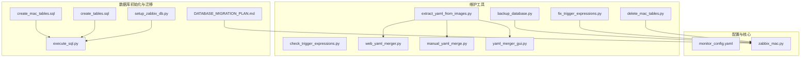
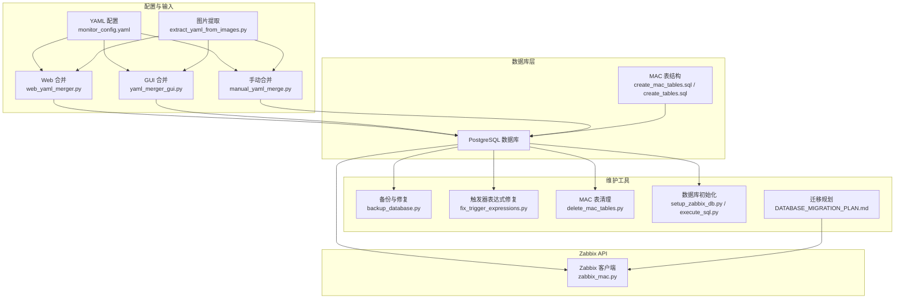
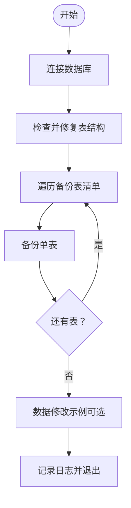
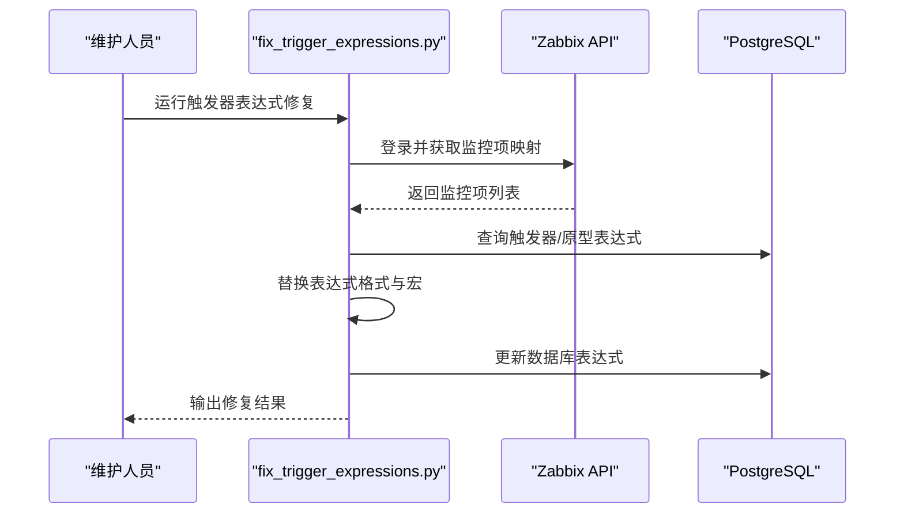
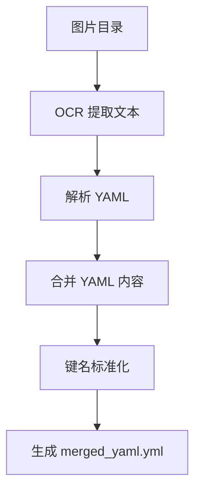
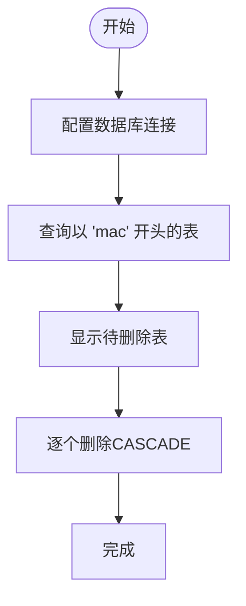
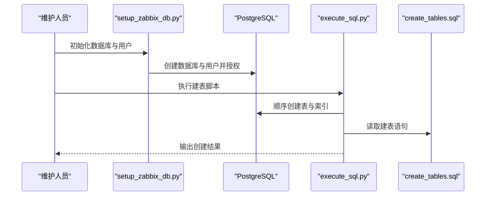
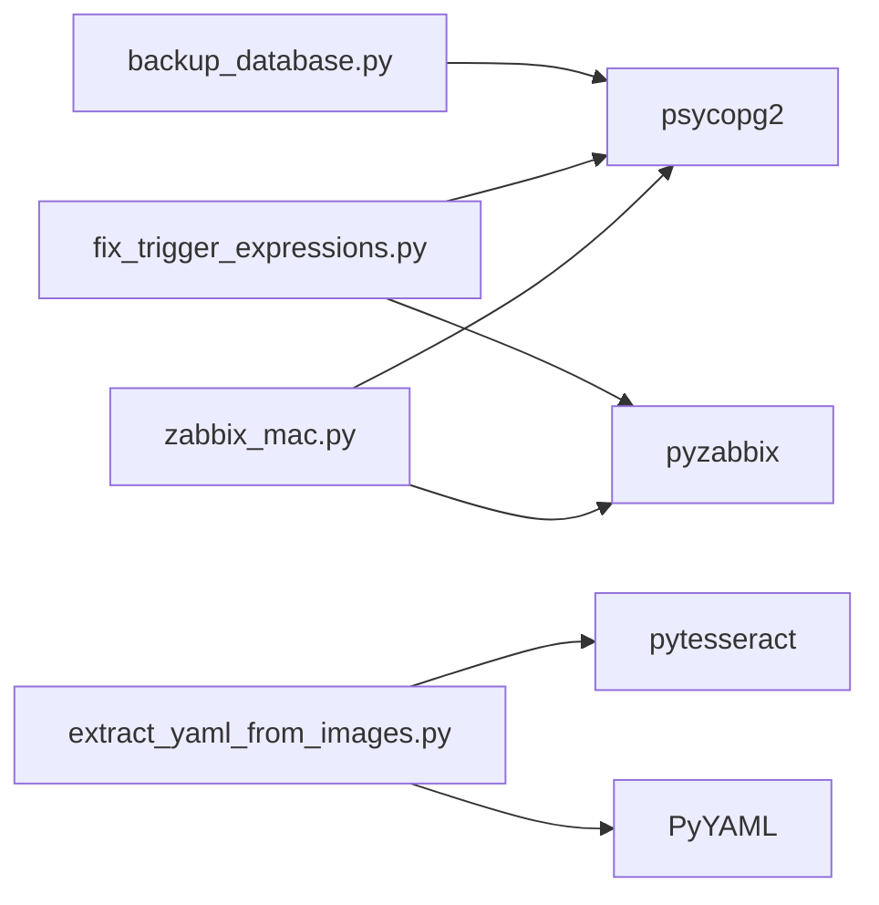

# 系统维护工具

<cite>
**本文档引用的文件**
- [backup_database.py](file://backup_database.py)
- [fix_trigger_expressions.py](file://fix_trigger_expressions.py)
- [check_trigger_expressions.py](file://check_trigger_expressions.py)
- [extract_yaml_from_images.py](file://extract_yaml_from_images.py)
- [web_yaml_merger.py](file://web_yaml_merger.py)
- [manual_yaml_merge.py](file://manual_yaml_merge.py)
- [yaml_merger_gui.py](file://yaml_merger_gui.py)
- [delete_mac_tables.py](file://delete_mac_tables.py)
- [create_mac_tables.sql](file://create_mac_tables.sql)
- [create_tables.sql](file://create_tables.sql)
- [execute_sql.py](file://execute_sql.py)
- [setup_zabbix_db.py](file://setup_zabbix_db.py)
- [DATABASE_MIGRATION_PLAN.md](file://DATABASE_MIGRATION_PLAN.md)
- [monitor_config.yaml](file://monitor_config.yaml)
- [zabbix_mac.py](file://zabbix_mac.py)
</cite>

## 目录
1. [简介](#简介)
2. [项目结构](#项目结构)
3. [核心组件](#核心组件)
4. [架构总览](#架构总览)
5. [详细组件分析](#详细组件分析)
6. [依赖分析](#依赖分析)
7. [性能考虑](#性能考虑)
8. [故障排除指南](#故障排除指南)
9. [结论](#结论)
10. [附录](#附录)

## 简介
本文件面向系统维护人员，系统性梳理并说明本仓库中与“系统维护”密切相关的工具与脚本，包括：
- 数据库备份与修复工具
- 触发器表达式修复工具
- YAML 提取与合并工具
- MAC 表清理工具
- 数据库初始化与迁移规划

文档将解释各工具的功能、适用场景、执行步骤、配置参数、注意事项，并给出最佳实践、故障恢复与数据保护策略，帮助读者在生产环境中安全、高效地进行系统维护。

## 项目结构
围绕系统维护的相关文件主要分布在以下类别：
- 数据库备份与修复：backup_database.py
- 触发器表达式修复：fix_trigger_expressions.py、check_trigger_expressions.py
- YAML 提取与合并：extract_yaml_from_images.py、web_yaml_merger.py、manual_yaml_merge.py、yaml_merger_gui.py
- MAC 表清理：delete_mac_tables.py
- 数据库初始化与迁移：create_mac_tables.sql、create_tables.sql、execute_sql.py、setup_zabbix_db.py、DATABASE_MIGRATION_PLAN.md
- 配置样例：monitor_config.yaml
- 核心同步与客户端：zabbix_mac.py

**图表来源**
- [backup_database.py:1-214](file://backup_database.py#L1-L214)
- [fix_trigger_expressions.py:1-174](file://fix_trigger_expressions.py#L1-L174)
- [check_trigger_expressions.py:1-48](file://check_trigger_expressions.py#L1-L48)
- [extract_yaml_from_images.py:1-217](file://extract_yaml_from_images.py#L1-L217)
- [web_yaml_merger.py:1-513](file://web_yaml_merger.py#L1-L513)
- [manual_yaml_merge.py:1-108](file://manual_yaml_merge.py#L1-L108)
- [yaml_merger_gui.py:1-172](file://yaml_merger_gui.py#L1-L172)
- [delete_mac_tables.py:1-53](file://delete_mac_tables.py#L1-L53)
- [create_mac_tables.sql:1-252](file://create_mac_tables.sql#L1-L252)
- [create_tables.sql:1-198](file://create_tables.sql#L1-L198)
- [execute_sql.py:1-170](file://execute_sql.py#L1-L170)
- [setup_zabbix_db.py:1-85](file://setup_zabbix_db.py#L1-L85)
- [DATABASE_MIGRATION_PLAN.md:1-210](file://DATABASE_MIGRATION_PLAN.md#L1-L210)
- [monitor_config.yaml:1-20](file://monitor_config.yaml#L1-L20)
- [zabbix_mac.py:1-800](file://zabbix_mac.py#L1-L800)

**章节来源**
- [backup_database.py:1-214](file://backup_database.py#L1-L214)
- [fix_trigger_expressions.py:1-174](file://fix_trigger_expressions.py#L1-L174)
- [extract_yaml_from_images.py:1-217](file://extract_yaml_from_images.py#L1-L217)
- [web_yaml_merger.py:1-513](file://web_yaml_merger.py#L1-L513)
- [manual_yaml_merge.py:1-108](file://manual_yaml_merge.py#L1-L108)
- [yaml_merger_gui.py:1-172](file://yaml_merger_gui.py#L1-L172)
- [delete_mac_tables.py:1-53](file://delete_mac_tables.py#L1-L53)
- [create_mac_tables.sql:1-252](file://create_mac_tables.sql#L1-L252)
- [create_tables.sql:1-198](file://create_tables.sql#L1-L198)
- [execute_sql.py:1-170](file://execute_sql.py#L1-L170)
- [setup_zabbix_db.py:1-85](file://setup_zabbix_db.py#L1-L85)
- [DATABASE_MIGRATION_PLAN.md:1-210](file://DATABASE_MIGRATION_PLAN.md#L1-L210)
- [monitor_config.yaml:1-20](file://monitor_config.yaml#L1-L20)
- [zabbix_mac.py:1-800](file://zabbix_mac.py#L1-L800)

## 核心组件
- 数据库备份与修复工具：负责备份指定表、修复表结构、修改数据示例、日志记录与异常处理。
- 触发器表达式修复工具：从 Zabbix API 获取监控项映射，修复数据库中触发器与触发器原型的表达式格式。
- YAML 提取与合并工具：支持从图片提取 YAML、Web 界面合并、命令行 GUI 合并、手动合并。
- MAC 表清理工具：查找并删除以特定前缀开头的表，用于环境清理。
- 数据库初始化与迁移：提供建表脚本、SQL 执行脚本、数据库初始化脚本与迁移规划文档。
- 配置与核心：monitor_config.yaml 提供主机配置示例；zabbix_mac.py 提供 Zabbix API 客户端与指纹比较逻辑。

**章节来源**
- [backup_database.py:1-214](file://backup_database.py#L1-L214)
- [fix_trigger_expressions.py:1-174](file://fix_trigger_expressions.py#L1-L174)
- [extract_yaml_from_images.py:1-217](file://extract_yaml_from_images.py#L1-L217)
- [web_yaml_merger.py:1-513](file://web_yaml_merger.py#L1-L513)
- [manual_yaml_merge.py:1-108](file://manual_yaml_merge.py#L1-L108)
- [yaml_merger_gui.py:1-172](file://yaml_merger_gui.py#L1-L172)
- [delete_mac_tables.py:1-53](file://delete_mac_tables.py#L1-L53)
- [create_mac_tables.sql:1-252](file://create_mac_tables.sql#L1-L252)
- [create_tables.sql:1-198](file://create_tables.sql#L1-L198)
- [execute_sql.py:1-170](file://execute_sql.py#L1-L170)
- [setup_zabbix_db.py:1-85](file://setup_zabbix_db.py#L1-L85)
- [DATABASE_MIGRATION_PLAN.md:1-210](file://DATABASE_MIGRATION_PLAN.md#L1-L210)
- [monitor_config.yaml:1-20](file://monitor_config.yaml#L1-L20)
- [zabbix_mac.py:1-800](file://zabbix_mac.py#L1-L800)

## 架构总览
系统维护工具围绕“数据库—配置—Zabbix API”的交互展开，形成如下维护闭环：
- 数据库层：提供模板、监控项、触发器、自动发现规则及其原型的数据存储。
- 配置层：YAML 配置文件与 Web/GUI 合并工具，支撑从图片提取与人工输入的 YAML 内容整合。
- API 层：Zabbix API 客户端负责与 Zabbix 服务交互，执行创建、更新、删除等操作。
- 维护工具层：备份、修复、清理、初始化与迁移脚本保障系统稳定与可演进。

**图表来源**
- [monitor_config.yaml:1-20](file://monitor_config.yaml#L1-L20)
- [extract_yaml_from_images.py:1-217](file://extract_yaml_from_images.py#L1-L217)
- [web_yaml_merger.py:1-513](file://web_yaml_merger.py#L1-L513)
- [yaml_merger_gui.py:1-172](file://yaml_merger_gui.py#L1-L172)
- [manual_yaml_merge.py:1-108](file://manual_yaml_merge.py#L1-L108)
- [create_mac_tables.sql:1-252](file://create_mac_tables.sql#L1-L252)
- [create_tables.sql:1-198](file://create_tables.sql#L1-L198)
- [backup_database.py:1-214](file://backup_database.py#L1-L214)
- [fix_trigger_expressions.py:1-174](file://fix_trigger_expressions.py#L1-L174)
- [delete_mac_tables.py:1-53](file://delete_mac_tables.py#L1-L53)
- [setup_zabbix_db.py:1-85](file://setup_zabbix_db.py#L1-L85)
- [execute_sql.py:1-170](file://execute_sql.py#L1-L170)
- [DATABASE_MIGRATION_PLAN.md:1-210](file://DATABASE_MIGRATION_PLAN.md#L1-L210)
- [zabbix_mac.py:1-800](file://zabbix_mac.py#L1-L800)

## 详细组件分析

### 数据库备份与修复工具（backup_database.py）
- 功能概述
  - 连接 PostgreSQL 数据库，备份指定表集合。
  - 检查并修复表结构（如视图存在性、字段类型），必要时重建视图。
  - 提供数据修改示例（演示性），并统一记录日志与异常处理。
- 适用场景
  - 系统升级前的全量备份。
  - 发现表结构异常（如历史字段类型不一致）时的修复。
  - 需要临时修改数据进行验证时的演示性操作。
- 执行步骤
  - 确认数据库连接参数正确。
  - 运行脚本，自动备份指定表并输出备份文件路径。
  - 如需修复，脚本会自动检查并修复表结构。
  - 如需修改数据，可在相应函数中添加业务逻辑。
- 配置参数
  - 数据库连接参数：主机、端口、数据库名、用户名、密码。
  - 备份表清单：可按需调整。
  - 时间戳命名：备份文件名包含时间戳，避免覆盖。
- 注意事项
  - 备份文件保存在本地目录，建议定期归档与校验。
  - 修复过程涉及 DDL 操作，应在维护窗口执行。
  - 修改数据操作为演示性，生产环境应谨慎使用。

**图表来源**
- [backup_database.py:54-214](file://backup_database.py#L54-L214)

**章节来源**
- [backup_database.py:1-214](file://backup_database.py#L1-L214)

### 触发器表达式修复工具（fix_trigger_expressions.py）
- 功能概述
  - 从 Zabbix API 获取监控项映射，修复数据库中触发器与触发器原型的表达式格式。
  - 支持针对特定触发器名称的硬编码修复与通用宏替换。
- 适用场景
  - 触发器表达式格式不规范导致告警异常。
  - 从旧版本或外部导入的模板表达式需要统一格式。
- 执行步骤
  - 确认 Zabbix API 与数据库连接参数正确。
  - 运行脚本修复触发器表达式。
  - 运行脚本修复触发器原型表达式。
- 配置参数
  - Zabbix API 地址、用户名、密码。
  - 数据库连接参数。
  - 主机名（用于原型修复）。
- 注意事项
  - 修复前建议备份相关表。
  - 宏替换为通用策略，需结合实际模板验证表达式正确性。

**图表来源**
- [fix_trigger_expressions.py:34-174](file://fix_trigger_expressions.py#L34-L174)

**章节来源**
- [fix_trigger_expressions.py:1-174](file://fix_trigger_expressions.py#L1-L174)
- [check_trigger_expressions.py:1-48](file://check_trigger_expressions.py#L1-L48)

### YAML 提取与合并工具
- 提取工具（extract_yaml_from_images.py）
  - 从图片目录读取图片，使用 OCR 提取文本并解析 YAML。
  - 若无法自动提取，支持手动输入并解析。
  - 合并多个 YAML 内容，标准化键名并生成最终文件。
- Web 合并（web_yaml_merger.py）
  - 提供 Web 界面，支持浏览图片、粘贴 YAML、合并与下载。
- GUI 合并（yaml_merger_gui.py）
  - 命令行交互式合并，逐张图片输入 YAML 并合并。
- 手动合并（manual_yaml_merge.py）
  - 提供示例 YAML 内容，用户可直接编辑并生成合并结果。

**图表来源**
- [extract_yaml_from_images.py:26-217](file://extract_yaml_from_images.py#L26-L217)
- [web_yaml_merger.py:69-513](file://web_yaml_merger.py#L69-L513)
- [yaml_merger_gui.py:79-172](file://yaml_merger_gui.py#L79-L172)
- [manual_yaml_merge.py:50-108](file://manual_yaml_merge.py#L50-L108)

**章节来源**
- [extract_yaml_from_images.py:1-217](file://extract_yaml_from_images.py#L1-L217)
- [web_yaml_merger.py:1-513](file://web_yaml_merger.py#L1-L513)
- [manual_yaml_merge.py:1-108](file://manual_yaml_merge.py#L1-L108)
- [yaml_merger_gui.py:1-172](file://yaml_merger_gui.py#L1-L172)

### MAC 表清理工具（delete_mac_tables.py）
- 功能概述
  - 连接数据库，查找并删除以特定前缀（如 mac）开头的表（含级联删除）。
- 适用场景
  - 清理测试环境残留表。
  - 重新初始化 MAC 相关表结构。
- 执行步骤
  - 配置数据库连接参数。
  - 运行脚本查看将被删除的表并确认。
  - 执行删除操作。
- 注意事项
  - 删除操作不可逆，建议先备份或在非生产环境执行。

**图表来源**
- [delete_mac_tables.py:15-53](file://delete_mac_tables.py#L15-L53)

**章节来源**
- [delete_mac_tables.py:1-53](file://delete_mac_tables.py#L1-L53)

### 数据库初始化与迁移
- 建表脚本（create_mac_tables.sql / create_tables.sql）
  - 定义模板、监控项、触发器、自动发现规则、原型、主机等表结构与索引。
- SQL 执行脚本（execute_sql.py）
  - 顺序创建表与索引，验证表创建结果。
- 数据库初始化（setup_zabbix_db.py）
  - 创建数据库与用户，授予权限，便于后续部署。
- 迁移规划（DATABASE_MIGRATION_PLAN.md）
  - 从 YAML 切换到数据库配置的完整规划，包括新增主机相关表、代码修改与验证流程。

**图表来源**
- [setup_zabbix_db.py:7-85](file://setup_zabbix_db.py#L7-L85)
- [execute_sql.py:6-170](file://execute_sql.py#L6-L170)
- [create_tables.sql:1-198](file://create_tables.sql#L1-L198)
- [create_mac_tables.sql:1-252](file://create_mac_tables.sql#L1-L252)

**章节来源**
- [create_mac_tables.sql:1-252](file://create_mac_tables.sql#L1-L252)
- [create_tables.sql:1-198](file://create_tables.sql#L1-L198)
- [execute_sql.py:1-170](file://execute_sql.py#L1-L170)
- [setup_zabbix_db.py:1-85](file://setup_zabbix_db.py#L1-L85)
- [DATABASE_MIGRATION_PLAN.md:1-210](file://DATABASE_MIGRATION_PLAN.md#L1-L210)

## 依赖分析
- 组件耦合
  - backup_database.py 与 zabbix_mac.py 在日志与数据库交互方面存在间接耦合（均使用 PostgreSQL 连接）。
  - fix_trigger_expressions.py 依赖 Zabbix API 与 PostgreSQL，与 zabbix_mac.py 的客户端能力互补。
  - YAML 合并工具与 monitor_config.yaml 配置文件共同构成配置输入链路。
- 外部依赖
  - PostgreSQL 驱动（psycopg2）。
  - Zabbix API 客户端（pyzabbix）。
  - 图像识别与 YAML 解析库（Pillow、pytesseract、PyYAML）。
- 循环依赖
  - 未发现直接循环依赖，维护工具之间通过配置与数据库解耦。

**图表来源**
- [backup_database.py:12-40](file://backup_database.py#L12-L40)
- [fix_trigger_expressions.py:8-29](file://fix_trigger_expressions.py#L8-L29)
- [extract_yaml_from_images.py:7-11](file://extract_yaml_from_images.py#L7-L11)
- [zabbix_mac.py:19-22](file://zabbix_mac.py#L19-L22)

**章节来源**
- [backup_database.py:1-214](file://backup_database.py#L1-L214)
- [fix_trigger_expressions.py:1-174](file://fix_trigger_expressions.py#L1-L174)
- [extract_yaml_from_images.py:1-217](file://extract_yaml_from_images.py#L1-L217)
- [zabbix_mac.py:1-800](file://zabbix_mac.py#L1-L800)

## 性能考虑
- 备份与修复
  - 备份为全表导出，建议在低峰期执行，避免影响在线业务。
  - 修复涉及 DDL 与视图重建，建议评估锁粒度与并发影响。
- 触发器修复
  - 一次性扫描与更新大量表达式，建议分批处理或在维护窗口执行。
- YAML 合并
  - 图片 OCR 与 YAML 解析为 CPU 密集型，建议在专用资源上执行。
- 数据库初始化
  - 顺序建表与索引创建耗时较长，建议批量提交与合理分区。

[本节为通用指导，无需具体文件分析]

## 故障排除指南
- 数据库连接失败
  - 检查连接参数（主机、端口、数据库、用户、密码）。
  - 确认数据库服务状态与网络连通性。
- 权限不足
  - 使用具备足够权限的账户执行初始化与建表脚本。
  - 确认数据库用户已获得相应权限。
- 触发器修复失败
  - 检查 Zabbix API 可达性与认证信息。
  - 核对表达式替换规则与模板宏是否匹配。
- YAML 提取失败
  - 确认图片格式与 OCR 语言包安装。
  - 若自动提取失败，使用手动输入模式补充 YAML。
- 表清理误删
  - 删除前务必核对将被删除的表清单，必要时先备份。
- 日志定位
  - 所有脚本均输出详细日志，建议结合日志排查问题。

**章节来源**
- [backup_database.py:54-214](file://backup_database.py#L54-L214)
- [fix_trigger_expressions.py:61-174](file://fix_trigger_expressions.py#L61-L174)
- [extract_yaml_from_images.py:26-119](file://extract_yaml_from_images.py#L26-L119)
- [delete_mac_tables.py:15-53](file://delete_mac_tables.py#L15-L53)

## 结论
本仓库提供了完善的系统维护工具链：从数据库备份与修复、触发器表达式修复，到 YAML 提取与合并、MAC 表清理与数据库初始化，再到迁移规划与核心同步客户端，形成了覆盖“准备—执行—验证—恢复”的闭环。遵循本文档的最佳实践与注意事项，可在保证数据安全的前提下高效完成系统维护任务。

[本节为总结，无需具体文件分析]

## 附录
- 最佳实践
  - 维护窗口执行高风险操作（DDL、大范围更新）。
  - 执行前备份数据库与关键配置。
  - 分批处理大规模变更，降低对在线业务的影响。
  - 使用 dry-run 或测试环境先行验证。
- 故障恢复
  - 通过备份文件恢复数据库至最近一次健康状态。
  - 使用迁移规划文档回滚到 YAML 配置模式。
  - 通过日志定位问题根因并采取针对性措施。
- 数据保护策略
  - 定期归档备份文件，验证恢复流程。
  - 控制数据库访问权限，最小化暴露面。
  - 对关键脚本执行前后进行快照，便于回滚。

[本节为通用指导，无需具体文件分析]