# 配置验证工具

<cite>
**本文引用的文件**
- [check_api_params.py](file://check_api_params.py)
- [check_host.py](file://check_host.py)
- [check_prototypes.py](file://check_prototypes.py)
- [check_trigger_expressions.py](file://check_trigger_expressions.py)
- [check_item_prototypes_delay.py](file://check_item_prototypes_delay.py)
- [check_trigger_prototypes.py](file://check_trigger_prototypes.py)
- [check_zabbix_prototypes.py](file://check_zabbix_prototypes.py)
- [fix_trigger_expressions.py](file://fix_trigger_expressions.py)
- [monitor_config.yaml](file://monitor_config.yaml)
- [create_mac_tables.sql](file://create_mac_tables.sql)
- [create_tables.sql](file://create_tables.sql)
- [test_prototypes.py](file://test_prototypes.py)
- [test_trigger_prototypes.py](file://test_trigger_prototypes.py)
- [app.py](file://app.py)
</cite>

## 目录
1. [简介](#简介)
2. [项目结构](#项目结构)
3. [核心组件](#核心组件)
4. [架构总览](#架构总览)
5. [详细组件分析](#详细组件分析)
6. [依赖分析](#依赖分析)
7. [性能考虑](#性能考虑)
8. [故障排查指南](#故障排查指南)
9. [结论](#结论)
10. [附录](#附录)

## 简介
本文件系统性梳理并解释配置验证工具集，覆盖以下关键能力：
- API 参数验证：校验 Zabbix API 方法参数，确保调用接口的参数结构正确。
- 主机配置检查：确认目标主机在 Zabbix 中是否存在，避免误配或遗漏。
- 原型配置验证：检查自动发现规则、监控项原型与触发器原型的数据完整性与一致性。
- 触发器表达式检查：读取并展示触发器与触发器原型的表达式，便于人工复核。
- 监控项延迟检查：核对监控项原型的采样间隔字段，保障采集节奏合理。
- 表结构与配置：提供数据库表结构定义与 YAML 配置示例，支撑配置即代码（Monitor as Code）实践。

这些工具在监控系统中承担“质量门禁”的角色，通过自动化检查与修复，显著提升配置质量与系统稳定性。

## 项目结构
该仓库围绕“配置验证与修复”主题组织，主要文件如下：
- 验证脚本：check_api_params.py、check_host.py、check_prototypes.py、check_trigger_expressions.py、check_item_prototypes_delay.py、check_trigger_prototypes.py、check_zabbix_prototypes.py
- 修复脚本：fix_trigger_expressions.py
- 数据库建表与示例数据：create_tables.sql、create_mac_tables.sql
- 配置示例：monitor_config.yaml
- 测试与演示：test_prototypes.py、test_trigger_prototypes.py
- Web 管理入口（可选）：app.py

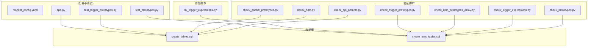

**图示来源**
- [check_api_params.py](file://check_api_params.py)
- [check_host.py](file://check_host.py)
- [check_prototypes.py](file://check_prototypes.py)
- [check_trigger_expressions.py](file://check_trigger_expressions.py)
- [check_item_prototypes_delay.py](file://check_item_prototypes_delay.py)
- [check_trigger_prototypes.py](file://check_trigger_prototypes.py)
- [check_zabbix_prototypes.py](file://check_zabbix_prototypes.py)
- [fix_trigger_expressions.py](file://fix_trigger_expressions.py)
- [create_tables.sql](file://create_tables.sql)
- [create_mac_tables.sql](file://create_mac_tables.sql)
- [test_prototypes.py](file://test_prototypes.py)
- [test_trigger_prototypes.py](file://test_trigger_prototypes.py)
- [app.py](file://app.py)

**章节来源**
- [check_api_params.py](file://check_api_params.py)
- [check_host.py](file://check_host.py)
- [check_prototypes.py](file://check_prototypes.py)
- [check_trigger_expressions.py](file://check_trigger_expressions.py)
- [check_item_prototypes_delay.py](file://check_item_prototypes_delay.py)
- [check_trigger_prototypes.py](file://check_trigger_prototypes.py)
- [check_zabbix_prototypes.py](file://check_zabbix_prototypes.py)
- [fix_trigger_expressions.py](file://fix_trigger_expressions.py)
- [monitor_config.yaml](file://monitor_config.yaml)
- [create_tables.sql](file://create_tables.sql)
- [create_mac_tables.sql](file://create_mac_tables.sql)
- [test_prototypes.py](file://test_prototypes.py)
- [test_trigger_prototypes.py](file://test_trigger_prototypes.py)
- [app.py](file://app.py)

## 核心组件
- API 参数验证工具：通过 Zabbix API 查询方法参数，辅助开发与集成时的参数校验。
- 主机存在性检查工具：快速确认目标主机是否存在于 Zabbix 中。
- 原型配置检查工具：从数据库读取自动发现规则、监控项原型与触发器原型，进行完整性与一致性检查。
- 触发器表达式检查工具：读取触发器与触发器原型的表达式，便于人工复核与审计。
- 监控项延迟检查工具：核对监控项原型的 delay 字段，确保采集周期合理。
- 触发器表达式修复工具：将旧格式表达式修复为新格式，减少告警误报与不可解析问题。
- 表结构与示例数据：提供标准表结构与示例数据，支撑配置即代码实践。
- 配置示例：YAML 配置示例，指导主机与额外监控项的配置。

**章节来源**
- [check_api_params.py](file://check_api_params.py)
- [check_host.py](file://check_host.py)
- [check_prototypes.py](file://check_prototypes.py)
- [check_trigger_expressions.py](file://check_trigger_expressions.py)
- [check_item_prototypes_delay.py](file://check_item_prototypes_delay.py)
- [check_trigger_prototypes.py](file://check_trigger_prototypes.py)
- [check_zabbix_prototypes.py](file://check_zabbix_prototypes.py)
- [fix_trigger_expressions.py](file://fix_trigger_expressions.py)
- [monitor_config.yaml](file://monitor_config.yaml)
- [create_tables.sql](file://create_tables.sql)
- [create_mac_tables.sql](file://create_mac_tables.sql)

## 架构总览
整体架构由“验证/修复脚本 + 数据库 + Zabbix API + 配置文件”构成，验证与修复流程如下：

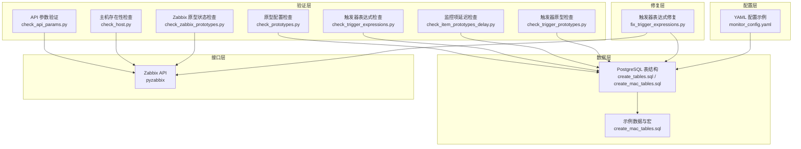

**图示来源**
- [check_api_params.py](file://check_api_params.py)
- [check_host.py](file://check_host.py)
- [check_prototypes.py](file://check_prototypes.py)
- [check_trigger_expressions.py](file://check_trigger_expressions.py)
- [check_item_prototypes_delay.py](file://check_item_prototypes_delay.py)
- [check_trigger_prototypes.py](file://check_trigger_prototypes.py)
- [check_zabbix_prototypes.py](file://check_zabbix_prototypes.py)
- [fix_trigger_expressions.py](file://fix_trigger_expressions.py)
- [create_tables.sql](file://create_tables.sql)
- [create_mac_tables.sql](file://create_mac_tables.sql)
- [monitor_config.yaml](file://monitor_config.yaml)

## 详细组件分析

### API 参数验证工具
- 功能概述：连接 Zabbix API，查询指定方法（如触发器原型创建）的参数定义，辅助开发者在集成阶段核对参数结构。
- 检查逻辑：
  - 建立与 Zabbix API 的连接并登录。
  - 使用 API 查询方法参数信息。
  - 输出参数定义，便于比对。
- 错误检测机制：捕获连接与查询异常，打印错误信息。
- 修复建议：若参数缺失或类型不符，依据返回的参数定义修正调用侧参数。
- 使用示例与执行流程：
  - 设置 Zabbix API 地址、用户名与密码。
  - 运行脚本，查看输出的方法参数定义。
- 输出结果解读：输出包含方法名与参数定义，用于对照调用方参数。

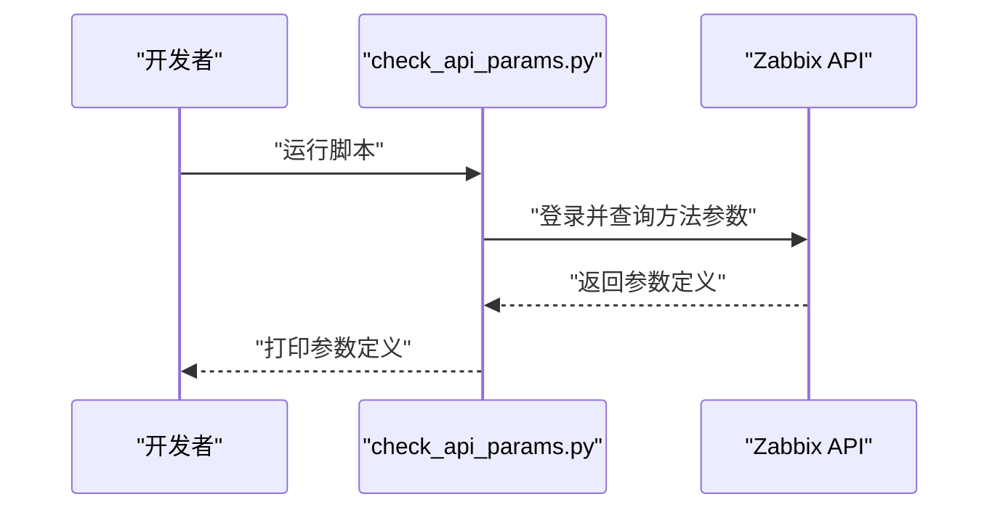

**图示来源**
- [check_api_params.py](file://check_api_params.py)

**章节来源**
- [check_api_params.py](file://check_api_params.py)

### 主机配置检查工具
- 功能概述：检查 Zabbix 中是否存在指定主机，避免因主机缺失导致的监控失效。
- 检查逻辑：
  - 连接 Zabbix API 并登录。
  - 使用过滤条件查询主机是否存在。
  - 输出主机存在性与 ID。
- 错误检测机制：捕获连接异常与查询异常。
- 修复建议：若主机不存在，需在 Zabbix 中创建主机或修正主机名。
- 使用示例与执行流程：
  - 配置 Zabbix API 地址、用户名与密码。
  - 运行脚本，查看主机存在性报告。
- 输出结果解读：输出主机名与 ID，或提示不存在。

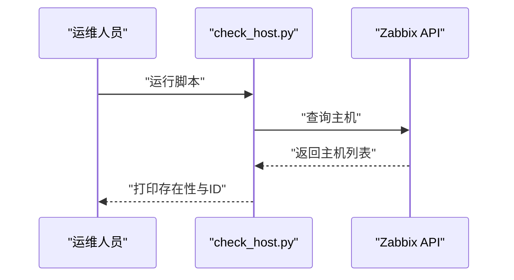

**图示来源**
- [check_host.py](file://check_host.py)

**章节来源**
- [check_host.py](file://check_host.py)

### 原型配置验证工具
- 功能概述：从数据库读取自动发现规则、监控项原型与触发器原型，进行完整性与一致性检查。
- 检查逻辑：
  - 连接数据库。
  - 分别查询三类表，输出记录数量与关键字段。
- 错误检测机制：捕获数据库连接与查询异常。
- 修复建议：若记录为空或不一致，检查上游导入流程或数据源。
- 使用示例与执行流程：
  - 配置数据库连接参数。
  - 运行脚本，查看各类原型的统计与明细。
- 输出结果解读：输出每类原型的数量与关键字段，便于核对。

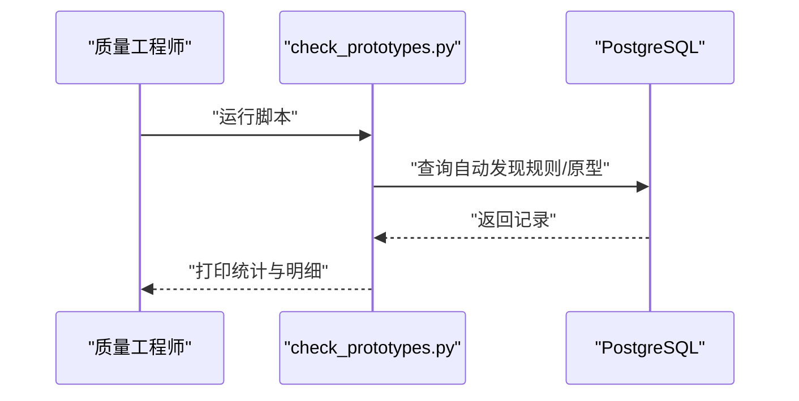

**图示来源**
- [check_prototypes.py](file://check_prototypes.py)

**章节来源**
- [check_prototypes.py](file://check_prototypes.py)
- [create_mac_tables.sql](file://create_mac_tables.sql)

### 触发器表达式检查工具
- 功能概述：读取触发器与触发器原型的表达式，便于人工复核与审计。
- 检查逻辑：
  - 连接数据库。
  - 查询触发器与触发器原型的表达式并输出。
- 错误检测机制：捕获数据库异常并打印堆栈。
- 修复建议：若表达式格式不规范，结合修复工具进行批量修复。
- 使用示例与执行流程：
  - 配置数据库连接参数。
  - 运行脚本，查看表达式列表。
- 输出结果解读：输出表达式文本，便于人工复核。

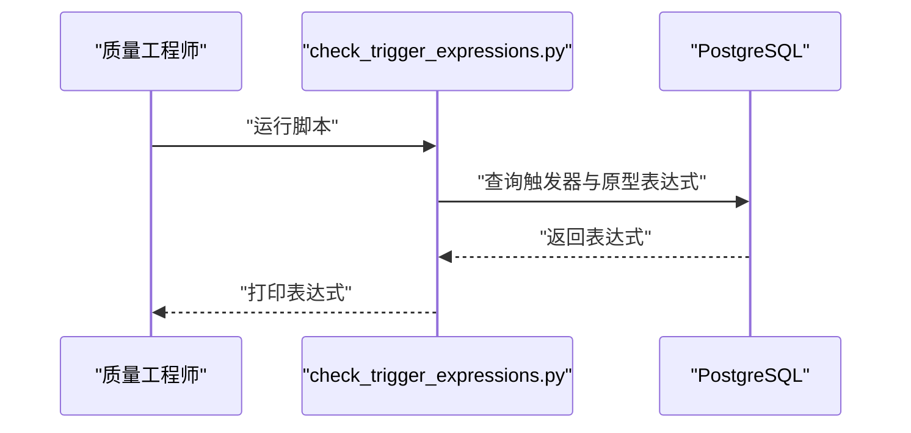

**图示来源**
- [check_trigger_expressions.py](file://check_trigger_expressions.py)

**章节来源**
- [check_trigger_expressions.py](file://check_trigger_expressions.py)
- [create_mac_tables.sql](file://create_mac_tables.sql)

### 监控项延迟检查工具
- 功能概述：核对监控项原型的 delay 字段，保障采集节奏合理。
- 检查逻辑：
  - 连接数据库。
  - 查询监控项原型的 delay 字段并输出。
- 错误检测机制：捕获数据库异常。
- 修复建议：若 delay 格式不规范或不合理，统一调整为标准格式。
- 使用示例与执行流程：
  - 配置数据库连接参数。
  - 运行脚本，查看 delay 列表。
- 输出结果解读：输出监控项原型的 delay 值，便于核对。

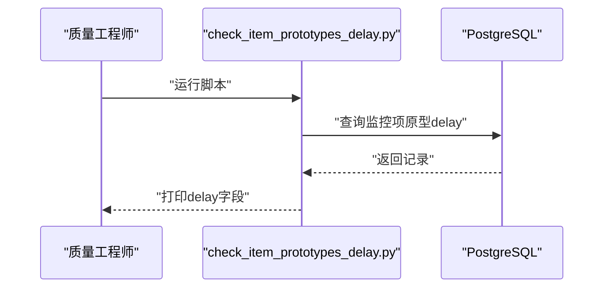

**图示来源**
- [check_item_prototypes_delay.py](file://check_item_prototypes_delay.py)

**章节来源**
- [check_item_prototypes_delay.py](file://check_item_prototypes_delay.py)
- [create_mac_tables.sql](file://create_mac_tables.sql)

### 触发器原型检查工具
- 功能概述：检查触发器原型的描述与表达式，辅助核对模板一致性。
- 检查逻辑：
  - 连接数据库。
  - 查询触发器原型的描述与表达式。
- 错误检测机制：捕获数据库异常。
- 修复建议：若表达式不完整或不规范，结合修复工具进行修复。
- 使用示例与执行流程：
  - 配置数据库连接参数。
  - 运行脚本，查看原型列表。
- 输出结果解读：输出描述与表达式，便于核对。

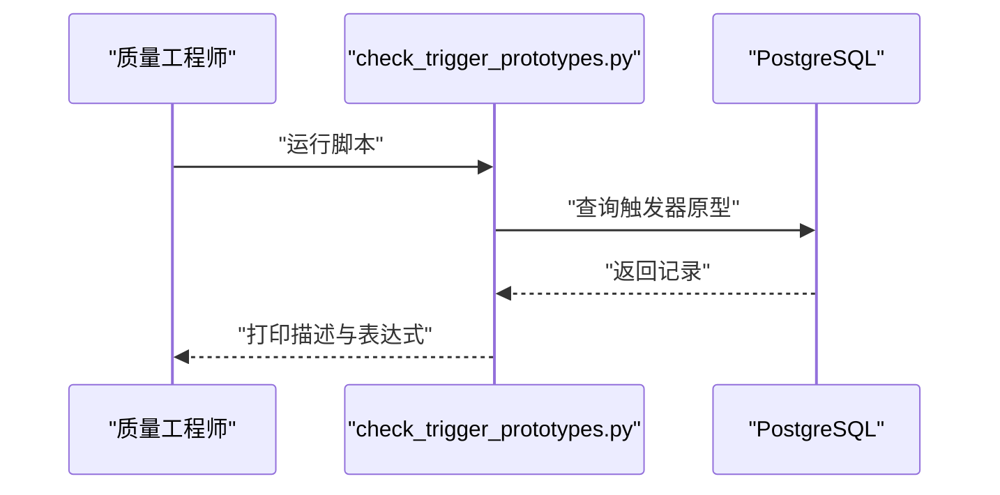

**图示来源**
- [check_trigger_prototypes.py](file://check_trigger_prototypes.py)

**章节来源**
- [check_trigger_prototypes.py](file://check_trigger_prototypes.py)
- [create_mac_tables.sql](file://create_mac_tables.sql)

### Zabbix 原型状态检查工具
- 功能概述：通过 Zabbix API 获取主机下的自动发现规则、监控项原型与触发器原型，核对实际状态。
- 检查逻辑：
  - 连接 Zabbix API。
  - 获取主机 ID。
  - 获取自动发现规则，并遍历规则获取其下的原型。
- 错误检测机制：捕获 API 调用异常。
- 修复建议：若原型缺失或不一致，检查模板同步与导入流程。
- 使用示例与执行流程：
  - 配置 Zabbix API 地址、用户名与密码。
  - 运行脚本，查看规则与原型列表。
- 输出结果解读：输出规则与原型的名称、键与描述等关键信息。

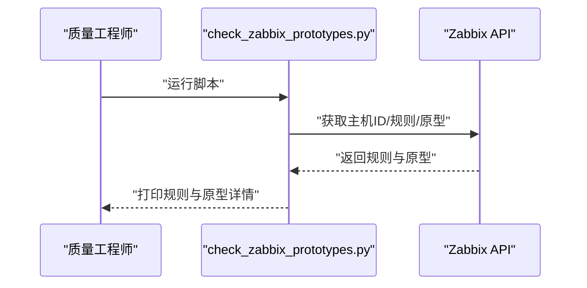

**图示来源**
- [check_zabbix_prototypes.py](file://check_zabbix_prototypes.py)

**章节来源**
- [check_zabbix_prototypes.py](file://check_zabbix_prototypes.py)
- [create_tables.sql](file://create_tables.sql)

### 触发器表达式修复工具
- 功能概述：修复数据库中触发器与触发器原型的表达式格式，统一为新格式，减少告警误报。
- 检查逻辑：
  - 通过 Zabbix API 获取监控项 ID 到键名的映射。
  - 读取触发器与触发器原型的表达式。
  - 对表达式进行格式修复（如替换主机名宏、替换宏变量为具体值）。
  - 写回数据库。
- 错误检测机制：捕获 API 与数据库异常，记录日志。
- 修复建议：优先修复表达式格式，再进行批量更新；修复后建议再次核对表达式检查工具输出。
- 使用示例与执行流程：
  - 配置 Zabbix API 与数据库连接参数。
  - 运行脚本，查看修复日志与结果。
- 输出结果解读：输出修复前后对比与提交状态。

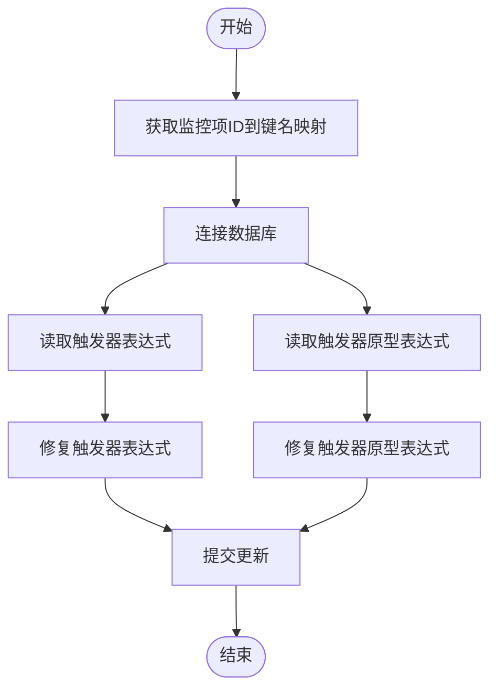

**图示来源**
- [fix_trigger_expressions.py](file://fix_trigger_expressions.py)

**章节来源**
- [fix_trigger_expressions.py](file://fix_trigger_expressions.py)
- [create_mac_tables.sql](file://create_mac_tables.sql)

## 依赖分析
- 组件耦合与内聚：
  - 验证脚本与数据库/API 的耦合度较低，职责单一，内聚性良好。
  - 修复脚本依赖 API 与数据库，耦合度较高，但职责明确。
- 外部依赖：
  - 数据库：PostgreSQL（psycopg2）。
  - 接口：Zabbix API（pyzabbix）。
- 潜在循环依赖：未发现循环依赖。
- 集成点：
  - 修复脚本同时依赖 API 与数据库，是跨层集成的关键点。

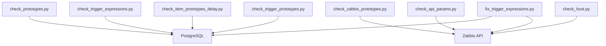

**图示来源**
- [check_prototypes.py](file://check_prototypes.py)
- [check_trigger_expressions.py](file://check_trigger_expressions.py)
- [check_item_prototypes_delay.py](file://check_item_prototypes_delay.py)
- [check_trigger_prototypes.py](file://check_trigger_prototypes.py)
- [check_zabbix_prototypes.py](file://check_zabbix_prototypes.py)
- [check_api_params.py](file://check_api_params.py)
- [check_host.py](file://check_host.py)
- [fix_trigger_expressions.py](file://fix_trigger_expressions.py)

**章节来源**
- [check_prototypes.py](file://check_prototypes.py)
- [check_trigger_expressions.py](file://check_trigger_expressions.py)
- [check_item_prototypes_delay.py](file://check_item_prototypes_delay.py)
- [check_trigger_prototypes.py](file://check_trigger_prototypes.py)
- [check_zabbix_prototypes.py](file://check_zabbix_prototypes.py)
- [check_api_params.py](file://check_api_params.py)
- [check_host.py](file://check_host.py)
- [fix_trigger_expressions.py](file://fix_trigger_expressions.py)

## 性能考虑
- 数据库查询优化：
  - 已创建索引以加速查询（如按模板名、规则ID、主机名等），建议在大规模数据场景下保持索引有效性。
- API 调用优化：
  - 合理设置超时与重试策略，避免长耗时阻塞。
  - 批量处理时注意分页与并发限制。
- 日志与可观测性：
  - 修复脚本使用日志记录关键步骤，便于定位性能瓶颈与异常。

[本节为通用性能建议，无需特定文件分析]

## 故障排查指南
- 数据库连接失败：
  - 检查数据库连接参数（主机、端口、数据库名、用户、密码）。
  - 确认数据库服务可用与网络连通。
- Zabbix API 连接失败：
  - 检查 API 地址、用户名与密码。
  - 确认 Zabbix 服务可用与网络连通。
- 表结构不匹配：
  - 对照 create_tables.sql 或 create_mac_tables.sql，确认表结构与字段是否一致。
- 表达式修复失败：
  - 查看修复脚本日志，确认 API 获取映射是否成功。
  - 检查表达式格式是否符合预期。

**章节来源**
- [fix_trigger_expressions.py](file://fix_trigger_expressions.py)
- [create_tables.sql](file://create_tables.sql)
- [create_mac_tables.sql](file://create_mac_tables.sql)

## 结论
配置验证工具通过“检查 + 修复”的闭环，有效提升了监控配置的质量与稳定性。建议在 CI/CD 流程中引入这些工具，形成自动化门禁，降低配置漂移与误报风险。同时，配合 YAML 配置与数据库表结构，实现“配置即代码”，进一步增强可追溯性与可维护性。

[本节为总结性内容，无需特定文件分析]

## 附录

### 表结构与字段说明
- items/triggers/discovery_rules/item_prototypes/trigger_prototypes/templates 等表结构定义见 create_tables.sql。
- mac_* 前缀表结构与示例数据见 create_mac_tables.sql。

**章节来源**
- [create_tables.sql](file://create_tables.sql)
- [create_mac_tables.sql](file://create_mac_tables.sql)

### YAML 配置示例
- monitor_config.yaml 提供主机与额外监控项的配置示例，指导如何以代码形式管理监控配置。

**章节来源**
- [monitor_config.yaml](file://monitor_config.yaml)

### 测试与演示
- test_prototypes.py：验证自动发现规则与原型数据。
- test_trigger_prototypes.py：演示通过 Zabbix API 创建触发器原型。

**章节来源**
- [test_prototypes.py](file://test_prototypes.py)
- [test_trigger_prototypes.py](file://test_trigger_prototypes.py)

### Web 管理入口（可选）
- app.py：基于 Flask 的 Web 界面，用于管理监控配置数据（当前示例中返回空数据）。

**章节来源**
- [app.py](file://app.py)