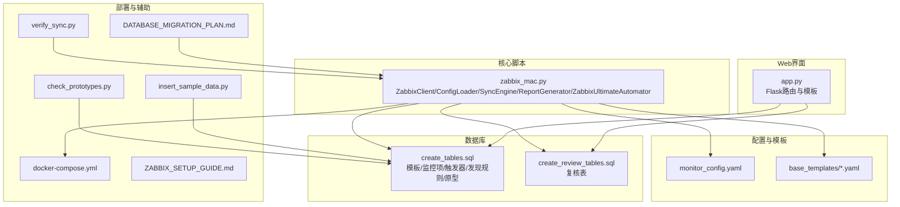
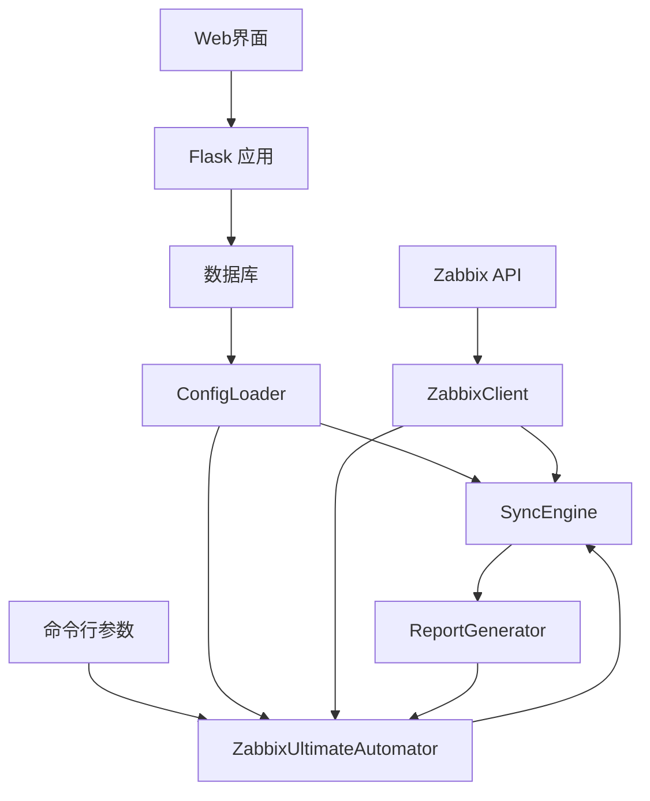
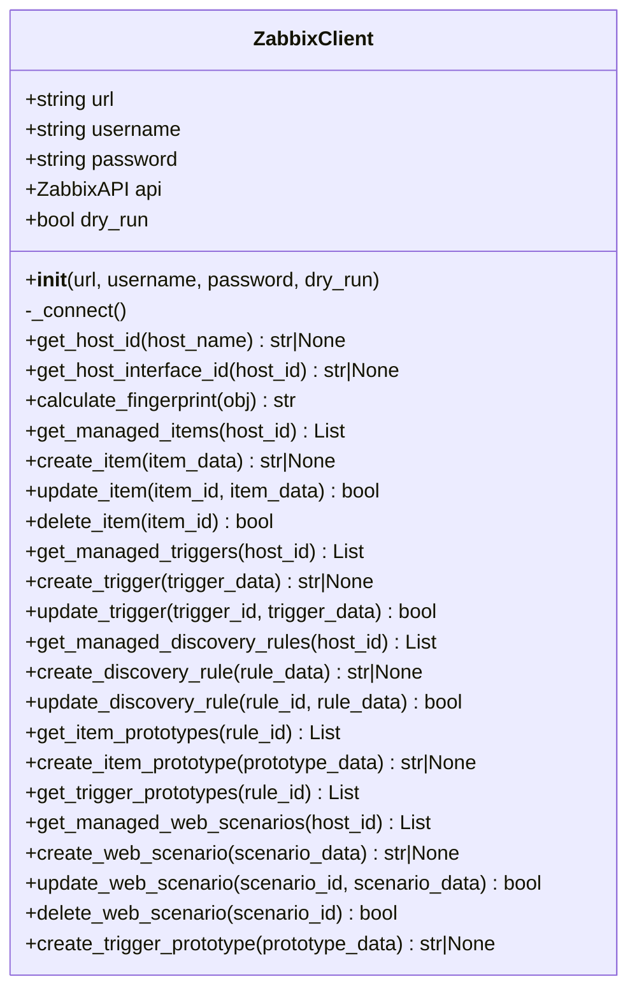
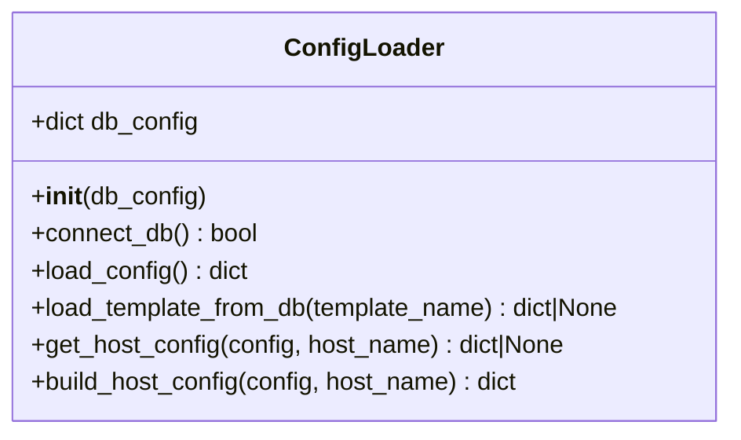
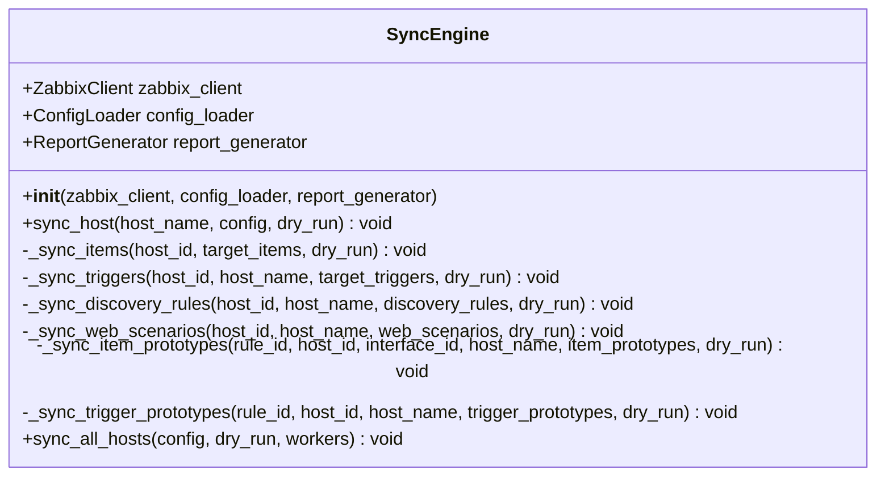
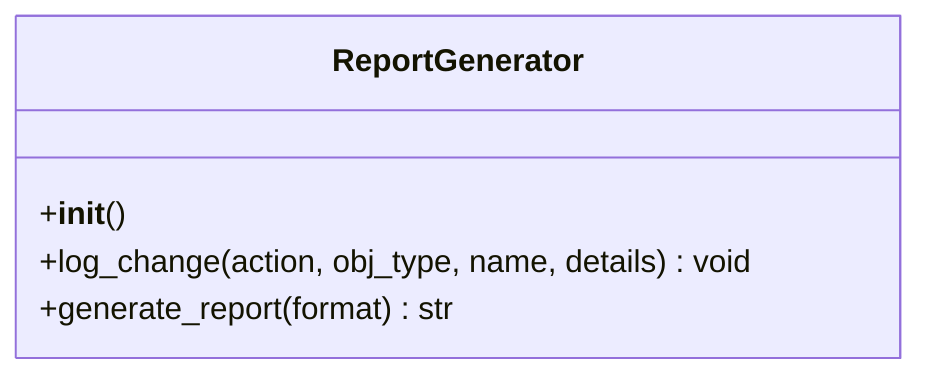
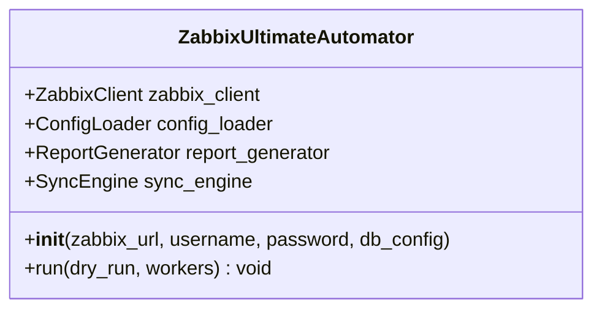
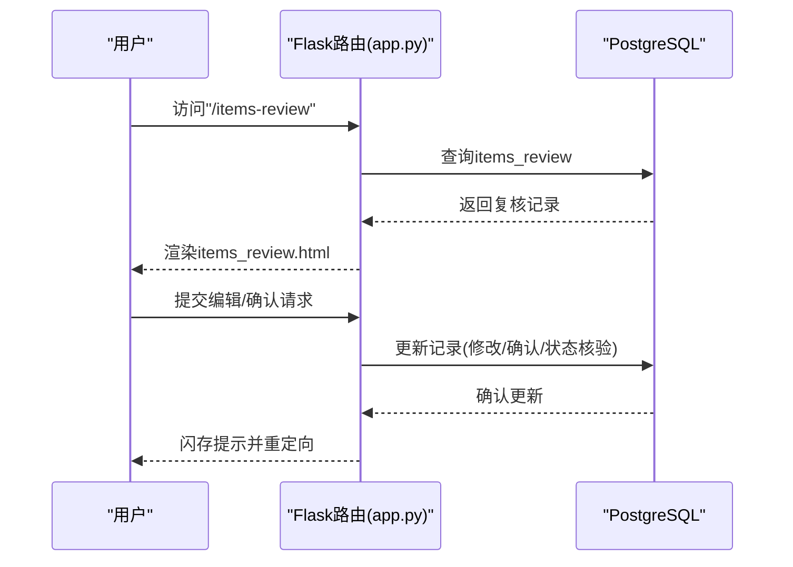
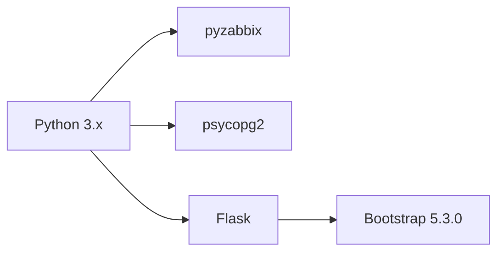
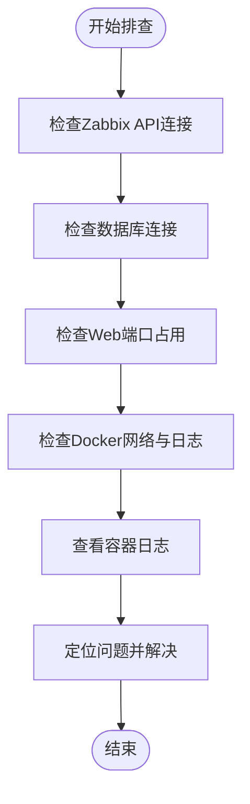

# 开发指南

<cite>
**本文引用的文件**   
- [app.py](file://app.py)
- [CODE_WIKI.md](file://CODE_WIKI.md)
- [ZABBIX_SETUP_GUIDE.md](file://ZABBIX_SETUP_GUIDE.md)
- [docker-compose.yml](file://docker-compose.yml)
- [monitor_config.yaml](file://monitor_config.yaml)
- [zabbix_mac.py](file://zabbix_mac.py)
- [create_tables.sql](file://create_tables.sql)
- [create_review_tables.sql](file://create_review_tables.sql)
- [DATABASE_MIGRATION_PLAN.md](file://DATABASE_MIGRATION_PLAN.md)
- [base_templates/common.yaml](file://base_templates/common.yaml)
- [base_templates/web.yaml](file://base_templates/web.yaml)
- [check_prototypes.py](file://check_prototypes.py)
- [verify_sync.py](file://verify_sync.py)
- [insert_sample_data.py](file://insert_sample_data.py)
- [test.py](file://test.py)
</cite>

## 目录
1. [简介](#简介)
2. [项目结构](#项目结构)
3. [核心组件](#核心组件)
4. [架构总览](#架构总览)
5. [详细组件分析](#详细组件分析)
6. [依赖分析](#依赖分析)
7. [性能考虑](#性能考虑)
8. [故障排除指南](#故障排除指南)
9. [结论](#结论)
10. [附录](#附录)

## 简介
本开发指南面向“Zabbix监控审核和自动化控制中心”项目，旨在帮助开发者快速搭建开发环境、理解代码结构与职责边界、掌握开发与调试流程、贡献代码与扩展功能、进行重构与性能优化、编写测试以及维护文档与发布流程。项目采用Python 3、Flask Web应用、PostgreSQL数据库与Zabbix 5.0 API，提供基于数据库的监控模板管理、Web审核界面与复核表机制。

## 项目结构
项目采用按功能分层与按职责划分相结合的组织方式：
- 核心自动化脚本：zabbix_mac.py（Zabbix API客户端、配置加载器、同步引擎、报告生成器、主自动化类）
- Web管理界面：app.py（Flask路由与模板渲染）
- 数据库初始化与复核表：create_tables.sql、create_review_tables.sql
- 配置与模板：monitor_config.yaml、base_templates/*.yaml
- Docker与Zabbix部署：docker-compose.yml、ZABBIX_SETUP_GUIDE.md
- 辅助脚本：检查、验证、示例数据、迁移规划等

**图表来源**
- [zabbix_mac.py](file://zabbix_mac.py)
- [app.py](file://app.py)
- [create_tables.sql](file://create_tables.sql)
- [create_review_tables.sql](file://create_review_tables.sql)
- [monitor_config.yaml](file://monitor_config.yaml)
- [base_templates/common.yaml](file://base_templates/common.yaml)
- [base_templates/web.yaml](file://base_templates/web.yaml)
- [docker-compose.yml](file://docker-compose.yml)
- [ZABBIX_SETUP_GUIDE.md](file://ZABBIX_SETUP_GUIDE.md)
- [check_prototypes.py](file://check_prototypes.py)
- [verify_sync.py](file://verify_sync.py)
- [insert_sample_data.py](file://insert_sample_data.py)
- [DATABASE_MIGRATION_PLAN.md](file://DATABASE_MIGRATION_PLAN.md)

**章节来源**
- [CODE_WIKI.md](file://CODE_WIKI.md)
- [docker-compose.yml](file://docker-compose.yml)
- [monitor_config.yaml](file://monitor_config.yaml)
- [base_templates/common.yaml](file://base_templates/common.yaml)
- [base_templates/web.yaml](file://base_templates/web.yaml)

## 核心组件
- ZabbixClient：封装Zabbix API调用，负责主机ID/接口ID获取、指纹计算、监控项/触发器/发现规则/原型的增删改查。
- ConfigLoader：从数据库加载模板与主机配置，构建主机完整配置。
- SyncEngine：核心同步逻辑，支持并发同步主机、清理多余对象、处理依赖与原型。
- ReportGenerator：记录变更并生成报告。
- ZabbixUltimateAutomator：整合组件，解析参数、初始化各模块、执行同步与生成报告。
- Flask Web应用：提供系统信息、模板、监控项、触发器、原型、主机与复核表的管理界面。

**章节来源**
- [zabbix_mac.py](file://zabbix_mac.py)
- [CODE_WIKI.md](file://CODE_WIKI.md)

## 架构总览
系统采用“配置驱动 + API同步 + Web审核”的三层架构：
- 配置层：PostgreSQL数据库存储模板与主机配置；YAML作为历史与补充输入（未来可逐步迁移到数据库）。
- 同步层：ZabbixClient连接Zabbix API，ConfigLoader加载配置，SyncEngine执行同步，ReportGenerator生成报告。
- 展示层：Flask Web应用提供可视化管理与复核表功能。

**图表来源**
- [CODE_WIKI.md](file://CODE_WIKI.md)
- [zabbix_mac.py](file://zabbix_mac.py)
- [app.py](file://app.py)

## 详细组件分析

### ZabbixClient 类
职责与方法概览：
- 连接与重试：带最大重试次数与延迟的连接机制。
- 主机与接口：根据主机名获取ID，优先Zabbix agent接口。
- 指纹计算：排除无关字段后计算MD5指纹，用于变更对比。
- 对象管理：监控项、触发器、发现规则、原型的增删改查。

**图表来源**
- [zabbix_mac.py](file://zabbix_mac.py)

**章节来源**
- [zabbix_mac.py](file://zabbix_mac.py)

### ConfigLoader 类
职责与方法概览：
- 数据库连接与配置加载：从数据库加载模板与主机配置。
- 主机配置构建：组合模板与主机额外项，形成完整主机配置。

**图表来源**
- [zabbix_mac.py](file://zabbix_mac.py)

**章节来源**
- [zabbix_mac.py](file://zabbix_mac.py)

### SyncEngine 类
职责与方法概览：
- 单主机同步：监控项、触发器、发现规则、Web场景与原型的同步。
- 并发同步：使用线程池并发处理多主机。
- 清理多余对象：对比目标与当前配置，删除多余对象。

**图表来源**
- [zabbix_mac.py](file://zabbix_mac.py)

**章节来源**
- [zabbix_mac.py](file://zabbix_mac.py)

### ReportGenerator 类
职责与方法概览：
- 记录变更：创建、更新、删除对象的日志。
- 生成报告：支持JSON或表格格式输出。

**图表来源**
- [zabbix_mac.py](file://zabbix_mac.py)

**章节来源**
- [zabbix_mac.py](file://zabbix_mac.py)

### ZabbixUltimateAutomator 类
职责与方法概览：
- 初始化：ZabbixClient、ConfigLoader、ReportGenerator、SyncEngine。
- 运行：加载配置、并发同步、生成报告。

**图表来源**
- [zabbix_mac.py](file://zabbix_mac.py)

**章节来源**
- [zabbix_mac.py](file://zabbix_mac.py)

### Web 应用路由与复核表
- 路由覆盖：系统信息、模板、监控项、触发器、原型、主机、复核表（监控项、触发器、原型）。
- 复核表：支持修改、确认/取消确认、状态核验与标记修改，配合确认状态控制同步行为。

**图表来源**
- [app.py](file://app.py)

**章节来源**
- [app.py](file://app.py)
- [CODE_WIKI.md](file://CODE_WIKI.md)

## 依赖分析
- Python 3.x
- pyzabbix：Zabbix API客户端库
- psycopg2：PostgreSQL驱动
- Flask：Web应用框架
- Bootstrap 5.3.0：前端UI框架

**图表来源**
- [CODE_WIKI.md](file://CODE_WIKI.md)

**章节来源**
- [CODE_WIKI.md](file://CODE_WIKI.md)

## 性能考虑
- 并发同步：通过线程池并发处理多主机，提升大规模环境下的同步效率。
- 数据库索引：为常用查询字段建立索引，降低查询耗时。
- 指纹对比：排除无关字段后计算指纹，减少对比开销。
- 模拟运行：dry-run模式用于预演，避免生产环境误操作。
- Docker网络：使用host.docker.internal访问宿主机服务，减少网络延迟。

**章节来源**
- [zabbix_mac.py](file://zabbix_mac.py)
- [create_tables.sql](file://create_tables.sql)
- [docker-compose.yml](file://docker-compose.yml)

## 故障排除指南
常见问题与解决思路：
- 连接Zabbix API失败：检查URL、用户名、密码与网络连通性。
- 主机不存在：确认主机名正确且已在Zabbix中注册。
- 同步失败：检查用户权限、数据库配置与Zabbix API可用性。
- 数据库连接失败：检查数据库配置、服务状态与防火墙设置。
- Web服务器启动失败：检查端口占用并释放端口。
- Docker容器无法连接数据库：检查PostgreSQL监听地址、pg_hba.conf与容器日志。
- Web界面无法访问：检查容器状态、端口占用与Web容器日志。

**图表来源**
- [ZABBIX_SETUP_GUIDE.md](file://ZABBIX_SETUP_GUIDE.md)
- [app.py](file://app.py)

**章节来源**
- [CODE_WIKI.md](file://CODE_WIKI.md)
- [ZABBIX_SETUP_GUIDE.md](file://ZABBIX_SETUP_GUIDE.md)

## 结论
本项目通过将监控配置代码化与数据库化，结合Web审核与复核表机制，提供了声明式、可审计、可并发的Zabbix自动化管理能力。建议在开发中遵循统一的代码规范、完善的测试策略与文档维护流程，持续优化性能与可扩展性。

## 附录

### 开发环境搭建
- Python运行环境：Python 3.x
- 依赖安装：pip安装pyzabbix、psycopg2、Flask、Bootstrap（前端资源随模板使用）
- 数据库：PostgreSQL（可使用Docker Compose一键部署）
- Zabbix：使用提供的docker-compose与安装指南进行部署与验证

**章节来源**
- [CODE_WIKI.md](file://CODE_WIKI.md)
- [ZABBIX_SETUP_GUIDE.md](file://ZABBIX_SETUP_GUIDE.md)
- [docker-compose.yml](file://docker-compose.yml)

### IDE配置与调试工具
- 推荐使用支持Python的IDE（如PyCharm、VSCode），启用Python解释器与虚拟环境。
- 调试建议：
  - 使用断点调试ZabbixClient的连接与重试逻辑。
  - 在Flask路由中设置断点，观察数据库查询与模板渲染。
  - 使用dry-run模式进行无副作用验证。
- 日志：默认INFO级别，可根据需要调整日志级别以辅助排错。

**章节来源**
- [zabbix_mac.py](file://zabbix_mac.py)
- [app.py](file://app.py)

### 贡献指南
- 分支策略：建议使用特性分支开发，完成后发起Pull Request。
- 提交流程：提交前确保通过单元测试与集成测试，更新相关文档。
- 代码审查：关注代码风格、异常处理、日志输出与性能影响。
- 问题报告：提供最小可复现步骤、环境信息与日志片段。

**章节来源**
- [CODE_WIKI.md](file://CODE_WIKI.md)

### 扩展开发指南
- 新增功能模块：
  - 若需新增对象类型（如Web场景），参考现有ZabbixClient方法扩展与SyncEngine同步逻辑。
  - 在数据库层新增对应表结构与索引，参考create_tables.sql与create_review_tables.sql。
- 集成第三方服务：
  - 通过配置文件或数据库表扩展输入源，保持ConfigLoader的加载逻辑可扩展。
  - 在ZabbixClient中增加新API调用封装，注意重试与错误处理。
- 复核表扩展：
  - 新增复核表时，确保唯一约束与索引设计合理，配合Flask路由与模板进行管理。

**章节来源**
- [zabbix_mac.py](file://zabbix_mac.py)
- [create_tables.sql](file://create_tables.sql)
- [create_review_tables.sql](file://create_review_tables.sql)
- [DATABASE_MIGRATION_PLAN.md](file://DATABASE_MIGRATION_PLAN.md)

### 代码重构与性能优化建议
- 重构方向：
  - 将重复的数据库查询封装为独立方法，提升可读性与可维护性。
  - 将Zabbix API调用抽象为统一的客户端接口，便于替换与测试。
  - 将Web路由与模板渲染分离，便于前后端解耦。
- 性能优化：
  - 使用批量插入与更新，减少往返次数。
  - 为高频查询字段建立索引，优化查询性能。
  - 控制并发度，避免过度并发导致API或数据库压力过大。
  - 使用dry-run进行预演，减少生产环境风险。

**章节来源**
- [zabbix_mac.py](file://zabbix_mac.py)
- [create_tables.sql](file://create_tables.sql)

### 单元测试与集成测试编写指南
- 单元测试：
  - 针对ZabbixClient的关键方法（连接、主机ID获取、指纹计算、对象增删改）编写测试。
  - 使用mock模拟Zabbix API与数据库，隔离外部依赖。
- 集成测试：
  - 使用Docker Compose启动Zabbix与PostgreSQL，执行真实API调用与数据库交互。
  - 验证从数据库加载配置、同步到Zabbix、生成报告的完整流程。
- 测试脚本参考：
  - test.py：基础示例，可扩展为具体测试用例。
  - verify_sync.py：验证Zabbix中对象是否成功同步。
  - check_prototypes.py：检查数据库中的原型与规则是否存在。

**章节来源**
- [test.py](file://test.py)
- [verify_sync.py](file://verify_sync.py)
- [check_prototypes.py](file://check_prototypes.py)

### 文档维护与版本发布流程
- 文档维护：
  - 代码变更应同步更新CODE_WIKI.md与相关README。
  - 发布前进行文档一致性检查，确保示例与实现一致。
- 版本发布：
  - 使用语义化版本号，记录重大变更与破坏性改动。
  - 发布前执行全量测试与回归验证，确保向后兼容性。
  - 提供升级与迁移指南（如DATABASE_MIGRATION_PLAN.md所述）。

**章节来源**
- [CODE_WIKI.md](file://CODE_WIKI.md)
- [DATABASE_MIGRATION_PLAN.md](file://DATABASE_MIGRATION_PLAN.md)