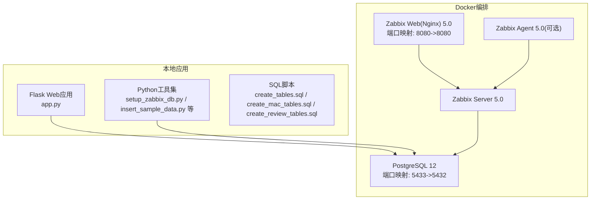
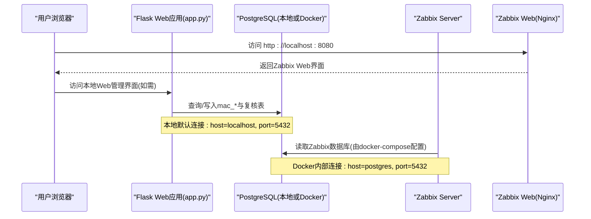
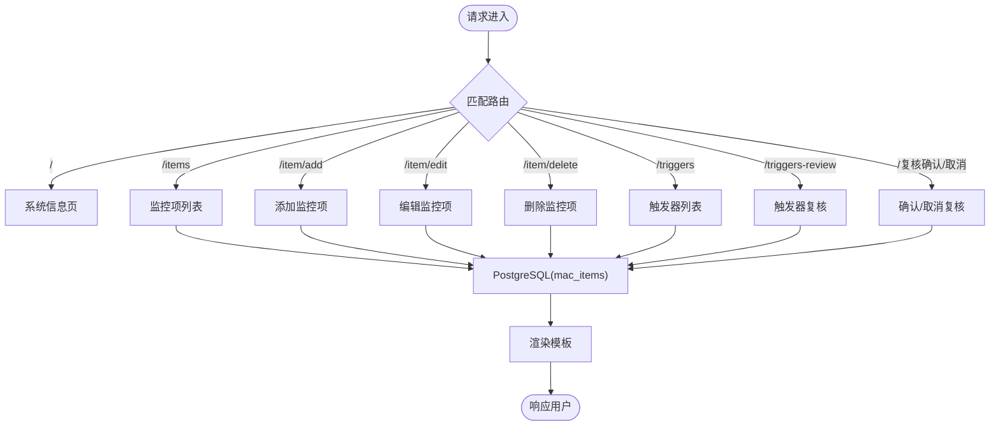
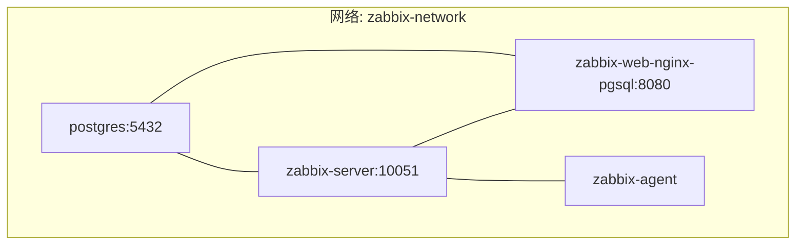
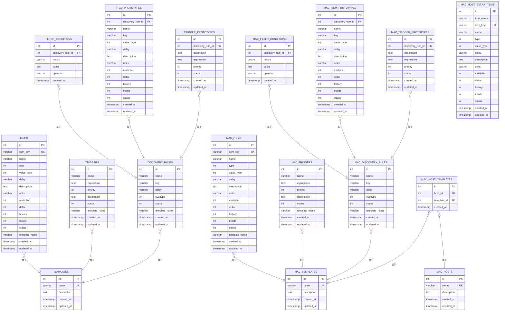
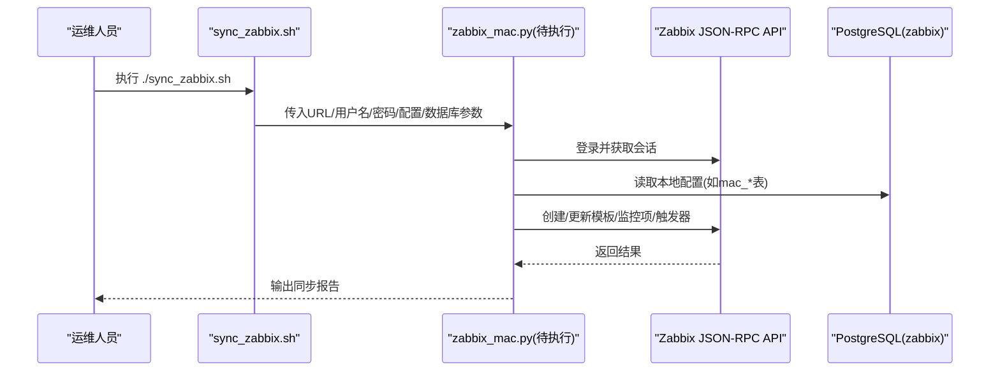
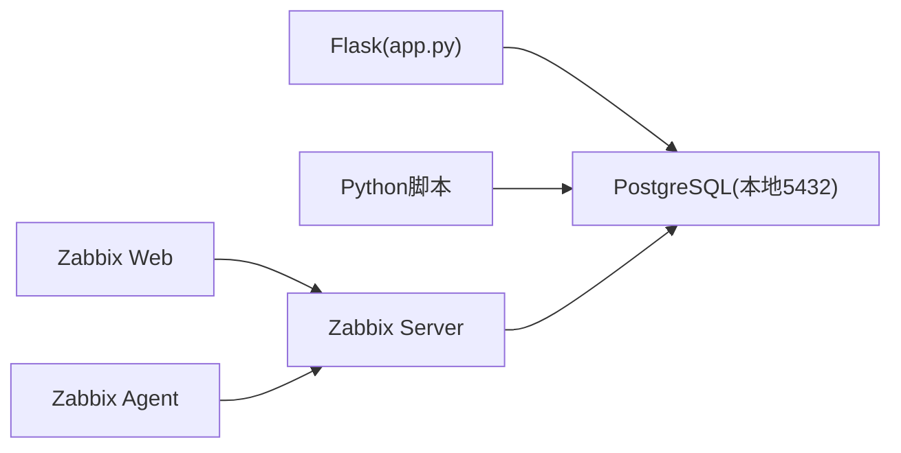

# 快速开始

<cite>
**本文引用的文件**
- [app.py](file://app.py)
- [docker-compose.yml](file://docker-compose.yml)
- [ZABBIX_SETUP_GUIDE.md](file://ZABBIX_SETUP_GUIDE.md)
- [monitor_config.yaml](file://monitor_config.yaml)
- [setup_zabbix_db.py](file://setup_zabbix_db.py)
- [setup_zabbix_db.sql](file://setup_zabbix_db.sql)
- [create_tables.sql](file://create_tables.sql)
- [create_mac_tables.sql](file://create_mac_tables.sql)
- [create_review_tables.sql](file://create_review_tables.sql)
- [sync_zabbix.sh](file://sync_zabbix.sh)
- [insert_sample_data.py](file://insert_sample_data.py)
</cite>

## 目录
1. [简介](#简介)
2. [项目结构](#项目结构)
3. [核心组件](#核心组件)
4. [架构总览](#架构总览)
5. [详细组件分析](#详细组件分析)
6. [依赖分析](#依赖分析)
7. [性能考虑](#性能考虑)
8. [故障排除指南](#故障排除指南)
9. [结论](#结论)
10. [附录](#附录)

## 简介
本指南面向首次接触“Zabbix监控审核和自动化控制中心”的用户，帮助你在约30分钟内完成从零到一的环境搭建与基础验证。内容覆盖：
- Python运行环境准备与依赖安装
- PostgreSQL数据库初始化与Zabbix专用数据库/用户创建
- Zabbix服务器与Web前端的Docker部署与网络配置
- Web应用（Flask）的数据库表结构初始化与示例数据导入
- 首次运行流程：数据库初始化、Zabbix Web界面访问、基础功能验证
- Docker与传统部署方式的差异对比与选择建议

## 项目结构
该项目采用“多容器+本地Web应用”的组合架构：
- 使用Docker Compose编排PostgreSQL、Zabbix Server、Zabbix Web前端与可选Agent
- 本地Flask应用负责展示与管理监控配置（mac_*表），并与Zabbix进行数据同步
- 提供SQL脚本与Python脚本用于数据库表结构与示例数据初始化

图表来源
- [docker-compose.yml:1-76](file://docker-compose.yml#L1-L76)
- [app.py:1-50](file://app.py#L1-L50)
- [setup_zabbix_db.py:1-85](file://setup_zabbix_db.py#L1-L85)
- [create_tables.sql:1-50](file://create_tables.sql#L1-L50)
- [create_mac_tables.sql:1-50](file://create_mac_tables.sql#L1-L50)
- [create_review_tables.sql:1-50](file://create_review_tables.sql#L1-L50)

章节来源
- [docker-compose.yml:1-76](file://docker-compose.yml#L1-L76)
- [app.py:1-50](file://app.py#L1-L50)

## 核心组件
- Flask Web应用（app.py）
  - 负责渲染模板、处理表单、连接PostgreSQL数据库（默认本地5432端口）
  - 提供监控项、触发器、主机等管理页面与复核流程页面
- Docker编排（docker-compose.yml）
  - 提供PostgreSQL、Zabbix Server、Zabbix Web前端、Zabbix Agent四类服务
  - 默认端口映射：PG 5433、Web 8080、Server 10051
- 数据库初始化脚本
  - setup_zabbix_db.py：创建Zabbix专用用户与数据库并授权
  - setup_zabbix_db.sql：SQL版本的数据库与用户创建及时区设置
  - create_tables.sql / create_mac_tables.sql / create_review_tables.sql：标准表与MaC表、复核表结构
- 示例数据与同步
  - insert_sample_data.py：向标准表插入示例数据
  - sync_zabbix.sh：封装Zabbix API同步参数，调用Python脚本进行同步

章节来源
- [app.py:1-120](file://app.py#L1-L120)
- [docker-compose.yml:1-76](file://docker-compose.yml#L1-L76)
- [setup_zabbix_db.py:1-85](file://setup_zabbix_db.py#L1-L85)
- [setup_zabbix_db.sql:1-11](file://setup_zabbix_db.sql#L1-L11)
- [create_tables.sql:1-120](file://create_tables.sql#L1-L120)
- [create_mac_tables.sql:1-120](file://create_mac_tables.sql#L1-L120)
- [create_review_tables.sql:1-120](file://create_review_tables.sql#L1-L120)
- [insert_sample_data.py:1-120](file://insert_sample_data.py#L1-L120)
- [sync_zabbix.sh:1-31](file://sync_zabbix.sh#L1-L31)

## 架构总览
下图展示了“本地Web应用 + Docker化Zabbix + PostgreSQL”三者之间的交互关系与数据流向。

图表来源
- [app.py:17-29](file://app.py#L17-L29)
- [docker-compose.yml:18-56](file://docker-compose.yml#L18-L56)
- [ZABBIX_SETUP_GUIDE.md:78-105](file://ZABBIX_SETUP_GUIDE.md#L78-L105)

## 详细组件分析

### 组件A：Flask Web应用（app.py）
- 功能概览
  - 提供系统信息、模板、监控项、触发器、主机等管理页面
  - 支持复核流程：监控项、触发器、原型的复核与确认
  - 数据库连接默认指向本地PostgreSQL（端口5432）
- 关键路由与职责
  - 首页与系统信息：展示统计与主机列表占位
  - 模板与原型管理：提供列表与详情占位（当前为空）
  - 监控项与触发器管理：支持增删改查
  - 复核表管理：支持编辑、确认/取消确认
- 数据库交互
  - 使用psycopg2连接PostgreSQL
  - 通过SQL脚本创建的表结构进行CRUD操作

图表来源
- [app.py:31-101](file://app.py#L31-L101)
- [app.py:103-221](file://app.py#L103-L221)
- [app.py:223-332](file://app.py#L223-L332)
- [app.py:413-595](file://app.py#L413-L595)

章节来源
- [app.py:1-774](file://app.py#L1-L774)

### 组件B：Docker编排（docker-compose.yml）
- 服务组成
  - postgres：PostgreSQL 12，端口映射5433:5432，持久化卷postgres-data
  - zabbix-server：Zabbix Server 5.0，连接postgres
  - zabbix-web-nginx-pgsql：Zabbix Web前端，端口映射8080:8080
  - zabbix-agent：Zabbix Agent（可选）
- 网络与依赖
  - 使用自定义bridge网络zabbix-network
  - 服务间通过服务名相互发现（如zabbix-server依赖postgres）

图表来源
- [docker-compose.yml:1-76](file://docker-compose.yml#L1-L76)

章节来源
- [docker-compose.yml:1-76](file://docker-compose.yml#L1-L76)

### 组件C：数据库初始化与表结构（setup_zabbix_db.py / setup_zabbix_db.sql / create_*_tables.sql）
- Zabbix数据库与用户创建
  - setup_zabbix_db.py：先连接默认postgres创建用户与数据库，再连接zabbix数据库授予权限
  - setup_zabbix_db.sql：SQL脚本一次性创建用户、数据库并设置时区
- 表结构设计
  - create_tables.sql：标准Zabbix表（items、triggers、discovery_rules、filter_conditions、item_prototypes、trigger_prototypes、templates）
  - create_mac_tables.sql：MaC表（mac_templates、mac_items、mac_triggers、mac_discovery_rules、mac_filter_conditions、mac_item_prototypes、mac_trigger_prototypes、mac_hosts、mac_host_templates、mac_host_extra_items）
  - create_review_tables.sql：复核表（items_review、triggers_review、item_prototypes_review、trigger_prototypes_review）
- 示例数据
  - insert_sample_data.py：向标准表插入Linux监控相关示例数据

图表来源
- [create_tables.sql:1-198](file://create_tables.sql#L1-L198)
- [create_mac_tables.sql:1-252](file://create_mac_tables.sql#L1-L252)
- [create_review_tables.sql:1-201](file://create_review_tables.sql#L1-L201)

章节来源
- [setup_zabbix_db.py:1-85](file://setup_zabbix_db.py#L1-L85)
- [setup_zabbix_db.sql:1-11](file://setup_zabbix_db.sql#L1-L11)
- [create_tables.sql:1-198](file://create_tables.sql#L1-L198)
- [create_mac_tables.sql:1-252](file://create_mac_tables.sql#L1-L252)
- [create_review_tables.sql:1-201](file://create_review_tables.sql#L1-L201)
- [insert_sample_data.py:1-240](file://insert_sample_data.py#L1-L240)

### 组件D：Zabbix同步与配置（monitor_config.yaml / sync_zabbix.sh）
- monitor_config.yaml：示例配置文件，定义主机、模板与额外监控项
- sync_zabbix.sh：封装Zabbix API地址、凭据与数据库连接参数，调用Python脚本执行同步

图表来源
- [sync_zabbix.sh:1-31](file://sync_zabbix.sh#L1-L31)
- [monitor_config.yaml:1-20](file://monitor_config.yaml#L1-L20)

章节来源
- [monitor_config.yaml:1-20](file://monitor_config.yaml#L1-L20)
- [sync_zabbix.sh:1-31](file://sync_zabbix.sh#L1-L31)

## 依赖分析
- Python依赖
  - psycopg2：PostgreSQL连接
  - flask：Web框架
- Docker服务依赖
  - zabbix-server依赖postgres
  - zabbix-web依赖postgres与zabbix-server
  - zabbix-agent依赖zabbix-server

图表来源
- [app.py:9-15](file://app.py#L9-L15)
- [docker-compose.yml:31-56](file://docker-compose.yml#L31-L56)

章节来源
- [app.py:1-50](file://app.py#L1-L50)
- [docker-compose.yml:1-76](file://docker-compose.yml#L1-L76)

## 性能考虑
- 数据库索引：SQL脚本中已为常用查询列建立索引，有助于提升查询性能
- 连接池：生产环境建议引入连接池减少连接开销
- 日志与监控：Docker日志便于问题定位；建议开启慢查询日志与Zabbix性能指标

## 故障排除指南
- 容器无法连接数据库
  - 检查PostgreSQL监听地址与pg_hba.conf配置
  - 参考ZABBIX_SETUP_GUIDE中的配置步骤与重启命令
- Web界面无法访问
  - 检查端口占用与容器状态
  - 查看zabbix-web容器日志
- 数据库权限问题
  - 确认zabbix用户对zabbix数据库具备全部权限
  - 使用setup_zabbix_db.py或setup_zabbix_db.sql重新初始化

章节来源
- [ZABBIX_SETUP_GUIDE.md:106-138](file://ZABBIX_SETUP_GUIDE.md#L106-L138)
- [setup_zabbix_db.py:1-85](file://setup_zabbix_db.py#L1-L85)
- [setup_zabbix_db.sql:1-11](file://setup_zabbix_db.sql#L1-L11)

## 结论
通过本指南，你可以在30分钟内完成：
- Python环境与依赖准备
- PostgreSQL数据库初始化与Zabbix专用用户/数据库创建
- Docker化Zabbix服务部署与网络连通性验证
- 本地Flask Web应用的数据库表结构初始化与示例数据导入
- Zabbix Web界面访问与基础功能验证

随后即可开展监控配置的审核与自动化管理工作。

## 附录

### 环境搭建步骤（总览）
- 准备Python运行环境
  - 安装Python 3.x与pip
  - 安装依赖：psycopg2、flask（如需）
- 初始化PostgreSQL与Zabbix数据库
  - 方式A：使用Python脚本创建用户与数据库并授权
  - 方式B：使用SQL脚本直接创建
- 初始化表结构与示例数据
  - 执行create_tables.sql、create_mac_tables.sql、create_review_tables.sql
  - 可选：执行insert_sample_data.py填充示例数据
- 启动Docker化Zabbix
  - 在项目根目录执行docker compose up -d
  - 访问http://localhost:8080，默认管理员凭据见ZABBIX_SETUP_GUIDE
- 首次运行与验证
  - 访问Zabbix Web界面确认服务可用
  - 如需，执行sync_zabbix.sh进行配置同步

章节来源
- [setup_zabbix_db.py:1-85](file://setup_zabbix_db.py#L1-L85)
- [setup_zabbix_db.sql:1-11](file://setup_zabbix_db.sql#L1-L11)
- [create_tables.sql:1-198](file://create_tables.sql#L1-L198)
- [create_mac_tables.sql:1-252](file://create_mac_tables.sql#L1-L252)
- [create_review_tables.sql:1-201](file://create_review_tables.sql#L1-L201)
- [insert_sample_data.py:1-240](file://insert_sample_data.py#L1-L240)
- [docker-compose.yml:1-76](file://docker-compose.yml#L1-L76)
- [ZABBIX_SETUP_GUIDE.md:55-85](file://ZABBIX_SETUP_GUIDE.md#L55-L85)
- [sync_zabbix.sh:1-31](file://sync_zabbix.sh#L1-L31)

### Docker部署 vs 传统部署（差异对比）
- Docker部署
  - 优点：一键拉起，隔离性强，便于迁移与回滚
  - 端口映射：PostgreSQL 5433、Zabbix Web 8080、Server 10051
  - 网络：服务间通过服务名通信
- 传统部署
  - 优点：更贴近生产环境，便于深度定制
  - 需要手动配置PostgreSQL监听地址与认证策略
  - 需要手动安装Zabbix Server与Web组件

章节来源
- [docker-compose.yml:1-76](file://docker-compose.yml#L1-L76)
- [ZABBIX_SETUP_GUIDE.md:12-54](file://ZABBIX_SETUP_GUIDE.md#L12-L54)