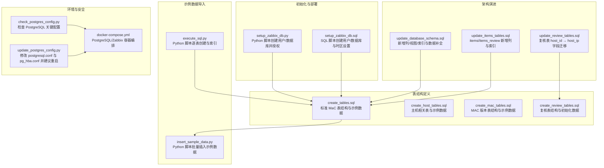
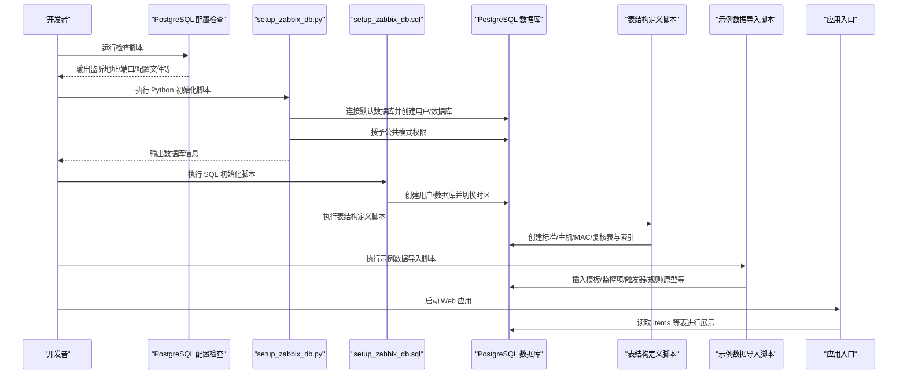
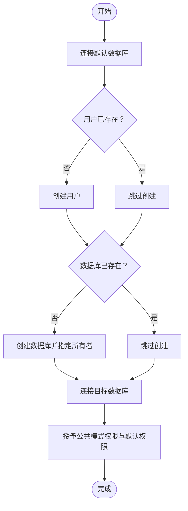
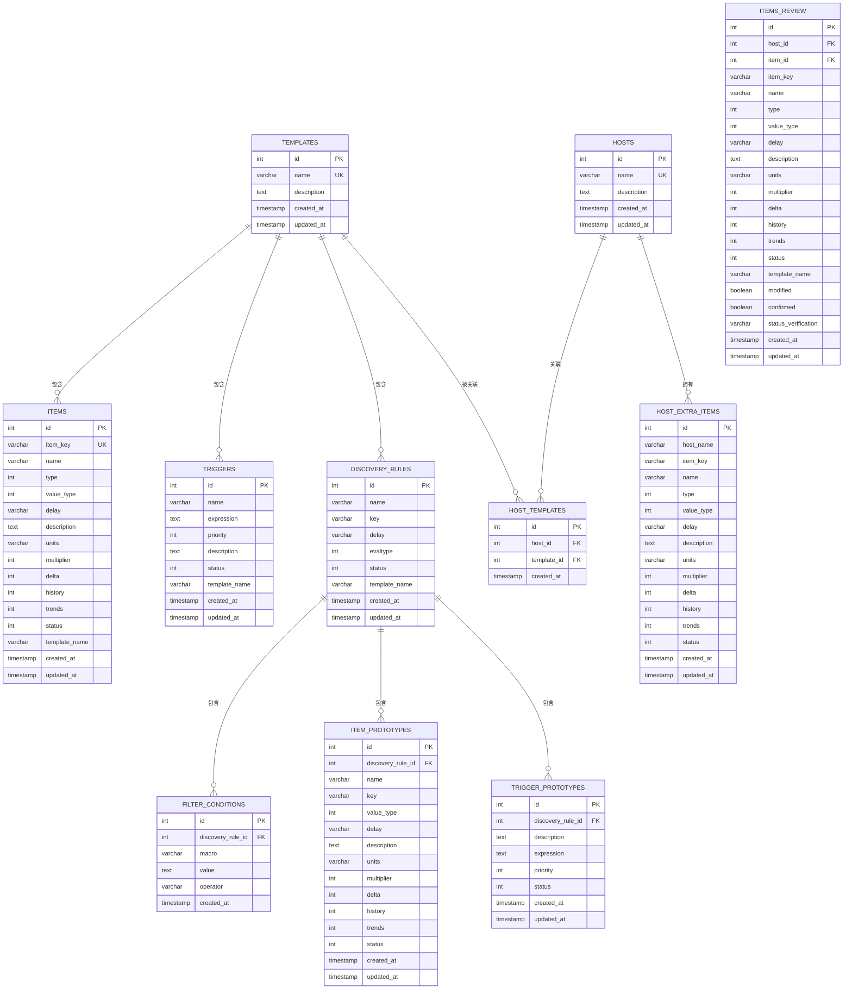
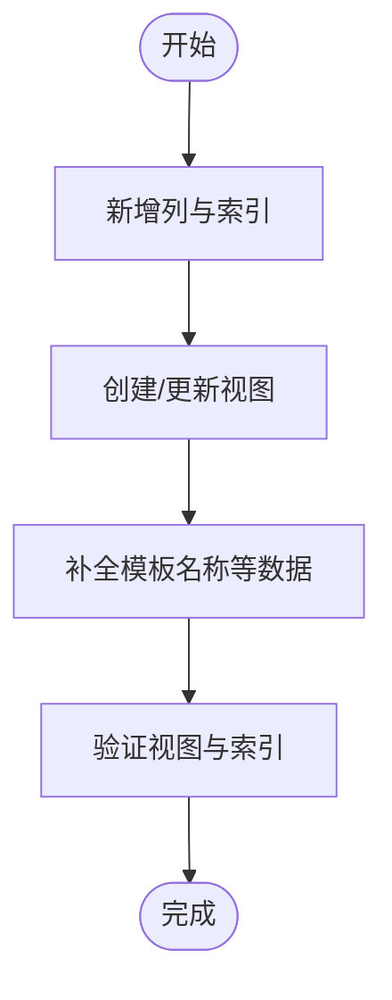
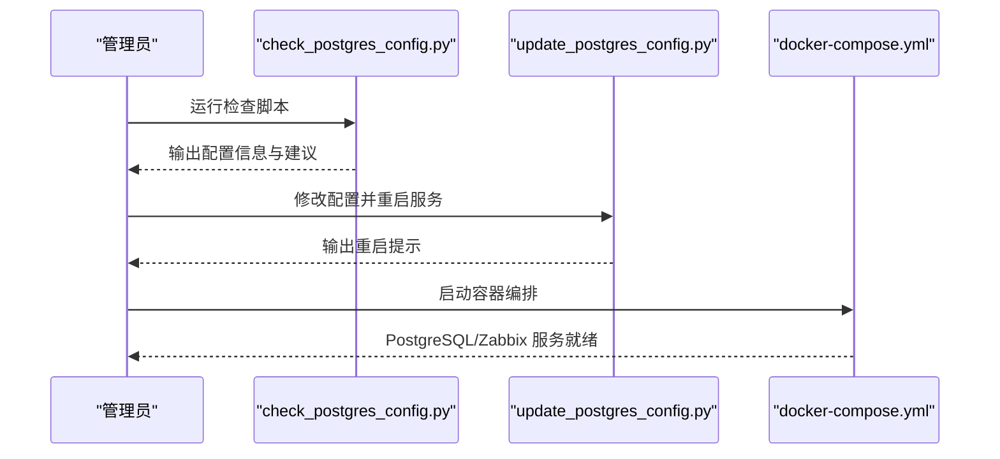

# 数据库初始化

<cite>
**本文引用的文件**
- [setup_zabbix_db.py](file://setup_zabbix_db.py)
- [setup_zabbix_db.sql](file://setup_zabbix_db.sql)
- [create_tables.sql](file://create_tables.sql)
- [create_host_tables.sql](file://create_host_tables.sql)
- [create_mac_tables.sql](file://create_mac_tables.sql)
- [create_review_tables.sql](file://create_review_tables.sql)
- [insert_sample_data.py](file://insert_sample_data.py)
- [execute_sql.py](file://execute_sql.py)
- [update_database_schema.sql](file://update_database_schema.sql)
- [update_items_tables.sql](file://update_items_tables.sql)
- [update_review_tables.sql](file://update_review_tables.sql)
- [DATABASE_MIGRATION_PLAN.md](file://DATABASE_MIGRATION_PLAN.md)
- [check_postgres_config.py](file://check_postgres_config.py)
- [update_postgres_config.py](file://update_postgres_config.py)
- [docker-compose.yml](file://docker-compose.yml)
- [app.py](file://app.py)
- [monitor_config.yaml](file://monitor_config.yaml)
</cite>

## 目录
1. [简介](#简介)
2. [项目结构](#项目结构)
3. [核心组件](#核心组件)
4. [架构总览](#架构总览)
5. [详细组件分析](#详细组件分析)
6. [依赖分析](#依赖分析)
7. [性能考虑](#性能考虑)
8. [故障排查指南](#故障排查指南)
9. [结论](#结论)
10. [附录](#附录)

## 简介
本文件面向数据库初始化与部署，覆盖以下内容：
- 数据库表结构创建流程与步骤
- 示例数据插入逻辑与数据字典
- 完整部署流程：PostgreSQL 环境准备、数据库与用户创建、表结构初始化、示例数据导入
- 权限配置与安全设置
- 常见初始化问题排查与解决方案

## 项目结构
该仓库围绕“Zabbix Monitor as Code（MaC）”主题，提供数据库初始化、示例数据导入、Web 管理界面以及数据库迁移规划文档。关键文件分布如下：
- 初始化与部署脚本：setup_zabbix_db.py、setup_zabbix_db.sql
- 表结构定义：create_tables.sql、create_host_tables.sql、create_mac_tables.sql、create_review_tables.sql
- 示例数据导入：insert_sample_data.py、execute_sql.py
- 架构演进与迁移：update_database_schema.sql、update_items_tables.sql、update_review_tables.sql
- PostgreSQL 环境与安全：check_postgres_config.py、update_postgres_config.py、docker-compose.yml
- 应用入口与配置：app.py、monitor_config.yaml
- 迁移规划文档：DATABASE_MIGRATION_PLAN.md

图表来源
- [setup_zabbix_db.py:1-85](file://setup_zabbix_db.py#L1-L85)
- [setup_zabbix_db.sql:1-11](file://setup_zabbix_db.sql#L1-L11)
- [create_tables.sql:1-198](file://create_tables.sql#L1-L198)
- [create_host_tables.sql:1-60](file://create_host_tables.sql#L1-L60)
- [create_mac_tables.sql:1-252](file://create_mac_tables.sql#L1-L252)
- [create_review_tables.sql:1-201](file://create_review_tables.sql#L1-L201)
- [insert_sample_data.py:1-240](file://insert_sample_data.py#L1-L240)
- [execute_sql.py:1-170](file://execute_sql.py#L1-L170)
- [update_database_schema.sql:1-123](file://update_database_schema.sql#L1-L123)
- [update_items_tables.sql:1-16](file://update_items_tables.sql#L1-L16)
- [update_review_tables.sql:1-78](file://update_review_tables.sql#L1-L78)
- [check_postgres_config.py:1-64](file://check_postgres_config.py#L1-L64)
- [update_postgres_config.py:1-74](file://update_postgres_config.py#L1-L74)
- [docker-compose.yml:1-76](file://docker-compose.yml#L1-L76)

章节来源
- [setup_zabbix_db.py:1-85](file://setup_zabbix_db.py#L1-L85)
- [setup_zabbix_db.sql:1-11](file://setup_zabbix_db.sql#L1-L11)
- [create_tables.sql:1-198](file://create_tables.sql#L1-L198)
- [create_host_tables.sql:1-60](file://create_host_tables.sql#L1-L60)
- [create_mac_tables.sql:1-252](file://create_mac_tables.sql#L1-L252)
- [create_review_tables.sql:1-201](file://create_review_tables.sql#L1-L201)
- [insert_sample_data.py:1-240](file://insert_sample_data.py#L1-L240)
- [execute_sql.py:1-170](file://execute_sql.py#L1-L170)
- [update_database_schema.sql:1-123](file://update_database_schema.sql#L1-L123)
- [update_items_tables.sql:1-16](file://update_items_tables.sql#L1-L16)
- [update_review_tables.sql:1-78](file://update_review_tables.sql#L1-L78)
- [check_postgres_config.py:1-64](file://check_postgres_config.py#L1-L64)
- [update_postgres_config.py:1-74](file://update_postgres_config.py#L1-L74)
- [docker-compose.yml:1-76](file://docker-compose.yml#L1-L76)
- [app.py:17-24](file://app.py#L17-L24)
- [monitor_config.yaml:1-20](file://monitor_config.yaml#L1-L20)

## 核心组件
- 数据库初始化脚本
  - Python 脚本：创建用户、数据库、授予权限
  - SQL 脚本：创建用户、数据库、切换数据库并设置时区
- 表结构定义
  - 标准 MaC 表：items、triggers、discovery_rules、filter_conditions、item_prototypes、trigger_prototypes、templates
  - 主机相关表：hosts、host_templates、host_extra_items
  - MAC 版本表：mac_templates、mac_items、mac_triggers、mac_discovery_rules、mac_filter_conditions、mac_item_prototypes、mac_trigger_prototypes、mac_hosts、mac_host_templates、mac_host_extra_items
  - 复核表：items_review、triggers_review、item_prototypes_review、trigger_prototypes_review
- 示例数据导入
  - Python 脚本：按模板/规则/原型分组插入，避免重复
  - Python 脚本：逐表创建与索引
- 架构演进脚本
  - 新增列、视图、索引与数据补全
  - items/items_review 新增列
  - 复核表 host_id → host_ip 字段迁移
- 环境与安全
  - 检查 PostgreSQL 关键配置
  - 修改 postgresql.conf 与 pg_hba.conf 并建议重启
  - Docker Compose 编排 PostgreSQL/Zabbix

章节来源
- [setup_zabbix_db.py:7-81](file://setup_zabbix_db.py#L7-L81)
- [setup_zabbix_db.sql:1-11](file://setup_zabbix_db.sql#L1-L11)
- [create_tables.sql:4-107](file://create_tables.sql#L4-L107)
- [create_host_tables.sql:3-47](file://create_host_tables.sql#L3-L47)
- [create_mac_tables.sql:4-151](file://create_mac_tables.sql#L4-L151)
- [create_review_tables.sql:4-119](file://create_review_tables.sql#L4-L119)
- [insert_sample_data.py:6-236](file://insert_sample_data.py#L6-L236)
- [execute_sql.py:6-166](file://execute_sql.py#L6-L166)
- [update_database_schema.sql:4-122](file://update_database_schema.sql#L4-L122)
- [update_items_tables.sql:3-16](file://update_items_tables.sql#L3-L16)
- [update_review_tables.sql:3-78](file://update_review_tables.sql#L3-L78)
- [check_postgres_config.py:6-60](file://check_postgres_config.py#L6-L60)
- [update_postgres_config.py:7-71](file://update_postgres_config.py#L7-L71)
- [docker-compose.yml:1-76](file://docker-compose.yml#L1-L76)

## 架构总览
下图展示数据库初始化与部署的整体流程，包括环境准备、用户/数据库创建、权限授予、表结构初始化、示例数据导入、架构演进与安全配置。

图表来源
- [check_postgres_config.py:6-60](file://check_postgres_config.py#L6-L60)
- [setup_zabbix_db.py:7-81](file://setup_zabbix_db.py#L7-L81)
- [setup_zabbix_db.sql:1-11](file://setup_zabbix_db.sql#L1-L11)
- [create_tables.sql:4-107](file://create_tables.sql#L4-L107)
- [insert_sample_data.py:6-236](file://insert_sample_data.py#L6-L236)
- [app.py:26-29](file://app.py#L26-L29)

## 详细组件分析

### 组件A：数据库初始化与权限配置
- 功能概述
  - Python 脚本：连接默认数据库，检查用户/数据库是否存在，不存在则创建；随后连接目标数据库，授予公共模式权限与默认权限。
  - SQL 脚本：创建用户、数据库并切换至目标数据库，设置时区。
- 关键步骤
  - 连接默认数据库并创建用户与数据库
  - 连接目标数据库并授予权限
  - 输出数据库连接信息
- 注意事项
  - 需要具备创建角色与数据库的权限
  - 授权需在目标数据库执行
  - 建议在生产环境使用强密码并限制网络访问

图表来源
- [setup_zabbix_db.py:10-62](file://setup_zabbix_db.py#L10-L62)

章节来源
- [setup_zabbix_db.py:7-81](file://setup_zabbix_db.py#L7-L81)
- [setup_zabbix_db.sql:1-11](file://setup_zabbix_db.sql#L1-L11)

### 组件B：表结构初始化与示例数据导入
- 功能概述
  - SQL 脚本：定义标准 MaC 表结构、索引与示例数据（模板、监控项、触发器、自动发现规则、过滤条件、原型等）。
  - Python 脚本：逐表创建与索引，便于调试与分步执行。
  - Python 脚本：按模板/规则/原型分组插入示例数据，避免重复键冲突。
- 关键步骤
  - 执行表结构定义脚本
  - 执行示例数据导入脚本
  - 验证表与数据
- 数据字典（节选）
  - items：监控项主表，包含键、名称、类型、值类型、延迟、描述、单位、历史/趋势保留天数、状态、所属模板等。
  - triggers：触发器主表，包含名称、表达式、优先级、描述、状态、所属模板等。
  - discovery_rules：自动发现规则，包含名称、键、延迟、评估类型、状态、所属模板等。
  - filter_conditions：发现规则的过滤条件，包含宏、值、运算符等。
  - item_prototypes/trigger_prototypes：规则对应的原型与触发器原型。
  - templates：模板元数据。
  - hosts/host_templates/host_extra_items：主机、主机-模板关联、主机额外监控项。
  - 复核表：items_review/triggers_review/item_prototypes_review/trigger_prototypes_review，包含复核状态字段与唯一约束。

图表来源
- [create_tables.sql:4-107](file://create_tables.sql#L4-L107)
- [create_host_tables.sql:3-47](file://create_host_tables.sql#L3-L47)
- [create_review_tables.sql:4-119](file://create_review_tables.sql#L4-L119)

章节来源
- [create_tables.sql:4-198](file://create_tables.sql#L4-L198)
- [create_host_tables.sql:3-60](file://create_host_tables.sql#L3-L60)
- [create_mac_tables.sql:4-151](file://create_mac_tables.sql#L4-L151)
- [create_review_tables.sql:4-201](file://create_review_tables.sql#L4-L201)
- [insert_sample_data.py:6-236](file://insert_sample_data.py#L6-L236)
- [execute_sql.py:6-166](file://execute_sql.py#L6-L166)

### 组件C：架构演进与数据迁移
- 功能概述
  - 新增列：items/items_review 新增 master_item 与 preprocessing 字段，并建立索引。
  - 复核表迁移：将 host_id 字段替换为 host_ip，更新索引与唯一约束。
  - 视图与索引：创建 items_total/triggers_total 视图，整合模板与自定义修改；为 extra 表建立索引。
  - 数据补全：为已有记录补全模板名称字段。
- 关键步骤
  - 执行架构更新脚本
  - 验证视图与索引
  - 检查数据完整性

图表来源
- [update_database_schema.sql:4-122](file://update_database_schema.sql#L4-L122)
- [update_items_tables.sql:3-16](file://update_items_tables.sql#L3-L16)
- [update_review_tables.sql:3-78](file://update_review_tables.sql#L3-L78)

章节来源
- [update_database_schema.sql:1-123](file://update_database_schema.sql#L1-L123)
- [update_items_tables.sql:1-16](file://update_items_tables.sql#L1-L16)
- [update_review_tables.sql:1-78](file://update_review_tables.sql#L1-L78)

### 组件D：PostgreSQL 环境准备与安全设置
- 功能概述
  - 检查脚本：输出监听地址、端口、数据目录、配置文件路径等。
  - 更新脚本：备份配置文件，修改 postgresql.conf 与 pg_hba.conf，建议重启服务。
  - Docker Compose：提供 PostgreSQL 与 Zabbix 的容器化部署方案。
- 关键步骤
  - 运行检查脚本确认配置
  - 根据建议修改配置并重启服务
  - 使用 Docker Compose 启动服务

图表来源
- [check_postgres_config.py:6-60](file://check_postgres_config.py#L6-L60)
- [update_postgres_config.py:7-71](file://update_postgres_config.py#L7-L71)
- [docker-compose.yml:1-76](file://docker-compose.yml#L1-L76)

章节来源
- [check_postgres_config.py:1-64](file://check_postgres_config.py#L1-L64)
- [update_postgres_config.py:1-74](file://update_postgres_config.py#L1-L74)
- [docker-compose.yml:1-76](file://docker-compose.yml#L1-L76)

### 组件E：应用入口与配置
- 功能概述
  - Web 应用通过 psycopg2 连接数据库，渲染模板页面。
  - 默认连接配置指向 zabbix_mac 数据库，若未创建对应表则返回空数据。
- 关键步骤
  - 配置数据库连接参数
  - 在路由中查询 items 等表并渲染页面

章节来源
- [app.py:17-24](file://app.py#L17-L24)
- [app.py:96-101](file://app.py#L96-L101)

## 依赖分析
- 组件耦合
  - 初始化脚本依赖于 PostgreSQL 服务可用与默认数据库存在。
  - 表结构定义脚本之间存在依赖关系（如 discovery_rules 为 item_prototypes/trigger_prototypes 的外键）。
  - 示例数据导入脚本依赖于模板与规则已存在。
- 外部依赖
  - Python 脚本依赖 psycopg2。
  - Docker Compose 依赖 Docker 环境。
- 循环依赖
  - 未发现循环依赖。

```mermaid
graph TB
InitPy["setup_zabbix_db.py"] --> DB["PostgreSQL"]
InitSQL["setup_zabbix_db.sql"] --> DB
Tables["create_tables.sql"] --> DB
HostTables["create_host_tables.sql"] --> DB
MacTables["create_mac_tables.sql"] --> DB
ReviewTables["create_review_tables.sql"] --> DB
SamplePy["insert_sample_data.py"] --> DB
ExecPy["execute_sql.py"] --> DB
UpdateSchema["update_database_schema.sql"] --> DB
UpdateItems["update_items_tables.sql"] --> DB
UpdateReview["update_review_tables.sql"] --> DB
App["app.py"] --> DB
Compose["docker-compose.yml"] --> DB
```

图表来源
- [setup_zabbix_db.py:10-62](file://setup_zabbix_db.py#L10-L62)
- [setup_zabbix_db.sql:1-11](file://setup_zabbix_db.sql#L1-L11)
- [create_tables.sql:4-107](file://create_tables.sql#L4-L107)
- [create_host_tables.sql:3-47](file://create_host_tables.sql#L3-L47)
- [create_mac_tables.sql:4-151](file://create_mac_tables.sql#L4-L151)
- [create_review_tables.sql:4-119](file://create_review_tables.sql#L4-L119)
- [insert_sample_data.py:6-236](file://insert_sample_data.py#L6-L236)
- [execute_sql.py:6-166](file://execute_sql.py#L6-L166)
- [update_database_schema.sql:4-122](file://update_database_schema.sql#L4-L122)
- [update_items_tables.sql:3-16](file://update_items_tables.sql#L3-L16)
- [update_review_tables.sql:3-78](file://update_review_tables.sql#L3-L78)
- [app.py:26-29](file://app.py#L26-L29)
- [docker-compose.yml:1-76](file://docker-compose.yml#L1-L76)

章节来源
- [setup_zabbix_db.py:10-62](file://setup_zabbix_db.py#L10-L62)
- [create_tables.sql:4-107](file://create_tables.sql#L4-L107)
- [insert_sample_data.py:6-236](file://insert_sample_data.py#L6-L236)
- [update_review_tables.sql:3-78](file://update_review_tables.sql#L3-L78)
- [docker-compose.yml:1-76](file://docker-compose.yml#L1-L76)

## 性能考虑
- 索引优化
  - 为 items/template_name、triggers/template_name、discovery_rules/template_name 等常用查询字段建立索引。
  - 为复核表与 extra 表的关键字段建立索引，提升查询与去重效率。
- 视图与数据整合
  - 通过视图整合模板与自定义修改，减少复杂查询开销。
- 批量插入
  - Python 脚本采用批量插入与 ON CONFLICT 避免重复，降低写入压力。
- 连接池与超时
  - 生产环境建议使用连接池与合理超时配置，避免长事务占用资源。

## 故障排查指南
- PostgreSQL 配置问题
  - 症状：无法从外部访问或容器无法连接。
  - 排查：使用检查脚本查看 listen_addresses、port、data_directory、config_file、hba_file。
  - 解决：根据建议修改 postgresql.conf 与 pg_hba.conf，并重启服务。
- 用户/数据库权限不足
  - 症状：初始化脚本报错，无法创建用户或数据库。
  - 排查：确认当前用户具备创建角色与数据库的权限。
  - 解决：使用具备足够权限的账户执行初始化脚本。
- 表结构依赖错误
  - 症状：外键约束失败或索引创建报错。
  - 排查：确认父表（如 discovery_rules）先于子表创建。
  - 解决：按顺序执行表结构定义脚本。
- 示例数据重复或缺失
  - 症状：插入时报唯一键冲突或数据不完整。
  - 排查：检查模板/规则是否已存在，确认键唯一性。
  - 解决：使用 ON CONFLICT 或先清理再导入。
- Docker 网络访问
  - 症状：容器内应用无法连接数据库。
  - 排查：确认容器网络与主机端口映射正确。
  - 解决：调整 docker-compose.yml 的端口映射与网络配置。

章节来源
- [check_postgres_config.py:6-60](file://check_postgres_config.py#L6-L60)
- [update_postgres_config.py:7-71](file://update_postgres_config.py#L7-L71)
- [setup_zabbix_db.py:7-81](file://setup_zabbix_db.py#L7-L81)
- [create_tables.sql:4-107](file://create_tables.sql#L4-L107)
- [insert_sample_data.py:6-236](file://insert_sample_data.py#L6-L236)
- [docker-compose.yml:1-76](file://docker-compose.yml#L1-L76)

## 结论
通过上述脚本与流程，可完成从零到一的数据库初始化与部署，涵盖环境准备、用户/数据库创建、权限授予、表结构初始化、示例数据导入、架构演进与安全配置。建议在生产环境中结合 Docker Compose 快速部署，并遵循最小权限原则与强密码策略，定期备份与验证数据一致性。

## 附录

### 完整数据库部署流程
- 环境准备
  - 运行 PostgreSQL 配置检查脚本，确认监听地址、端口与配置文件路径。
  - 如需容器访问，参考 Docker Compose 编排文件。
- 用户与数据库创建
  - 执行 Python 初始化脚本或 SQL 初始化脚本。
- 权限配置
  - 在目标数据库授予公共模式权限与默认权限。
- 表结构初始化
  - 执行表结构定义脚本（按依赖顺序）。
- 示例数据导入
  - 执行示例数据导入脚本，验证数据完整性。
- 架构演进
  - 根据需要执行架构更新脚本，补充列、视图与索引。
- 安全设置
  - 修改 postgresql.conf 与 pg_hba.conf，重启服务。
- 应用启动
  - 启动 Web 应用，确认页面可正常访问。

章节来源
- [check_postgres_config.py:6-60](file://check_postgres_config.py#L6-L60)
- [update_postgres_config.py:7-71](file://update_postgres_config.py#L7-L71)
- [setup_zabbix_db.py:7-81](file://setup_zabbix_db.py#L7-L81)
- [setup_zabbix_db.sql:1-11](file://setup_zabbix_db.sql#L1-L11)
- [create_tables.sql:4-107](file://create_tables.sql#L4-L107)
- [insert_sample_data.py:6-236](file://insert_sample_data.py#L6-L236)
- [update_database_schema.sql:4-122](file://update_database_schema.sql#L4-L122)
- [docker-compose.yml:1-76](file://docker-compose.yml#L1-L76)
- [app.py:26-29](file://app.py#L26-L29)