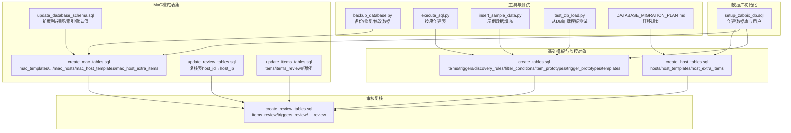
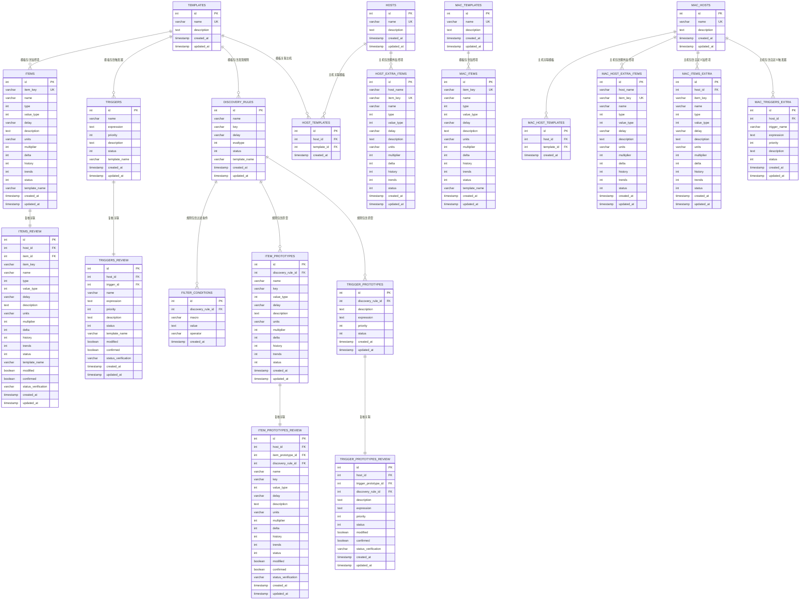
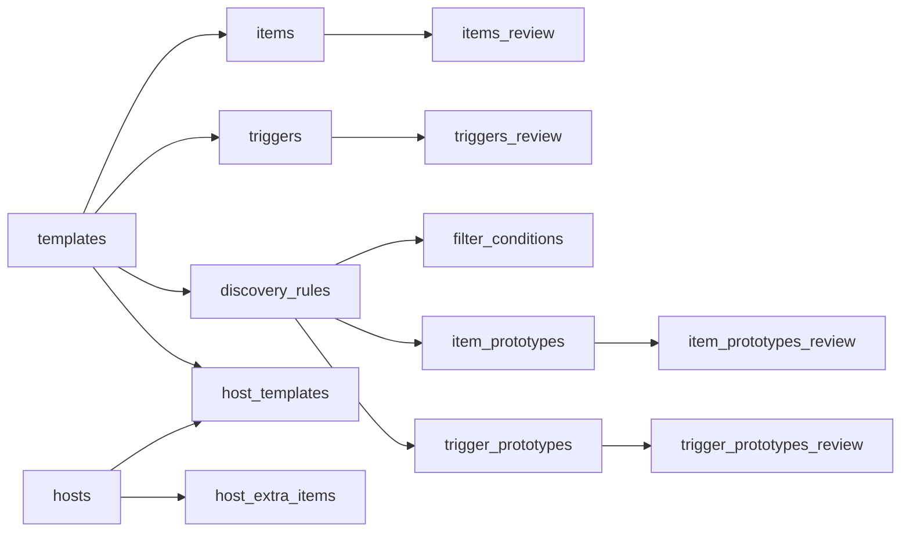
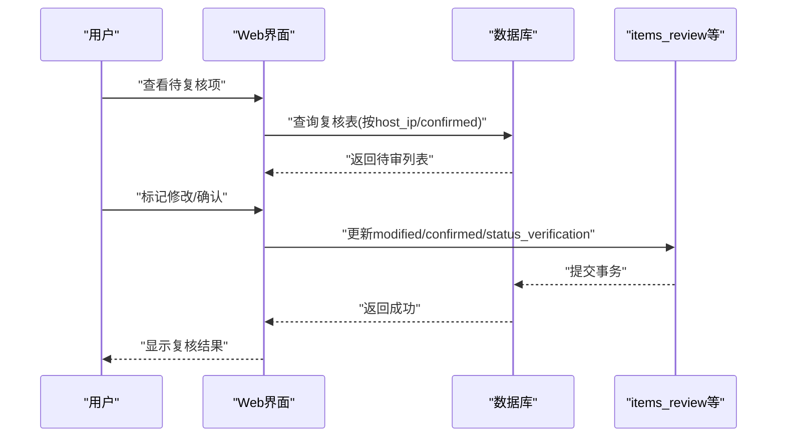

# 数据库设计

<cite>
**本文引用的文件**
- [create_tables.sql](file://create_tables.sql)
- [create_review_tables.sql](file://create_review_tables.sql)
- [create_mac_tables.sql](file://create_mac_tables.sql)
- [create_host_tables.sql](file://create_host_tables.sql)
- [setup_zabbix_db.sql](file://setup_zabbix_db.sql)
- [update_database_schema.sql](file://update_database_schema.sql)
- [update_review_tables.sql](file://update_review_tables.sql)
- [update_items_tables.sql](file://update_items_tables.sql)
- [backup_database.py](file://backup_database.py)
- [DATABASE_MIGRATION_PLAN.md](file://DATABASE_MIGRATION_PLAN.md)
- [execute_sql.py](file://execute_sql.py)
- [insert_sample_data.py](file://insert_sample_data.py)
- [test_db_load.py](file://test_db_load.py)
- [monitor_config.yaml](file://monitor_config.yaml)
</cite>

## 目录
1. [简介](#简介)
2. [项目结构](#项目结构)
3. [核心组件](#核心组件)
4. [架构总览](#架构总览)
5. [详细组件分析](#详细组件分析)
6. [依赖分析](#依赖分析)
7. [性能考虑](#性能考虑)
8. [故障排查指南](#故障排查指南)
9. [结论](#结论)
10. [附录](#附录)

## 简介
本文件面向“Zabbix监控审核和自动化控制中心”的数据库设计，系统化梳理了监控项、触发器、自动发现规则及其原型、模板、主机与复核表等核心表的结构、字段定义、约束关系与索引策略；并结合初始化脚本、迁移方案、备份与恢复最佳实践，形成完整的设计与运维指导。文档同时解释复核表的设计理念与审核流程的数据支撑机制，帮助读者在不深入源码的情况下理解数据库层的职责与边界。

## 项目结构
该仓库采用“按主题分层”的数据库脚本组织方式，核心脚本包括：
- 基础模板与监控对象表：create_tables.sql
- 审核复核专用表：create_review_tables.sql
- MaC（Monitor as Code）模式下的独立表集：create_mac_tables.sql
- 主机与主机-模板关联表：create_host_tables.sql
- 数据库初始化与权限设置：setup_zabbix_db.sql
- 架构演进与扩展：update_database_schema.sql、update_review_tables.sql、update_items_tables.sql
- 示例数据与测试：insert_sample_data.py、test_db_load.py
- 备份与恢复：backup_database.py
- 迁移规划：DATABASE_MIGRATION_PLAN.md

**图表来源**
- [setup_zabbix_db.sql:1-11](file://setup_zabbix_db.sql#L1-L11)
- [create_tables.sql:1-198](file://create_tables.sql#L1-L198)
- [create_review_tables.sql:1-201](file://create_review_tables.sql#L1-L201)
- [create_mac_tables.sql:1-252](file://create_mac_tables.sql#L1-L252)
- [create_host_tables.sql:1-60](file://create_host_tables.sql#L1-L60)
- [update_database_schema.sql:1-123](file://update_database_schema.sql#L1-L123)
- [update_review_tables.sql:1-78](file://update_review_tables.sql#L1-L78)
- [update_items_tables.sql:1-16](file://update_items_tables.sql#L1-L16)
- [backup_database.py:1-214](file://backup_database.py#L1-L214)
- [execute_sql.py:1-170](file://execute_sql.py#L1-L170)
- [insert_sample_data.py:1-240](file://insert_sample_data.py#L1-L240)
- [test_db_load.py:1-74](file://test_db_load.py#L1-L74)
- [DATABASE_MIGRATION_PLAN.md:1-210](file://DATABASE_MIGRATION_PLAN.md#L1-L210)

**章节来源**
- [create_tables.sql:1-198](file://create_tables.sql#L1-L198)
- [create_review_tables.sql:1-201](file://create_review_tables.sql#L1-L201)
- [create_mac_tables.sql:1-252](file://create_mac_tables.sql#L1-L252)
- [create_host_tables.sql:1-60](file://create_host_tables.sql#L1-L60)
- [setup_zabbix_db.sql:1-11](file://setup_zabbix_db.sql#L1-L11)
- [update_database_schema.sql:1-123](file://update_database_schema.sql#L1-L123)
- [update_review_tables.sql:1-78](file://update_review_tables.sql#L1-L78)
- [update_items_tables.sql:1-16](file://update_items_tables.sql#L1-L16)
- [backup_database.py:1-214](file://backup_database.py#L1-L214)
- [DATABASE_MIGRATION_PLAN.md:1-210](file://DATABASE_MIGRATION_PLAN.md#L1-L210)
- [execute_sql.py:1-170](file://execute_sql.py#L1-L170)
- [insert_sample_data.py:1-240](file://insert_sample_data.py#L1-L240)
- [test_db_load.py:1-74](file://test_db_load.py#L1-L74)

## 核心组件
本节对数据库中的关键表进行逐项说明，涵盖字段、数据类型、约束与典型用途。

- 模板表（templates）
  - 字段要点：id（主键）、name（唯一）、description、created_at、updated_at
  - 作用：承载监控模板元信息，被监控对象表通过template_name关联
  - 约束：name唯一

- 监控项表（items）
  - 字段要点：id（主键）、item_key（唯一）、name、type、value_type、delay、units、multiplier、delta、history、trends、status、template_name、时间戳
  - 作用：存储监控项模板定义
  - 约束：item_key唯一；外键指向templates.name

- 触发器表（triggers）
  - 字段要点：id（主键）、name、expression、priority、description、status、template_name、时间戳
  - 作用：存储触发器模板定义
  - 约束：外键指向templates.name

- 自动发现规则表（discovery_rules）
  - 字段要点：id（主键）、name、key、delay、evaltype、status、template_name、时间戳
  - 作用：定义自动发现规则
  - 约束：外键指向templates.name

- 发现过滤条件表（filter_conditions）
  - 字段要点：id（主键）、discovery_rule_id（外键，级联删除）、macro、value、operator、created_at
  - 作用：为发现规则提供过滤条件
  - 约束：discovery_rule_id引用discovery_rules(id)，ON DELETE CASCADE

- 监控项原型表（item_prototypes）
  - 字段要点：id（主键）、discovery_rule_id（外键，级联删除）、name、key、value_type、delay、units、multiplier、delta、history、trends、status、时间戳
  - 作用：定义发现规则下的监控项原型
  - 约束：discovery_rule_id引用discovery_rules(id)，ON DELETE CASCADE

- 触发器原型表（trigger_prototypes）
  - 字段要点：id（主键）、discovery_rule_id（外键，级联删除）、description、expression、priority、status、时间戳
  - 作用：定义发现规则下的触发器原型
  - 约束：discovery_rule_id引用discovery_rules(id)，ON DELETE CASCADE

- 主机表（hosts）
  - 字段要点：id（主键）、name（唯一）、description、created_at、updated_at
  - 作用：记录受管主机
  - 约束：name唯一

- 主机-模板关联表（host_templates）
  - 字段要点：id（主键）、host_id（外键，级联删除）、template_id（外键，级联删除）、created_at
  - 作用：建立主机与模板的多对多关系（简化为host_id+template_id唯一）
  - 约束：host_id、template_id分别引用hosts(id)、templates(id)，UNIQUE(host_id, template_id)

- 主机额外监控项表（host_extra_items）
  - 字段要点：id（主键）、host_name、item_key（唯一）、name、type、value_type、delay、units、multiplier、delta、history、trends、status、created_at、updated_at
  - 作用：存储针对特定主机的自定义监控项
  - 约束：UNIQUE(host_name, item_key)

- 复核表（items_review、triggers_review、item_prototypes_review、trigger_prototypes_review）
  - 字段要点：id（主键）、host_id或host_ip（外键，级联删除）、各对象对应字段、modified、confirmed、status_verification、时间戳、唯一约束（host_id/item_id等）
  - 作用：承载审核流程中的“修改标记”、“确认状态”、“状态核验”等字段，支持复核与追踪
  - 约束：外键引用对应基表；UNIQUE(host_id, 对象id)

- MaC模式表集（mac_templates、mac_items、mac_triggers、mac_discovery_rules、mac_filter_conditions、mac_item_prototypes、mac_trigger_prototypes、mac_hosts、mac_host_templates、mac_host_extra_items）
  - 作用：与上述表一一对应，但命名空间为mac_，用于MaC工作流与历史数据隔离
  - 约束：与非mac表保持相同的外键与唯一性约束

- 扩展表与视图（mac_items_extra、mac_triggers_extra、mac_items_total、mac_triggers_total）
  - 作用：支持用户自定义修改的监控项/触发器，以及整合模板与自定义的视图
  - 约束：UNIQUE(host_id, item_key/trigger_name)；视图通过LEFT JOIN合并模板与自定义

**章节来源**
- [create_tables.sql:4-98](file://create_tables.sql#L4-L98)
- [create_host_tables.sql:3-40](file://create_host_tables.sql#L3-L40)
- [create_review_tables.sql:4-102](file://create_review_tables.sql#L4-L102)
- [create_mac_tables.sql:4-137](file://create_mac_tables.sql#L4-L137)
- [update_database_schema.sql:11-93](file://update_database_schema.sql#L11-L93)

## 架构总览
下图展示数据库层的核心表与它们之间的关系，突出外键约束与一对多/一对一映射。

**图表来源**
- [create_tables.sql:4-98](file://create_tables.sql#L4-L98)
- [create_host_tables.sql:3-40](file://create_host_tables.sql#L3-L40)
- [create_review_tables.sql:4-102](file://create_review_tables.sql#L4-L102)
- [create_mac_tables.sql:4-137](file://create_mac_tables.sql#L4-L137)
- [update_database_schema.sql:11-93](file://update_database_schema.sql#L11-L93)

## 详细组件分析

### 复核表设计理念与审核流程支撑
- 设计目标
  - 将“模板定义”与“主机实例化”解耦：items_review等表以host_id或host_ip为维度，记录每个主机上监控对象的复核状态
  - 通过modified、confirmed、status_verification三类字段，明确“是否修改过”、“是否已确认”、“状态核验结果”，支撑审核闭环
  - 通过UNIQUE(host_id, 对象id)保证每台主机对同一对象只有一条复核记录，避免重复或遗漏

- 审核流程数据支撑
  - 初始化：create_review_tables.sql通过JOIN模板与主机-模板关联，批量生成初始复核记录（ON CONFLICT忽略）
  - 变更跟踪：当模板或主机额外项发生变化时，复核表中的modified与status_verification可用于追踪差异
  - 确认机制：confirmed字段用于标记复核结果，配合前端界面实现审批与发布

- 字段与约束
  - 复核字段：modified（是否修改）、confirmed（是否确认）、status_verification（状态核验）
  - 外键：host_id或host_ip引用主机表；对象字段引用items/triggers/item_prototypes/trigger_prototypes
  - 唯一性：UNIQUE(host_id, item_id)等，防止重复

- 架构演进
  - update_review_tables.sql将host_id迁移到host_ip，统一使用主机标识而非内部ID，提升可读性与可移植性
  - 同步更新索引与唯一约束，保证查询与去重效率

**章节来源**
- [create_review_tables.sql:4-102](file://create_review_tables.sql#L4-L102)
- [update_review_tables.sql:1-78](file://update_review_tables.sql#L1-L78)

### MaC模式表集与扩展视图
- MaC表集（mac_*）与标准表集（非mac前缀）一一对应，用于隔离历史数据与MaC工作流
- 扩展视图（mac_items_total、mac_triggers_total）通过LEFT JOIN模板与自定义表，提供“模板+自定义”的聚合视图，便于审计与对比
- 扩展表（mac_items_extra、mac_triggers_extra）用于存储用户针对主机的自定义修改，支持差异化治理

**章节来源**
- [create_mac_tables.sql:4-137](file://create_mac_tables.sql#L4-L137)
- [update_database_schema.sql:11-93](file://update_database_schema.sql#L11-L93)

### 主机与模板关联
- hosts：记录受管主机
- host_templates：建立主机与模板的多对多关系（简化为唯一组合）
- host_extra_items：为特定主机追加额外监控项，优先级高于模板

**章节来源**
- [create_host_tables.sql:3-40](file://create_host_tables.sql#L3-L40)

### 自动发现规则与原型
- discovery_rules：定义自动发现规则
- filter_conditions：为规则提供过滤条件
- item_prototypes / trigger_prototypes：规则下的原型集合，由规则外键关联

**章节来源**
- [create_tables.sql:37-89](file://create_tables.sql#L37-L89)

## 依赖分析
- 外键依赖链
  - discovery_rules → filter_conditions、item_prototypes、trigger_prototypes
  - templates → items、triggers、discovery_rules
  - hosts → host_templates、host_extra_items
  - host_templates → hosts、templates
  - 各*review表 → 对应基表（items/triggers/item_prototypes/trigger_prototypes）

- 级联删除
  - filter_conditions、item_prototypes、trigger_prototypes在discovery_rules删除时级联清理
  - host_templates在hosts或templates删除时级联清理

- 唯一性约束
  - items.item_key、templates.name、hosts.name、host_extra_items.host_name+item_key
  - review表的host_id+对象id唯一

**图表来源**
- [create_tables.sql:4-98](file://create_tables.sql#L4-L98)
- [create_host_tables.sql:3-40](file://create_host_tables.sql#L3-L40)
- [create_review_tables.sql:4-102](file://create_review_tables.sql#L4-L102)

**章节来源**
- [create_tables.sql:4-98](file://create_tables.sql#L4-L98)
- [create_host_tables.sql:3-40](file://create_host_tables.sql#L3-L40)
- [create_review_tables.sql:4-102](file://create_review_tables.sql#L4-L102)

## 性能考虑
- 索引策略
  - items：item_key、template_name
  - triggers：template_name
  - discovery_rules：template_name
  - filter_conditions：discovery_rule_id
  - item_prototypes、trigger_prototypes：discovery_rule_id
  - hosts：name
  - host_templates：host_id、template_id
  - host_extra_items：host_name、item_key
  - review表：host_id/host_ip、对象id、confirmed
  - mac_*扩展：items_extra、triggers_extra、hosts、host_templates、host_extra_items等均有相应索引

- 查询性能建议
  - 复核场景：按host_id/host_ip与对象id过滤，优先使用带索引的字段
  - 模板对比：通过JOIN模板与自定义视图（如mac_items_total）减少多次查询
  - 大规模数据：对频繁过滤字段（如template_name、item_key、host_name）保持索引，避免全表扫描

- 架构演进中的索引
  - update_review_tables.sql将host_id改为host_ip后，重建对应索引，确保查询效率
  - update_database_schema.sql为扩展表与视图增加索引，保障聚合查询性能

**章节来源**
- [create_tables.sql:100-107](file://create_tables.sql#L100-L107)
- [create_host_tables.sql:42-47](file://create_host_tables.sql#L42-L47)
- [create_review_tables.sql:104-119](file://create_review_tables.sql#L104-L119)
- [create_mac_tables.sql:139-151](file://create_mac_tables.sql#L139-L151)
- [update_review_tables.sql:51-62](file://update_review_tables.sql#L51-L62)
- [update_database_schema.sql:95-99](file://update_database_schema.sql#L95-L99)

## 故障排查指南
- 备份与恢复
  - 备份脚本backup_database.py支持：
    - 连接数据库、遍历指定表导出为JSON文件
    - 修改数据示例（可按需扩展）
    - 检查并修复表结构（如视图缺失、字段类型异常），必要时重建视图
  - 建议：定期执行备份，保留时间戳命名；在变更前先备份，变更后验证一致性

- 数据迁移与一致性
  - DATABASE_MIGRATION_PLAN.md提供了从YAML到数据库的迁移路径与验证方法
  - 通过insert_sample_data.py与test_db_load.py验证数据加载与查询逻辑

- 常见问题定位
  - 外键约束报错：检查关联表是否已创建、外键字段是否正确
  - 唯一冲突：items.item_key、templates.name、hosts.name、host_extra_items.host_name+item_key冲突时，使用ON CONFLICT策略或调整键值
  - 复核表字段缺失：确认是否执行了update_review_tables.sql将host_id迁移到host_ip

**章节来源**
- [backup_database.py:1-214](file://backup_database.py#L1-L214)
- [DATABASE_MIGRATION_PLAN.md:1-210](file://DATABASE_MIGRATION_PLAN.md#L1-L210)
- [insert_sample_data.py:1-240](file://insert_sample_data.py#L1-L240)
- [test_db_load.py:1-74](file://test_db_load.py#L1-L74)

## 结论
本数据库设计围绕“模板-对象-主机-复核”的核心模型，既满足Zabbix标准模板与自动发现的建模需求，又通过复核表与MaC扩展表实现审核与差异化治理。通过完善的索引策略、外键约束与视图聚合，系统在可维护性、可审计性与性能之间取得平衡。配合迁移规划与备份恢复脚本，可安全地从YAML向数据库迁移，并持续演进。

## 附录

### 数据库初始化脚本使用指南
- 初始化数据库与用户
  - 使用setup_zabbix_db.sql创建数据库与用户，并设置时区
- 创建基础表与索引
  - 使用create_tables.sql创建模板与监控对象表及索引
  - 使用create_host_tables.sql创建主机与关联表
- 创建复核表
  - 使用create_review_tables.sql创建复核表并初始化数据
- MaC模式与扩展
  - 使用create_mac_tables.sql创建MaC表集
  - 使用update_database_schema.sql扩展列、视图与索引
  - 使用update_review_tables.sql将host_id迁移到host_ip
  - 使用update_items_tables.sql为items与items_review新增master_item与preprocessing字段
- 示例数据与测试
  - 使用insert_sample_data.py填充示例数据
  - 使用test_db_load.py验证从数据库加载模板

**章节来源**
- [setup_zabbix_db.sql:1-11](file://setup_zabbix_db.sql#L1-L11)
- [create_tables.sql:1-198](file://create_tables.sql#L1-L198)
- [create_host_tables.sql:1-60](file://create_host_tables.sql#L1-L60)
- [create_review_tables.sql:1-201](file://create_review_tables.sql#L1-L201)
- [create_mac_tables.sql:1-252](file://create_mac_tables.sql#L1-L252)
- [update_database_schema.sql:1-123](file://update_database_schema.sql#L1-L123)
- [update_review_tables.sql:1-78](file://update_review_tables.sql#L1-L78)
- [update_items_tables.sql:1-16](file://update_items_tables.sql#L1-L16)
- [insert_sample_data.py:1-240](file://insert_sample_data.py#L1-L240)
- [test_db_load.py:1-74](file://test_db_load.py#L1-L74)

### 复核流程序列图（概念示意）

[此图为概念流程示意，不直接映射具体源码文件，故无图表来源]

### 数据迁移方案（基于迁移规划）
- 迁移目标：将YAML配置迁移至数据库表
- 步骤概览：
  - 备份现有YAML配置
  - 创建新表结构（参考create_host_tables.sql等）
  - 编写迁移脚本，导入主机、模板、监控项、触发器、发现规则与原型
  - 验证迁移一致性，运行dry-run与实际同步
- 风险与收益：
  - 收益：集中管理、版本控制、SQL灵活分析、权限控制
  - 风险：迁移过程中的数据准确性与系统兼容性

**章节来源**
- [DATABASE_MIGRATION_PLAN.md:102-190](file://DATABASE_MIGRATION_PLAN.md#L102-L190)