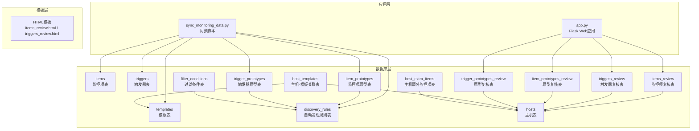
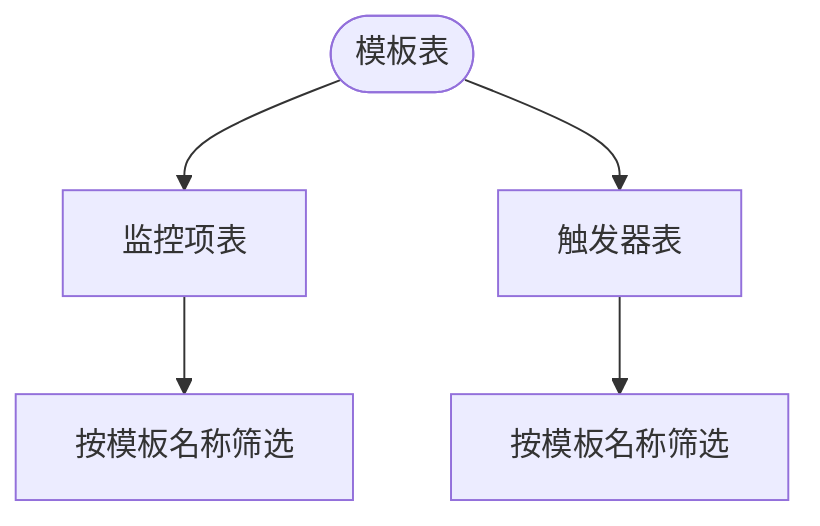
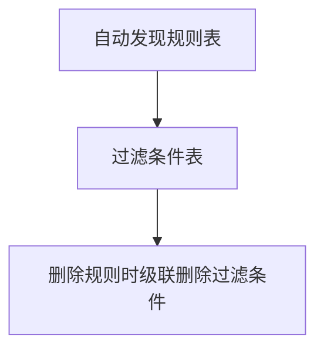
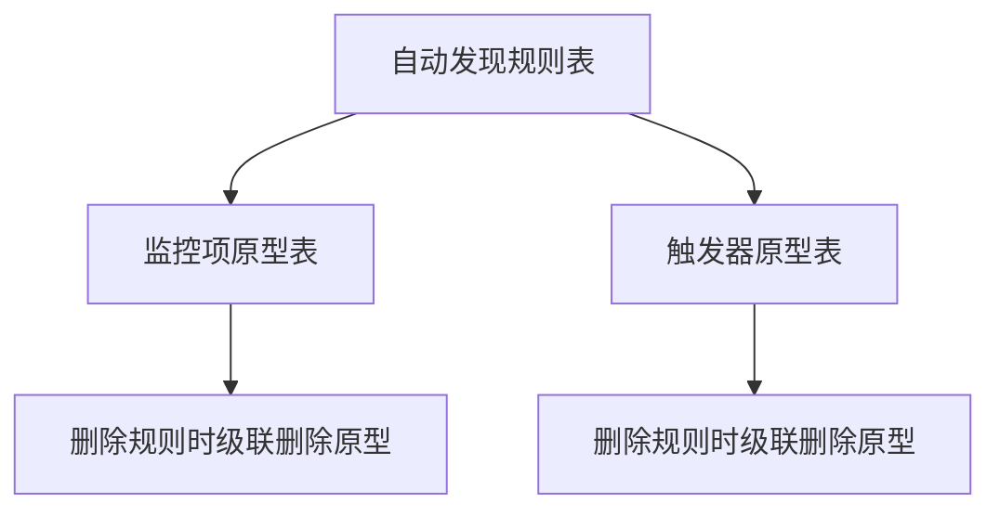
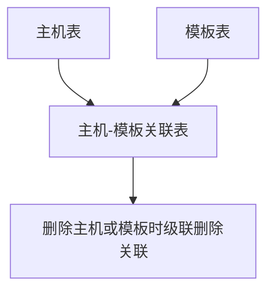
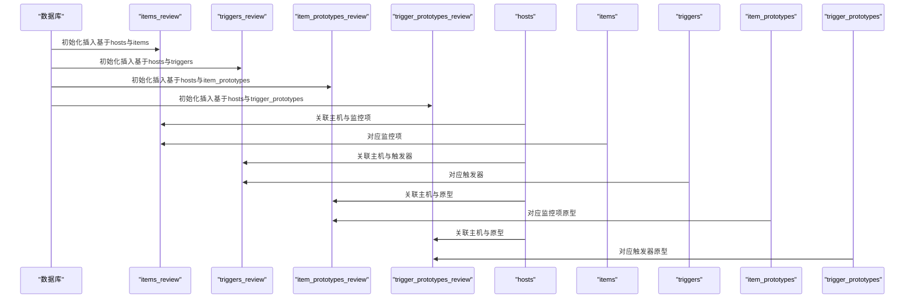
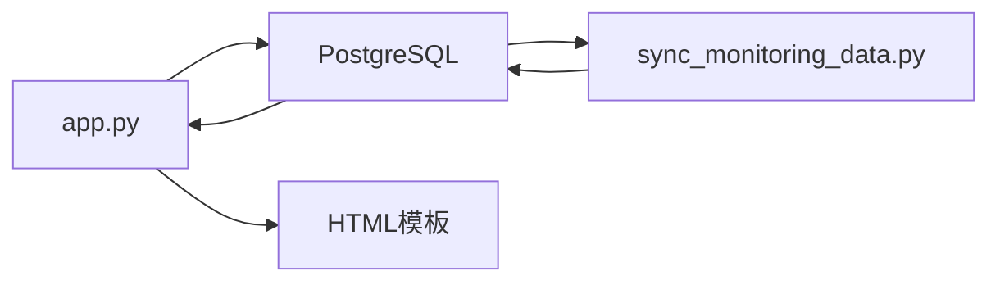

# 数据模型关系

<cite>
**本文档引用的文件**
- [create_tables.sql](file://create_tables.sql)
- [create_mac_tables.sql](file://create_mac_tables.sql)
- [create_review_tables.sql](file://create_review_tables.sql)
- [create_host_tables.sql](file://create_host_tables.sql)
- [update_database_schema.sql](file://update_database_schema.sql)
- [DATABASE_MIGRATION_PLAN.md](file://DATABASE_MIGRATION_PLAN.md)
- [sync_monitoring_data.py](file://sync_monitoring_data.py)
- [app.py](file://app.py)
- [execute_sql.py](file://execute_sql.py)
- [items_review.html](file://templates/items_review.html)
- [triggers_review.html](file://templates/triggers_review.html)
</cite>

## 目录
1. [简介](#简介)
2. [项目结构](#项目结构)
3. [核心组件](#核心组件)
4. [架构总览](#架构总览)
5. [详细组件分析](#详细组件分析)
6. [依赖分析](#依赖分析)
7. [性能考虑](#性能考虑)
8. [故障排除指南](#故障排除指南)
9. [结论](#结论)

## 简介
本文件聚焦于Zabbix监控审核与自动化控制中心的数据库数据模型关系，系统化阐述各表之间的关联关系、外键约束设计、级联删除策略以及数据完整性保障机制。特别地，文档详细解释了监控项与模板的一对多关系、自动发现规则与其过滤条件的父子关系、自动发现规则与监控项原型/触发器原型的关联关系，并通过ER图直观展示数据模型结构。此外，文档还说明了复核表如何支撑审核流程的数据关系设计，帮助读者全面理解该系统的数据架构。

## 项目结构
该项目采用“数据库表结构 + Python应用 + HTML模板”的分层组织方式：
- 数据库层：通过SQL脚本定义核心表结构及索引，支持模板、监控项、触发器、自动发现规则及其原型、过滤条件等。
- 应用层：Flask Web应用负责数据展示与复核流程管理；同步脚本负责将数据库配置同步至Zabbix。
- 模板层：Jinja2模板渲染Web界面，展示复核数据与操作入口。



图表来源
- [create_tables.sql:4-98](file://create_tables.sql#L4-L98)
- [create_mac_tables.sql:4-116](file://create_mac_tables.sql#L4-L116)
- [create_review_tables.sql:4-102](file://create_review_tables.sql#L4-L102)
- [create_host_tables.sql:3-40](file://create_host_tables.sql#L3-L40)
- [app.py:413-771](file://app.py#L413-L771)
- [sync_monitoring_data.py:63-177](file://sync_monitoring_data.py#L63-L177)

章节来源
- [create_tables.sql:1-198](file://create_tables.sql#L1-L198)
- [create_mac_tables.sql:1-252](file://create_mac_tables.sql#L1-L252)
- [create_review_tables.sql:1-201](file://create_review_tables.sql#L1-L201)
- [create_host_tables.sql:1-60](file://create_host_tables.sql#L1-L60)
- [app.py:1-774](file://app.py#L1-L774)
- [sync_monitoring_data.py:1-467](file://sync_monitoring_data.py#L1-L467)

## 核心组件
本节概述数据库中与监控审核和自动化控制密切相关的表及其职责：
- 模板表（templates/mac_templates）：存储监控模板元数据，作为监控项、触发器、自动发现规则的归属主体。
- 监控项表（items/mac_items）：存储模板化的监控项定义，与模板形成一对多关系。
- 触发器表（triggers/mac_triggers）：存储模板化的触发器定义，与模板形成一对多关系。
- 自动发现规则表（discovery_rules/mac_discovery_rules）：定义自动发现规则，与模板形成一对多关系。
- 过滤条件表（filter_conditions/mac_filter_conditions）：定义自动发现规则的过滤条件，与规则形成父子关系。
- 监控项原型表（item_prototypes/mac_item_prototypes）：定义自动发现规则下的监控项原型，与规则形成父子关系。
- 触发器原型表（trigger_prototypes/mac_trigger_prototypes）：定义自动发现规则下的触发器原型，与规则形成父子关系。
- 主机表（hosts/mac_hosts）：存储主机信息，与模板通过关联表建立多对多关系。
- 主机-模板关联表（host_templates/mac_host_templates）：建立主机与模板的多对多关系。
- 主机额外监控项表（host_extra_items/mac_host_extra_items）：存储主机层面的额外监控项，支持个性化定制。
- 复核表（items_review/mac_items_review、triggers_review/mac_triggers_review、item_prototypes_review/mac_item_prototypes_review、trigger_prototypes_review/mac_trigger_prototypes_review）：支撑审核流程，记录修改与确认状态。

章节来源
- [create_tables.sql:4-98](file://create_tables.sql#L4-L98)
- [create_mac_tables.sql:4-116](file://create_mac_tables.sql#L4-L116)
- [create_review_tables.sql:4-102](file://create_review_tables.sql#L4-L102)
- [create_host_tables.sql:3-40](file://create_host_tables.sql#L3-L40)

## 架构总览
下图展示了数据模型的整体关系，重点体现“模板-监控项/触发器”、“规则-过滤条件/原型”的层次化父子关系，以及“主机-模板”的多对多关系。

```mermaid
erDiagram
TEMPLATES {
int id PK
varchar name UK
text description
timestamp created_at
timestamp updated_at
}
ITEMS {
int id PK
varchar item_key UK
varchar name
int type
int value_type
varchar delay
text description
varchar units
int multiplier
int delta
int history
int trends
int status
varchar template_name
timestamp created_at
timestamp updated_at
}
TRIGGERS {
int id PK
varchar name
text expression
int priority
text description
int status
varchar template_name
timestamp created_at
timestamp updated_at
}
DISCOVERY_RULES {
int id PK
varchar name
varchar key
varchar delay
int evaltype
int status
varchar template_name
timestamp created_at
timestamp updated_at
}
FILTER_CONDITIONS {
int id PK
int discovery_rule_id FK
varchar macro
text value
varchar operator
timestamp created_at
}
ITEM_PROTOTYPES {
int id PK
int discovery_rule_id FK
varchar name
varchar key
int value_type
varchar delay
text description
varchar units
int multiplier
int delta
int history
int trends
int status
timestamp created_at
timestamp updated_at
}
TRIGGER_PROTOTYPES {
int id PK
int discovery_rule_id FK
text description
text expression
int priority
int status
timestamp created_at
timestamp updated_at
}
HOSTS {
int id PK
varchar name UK
text description
timestamp created_at
timestamp updated_at
}
HOST_TEMPLATES {
int id PK
int host_id FK
int template_id FK
timestamp created_at
unique(host_id, template_id)
}
HOST_EXTRA_ITEMS {
int id PK
varchar host_name
varchar item_key
varchar name
int type
int value_type
varchar delay
text description
varchar units
int multiplier
int delta
int history
int trends
int status
timestamp created_at
timestamp updated_at
unique(host_name, item_key)
}
ITEMS_REVIEW {
int id PK
int host_id FK
int item_id FK
varchar item_key
varchar name
int type
int value_type
varchar delay
text description
varchar units
int multiplier
int delta
int history
int trends
int status
varchar template_name
boolean modified
boolean confirmed
varchar status_verification
timestamp created_at
timestamp updated_at
unique(host_id, item_id)
}
TRIGGERS_REVIEW {
int id PK
int host_id FK
int trigger_id FK
varchar name
text expression
int priority
text description
int status
varchar template_name
boolean modified
boolean confirmed
varchar status_verification
timestamp created_at
timestamp updated_at
unique(host_id, trigger_id)
}
ITEM_PROTOTYPES_REVIEW {
int id PK
int host_id FK
int item_prototype_id FK
int discovery_rule_id FK
varchar name
varchar key
int value_type
varchar delay
text description
varchar units
int multiplier
int delta
int history
int trends
int status
boolean modified
boolean confirmed
varchar status_verification
timestamp created_at
timestamp updated_at
unique(host_id, item_prototype_id)
}
TRIGGER_PROTOTYPES_REVIEW {
int id PK
int host_id FK
int trigger_prototype_id FK
int discovery_rule_id FK
text description
text expression
int priority
int status
boolean modified
boolean confirmed
varchar status_verification
timestamp created_at
timestamp updated_at
unique(host_id, trigger_prototype_id)
}
TEMPLATES ||--o{ ITEMS : "包含"
TEMPLATES ||--o{ TRIGGERS : "包含"
TEMPLATES ||--o{ DISCOVERY_RULES : "包含"
DISCOVERY_RULES ||--o{ FILTER_CONDITIONS : "包含"
DISCOVERY_RULES ||--o{ ITEM_PROTOTYPES : "包含"
DISCOVERY_RULES ||--o{ TRIGGER_PROTOTYPES : "包含"
HOSTS ||--o{ HOST_EXTRA_ITEMS : "拥有"
HOSTS ||--o{ ITEMS_REVIEW : "关联"
HOSTS ||--o{ TRIGGERS_REVIEW : "关联"
HOSTS ||--o{ ITEM_PROTOTYPES_REVIEW : "关联"
HOSTS ||--o{ TRIGGER_PROTOTYPES_REVIEW : "关联"
ITEMS_REVIEW }o--|| ITEMS : "对应"
TRIGGERS_REVIEW }o--|| TRIGGERS : "对应"
ITEM_PROTOTYPES_REVIEW }o--|| ITEM_PROTOTYPES : "对应"
TRIGGER_PROTOTYPES_REVIEW }o--|| TRIGGER_PROTOTYPES : "对应"
HOSTS ||--o{ HOST_TEMPLATES : "关联"
TEMPLATES ||--o{ HOST_TEMPLATES : "被关联"
```

图表来源
- [create_tables.sql:4-98](file://create_tables.sql#L4-L98)
- [create_mac_tables.sql:4-116](file://create_mac_tables.sql#L4-L116)
- [create_review_tables.sql:4-102](file://create_review_tables.sql#L4-L102)
- [create_host_tables.sql:3-40](file://create_host_tables.sql#L3-L40)

## 详细组件分析

### 模板与监控项/触发器的关系
- 关系性质：模板与监控项、触发器之间是一对多关系。模板表作为父实体，监控项与触发器表通过字段标识其所属模板。
- 外键约束：监控项与触发器表均包含模板名称字段，用于标识归属模板。虽然未显式声明外键约束，但通过唯一约束与业务逻辑保证一致性。
- 级联删除：无级联删除策略，删除模板需先清理其下的监控项与触发器。



图表来源
- [create_tables.sql:4-35](file://create_tables.sql#L4-L35)
- [create_mac_tables.sql:4-44](file://create_mac_tables.sql#L4-L44)

章节来源
- [create_tables.sql:4-35](file://create_tables.sql#L4-L35)
- [create_mac_tables.sql:4-44](file://create_mac_tables.sql#L4-L44)

### 自动发现规则与其过滤条件的父子关系
- 关系性质：自动发现规则与其过滤条件之间是父子关系。过滤条件表通过外键引用规则表的主键。
- 外键约束：过滤条件表的规则ID字段引用规则表主键，并设置级联删除。
- 级联删除：当删除规则时，其下的过滤条件会自动删除，避免悬挂数据。



图表来源
- [create_tables.sql:37-58](file://create_tables.sql#L37-L58)
- [create_mac_tables.sql:46-67](file://create_mac_tables.sql#L46-L67)

章节来源
- [create_tables.sql:37-58](file://create_tables.sql#L37-L58)
- [create_mac_tables.sql:46-67](file://create_mac_tables.sql#L46-L67)

### 自动发现规则与监控项原型/触发器原型的关联关系
- 关系性质：规则与原型之间是父子关系。原型表通过外键引用规则表主键。
- 外键约束：原型表的规则ID字段引用规则表主键，并设置级联删除。
- 级联删除：删除规则时，其下的原型会自动删除，确保数据一致性。



图表来源
- [create_tables.sql:37-89](file://create_tables.sql#L37-L89)
- [create_mac_tables.sql:46-98](file://create_mac_tables.sql#L46-L98)

章节来源
- [create_tables.sql:37-89](file://create_tables.sql#L37-L89)
- [create_mac_tables.sql:46-98](file://create_mac_tables.sql#L46-L98)

### 主机与模板的多对多关系
- 关系性质：主机与模板之间是多对多关系，通过中间表建立关联。
- 外键约束：中间表的主机ID与模板ID分别引用主机表与模板表主键，并设置级联删除。
- 唯一约束：中间表对主机ID与模板ID组合进行唯一约束，防止重复关联。



图表来源
- [create_host_tables.sql:3-19](file://create_host_tables.sql#L3-L19)
- [create_mac_tables.sql:109-116](file://create_mac_tables.sql#L109-L116)

章节来源
- [create_host_tables.sql:3-19](file://create_host_tables.sql#L3-L19)
- [create_mac_tables.sql:109-116](file://create_mac_tables.sql#L109-L116)

### 复核表支撑审核流程的数据关系设计
- 关系性质：复核表与原始对象表之间是一对一映射关系，通过唯一约束绑定主机与对象。
- 外键约束：复核表的主机ID与对象ID字段分别引用主机表与原始对象表主键，并设置级联删除。
- 审核字段：复核表包含修改标记、确认标记与状态核验字段，支撑审核流程。
- 初始化：复核表通过SQL脚本从原始表初始化，确保每台主机的每个对象都有对应的复核记录。



图表来源
- [create_review_tables.sql:4-102](file://create_review_tables.sql#L4-L102)
- [app.py:413-771](file://app.py#L413-L771)

章节来源
- [create_review_tables.sql:4-102](file://create_review_tables.sql#L4-L102)
- [app.py:413-771](file://app.py#L413-L771)
- [items_review.html:1-46](file://templates/items_review.html#L1-L46)
- [triggers_review.html:1-42](file://templates/triggers_review.html#L1-L42)

### 数据完整性与级联删除策略
- 外键约束：过滤条件、原型表均通过外键引用规则表主键；复核表通过外键引用主机与原始对象表主键；主机-模板关联表通过外键引用主机与模板表主键。
- 级联删除：规则表的过滤条件与原型均设置级联删除；主机-模板关联表设置级联删除；复核表设置级联删除。
- 唯一约束：主机-模板关联表对主机ID与模板ID组合唯一；复核表对主机ID与对象ID组合唯一；主机额外监控项表对主机名与监控项键唯一；监控项表对监控项键唯一。
- 索引优化：为常用查询字段创建索引，如监控项键、模板名、规则ID、主机ID等，提升查询性能。

章节来源
- [create_tables.sql:50-107](file://create_tables.sql#L50-L107)
- [create_mac_tables.sql:59-151](file://create_mac_tables.sql#L59-L151)
- [create_review_tables.sql:104-119](file://create_review_tables.sql#L104-L119)
- [create_host_tables.sql:42-47](file://create_host_tables.sql#L42-L47)

## 依赖分析
- 应用层依赖：Flask应用通过数据库连接读取与更新复核表；同步脚本从数据库读取模板与对象配置，同步至Zabbix。
- 数据流向：数据库层承载数据，应用层负责展示与审核，同步脚本负责与Zabbix对接。
- 复核流程：前端模板展示复核数据，用户通过编辑与确认操作更新复核表状态。



图表来源
- [app.py:1-774](file://app.py#L1-L774)
- [sync_monitoring_data.py:1-467](file://sync_monitoring_data.py#L1-L467)

章节来源
- [app.py:1-774](file://app.py#L1-L774)
- [sync_monitoring_data.py:1-467](file://sync_monitoring_data.py#L1-L467)

## 性能考虑
- 索引策略：为监控项键、模板名、规则ID、主机ID等高频查询字段建立索引，减少查询时间。
- 唯一约束：通过唯一约束避免重复数据，降低去重与校验成本。
- 视图与聚合：通过视图整合主机、模板与对象数据，简化复杂查询。
- 同步策略：同步脚本按模板维度批量读取与更新，减少网络往返与事务开销。

章节来源
- [create_tables.sql:100-107](file://create_tables.sql#L100-L107)
- [create_mac_tables.sql:139-151](file://create_mac_tables.sql#L139-L151)
- [update_database_schema.sql:46-99](file://update_database_schema.sql#L46-L99)

## 故障排除指南
- 复核表字段缺失：若前端显示异常，检查复核表是否包含host_ip字段。根据迁移计划，复核表字段可能与模板表字段存在差异，需核对字段映射。
- 级联删除问题：删除规则后过滤条件或原型未删除，检查外键约束与级联删除设置。
- 唯一约束冲突：插入复核表或主机-模板关联表时出现唯一约束冲突，检查唯一键组合是否重复。
- 同步失败：同步脚本连接Zabbix失败或API调用异常，检查Zabbix API地址、认证信息与网络连通性。

章节来源
- [DATABASE_MIGRATION_PLAN.md:112-154](file://DATABASE_MIGRATION_PLAN.md#L112-L154)
- [app.py:413-771](file://app.py#L413-L771)
- [sync_monitoring_data.py:186-301](file://sync_monitoring_data.py#L186-L301)

## 结论
本数据模型围绕“模板-对象-规则-原型-主机”的层次化结构展开，通过外键约束与级联删除策略确保数据一致性，通过复核表支撑审核流程，通过索引与视图提升查询性能。该设计既满足Zabbix监控模板化管理的需求，又为后续的自动化控制与审计提供了坚实的数据基础。