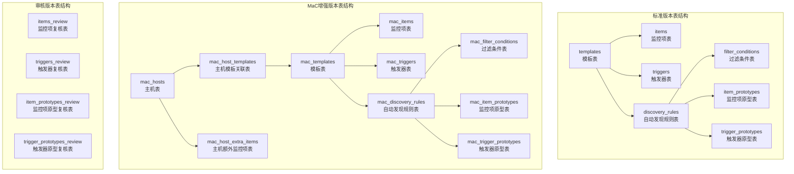
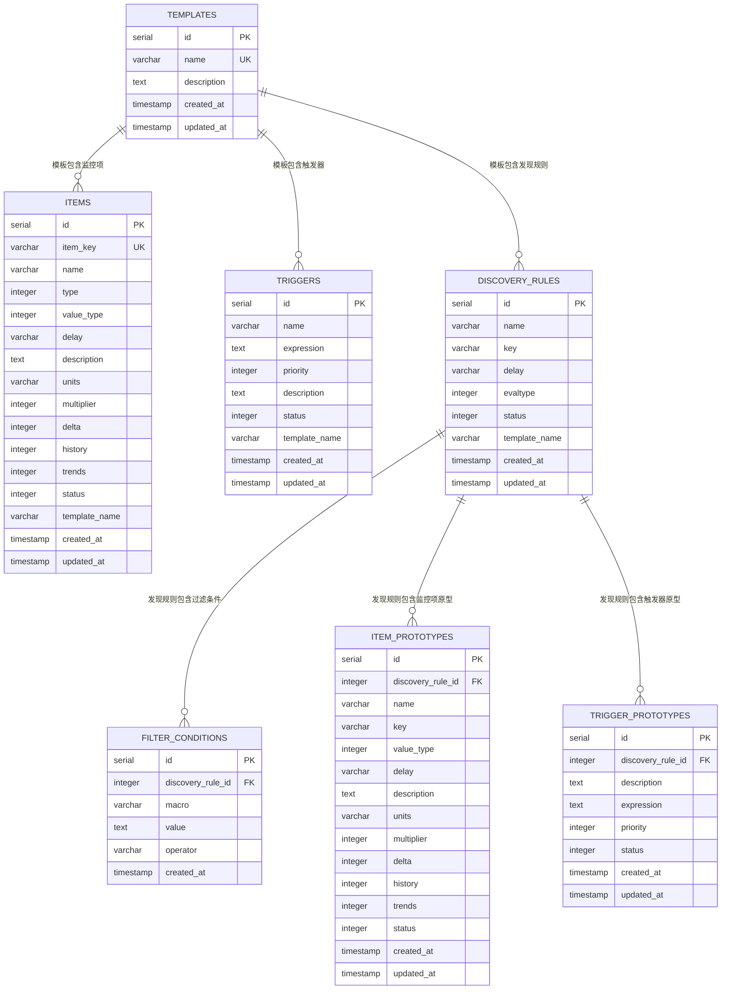
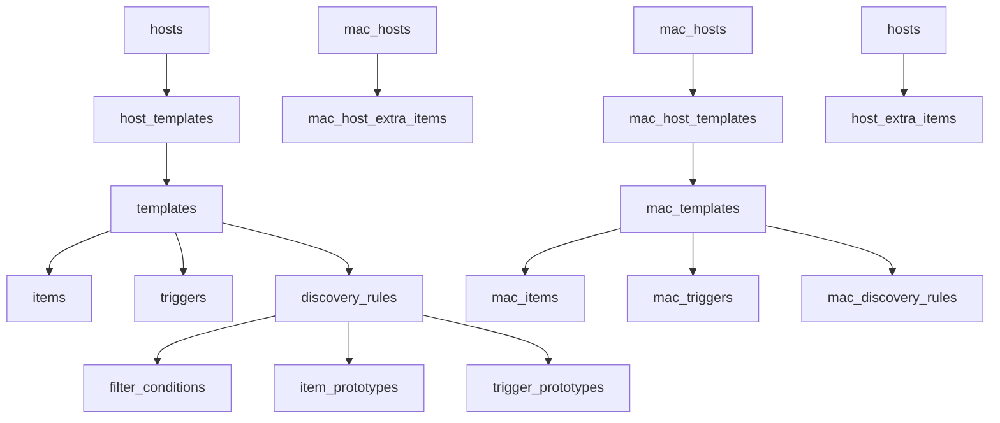
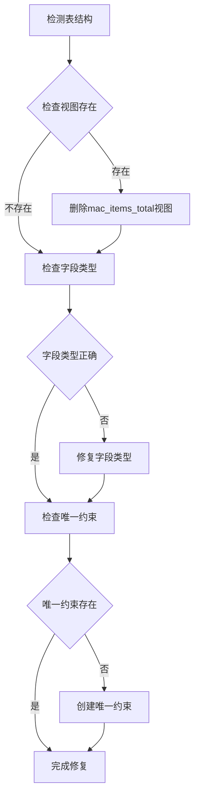

# 表结构设计

<cite>
**本文档引用的文件**
- [create_tables.sql](file://create_tables.sql)
- [create_mac_tables.sql](file://create_mac_tables.sql)
- [create_host_tables.sql](file://create_host_tables.sql)
- [create_review_tables.sql](file://create_review_tables.sql)
- [update_database_schema.sql](file://update_database_schema.sql)
- [execute_sql.py](file://execute_sql.py)
- [backup_database.py](file://backup_database.py)
- [database_backup/mac_items_20260420_104705.json](file://database_backup/mac_items_20260420_104705.json)
- [database_backup/mac_templates_20260420_104705.json](file://database_backup/mac_templates_20260420_104705.json)
- [database_backup/mac_discovery_rules_20260420_104705.json](file://database_backup/mac_discovery_rules_20260420_104705.json)
</cite>

## 目录
1. [简介](#简介)
2. [项目结构](#项目结构)
3. [核心组件](#核心组件)
4. [架构概览](#架构概览)
5. [详细组件分析](#详细组件分析)
6. [依赖分析](#依赖分析)
7. [性能考虑](#性能考虑)
8. [故障排除指南](#故障排除指南)
9. [结论](#结论)

## 简介

本文档详细描述了Zabbix监控审核和自动化控制中心的数据库表结构设计。该系统采用Monitor as Code (MaC)理念，通过数据库表来管理监控模板、监控项、触发器以及自动发现规则等核心监控配置。系统支持标准版本和MaC增强版本两种表结构，提供了完整的监控配置生命周期管理能力。

## 项目结构

系统采用分层的表结构设计，主要分为以下几类：

**图表来源**
- [create_tables.sql:1-198](file://create_tables.sql#L1-L198)
- [create_mac_tables.sql:1-252](file://create_mac_tables.sql#L1-L252)
- [create_review_tables.sql:1-201](file://create_review_tables.sql#L1-L201)

**章节来源**
- [create_tables.sql:1-198](file://create_tables.sql#L1-L198)
- [create_mac_tables.sql:1-252](file://create_mac_tables.sql#L1-L252)
- [create_review_tables.sql:1-201](file://create_review_tables.sql#L1-L201)

## 核心组件

系统包含三个主要版本的表结构设计，每种版本都有其特定的使用场景和功能特点：

### 标准版本表结构
- **templates**: 存储监控模板基本信息
- **items**: 存储监控项配置
- **triggers**: 存储触发器规则
- **discovery_rules**: 存储自动发现规则
- **filter_conditions**: 存储发现过滤条件
- **item_prototypes**: 存储监控项原型
- **trigger_prototypes**: 存储触发器原型

### MaC增强版本表结构
在标准版本基础上增加了主机管理和扩展监控项支持：
- **mac_hosts**: 主机管理表
- **mac_host_templates**: 主机与模板关联表
- **mac_host_extra_items**: 主机额外监控项表
- **mac_items_extra**: 用户自定义监控项扩展
- **mac_triggers_extra**: 用户自定义触发器扩展

### 审核版本表结构
提供监控配置的审核和变更追踪能力：
- **items_review**: 监控项变更审核表
- **triggers_review**: 触发器变更审核表
- **item_prototypes_review**: 监控项原型审核表
- **trigger_prototypes_review**: 触发器原型审核表

**章节来源**
- [create_tables.sql:4-98](file://create_tables.sql#L4-L98)
- [create_mac_tables.sql:4-116](file://create_mac_tables.sql#L4-L116)
- [create_review_tables.sql:4-102](file://create_review_tables.sql#L4-L102)

## 架构概览

系统采用层次化的表结构设计，通过外键关系建立表之间的关联：

**图表来源**
- [create_tables.sql:5-98](file://create_tables.sql#L5-L98)

## 详细组件分析

### 模板表 (templates)

模板表是整个监控系统的核心，用于组织和管理监控配置。

**字段定义**:
- `id`: 主键，自增序列
- `name`: 模板名称，唯一约束
- `description`: 模板描述
- `created_at`: 创建时间，默认当前时间戳
- `updated_at`: 更新时间，默认当前时间戳

**业务含义**:
- 作为监控项、触发器、发现规则的容器
- 支持多模板管理，便于监控配置的版本化控制
- 为审核版本提供基础数据源

**章节来源**
- [create_tables.sql:92-98](file://create_tables.sql#L92-L98)
- [create_mac_tables.sql:5-11](file://create_mac_tables.sql#L5-L11)

### 监控项表 (items)

监控项表存储具体的监控指标配置。

**字段定义**:
- `id`: 主键，自增序列
- `item_key`: 监控项键名，唯一约束
- `name`: 监控项显示名称
- `type`: 监控项类型
- `value_type`: 值类型
- `delay`: 采集间隔
- `description`: 描述信息
- `units`: 单位
- `multiplier`: 倍数，默认0
- `delta`: 变化类型，默认0
- `history`: 历史数据保留天数，默认7
- `trends`: 趋势数据保留天数，默认365
- `status`: 状态，默认0
- `template_name`: 所属模板名称
- `created_at`: 创建时间，默认当前时间戳
- `updated_at`: 更新时间，默认当前时间戳

**业务含义**:
- 定义具体的监控指标参数
- 支持多种监控项类型和值类型
- 提供历史和趋势数据的存储策略
- 与模板建立关联关系

**章节来源**
- [create_tables.sql:5-22](file://create_tables.sql#L5-L22)
- [create_mac_tables.sql:14-31](file://create_mac_tables.sql#L14-L31)

### 触发器表 (triggers)

触发器表定义监控告警规则。

**字段定义**:
- `id`: 主键，自增序列
- `name`: 触发器名称
- `expression`: 触发表达式
- `priority`: 告警优先级
- `description`: 描述信息
- `status`: 状态，默认0
- `template_name`: 所属模板名称
- `created_at`: 创建时间，默认当前时间戳
- `updated_at`: 更新时间，默认当前时间戳

**业务含义**:
- 定义监控告警的触发条件
- 支持不同优先级的告警级别
- 与模板关联，实现告警规则的模板化管理

**章节来源**
- [create_tables.sql:25-35](file://create_tables.sql#L25-L35)
- [create_mac_tables.sql:34-44](file://create_mac_tables.sql#L34-L44)

### 自动发现规则表 (discovery_rules)

自动发现规则表定义监控对象的自动发现机制。

**字段定义**:
- `id`: 主键，自增序列
- `name`: 发现规则名称
- `key`: 发现规则键名
- `delay`: 执行间隔
- `evaltype`: 计算类型，默认0
- `status`: 状态，默认0
- `template_name`: 所属模板名称
- `created_at`: 创建时间，默认当前时间戳
- `updated_at`: 更新时间，默认当前时间戳

**业务含义**:
- 定义监控对象的自动发现逻辑
- 支持网络接口、文件系统、块设备等发现规则
- 为后续的过滤条件和原型定义提供基础

**章节来源**
- [create_tables.sql:38-48](file://create_tables.sql#L38-L48)
- [create_mac_tables.sql:47-57](file://create_mac_tables.sql#L47-L57)

### 过滤条件表 (filter_conditions)

过滤条件表定义自动发现的筛选规则。

**字段定义**:
- `id`: 主键，自增序列
- `discovery_rule_id`: 外键，引用发现规则
- `macro`: 宏变量名称
- `value`: 匹配值
- `operator`: 操作符，默认MATCHES_REGEX
- `created_at`: 创建时间，默认当前时间戳

**业务含义**:
- 对自动发现的结果进行二次筛选
- 支持正则匹配和不匹配操作
- 实现监控对象的精确选择

**章节来源**
- [create_tables.sql:51-58](file://create_tables.sql#L51-L58)
- [create_mac_tables.sql:60-67](file://create_mac_tables.sql#L60-L67)

### 监控项原型表 (item_prototypes)

监控项原型表定义自动发现后生成的具体监控项模板。

**字段定义**:
- `id`: 主键，自增序列
- `discovery_rule_id`: 外键，引用发现规则
- `name`: 原型名称
- `key`: 原型键名
- `value_type`: 值类型
- `delay`: 采集间隔
- `description`: 描述信息
- `units`: 单位
- `multiplier`: 倍数，默认0
- `delta`: 变化类型，默认0
- `history`: 历史数据保留天数，默认7
- `trends`: 趋势数据保留天数，默认365
- `status`: 状态，默认0
- `created_at`: 创建时间，默认当前时间戳
- `updated_at`: 更新时间，默认当前时间戳

**业务含义**:
- 定义自动发现后生成的监控项模板
- 支持动态生成多个监控项实例
- 与发现规则建立一对一的关系

**章节来源**
- [create_tables.sql:61-77](file://create_tables.sql#L61-L77)
- [create_mac_tables.sql:70-86](file://create_mac_tables.sql#L70-L86)

### 触发器原型表 (trigger_prototypes)

触发器原型表定义自动发现后生成的告警规则模板。

**字段定义**:
- `id`: 主键，自增序列
- `discovery_rule_id`: 外键，引用发现规则
- `description`: 触发器描述
- `expression`: 触发表达式
- `priority`: 告警优先级
- `status`: 状态，默认0
- `created_at`: 创建时间，默认当前时间戳
- `updated_at`: 更新时间，默认当前时间戳

**业务含义**:
- 定义自动发现后生成的触发器模板
- 支持动态生成多个触发器实例
- 实现监控告警的模板化管理

**章节来源**
- [create_tables.sql:80-89](file://create_tables.sql#L80-L89)
- [create_mac_tables.sql:89-98](file://create_mac_tables.sql#L89-L98)

### MaC增强版本表结构

MaC版本在标准版本基础上增加了主机管理和扩展监控项支持：

#### 主机表 (mac_hosts)
- `id`: 主键，自增序列
- `name`: 主机名称，唯一约束
- `description`: 主机描述
- `template_name`: 默认模板名称
- `created_at`: 创建时间，默认当前时间戳
- `updated_at`: 更新时间，默认当前时间戳

#### 主机模板关联表 (mac_host_templates)
- `id`: 主键，自增序列
- `host_id`: 外键，引用主机
- `template_id`: 外键，引用模板
- `created_at`: 创建时间，默认当前时间戳
- 唯一约束：(host_id, template_id)

#### 主机额外监控项表 (mac_host_extra_items)
- `id`: 主键，自增序列
- `host_name`: 主机名称
- `item_key`: 监控项键名
- `name`: 监控项名称
- `type`: 监控项类型
- `value_type`: 值类型
- `delay`: 采集间隔
- `description`: 描述信息
- `units`: 单位
- `multiplier`: 倍数，默认0
- `delta`: 变化类型，默认0
- `history`: 历史数据保留天数，默认7
- `trends`: 趋势数据保留天数，默认365
- `status`: 状态，默认0
- `created_at`: 创建时间，默认当前时间戳
- `updated_at`: 更新时间，默认当前时间戳
- 唯一约束：(host_name, item_key)

**章节来源**
- [create_mac_tables.sql:101-137](file://create_mac_tables.sql#L101-L137)

### 审核版本表结构

审核版本提供监控配置的变更追踪和审批流程：

#### 监控项复核表 (items_review)
- `id`: 主键，自增序列
- `host_id`: 外键，引用主机
- `item_id`: 外键，引用监控项
- `item_key`: 监控项键名
- `name`: 监控项名称
- `type`: 监控项类型
- `value_type`: 值类型
- `delay`: 采集间隔
- `description`: 描述信息
- `units`: 单位
- `multiplier`: 倍数，默认0
- `delta`: 变化类型，默认0
- `history`: 历史数据保留天数，默认7
- `trends`: 趋势数据保留天数，默认365
- `status`: 状态，默认0
- `template_name`: 模板名称
- `modified`: 是否修改，默认FALSE
- `confirmed`: 是否确认，默认FALSE
- `status_verification`: 状态核验，默认pending
- `created_at`: 创建时间，默认当前时间戳
- `updated_at`: 更新时间，默认当前时间戳
- 唯一约束：(host_id, item_id)

**章节来源**
- [create_review_tables.sql:5-31](file://create_review_tables.sql#L5-L31)

## 依赖分析

系统表结构之间存在复杂的依赖关系，主要体现在外键约束和数据完整性保证上：

**图表来源**
- [create_tables.sql:5-98](file://create_tables.sql#L5-L98)
- [create_mac_tables.sql:4-116](file://create_mac_tables.sql#L4-L116)
- [create_host_tables.sql:4-40](file://create_host_tables.sql#L4-L40)

### 外键约束分析

系统通过外键约束确保数据的完整性和一致性：

1. **模板到监控项的约束**: 每个监控项必须属于一个有效的模板
2. **发现规则到过滤条件的约束**: 过滤条件必须关联到有效的发现规则
3. **发现规则到原型的约束**: 原型必须关联到有效的发现规则
4. **主机到模板的约束**: 主机模板关联必须引用有效的主机和模板
5. **主机到额外监控项的约束**: 额外监控项必须关联到有效的主机

### 约束条件总结

| 表名 | 主键约束 | 唯一约束 | 外键约束 |
|------|----------|----------|----------|
| templates | id | name | 无 |
| items | id | item_key | template_name → templates.name |
| triggers | id | 无 | template_name → templates.name |
| discovery_rules | id | 无 | template_name → templates.name |
| filter_conditions | id | 无 | discovery_rule_id → discovery_rules.id |
| item_prototypes | id | 无 | discovery_rule_id → discovery_rules.id |
| trigger_prototypes | id | 无 | discovery_rule_id → discovery_rules.id |
| mac_hosts | id | name | 无 |
| mac_host_templates | id | (host_id, template_id) | host_id → mac_hosts.id template_id → mac_templates.id |
| mac_host_extra_items | id | (host_name, item_key) | 无 |

**章节来源**
- [create_tables.sql:5-98](file://create_tables.sql#L5-L98)
- [create_mac_tables.sql:4-116](file://create_mac_tables.sql#L4-L116)
- [create_host_tables.sql:4-40](file://create_host_tables.sql#L4-L40)

## 性能考虑

系统在设计时充分考虑了性能优化，主要体现在索引设计和查询优化策略上：

### 索引设计

系统为常用查询字段建立了专门的索引：

1. **监控项表索引**:
   - `idx_items_item_key`: 基于item_key的唯一索引
   - `idx_items_template`: 基于template_name的普通索引

2. **发现规则表索引**:
   - `idx_discovery_rules_template`: 基于template_name的索引

3. **原型表索引**:
   - `idx_item_prototypes_rule`: 基于discovery_rule_id的索引
   - `idx_trigger_prototypes_rule`: 基于discovery_rule_id的索引

4. **主机相关表索引**:
   - `idx_hosts_name`: 基于name的唯一索引
   - `idx_host_templates_host`: 基于host_id的索引
   - `idx_host_templates_template`: 基于template_id的索引

### 查询优化策略

1. **批量操作**: 系统支持批量插入和更新操作，减少数据库往返次数
2. **索引优化**: 为高频查询字段建立索引，提高查询性能
3. **数据分区**: 对大量历史数据进行分区存储，提高查询效率
4. **缓存策略**: 对频繁访问的配置数据建立缓存层

## 故障排除指南

### 常见问题及解决方案

#### 表结构不一致问题
当系统检测到表结构不一致时，会自动执行修复操作：

**图表来源**
- [backup_database.py:117-155](file://backup_database.py#L117-L155)

#### 数据迁移问题
当从旧版本升级到新版本时，系统会自动处理数据迁移：

1. **字段添加**: 自动为现有表添加新字段
2. **表创建**: 创建新的表结构
3. **数据同步**: 同步现有数据到新表结构
4. **索引重建**: 重新创建必要的索引

**章节来源**
- [backup_database.py:117-155](file://backup_database.py#L117-L155)
- [update_database_schema.sql:4-123](file://update_database_schema.sql#L4-L123)

### 数据验证

系统提供了完善的数据验证机制：

1. **字段类型验证**: 确保字段类型符合预期
2. **唯一性验证**: 检查唯一约束是否满足
3. **外键完整性验证**: 确保外键引用有效
4. **数据完整性验证**: 检查关键字段是否为空

## 结论

本数据库表结构设计充分体现了Monitor as Code (MaC)的理念，通过标准化的表结构实现了监控配置的版本化管理、自动化部署和审核控制。系统支持三种不同的表结构版本，满足从简单监控到复杂企业级监控的各种需求。

### 设计优势

1. **模块化设计**: 清晰的表结构分离，便于维护和扩展
2. **数据完整性**: 完善的外键约束和约束条件，确保数据一致性
3. **性能优化**: 合理的索引设计和查询优化策略
4. **版本控制**: 支持监控配置的版本化管理和变更追踪
5. **扩展性**: MaC版本提供了强大的主机管理和扩展监控项能力

### 技术特色

1. **自动发现机制**: 完整的自动发现规则和原型体系
2. **审核流程**: 全面的监控配置审核和变更管理
3. **数据备份**: 完善的数据备份和恢复机制
4. **错误处理**: 健壮的错误检测和自动修复能力

该设计为Zabbix监控系统的自动化和标准化奠定了坚实的数据库基础，支持从个人使用到企业级大规模部署的各种应用场景。