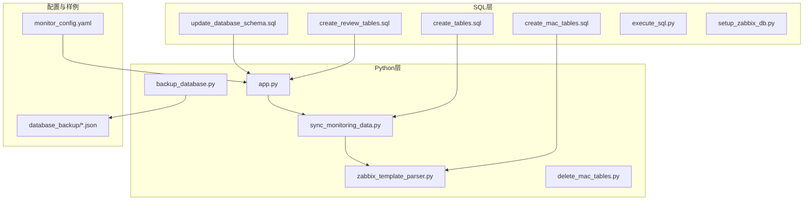
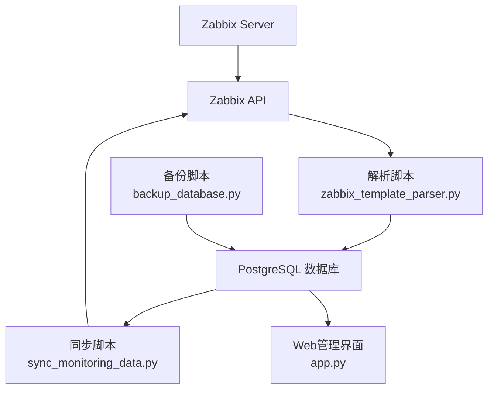
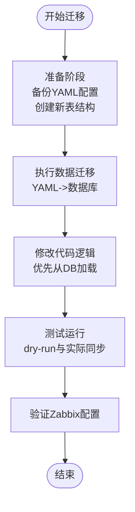
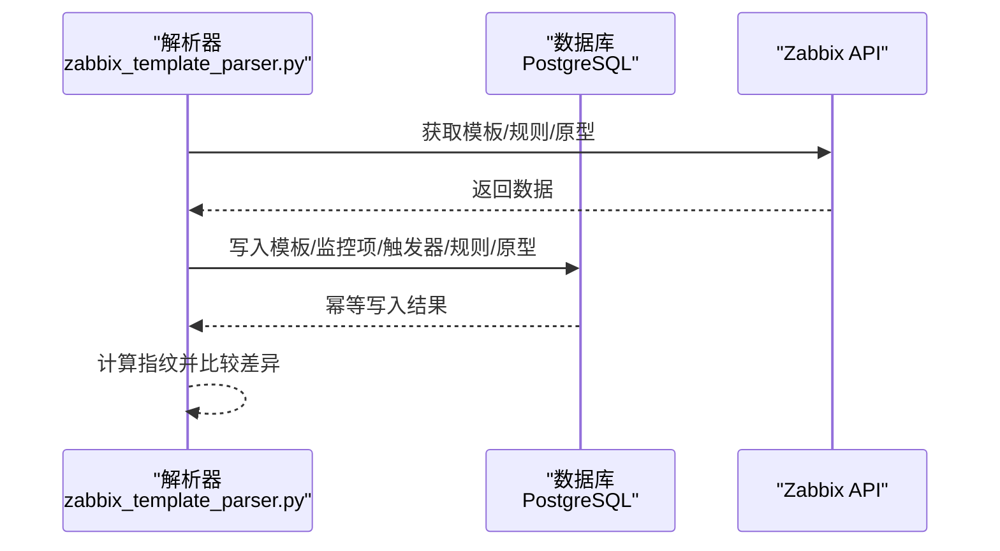
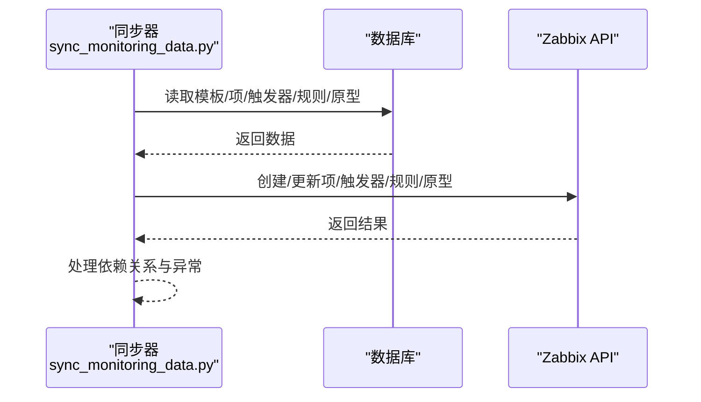
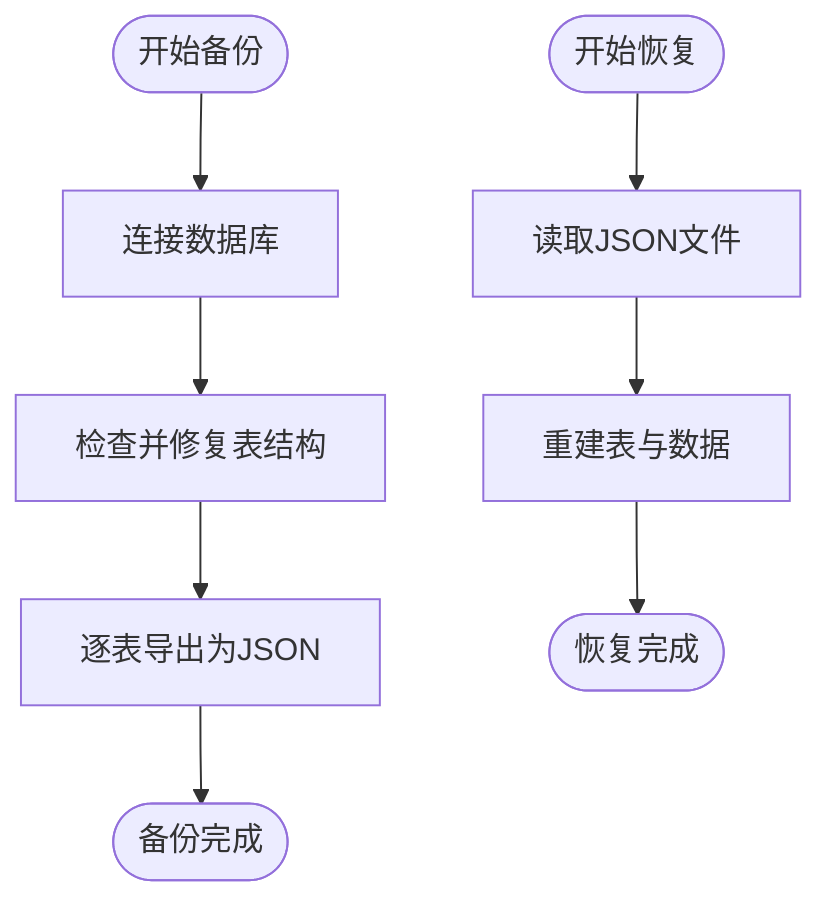
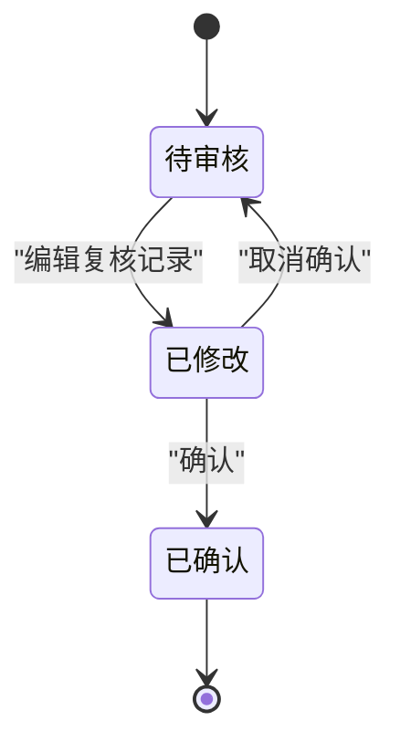
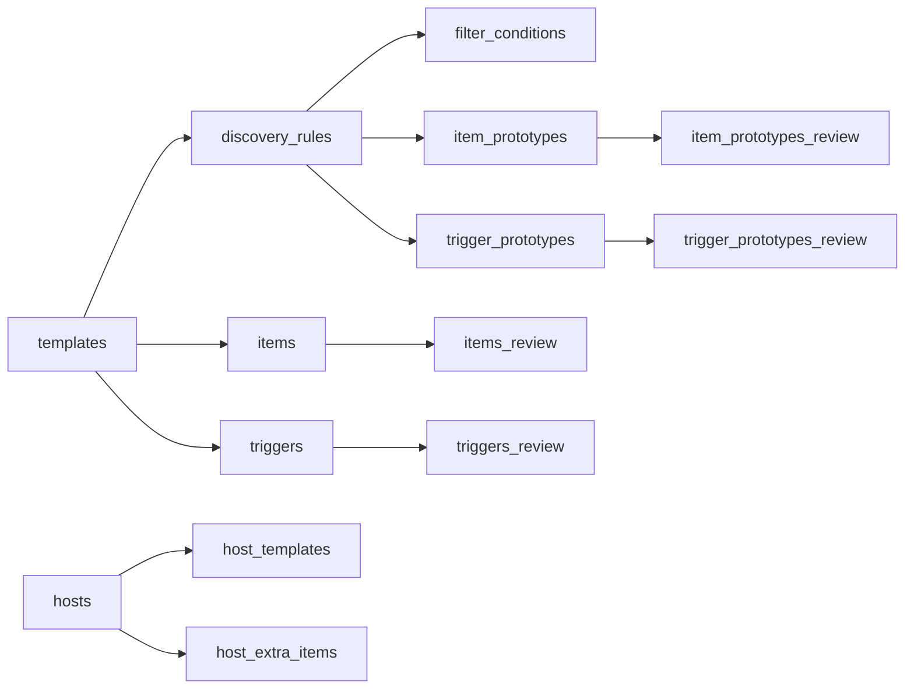

# 数据迁移与备份

<cite>
**本文引用的文件**
- [DATABASE_MIGRATION_PLAN.md](file://DATABASE_MIGRATION_PLAN.md)
- [backup_database.py](file://backup_database.py)
- [create_tables.sql](file://create_tables.sql)
- [create_mac_tables.sql](file://create_mac_tables.sql)
- [create_review_tables.sql](file://create_review_tables.sql)
- [update_database_schema.sql](file://update_database_schema.sql)
- [app.py](file://app.py)
- [zabbix_template_parser.py](file://zabbix_template_parser.py)
- [sync_monitoring_data.py](file://sync_monitoring_data.py)
- [monitor_config.yaml](file://monitor_config.yaml)
- [setup_zabbix_db.py](file://setup_zabbix_db.py)
- [execute_sql.py](file://execute_sql.py)
- [delete_mac_tables.py](file://delete_mac_tables.py)
</cite>

## 目录
1. [简介](#简介)
2. [项目结构](#项目结构)
3. [核心组件](#核心组件)
4. [架构总览](#架构总览)
5. [详细组件分析](#详细组件分析)
6. [依赖分析](#依赖分析)
7. [性能考量](#性能考量)
8. [故障排查指南](#故障排查指南)
9. [结论](#结论)
10. [附录](#附录)

## 简介
本文件面向“Zabbix监控审核与自动化控制中心”项目，围绕数据库迁移与备份两大主题，提供系统化、可落地的方案与最佳实践。内容涵盖：
- 数据库迁移规划与实施步骤（架构升级、数据转换、兼容性处理）
- 备份策略与恢复机制（备份文件格式、恢复流程）
- YAML到数据库的转换过程与数据一致性保障
- 增量备份、全量备份与灾难恢复最佳实践
- 数据迁移完整工作流程与风险控制措施

## 项目结构
该项目采用“SQL脚本 + Python脚本 + Web应用”的分层组织方式：
- SQL层：负责表结构定义、索引与示例数据初始化
- Python层：负责数据库连接、数据同步、备份与迁移
- Web层：基于Flask的可视化管理界面

图表来源
- [create_tables.sql](file://create_tables.sql)
- [create_mac_tables.sql](file://create_mac_tables.sql)
- [create_review_tables.sql](file://create_review_tables.sql)
- [update_database_schema.sql](file://update_database_schema.sql)
- [backup_database.py](file://backup_database.py)
- [sync_monitoring_data.py](file://sync_monitoring_data.py)
- [zabbix_template_parser.py](file://zabbix_template_parser.py)
- [app.py](file://app.py)
- [monitor_config.yaml](file://monitor_config.yaml)
- [database_backup](file://database_backup)

章节来源
- [create_tables.sql](file://create_tables.sql)
- [create_mac_tables.sql](file://create_mac_tables.sql)
- [create_review_tables.sql](file://create_review_tables.sql)
- [update_database_schema.sql](file://update_database_schema.sql)
- [backup_database.py](file://backup_database.py)
- [sync_monitoring_data.py](file://sync_monitoring_data.py)
- [zabbix_template_parser.py](file://zabbix_template_parser.py)
- [app.py](file://app.py)
- [monitor_config.yaml](file://monitor_config.yaml)
- [database_backup](file://database_backup)

## 核心组件
- 数据库表结构与索引
  - 基础模板与监控项/触发器/自动发现规则表
  - 复核表用于审核与状态核验
  - 新增主机与主机模板关联、主机额外监控项表
- 备份与恢复
  - JSON格式备份文件，按表拆分
  - 备份+修复+修改一体化流程
- 同步与解析
  - 从Zabbix API读取并写入数据库
  - 从数据库读取并同步到Zabbix
- Web管理
  - 基于Flask的增删改查界面
  - 复核表的确认/取消确认流程

章节来源
- [create_tables.sql](file://create_tables.sql)
- [create_mac_tables.sql](file://create_mac_tables.sql)
- [create_review_tables.sql](file://create_review_tables.sql)
- [backup_database.py](file://backup_database.py)
- [sync_monitoring_data.py](file://sync_monitoring_data.py)
- [zabbix_template_parser.py](file://zabbix_template_parser.py)
- [app.py](file://app.py)

## 架构总览
整体架构由“数据采集（Zabbix API）—数据存储（PostgreSQL）—数据展示（Web）—数据同步（双向）”组成，支持从YAML到数据库的迁移与从数据库到Zabbix的同步。

图表来源
- [sync_monitoring_data.py](file://sync_monitoring_data.py)
- [zabbix_template_parser.py](file://zabbix_template_parser.py)
- [app.py](file://app.py)
- [backup_database.py](file://backup_database.py)

## 详细组件分析

### 组件A：数据库迁移与架构升级
- 目标
  - 从YAML配置迁移到数据库表，支持主机配置、模板、监控项、触发器、自动发现规则及原型
  - 新增主机表、主机模板关联表、主机额外监控项表
- 关键步骤
  - 创建新表结构（含索引与示例数据）
  - 编写迁移脚本，将YAML配置导入数据库
  - 修改配置加载逻辑，优先从数据库加载，失败回退到YAML
  - 验证迁移结果，确保与Zabbix当前配置一致
- 数据一致性
  - 使用唯一约束避免重复
  - 使用ON CONFLICT策略进行幂等更新
  - 通过指纹计算与比较逻辑，最小化变更范围

图表来源
- [DATABASE_MIGRATION_PLAN.md](file://DATABASE_MIGRATION_PLAN.md)
- [create_mac_tables.sql](file://create_mac_tables.sql)
- [update_database_schema.sql](file://update_database_schema.sql)

章节来源
- [DATABASE_MIGRATION_PLAN.md](file://DATABASE_MIGRATION_PLAN.md)
- [create_mac_tables.sql](file://create_mac_tables.sql)
- [update_database_schema.sql](file://update_database_schema.sql)

### 组件B：YAML到数据库的转换与一致性保障
- 转换流程
  - 解析Zabbix模板，提取监控项、触发器、自动发现规则及其原型
  - 写入对应数据库表，保留中文注释与标准化字段
  - 通过唯一键与ON CONFLICT策略实现幂等写入
- 一致性保障
  - 使用Zabbix API指纹计算与比较，仅对差异项进行创建/更新
  - 支持触发器依赖关系的转换与同步
  - 复核表用于人工确认与状态核验

图表来源
- [zabbix_template_parser.py](file://zabbix_template_parser.py)
- [create_mac_tables.sql](file://create_mac_tables.sql)

章节来源
- [zabbix_template_parser.py](file://zabbix_template_parser.py)
- [create_mac_tables.sql](file://create_mac_tables.sql)

### 组件C：数据库到Zabbix的同步
- 功能
  - 从数据库读取最新配置，同步到Zabbix
  - 支持监控项、触发器、自动发现规则及其原型的创建/更新
  - 处理触发器依赖关系与部分字段的限制更新
- 错误处理
  - 对API异常进行捕获与日志记录
  - 逐条处理，保证部分失败不影响整体流程

图表来源
- [sync_monitoring_data.py](file://sync_monitoring_data.py)

章节来源
- [sync_monitoring_data.py](file://sync_monitoring_data.py)

### 组件D：备份与恢复机制
- 备份策略
  - 全量备份：按表导出为JSON文件，包含列名与行数据
  - 时间戳命名：便于区分版本与回滚
  - JSON编码器支持datetime序列化
- 恢复流程
  - 读取JSON文件，重建表结构与数据
  - 通过唯一约束与ON CONFLICT策略实现幂等恢复
- 修复能力
  - 检查并修复视图与字段类型不一致问题
  - 支持示例数据修改与验证

图表来源
- [backup_database.py](file://backup_database.py)

章节来源
- [backup_database.py](file://backup_database.py)

### 组件E：Web管理与复核流程
- 功能
  - 基于Flask的增删改查界面
  - 复核表支持“修改/确认/状态核验”字段
  - 支持主机与模板的关联管理
- 复核流程
  - 审核人员编辑复核记录，标记modified
  - 确认后设置confirmed，进入下一阶段
  - 未确认记录可随时取消确认

图表来源
- [app.py](file://app.py)
- [create_review_tables.sql](file://create_review_tables.sql)

章节来源
- [app.py](file://app.py)
- [create_review_tables.sql](file://create_review_tables.sql)

## 依赖分析
- 表间依赖
  - 自动发现规则依赖模板；原型依赖规则；过滤条件依赖规则
  - 复核表依赖主机与模板/规则/项
- 脚本依赖
  - 同步脚本依赖数据库表结构
  - 解析脚本依赖Zabbix API与数据库
  - Web界面依赖数据库与模板渲染
- 外部依赖
  - PostgreSQL驱动、PyZabbix、Flask

图表来源
- [create_tables.sql](file://create_tables.sql)
- [create_mac_tables.sql](file://create_mac_tables.sql)
- [create_review_tables.sql](file://create_review_tables.sql)

章节来源
- [create_tables.sql](file://create_tables.sql)
- [create_mac_tables.sql](file://create_mac_tables.sql)
- [create_review_tables.sql](file://create_review_tables.sql)

## 性能考量
- 索引优化
  - 在模板名、键名、规则ID等高频查询字段上建立索引
- 批量写入
  - 使用ON CONFLICT策略减少重复写入开销
- 连接池与超时
  - 建议在生产环境引入连接池与合理超时配置
- 复核表查询
  - 为confirmed字段建立索引，加速筛选

## 故障排查指南
- 数据库连接失败
  - 检查主机、端口、数据库名、用户名与密码
  - 使用独立脚本验证连接
- 表结构不一致
  - 使用修复函数检查并修正视图与字段类型
  - 重新创建视图或调整字段类型
- 同步异常
  - 查看API返回与日志，定位具体项/触发器/规则
  - 分批重试，避免全局阻塞
- 备份恢复失败
  - 确认JSON文件完整性与时间戳
  - 按表顺序恢复，必要时删除冲突数据后重试

章节来源
- [backup_database.py](file://backup_database.py)
- [sync_monitoring_data.py](file://sync_monitoring_data.py)
- [setup_zabbix_db.py](file://setup_zabbix_db.py)

## 结论
通过明确的迁移路径、完善的备份与恢复机制、严格的复核流程以及幂等的同步策略，本项目可在保证数据一致性的同时，实现从YAML到数据库再到Zabbix的全链路自动化管理。建议在生产环境中结合增量备份、定期演练与变更审批流程，持续提升系统的可靠性与可维护性。

## 附录

### A. 数据库迁移工作流程（摘要）
- 准备阶段
  - 备份现有YAML配置
  - 创建新表结构与索引
  - 编写迁移脚本
- 实施阶段
  - 执行迁移，校验唯一性与完整性
  - 修改配置加载逻辑，启用数据库优先
  - 进行dry-run与实际同步验证
- 验证阶段
  - 对比Zabbix当前配置与数据库目标配置
  - 修复差异，完成最终确认

章节来源
- [DATABASE_MIGRATION_PLAN.md](file://DATABASE_MIGRATION_PLAN.md)
- [create_mac_tables.sql](file://create_mac_tables.sql)
- [update_database_schema.sql](file://update_database_schema.sql)

### B. 备份文件格式与恢复流程（摘要）
- 备份文件格式
  - JSON对象，包含表名、列名数组与行数据
  - 时间戳命名，便于版本管理
- 恢复流程
  - 读取JSON，重建表结构
  - 插入数据，使用唯一约束避免重复
  - 验证数据完整性

章节来源
- [backup_database.py](file://backup_database.py)
- [database_backup](file://database_backup)

### C. 增量备份、全量备份与灾难恢复最佳实践
- 增量备份
  - 基于时间戳与唯一键的差异导出
  - 与全量备份结合，形成周期性策略
- 全量备份
  - 每月/每季度执行一次，归档至安全位置
- 灾难恢复
  - 定期演练恢复流程，验证备份文件可用性
  - 恢复后立即进行一致性校验与Zabbix配置对比

章节来源
- [backup_database.py](file://backup_database.py)

### D. YAML到数据库转换的关键点
- 字段映射与标准化
  - 保留中文注释，统一单位与类型
- 幂等写入
  - 使用唯一键与ON CONFLICT策略
- 触发器依赖
  - 转换依赖关系并在同步阶段重建

章节来源
- [zabbix_template_parser.py](file://zabbix_template_parser.py)
- [create_mac_tables.sql](file://create_mac_tables.sql)

### E. 数据库初始化与清理
- 初始化
  - 使用SQL脚本或Python脚本创建表与索引
  - 使用示例数据验证流程
- 清理
  - 删除以“mac”开头的表，便于切换到新架构

章节来源
- [execute_sql.py](file://execute_sql.py)
- [delete_mac_tables.py](file://delete_mac_tables.py)
- [setup_zabbix_db.py](file://setup_zabbix_db.py)