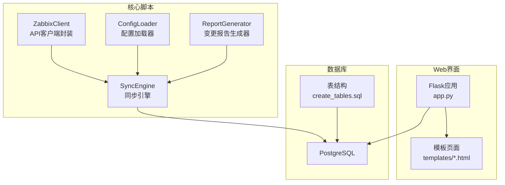
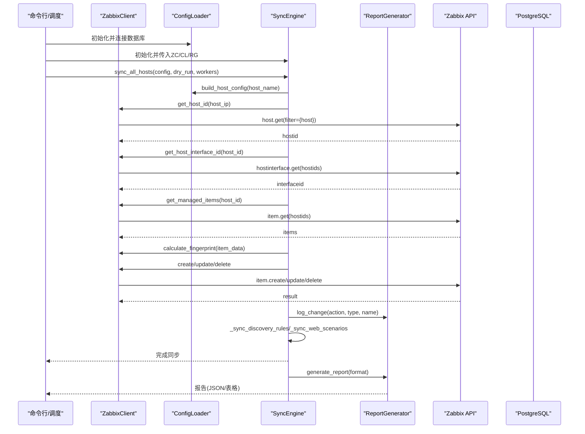
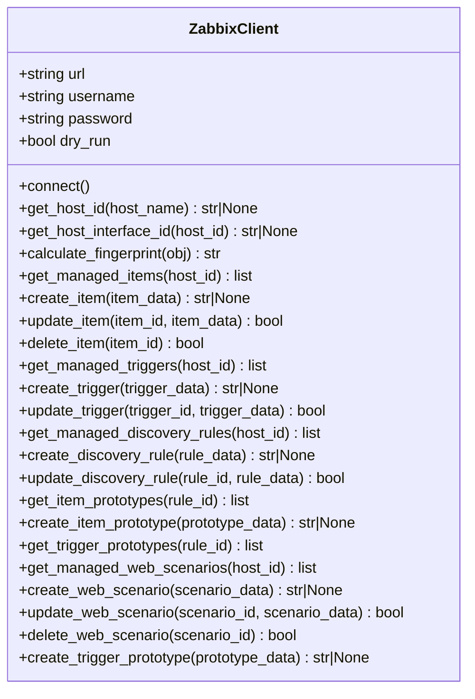
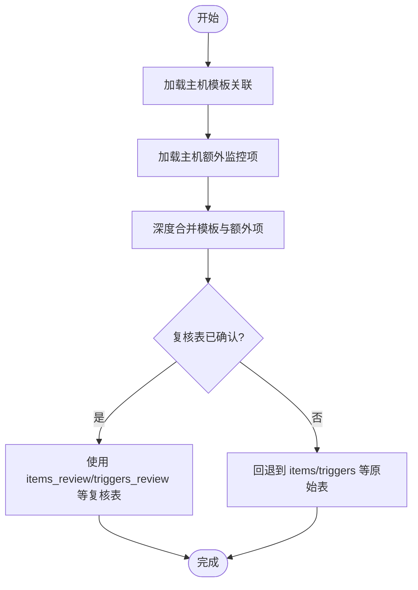
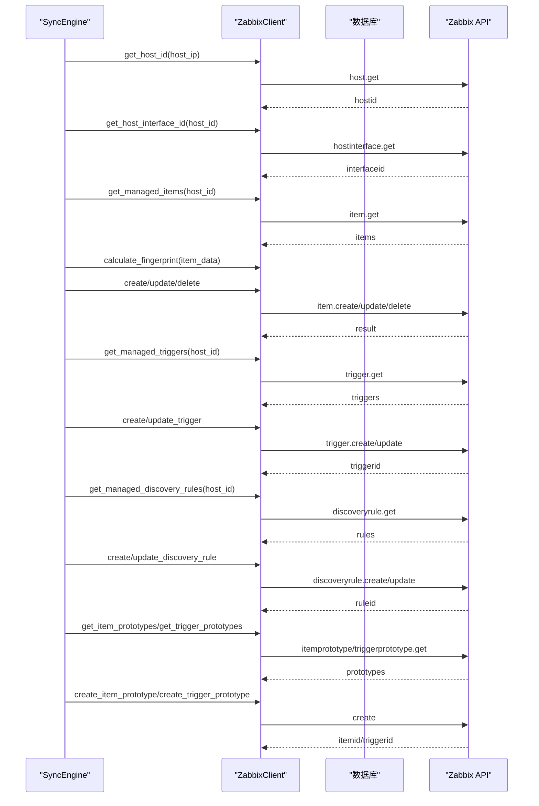
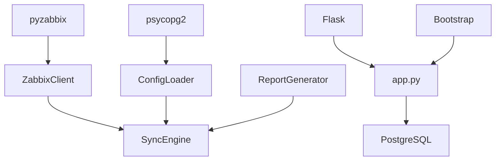

# Zabbix API客户端

<cite>
**本文档引用的文件**
- [zabbix_mac.py](file://zabbix_mac.py)
- [CODE_WIKI.md](file://CODE_WIKI.md)
- [app.py](file://app.py)
- [check_api_params.py](file://check_api_params.py)
- [monitor_config.yaml](file://monitor_config.yaml)
- [create_tables.sql](file://create_tables.sql)
- [read_template_from_zabbix.py](file://read_template_from_zabbix.py)
</cite>

## 目录
1. [简介](#简介)
2. [项目结构](#项目结构)
3. [核心组件](#核心组件)
4. [架构总览](#架构总览)
5. [详细组件分析](#详细组件分析)
6. [依赖分析](#依赖分析)
7. [性能考虑](#性能考虑)
8. [故障排除指南](#故障排除指南)
9. [结论](#结论)
10. [附录](#附录)

## 简介
本项目为 Zabbix Monitor as Code (MaC) 自动化系统，提供基于 Python 3 的 Zabbix 5.0 API 客户端封装与声明式同步能力，涵盖监控项（Items）、触发器（Triggers）、自动发现规则（LLD）及 Web 场景的管理。系统支持：
- 从数据库加载模板与主机配置
- 并发同步多台主机
- 生成变更报告
- dry_run 模式进行安全预演
- Web 管理界面与复核表机制

## 项目结构
项目采用“核心脚本 + Web界面 + 数据库表”的分层组织方式，核心同步逻辑集中在 zabbix_mac.py，Web 管理界面基于 Flask，数据库表结构由 SQL 脚本初始化。

**图表来源**
- [zabbix_mac.py](file://zabbix_mac.py)
- [app.py](file://app.py)
- [create_tables.sql](file://create_tables.sql)

**章节来源**
- [CODE_WIKI.md](file://CODE_WIKI.md)
- [zabbix_mac.py](file://zabbix_mac.py)
- [app.py](file://app.py)
- [create_tables.sql](file://create_tables.sql)

## 核心组件
- ZabbixClient：封装 Zabbix API 调用，提供连接管理、重试机制、错误处理、并发安全、对象指纹计算、主机/接口管理、监控项/触发器/规则/原型/场景的 CRUD 操作。
- ConfigLoader：从数据库加载模板与主机配置，支持模板合并与主机额外项覆盖。
- SyncEngine：核心同步逻辑，按主机维度执行监控项、触发器、LLD 规则及其原型、Web 场景的同步与清理。
- ReportGenerator：线程安全地记录创建/更新/删除变更，支持 JSON/表格两种报告格式。
- Flask Web 应用：提供系统信息、模板管理、监控项/触发器/原型管理、主机管理与复核表管理。

**章节来源**
- [zabbix_mac.py](file://zabbix_mac.py)
- [CODE_WIKI.md](file://CODE_WIKI.md)

## 架构总览
系统采用“配置驱动 + API 同步 + 报告输出”的架构，核心流程如下：

**图表来源**
- [zabbix_mac.py](file://zabbix_mac.py)

**章节来源**
- [zabbix_mac.py](file://zabbix_mac.py)

## 详细组件分析

### ZabbixClient 设计与实现
- 连接管理
  - 支持 dry_run 模式：在 dry_run=True 时跳过真实 API 调用，仅记录日志与模拟返回。
  - 连接建立：通过 ZabbixAPI(url) 与 api.login(username, password) 完成认证。
  - 重试机制：MAX_RETRY_ATTEMPTS=3，RETRY_DELAY=2s，捕获 ZabbixAPIException 与通用异常后指数退避式重试。
- 并发安全
  - 各 API 方法均内置重试与异常处理，避免因瞬时网络波动导致的失败。
  - ReportGenerator 使用 threading.Lock 保证变更记录的线程安全。
- 错误处理策略
  - 明确区分 ZabbixAPIException 与通用异常，分别记录错误日志并决定是否重试。
  - 对于不存在的对象（如主机、接口、规则），返回 None 并记录警告。
- 主机与接口管理
  - get_host_id：根据 host_name 查询 hostid，支持 dry_run 模拟。
  - get_host_interface_id：优先选择 type=1 的 Zabbix agent 接口，否则使用首个可用接口。
- 监控项管理
  - get_managed_items：获取主机所有监控项（Zabbix 5.0 无标签功能）。
  - create_item/update_item/delete_item：封装 CRUD，支持 dry_run。
- 触发器管理
  - get_managed_triggers：过滤带 ManagedBy 标签的触发器。
  - create_trigger/update_trigger：自动附加 ManagedBy 标签。
- 自动发现规则与原型
  - get_managed_discovery_rules：获取主机所有 LLD 规则（Zabbix 5.0 无标签功能）。
  - create_discovery_rule/update_discovery_rule：兼容不同 Zabbix 版本返回字段（ruleids/itemids）。
  - get_item_prototypes/get_trigger_prototypes：获取规则下的原型。
  - create_item_prototype/create_trigger_prototype：自动附加 ManagedBy 标签；触发器原型使用 discoveryids 参数。
- Web 场景管理
  - get_managed_web_scenarios：过滤带 ManagedBy 标签的 Web 场景。
  - create_web_scenario/update_web_scenario/delete_web_scenario：封装 CRUD。
- 指纹计算算法
  - calculate_fingerprint：排除不参与比对的字段（如 itemid/hostid/triggerid/ruleid/created/lastclock），对对象进行键排序后序列化并计算 MD5，用于配置比较与变更检测。

**图表来源**
- [zabbix_mac.py](file://zabbix_mac.py)

**章节来源**
- [zabbix_mac.py](file://zabbix_mac.py)

### ConfigLoader 配置加载与合并
- 数据库连接与重试：支持 MAX_RETRY_ATTEMPTS 与 RETRY_DELAY，连接失败自动重试。
- 配置加载
  - load_config：从数据库加载主机模板关联与额外监控项。
  - load_template_from_db：从 items_review/triggers_review/discovery_rules/item_prototypes_review/trigger_prototypes_review 等表加载模板，优先使用 confirmed=true 的记录，否则回退到原始表。
  - build_host_config：合并模板与主机额外项，额外项优先级最高。
- 深度合并：deep_merge 支持嵌套字典合并，避免覆盖模板中的关键字段。

**图表来源**
- [zabbix_mac.py](file://zabbix_mac.py)

**章节来源**
- [zabbix_mac.py](file://zabbix_mac.py)

### SyncEngine 同步引擎
- 主机同步入口：sync_host(host_name, config, dry_run)
- 监控项同步
  - 分离独立项与依赖项（type=15/18 且含 master_item），先创建独立项，再创建依赖项。
  - 通过 calculate_fingerprint 比较目标与当前配置，必要时更新或创建。
  - 依赖项 master_itemid 通过当前映射查找，若缺失则跳过创建。
- 触发器同步
  - 表达式宏变量替换为默认值，确保表达式可读性；保留 {host:name} 格式，避免 Zabbix 解析错误。
  - 依赖关系处理：先创建不含依赖的触发器，再执行二次更新以设置依赖关系。
- LLD 规则与原型
  - 规则同步：兼容不同版本返回字段（ruleid/itemids），指纹比较后更新或创建。
  - 原型同步：监控项原型与触发器原型分别处理，支持 Dependent item 与 Calculated item 的特殊参数。
- Web 场景同步
  - 通过 name 匹配，指纹比较后更新或创建。
- 清理多余对象
  - 对监控项、触发器、LLD 规则、Web 场景执行差异比对并删除多余对象。

**图表来源**
- [zabbix_mac.py](file://zabbix_mac.py)

**章节来源**
- [zabbix_mac.py](file://zabbix_mac.py)

### ReportGenerator 报告生成器
- 线程安全：使用 threading.Lock 保护变更记录。
- 变更类型：created/updated/deleted，记录对象类型、名称与详情。
- 报告格式：支持 JSON 与表格两种输出，便于审计与人工审阅。

**章节来源**
- [zabbix_mac.py](file://zabbix_mac.py)

### Web 管理界面（Flask）
- 路由覆盖：系统信息、模板管理、监控项/触发器/原型管理、主机管理、复核表管理等。
- 数据库交互：通过 psycopg2 连接 PostgreSQL，支持增删改查与批量操作。
- 闪存消息：使用 Flask 的 flash 机制提示操作结果。

**章节来源**
- [app.py](file://app.py)

## 依赖分析
- 外部依赖
  - pyzabbix：Zabbix API 客户端库
  - psycopg2：PostgreSQL 数据库驱动
  - Flask：Web 应用框架
  - Bootstrap：前端 UI 框架
- 内部耦合
  - ZabbixClient 与 SyncEngine 强耦合（API 调用）
  - ConfigLoader 与 SyncEngine（配置加载）
  - ReportGenerator 与 SyncEngine（变更记录）
  - Web 应用与数据库（数据持久化）

**图表来源**
- [zabbix_mac.py](file://zabbix_mac.py)
- [app.py](file://app.py)

**章节来源**
- [zabbix_mac.py](file://zabbix_mac.py)
- [CODE_WIKI.md](file://CODE_WIKI.md)

## 性能考虑
- 并发同步：通过 ThreadPoolExecutor 并发处理多台主机，提升大规模环境下的同步效率。
- 重试与退避：统一的重试策略降低瞬时故障影响，避免过度重试导致资源浪费。
- 指纹比较：通过 MD5 指纹快速判断配置是否变化，减少不必要的 API 调用。
- 数据库索引：SQL 脚本中为关键字段建立索引，优化查询性能。
- 表结构设计：合理字段类型与默认值，减少存储与传输开销。

[本节为通用性能讨论，无需具体文件分析]

## 故障排除指南
- 连接 Zabbix API 失败
  - 检查 URL 与凭据；确认网络连通性；查看日志中的 ZabbixAPIException 与通用异常信息。
- 主机不存在
  - 确认主机名与 Zabbix 中注册一致；检查 get_host_id 的返回值。
- 同步失败
  - 检查用户权限与数据库配置；查看 ReportGenerator 输出的变更详情。
- 数据库连接失败
  - 检查数据库配置与服务状态；利用 ConfigLoader 的重试机制自动恢复。
- Web 服务器启动失败
  - 检查端口占用并释放端口；确认 Flask 应用配置正确。

**章节来源**
- [zabbix_mac.py](file://zabbix_mac.py)
- [CODE_WIKI.md](file://CODE_WIKI.md)

## 结论
Zabbix API 客户端通过严谨的连接管理、重试机制、错误处理与并发安全设计，结合配置驱动与声明式同步策略，实现了对监控项、触发器、LLD 规则与 Web 场景的高效管理。配合 Web 界面与复核表机制，系统在保证安全性的同时提升了可维护性与可观测性。

[本节为总结性内容，无需具体文件分析]

## 附录

### 代码示例路径（不展示具体代码，仅提供定位）
- 初始化 ZabbixClient 并连接
  - [zabbix_mac.py](file://zabbix_mac.py)
- 获取主机 ID
  - [zabbix_mac.py](file://zabbix_mac.py)
- 获取主机接口 ID
  - [zabbix_mac.py](file://zabbix_mac.py)
- 创建监控项
  - [zabbix_mac.py](file://zabbix_mac.py)
- 更新监控项
  - [zabbix_mac.py](file://zabbix_mac.py)
- 删除监控项
  - [zabbix_mac.py](file://zabbix_mac.py)
- 创建触发器
  - [zabbix_mac.py](file://zabbix_mac.py)
- 更新触发器
  - [zabbix_mac.py](file://zabbix_mac.py)
- 创建 LLD 规则
  - [zabbix_mac.py](file://zabbix_mac.py)
- 更新 LLD 规则
  - [zabbix_mac.py](file://zabbix_mac.py)
- 创建监控项原型
  - [zabbix_mac.py](file://zabbix_mac.py)
- 创建触发器原型
  - [zabbix_mac.py](file://zabbix_mac.py)
- 创建 Web 场景
  - [zabbix_mac.py](file://zabbix_mac.py)
- 更新 Web 场景
  - [zabbix_mac.py](file://zabbix_mac.py)
- 删除 Web 场景
  - [zabbix_mac.py](file://zabbix_mac.py)
- 计算指纹
  - [zabbix_mac.py](file://zabbix_mac.py)
- 从数据库加载配置
  - [zabbix_mac.py](file://zabbix_mac.py)
- 构建主机配置
  - [zabbix_mac.py](file://zabbix_mac.py)
- 同步主机
  - [zabbix_mac.py](file://zabbix_mac.py)
- 生成变更报告
  - [zabbix_mac.py](file://zabbix_mac.py)

### API 参数检查脚本
- 用于检查 triggerprototype.create 与 itemprototype.create 的参数信息，辅助开发与调试。
  - [check_api_params.py](file://check_api_params.py)

### 监控配置示例
- YAML 配置示例，展示主机、模板与额外监控项的定义方式。
  - [monitor_config.yaml](file://monitor_config.yaml)

### 数据库表结构
- 初始化表结构与示例数据，支撑模板与主机配置的持久化。
  - [create_tables.sql](file://create_tables.sql)

### 从 Zabbix 读取模板
- 将 Zabbix 模板导出到数据库，便于后续同步与复核。
  - [read_template_from_zabbix.py](file://read_template_from_zabbix.py)

**章节来源**
- [zabbix_mac.py](file://zabbix_mac.py)
- [check_api_params.py](file://check_api_params.py)
- [monitor_config.yaml](file://monitor_config.yaml)
- [create_tables.sql](file://create_tables.sql)
- [read_template_from_zabbix.py](file://read_template_from_zabbix.py)