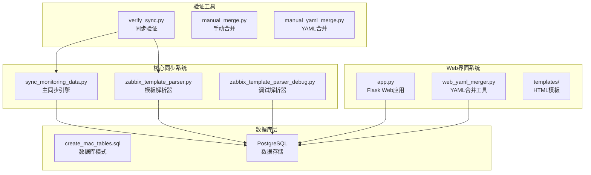
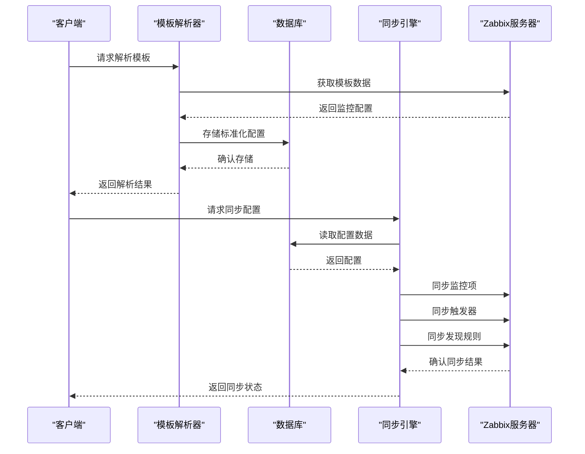
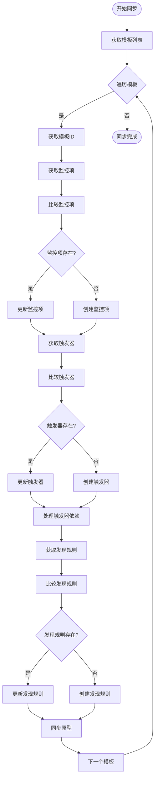
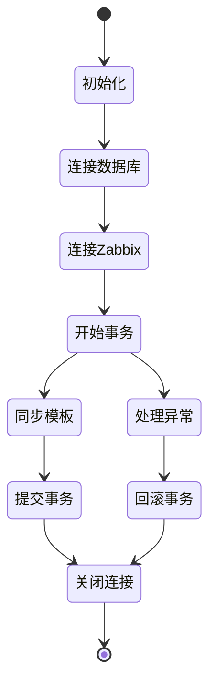
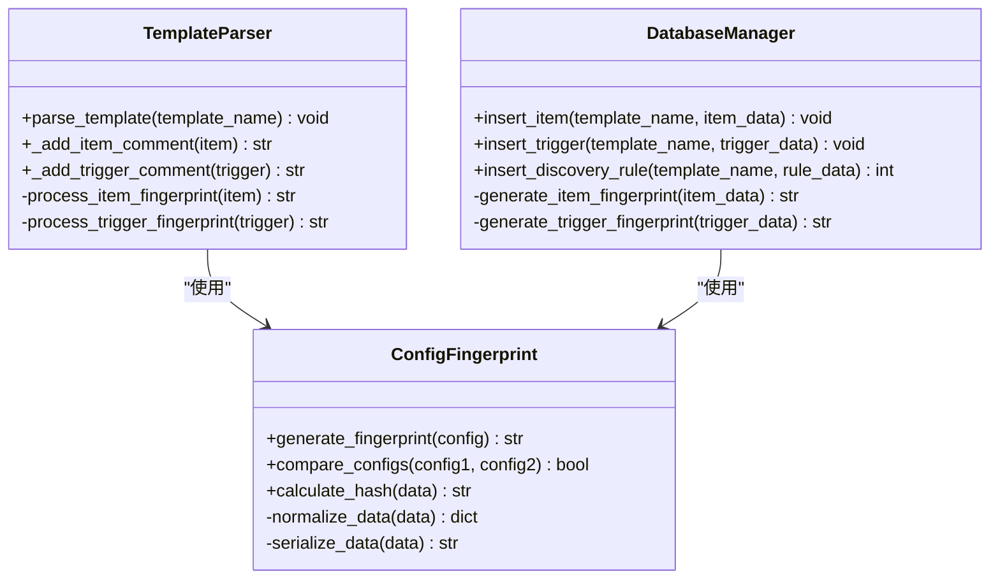
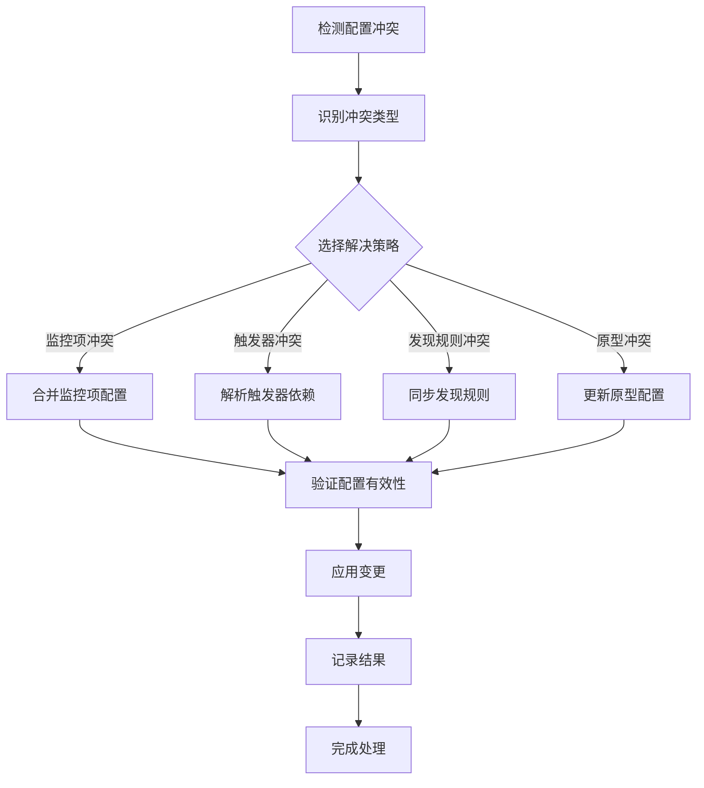
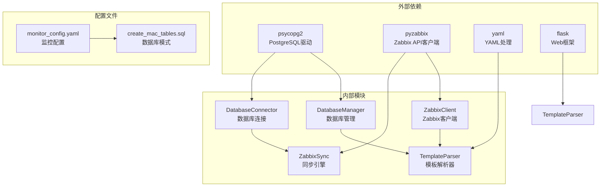
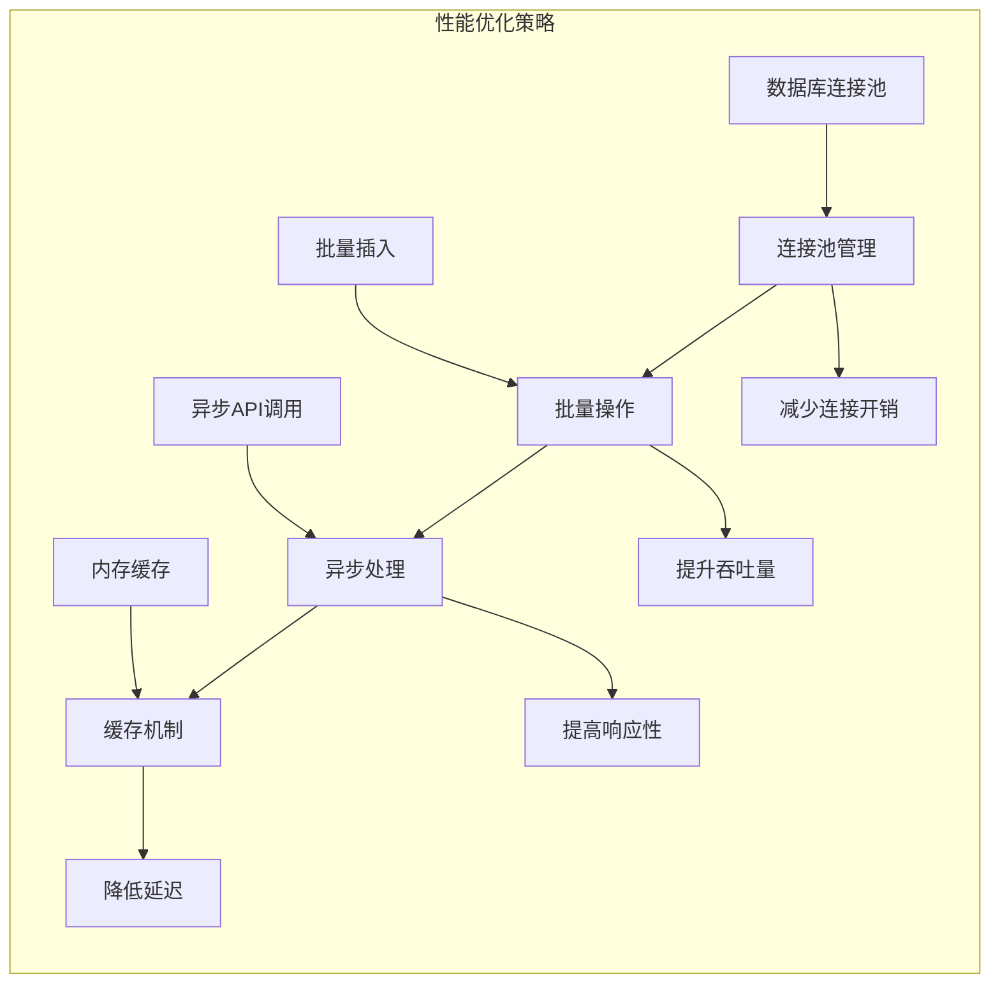
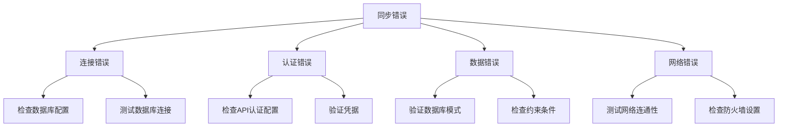

# 同步引擎

<cite>
**本文档引用的文件**
- [sync_monitoring_data.py](file://sync_monitoring_data.py)
- [zabbix_template_parser.py](file://zabbix_template_parser.py)
- [zabbix_template_parser_debug.py](file://zabbix_template_parser_debug.py)
- [app.py](file://app.py)
- [create_mac_tables.sql](file://create_mac_tables.sql)
- [verify_sync.py](file://verify_sync.py)
- [web_yaml_merger.py](file://web_yaml_merger.py)
- [manual_merge.py](file://manual_merge.py)
- [manual_yaml_merge.py](file://manual_yaml_merge.py)
</cite>

## 目录
1. [简介](#简介)
2. [项目结构](#项目结构)
3. [核心组件](#核心组件)
4. [架构概览](#架构概览)
5. [详细组件分析](#详细组件分析)
6. [依赖关系分析](#依赖关系分析)
7. [性能考虑](#性能考虑)
8. [故障排除指南](#故障排除指南)
9. [结论](#结论)

## 简介

这是一个基于Python的Zabbix监控配置同步系统，实现了从数据库到Zabbix服务器的双向同步功能。该系统提供了完整的监控配置管理解决方案，包括配置解析、数据同步、冲突处理和错误恢复机制。

系统采用模块化设计，主要包含三个核心组件：
- **配置解析器**：从Zabbix API读取监控配置并标准化存储
- **同步引擎**：将标准化的配置同步到Zabbix服务器
- **Web界面**：提供可视化配置管理和YAML合并工具

## 项目结构

**图表来源**
- [sync_monitoring_data.py:1-467](file://sync_monitoring_data.py#L1-L467)
- [zabbix_template_parser.py:1-834](file://zabbix_template_parser.py#L1-L834)
- [app.py:1-774](file://app.py#L1-L774)

**章节来源**
- [sync_monitoring_data.py:1-467](file://sync_monitoring_data.py#L1-L467)
- [zabbix_template_parser.py:1-834](file://zabbix_template_parser.py#L1-L834)
- [app.py:1-774](file://app.py#L1-L774)

## 核心组件

### 数据库连接器 (DatabaseConnector)

负责与PostgreSQL数据库进行交互，提供统一的数据库访问接口。

**主要功能**：
- 模板数据获取
- 监控项数据获取  
- 触发器数据获取
- 自动发现规则数据获取
- 触发器依赖关系处理

**数据结构复杂度**：
- 查询操作：O(n) - n为返回记录数
- 连接管理：O(1)
- 错误处理：O(1)

### Zabbix同步器 (ZabbixSync)

核心同步组件，负责将数据库中的配置同步到Zabbix服务器。

**主要功能**：
- 模板ID获取
- 监控项同步
- 触发器同步
- 自动发现规则同步
- 触发器依赖关系处理

**同步策略**：
- 使用Zabbix API进行增量同步
- 支持创建和更新操作
- 处理复杂的依赖关系

**章节来源**
- [sync_monitoring_data.py:41-178](file://sync_monitoring_data.py#L41-L178)
- [sync_monitoring_data.py:179-414](file://sync_monitoring_data.py#L179-L414)

## 架构概览

**图表来源**
- [zabbix_template_parser.py:583-790](file://zabbix_template_parser.py#L583-L790)
- [sync_monitoring_data.py:415-467](file://sync_monitoring_data.py#L415-L467)

## 详细组件分析

### SyncEngine类分析

虽然代码中没有显式的SyncEngine类，但`ZabbixSync`类实现了类似的功能。以下是其核心算法和实现原理：

#### 变更检测机制

**图表来源**
- [sync_monitoring_data.py:415-456](file://sync_monitoring_data.py#L415-L456)

#### 并发处理策略

系统采用以下并发处理策略：

1. **顺序同步**：模板级别的顺序处理，避免依赖关系问题
2. **API调用优化**：批量处理相似操作
3. **异常隔离**：每个模板的同步错误不影响其他模板

#### 事务管理

**图表来源**
- [sync_monitoring_data.py:415-467](file://sync_monitoring_data.py#L415-L467)

**章节来源**
- [sync_monitoring_data.py:179-414](file://sync_monitoring_data.py#L179-L414)

### 指纹计算算法

系统使用哈希算法进行配置比较和冲突检测：

#### 配置指纹生成

**图表来源**
- [zabbix_template_parser.py:696-790](file://zabbix_template_parser.py#L696-L790)
- [zabbix_template_parser_debug.py:663-709](file://zabbix_template_parser_debug.py#L663-L709)

#### 差异分析机制

系统通过以下方式实现差异分析：

1. **字段级比较**：逐字段比较配置差异
2. **依赖关系分析**：检查触发器依赖链
3. **原型匹配**：自动发现规则的原型同步
4. **冲突检测**：识别重复配置和冲突项

**章节来源**
- [zabbix_template_parser.py:583-790](file://zabbix_template_parser.py#L583-L790)

### 冲突解决机制

**图表来源**
- [zabbix_template_parser.py:415-460](file://zabbix_template_parser.py#L415-L460)

**章节来源**
- [zabbix_template_parser.py:415-581](file://zabbix_template_parser.py#L415-L581)

## 依赖关系分析

**图表来源**
- [sync_monitoring_data.py:12-16](file://sync_monitoring_data.py#L12-L16)
- [zabbix_template_parser.py:13-25](file://zabbix_template_parser.py#L13-L25)

**章节来源**
- [sync_monitoring_data.py:12-39](file://sync_monitoring_data.py#L12-L39)
- [zabbix_template_parser.py:13-31](file://zabbix_template_parser.py#L13-L31)

## 性能考虑

### 数据库优化

1. **索引策略**：
   - 在模板名称上建立唯一索引
   - 在监控项键上建立唯一索引
   - 在发现规则上建立外键索引

2. **查询优化**：
   - 使用批量查询减少网络往返
   - 实现分页处理大量数据
   - 缓存常用查询结果

### 同步性能优化

### 资源限制策略

1. **连接数限制**：控制同时建立的数据库和API连接数量
2. **内存使用限制**：实现数据分批处理避免内存溢出
3. **超时机制**：设置合理的操作超时时间
4. **重试策略**：实现指数退避的重试机制

## 故障排除指南

### 常见错误类型

### 错误恢复机制

1. **自动重试**：对临时性错误实现自动重试
2. **事务回滚**：确保部分失败时的数据一致性
3. **日志记录**：详细记录错误信息便于诊断
4. **状态监控**：实时监控同步状态和健康状况

**章节来源**
- [sync_monitoring_data.py:458-467](file://sync_monitoring_data.py#L458-L467)
- [zabbix_template_parser_debug.py:682-709](file://zabbix_template_parser_debug.py#L682-L709)

## 结论

该同步引擎系统提供了完整的Zabbix监控配置管理解决方案，具有以下特点：

1. **模块化设计**：清晰的组件分离和职责划分
2. **健壮性**：完善的错误处理和恢复机制
3. **可扩展性**：支持新的监控项类型和配置选项
4. **可视化**：提供Web界面进行配置管理和验证
5. **性能优化**：采用多种技术提升系统性能

系统通过标准化的配置解析、智能的同步策略和完善的监控机制，为企业提供了可靠的Zabbix监控配置管理平台。未来可以进一步增强的功能包括分布式部署、实时监控和更丰富的配置模板支持。