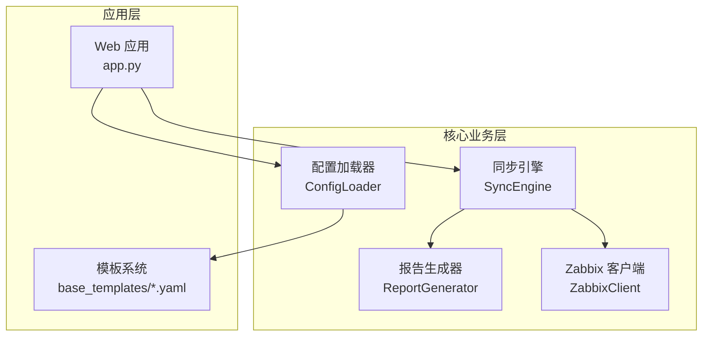
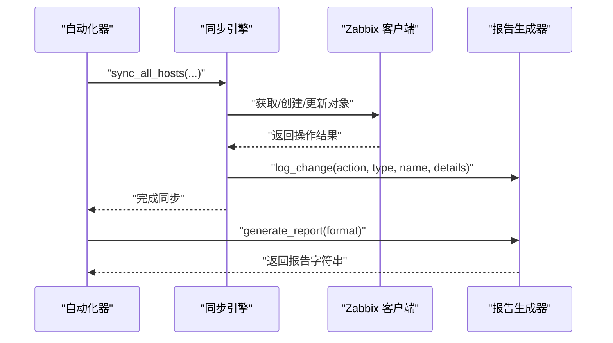
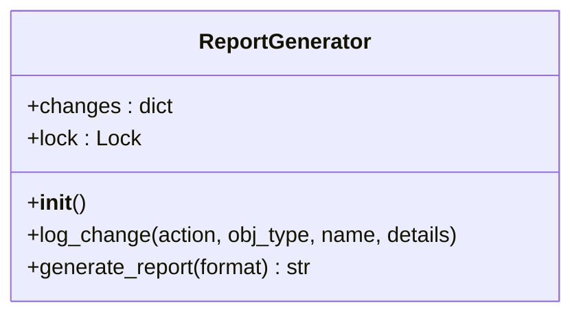
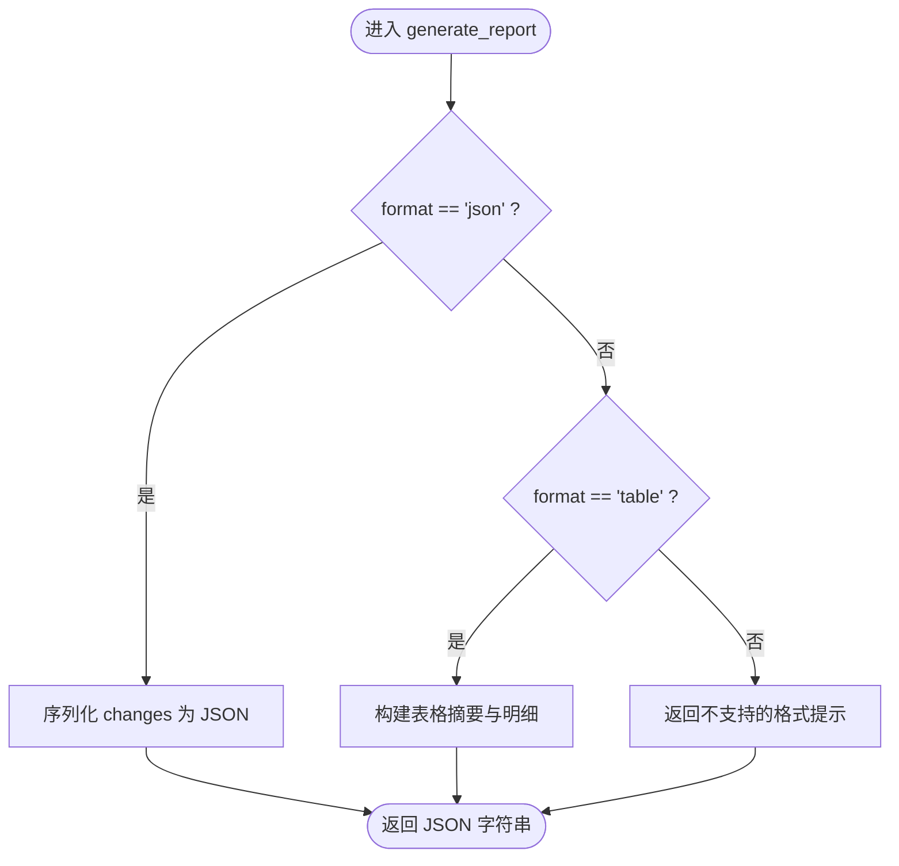
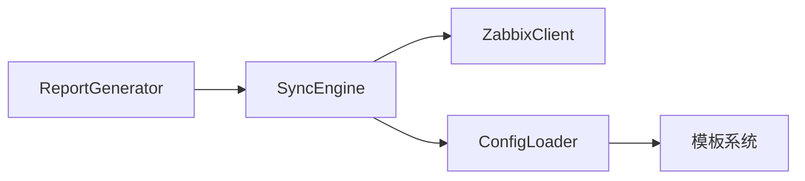

# 报告生成器

<cite>
**本文档引用的文件**
- [zabbix_mac.py](file://zabbix_mac.py)
- [app.py](file://app.py)
- [CODE_WIKI.md](file://CODE_WIKI.md)
- [common.yaml](file://base_templates/common.yaml)
- [web.yaml](file://base_templates/web.yaml)
</cite>

## 目录
1. [简介](#简介)
2. [项目结构](#项目结构)
3. [核心组件](#核心组件)
4. [架构总览](#架构总览)
5. [详细组件分析](#详细组件分析)
6. [依赖分析](#依赖分析)
7. [性能考虑](#性能考虑)
8. [故障排查指南](#故障排查指南)
9. [结论](#结论)
10. [附录](#附录)

## 简介
本文件面向“报告生成器”组件，聚焦于 ReportGenerator 类的设计与实现，系统阐述其在变更审计与同步过程中的作用，包括报告格式定义、数据聚合策略、输出选项配置、模板与动态内容生成机制，并给出同步结果报告、配置对比报告与错误统计报告的生成逻辑与使用示例。同时提供性能优化、内存管理与大容量数据处理策略建议，帮助读者在实际工程中高效、稳定地使用该组件。

## 项目结构
本项目采用“功能模块化 + 模板驱动”的组织方式：
- 核心业务逻辑集中在 zabbix_mac.py，其中包含 ReportGenerator、SyncEngine、ZabbixClient、ConfigLoader 等核心类。
- Web 界面入口位于 app.py，负责渲染模板与提供交互式管理页面。
- 报告生成器作为独立组件，贯穿同步流程并在最终阶段汇总变更结果。
- 模板系统以 YAML 为基础，提供通用监控项、触发器、自动发现规则与 Web 场景等模板，供 ConfigLoader 合并构建主机配置。

图表来源
- [zabbix_mac.py](file://zabbix_mac.py)
- [app.py](file://app.py)
- [common.yaml](file://base_templates/common.yaml)
- [web.yaml](file://base_templates/web.yaml)

章节来源
- [zabbix_mac.py](file://zabbix_mac.py)
- [app.py](file://app.py)
- [common.yaml](file://base_templates/common.yaml)
- [web.yaml](file://base_templates/web.yaml)

## 核心组件
- ReportGenerator：负责记录与生成变更报告，支持 JSON 与表格两种输出格式；内部使用线程锁保证并发安全。
- SyncEngine：协调同步流程，调用 ReportGenerator 记录变更并生成最终报告。
- ConfigLoader：加载模板与主机配置，构建目标配置供同步引擎使用。
- ZabbixClient：与 Zabbix API 交互，执行增删改查等操作。

章节来源
- [zabbix_mac.py](file://zabbix_mac.py)
- [CODE_WIKI.md](file://CODE_WIKI.md)

## 架构总览
ReportGenerator 在同步流程中的位置如下：
- 初始化：在自动化器启动时创建 ReportGenerator 实例。
- 日志记录：在同步过程中，针对每个对象的创建、更新、删除动作调用 log_change 记录。
- 报告生成：同步结束后，调用 generate_report 输出汇总报告。

图表来源
- [zabbix_mac.py](file://zabbix_mac.py)

章节来源
- [zabbix_mac.py](file://zabbix_mac.py)

## 详细组件分析

### ReportGenerator 类设计与实现
- 设计目标
  - 提供统一的变更审计能力，记录创建、更新、删除三类动作。
  - 支持多种输出格式，便于集成到日志、Web 页面或外部系统。
  - 保证多线程环境下的数据一致性。
- 关键属性
  - changes：按动作分类的变更集合，包含对象类型、名称与可选详情。
  - lock：线程锁，确保并发写入安全。
- 关键方法
  - log_change：记录单条变更，包含动作、对象类型、名称与详情。
  - generate_report：根据 format 生成报告，当前支持 json 与 table 两种格式。

图表来源
- [zabbix_mac.py](file://zabbix_mac.py)

章节来源
- [zabbix_mac.py](file://zabbix_mac.py)

### 报告格式定义与输出选项
- 当前支持格式
  - json：结构化输出，适合程序解析与存储。
  - table：人类可读的表格形式，包含变更总数与明细列表。
- 输出选项
  - format 参数：选择输出格式，默认为 json。
  - 其他扩展：可在现有基础上增加 CSV、HTML 等格式，以满足不同场景需求。

章节来源
- [zabbix_mac.py](file://zabbix_mac.py)

### 数据聚合策略
- 变更分类
  - created：新增对象列表。
  - updated：修改对象列表。
  - deleted：删除对象列表。
- 聚合维度
  - 按动作类型分组，便于快速统计与定位问题。
  - 每条变更记录包含对象类型、名称与可选详情，便于后续扩展。
- 并发安全
  - 使用线程锁保护共享状态，避免竞态条件导致的数据错乱。

章节来源
- [zabbix_mac.py](file://zabbix_mac.py)

### 报告生成逻辑详解
- JSON 格式
  - 直接序列化 changes 字典，保持层级清晰，便于二次处理。
- 表格格式
  - 输出变更摘要（新增/修改/删除数量），随后分别列出各动作对应的对象清单。
  - 适用于日志查看与人工审阅。

图表来源
- [zabbix_mac.py](file://zabbix_mac.py)

章节来源
- [zabbix_mac.py](file://zabbix_mac.py)

### 不同类型报告的生成逻辑
- 同步结果报告
  - 由 SyncEngine 在同步完成后调用 ReportGenerator 生成，汇总本次同步产生的所有变更。
  - 通常以表格格式输出，便于运维人员快速了解影响范围。
- 配置对比报告
  - 可通过比较目标配置与当前状态差异生成，但当前 ReportGenerator 未直接提供此能力。
  - 建议在 SyncEngine 内部进行差异计算后，将差异详情传入 ReportGenerator 的 log_change，从而在最终报告中体现对比结果。
- 错误统计报告
  - 可在同步过程中捕获异常并记录到 ReportGenerator，形成错误统计与明细。
  - 建议将错误类型、对象标识与堆栈信息作为 details 字段传入，提升可诊断性。

章节来源
- [zabbix_mac.py](file://zabbix_mac.py)

### 使用示例与最佳实践
- 生成 JSON 报告
  - 在自动化器运行结束时调用 generate_report(format="json")，将结果写入日志或文件。
- 生成表格报告
  - 在自动化器运行结束时调用 generate_report(format="table")，打印到标准输出或发送到通知渠道。
- 扩展输出格式
  - 新增 CSV/HTML 等格式时，建议遵循现有接口约定，保持 changes 结构不变，仅调整序列化逻辑。

章节来源
- [zabbix_mac.py](file://zabbix_mac.py)

### 报告模板系统、自定义字段与动态内容
- 模板系统
  - 通过 base_templates/*.yaml 提供通用监控项、触发器、自动发现规则与 Web 场景模板，ConfigLoader 负责加载与合并。
- 自定义字段
  - ReportGenerator 的 log_change 支持传入 details 字典，可用于承载自定义字段（如变更原因、责任人、审批编号等）。
- 动态内容生成
  - 在 SyncEngine 中根据对象类型与配置动态构造 details，再交由 ReportGenerator 记录，实现灵活的动态内容生成。

章节来源
- [zabbix_mac.py](file://zabbix_mac.py)
- [common.yaml](file://base_templates/common.yaml)
- [web.yaml](file://base_templates/web.yaml)

## 依赖分析
- 组件耦合
  - ReportGenerator 与 SyncEngine 弱耦合：通过方法调用传递变更信息，便于替换或扩展。
  - ConfigLoader 与模板系统强耦合：模板加载与合并逻辑集中在此，影响最终配置与报告内容。
- 外部依赖
  - threading：用于并发安全。
  - json：用于 JSON 格式输出。
- 循环依赖
  - 未发现循环依赖，整体结构清晰。

图表来源
- [zabbix_mac.py](file://zabbix_mac.py)

章节来源
- [zabbix_mac.py](file://zabbix_mac.py)

## 性能考虑
- 并发与锁
  - 使用线程锁保护共享状态，避免高并发下数据竞争；在极端高吞吐场景下，可考虑使用无锁队列或批量提交策略降低锁竞争。
- 内存管理
  - changes 字典随变更增长，建议在生成报告后及时清理或分批处理，避免长期持有大量中间数据。
- 大容量数据处理
  - 对于大规模主机同步，建议：
    - 分批生成报告（按主机或按动作类型），减少一次性输出压力。
    - 将 JSON 报告写入临时文件，再进行压缩或流式传输。
    - 在 Web 界面中提供分页与筛选功能，避免一次性渲染过多数据。
- I/O 优化
  - JSON 序列化默认使用 ensure_ascii=False，确保中文等字符正确输出；在高频场景下可评估使用更快的序列化库（如 ujson）以提升性能。

章节来源
- [zabbix_mac.py](file://zabbix_mac.py)

## 故障排查指南
- 报告格式不支持
  - 若传入不支持的 format，将返回“不支持的报告格式”提示。请检查调用参数。
- 并发冲突
  - 在高并发环境下，若出现数据不一致，检查是否正确使用了线程锁；必要时调整并发粒度或引入缓冲队列。
- 报告为空
  - 若未发生任何变更，changes 将为空；可通过增加日志或在调用前打印配置差异辅助定位。
- 输出乱码
  - 确保终端或日志系统支持 UTF-8；JSON 输出已设置 ensure_ascii=False，避免 ASCII 转义。

章节来源
- [zabbix_mac.py](file://zabbix_mac.py)

## 结论
ReportGenerator 作为变更审计的核心组件，提供了简洁而实用的报告生成功能。通过合理的数据聚合策略与线程安全设计，能够稳定支撑大规模同步任务。结合模板系统与动态内容生成机制，可进一步扩展为具备丰富上下文信息的综合报告体系。建议在生产环境中配合日志与监控，持续优化性能与可维护性。

## 附录
- API 参考
  - ReportGenerator.__init__：初始化报告生成器。
  - ReportGenerator.log_change：记录变更。
  - ReportGenerator.generate_report：生成报告。
- 使用建议
  - 在自动化器中统一调用 generate_report，确保每次同步都有可追溯的审计记录。
  - 为 details 字段预留扩展空间，逐步沉淀企业级审计规范。

章节来源
- [CODE_WIKI.md](file://CODE_WIKI.md)
- [zabbix_mac.py](file://zabbix_mac.py)