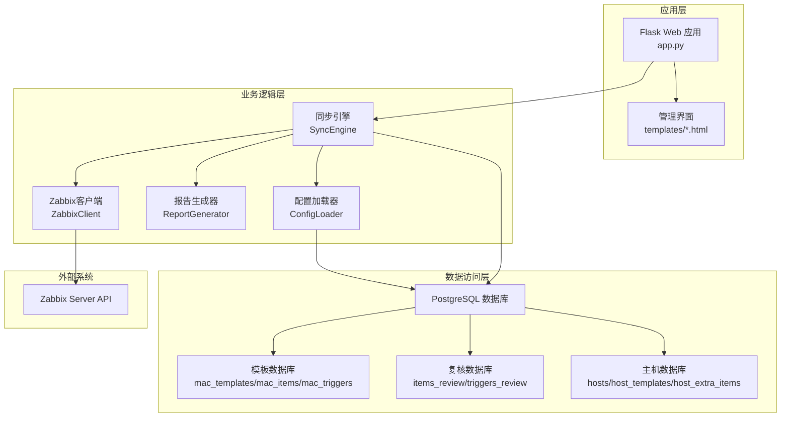
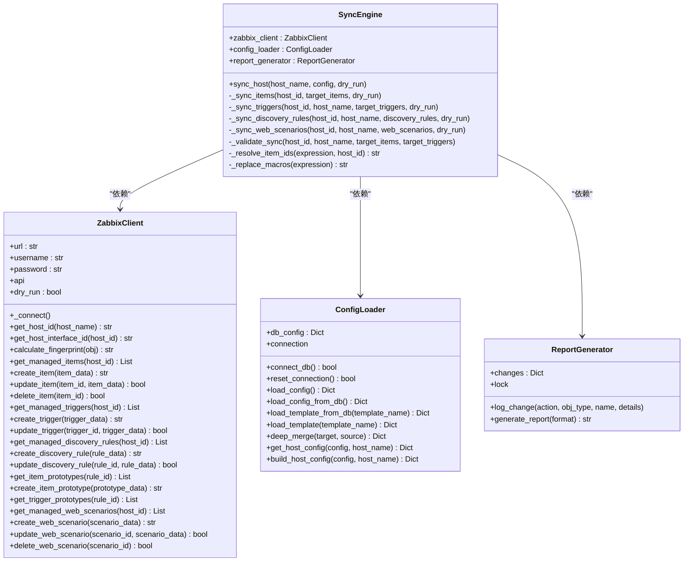
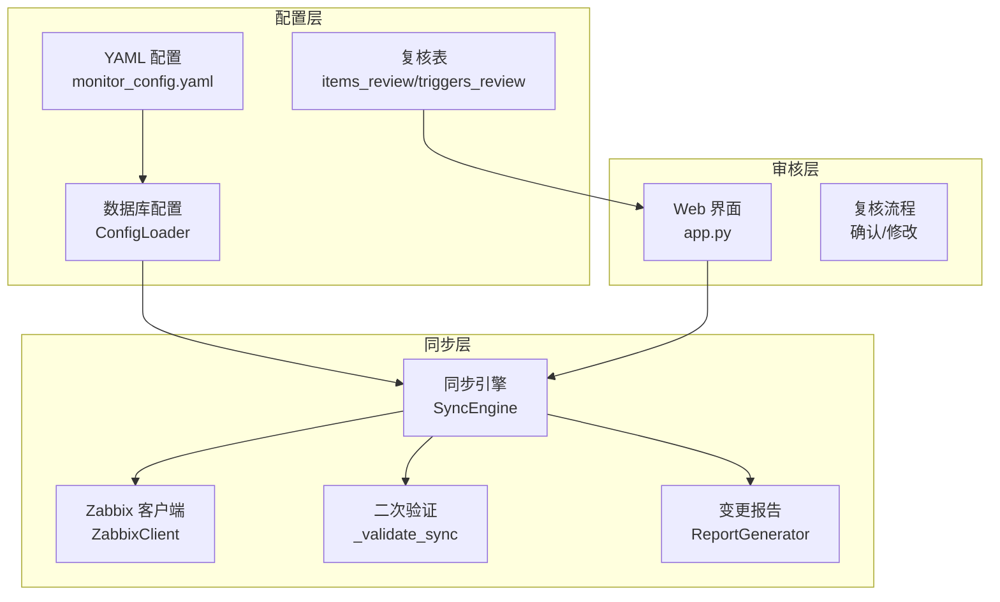
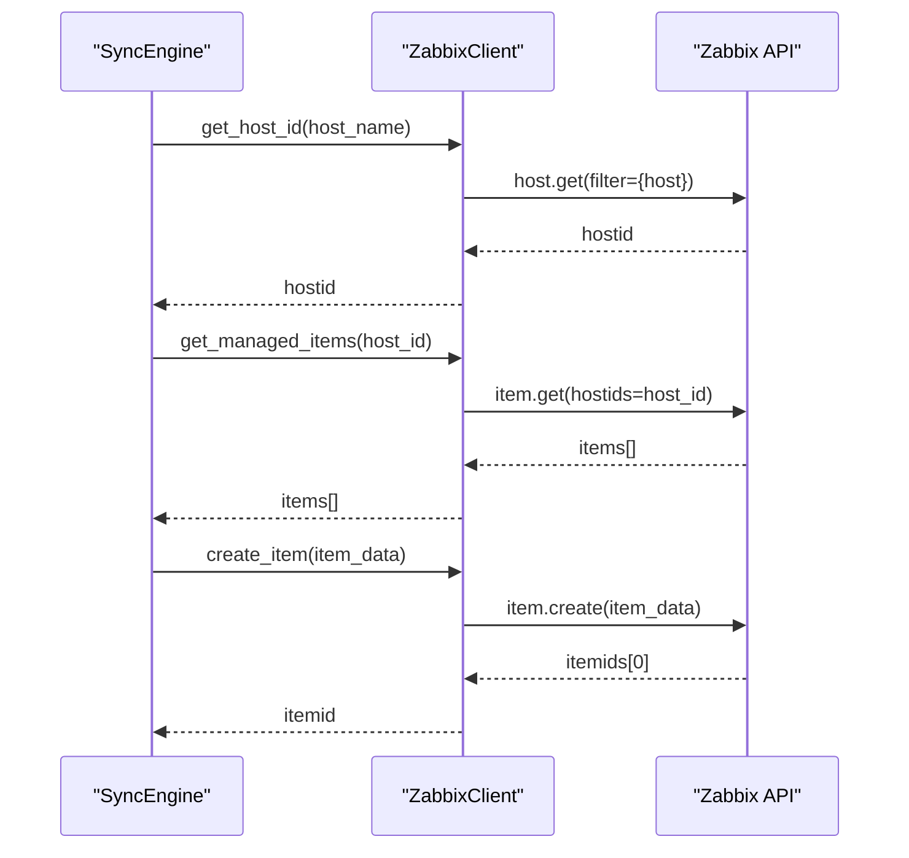
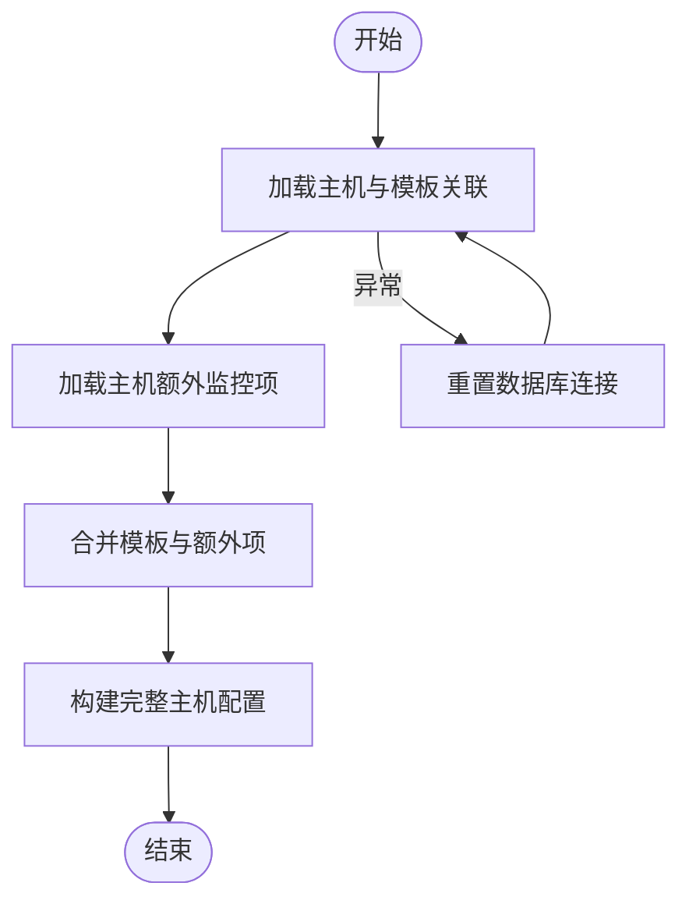
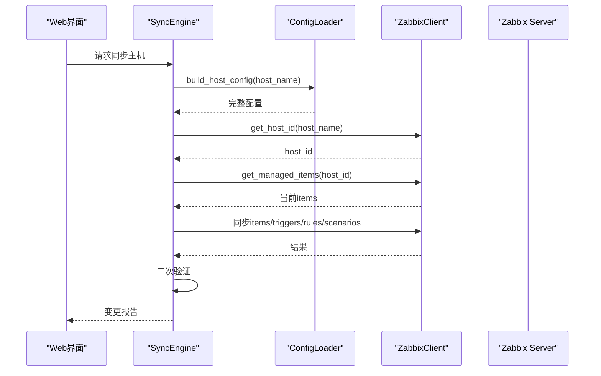
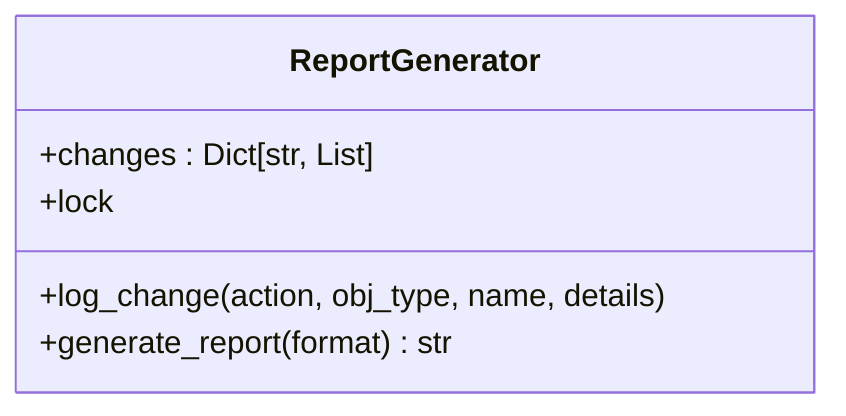
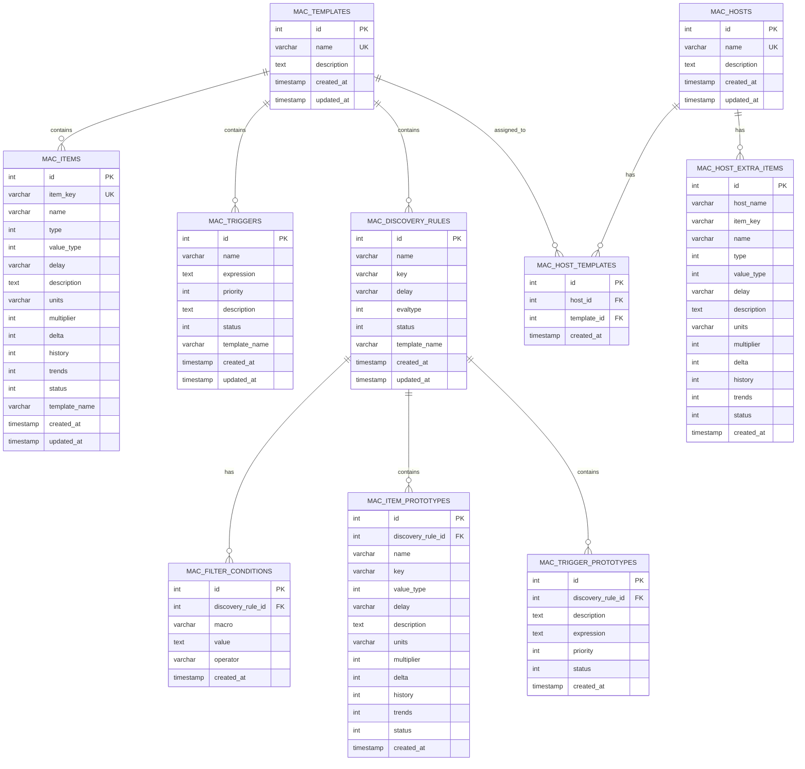
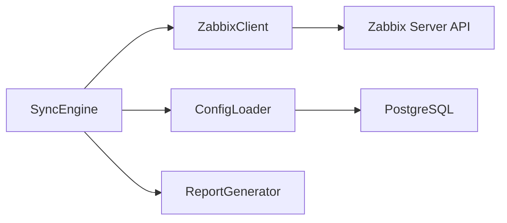

# 核心架构

<cite>
**本文档引用的文件**
- [zabbix_mac.py](file://zabbix_mac.py)
- [zabbix_template_parser.py](file://zabbix_template_parser.py)
- [sync_monitoring_data.py](file://sync_monitoring_data.py)
- [app.py](file://app.py)
- [monitor_config.yaml](file://monitor_config.yaml)
- [create_tables.sql](file://create_tables.sql)
- [create_mac_tables.sql](file://create_mac_tables.sql)
- [create_review_tables.sql](file://create_review_tables.sql)
- [create_host_tables.sql](file://create_host_tables.sql)
- [setup_zabbix_db.sql](file://setup_zabbix_db.sql)
</cite>

## 目录
1. [简介](#简介)
2. [项目结构](#项目结构)
3. [核心组件](#核心组件)
4. [架构总览](#架构总览)
5. [详细组件分析](#详细组件分析)
6. [依赖关系分析](#依赖关系分析)
7. [性能考量](#性能考量)
8. [故障排查指南](#故障排查指南)
9. [结论](#结论)
10. [附录](#附录)

## 简介
本项目是一个面向Zabbix的监控审核与自动化控制中心，围绕“声明式配置 + 审核复核 + 自动同步”的闭环设计，提供从配置生成、审核确认到Zabbix目标环境的自动化同步能力。系统通过ZabbixClient、ConfigLoader、SyncEngine、ReportGenerator等核心组件协同工作，形成清晰的分层架构与职责边界。

## 项目结构
项目采用按功能域划分的模块化组织方式，主要文件与职责如下：
- zabbix_mac.py：核心自动化系统，包含ZabbixClient、ConfigLoader、SyncEngine、ReportGenerator等关键类，负责配置加载、指纹校验、变更同步与验证。
- zabbix_template_parser.py：模板解析器，负责从Zabbix服务端拉取模板数据并写入数据库，支撑配置来源。
- sync_monitoring_data.py：监控数据同步脚本，展示数据库连接、Zabbix同步器等组件的典型用法。
- app.py：Flask Web应用，提供模板与复核表的管理界面，支撑人工审核与配置维护。
- monitor_config.yaml：示例配置文件，演示如何以YAML形式描述主机、模板与额外监控项。
- SQL脚本：create_tables.sql、create_mac_tables.sql、create_review_tables.sql、create_host_tables.sql、setup_zabbix_db.sql，定义数据库表结构与初始化数据。

**图表来源**
- [zabbix_mac.py](file://zabbix_mac.py)
- [app.py](file://app.py)
- [create_mac_tables.sql](file://create_mac_tables.sql)
- [create_review_tables.sql](file://create_review_tables.sql)
- [create_host_tables.sql](file://create_host_tables.sql)

**章节来源**
- [zabbix_mac.py](file://zabbix_mac.py)
- [app.py](file://app.py)
- [create_mac_tables.sql](file://create_mac_tables.sql)
- [create_review_tables.sql](file://create_review_tables.sql)
- [create_host_tables.sql](file://create_host_tables.sql)

## 核心组件
本节聚焦ZabbixClient、ConfigLoader、SyncEngine、ReportGenerator四大核心组件的设计理念与交互关系。

- ZabbixClient：封装Zabbix API调用，提供连接管理、重试机制、指纹计算、对象增删改查等能力，统一对外暴露稳定的接口。
- ConfigLoader：负责从数据库加载主机配置、模板与额外监控项，支持多模板合并与优先级覆盖，提供深度合并与构建完整主机配置的能力。
- SyncEngine：编排同步流程，协调ZabbixClient与ConfigLoader，执行监控项、触发器、自动发现规则、Web场景的同步与清理，并进行二次验证。
- ReportGenerator：线程安全地记录变更（创建/更新/删除），支持JSON与表格两种输出格式，便于审计与回溯。

**图表来源**
- [zabbix_mac.py](file://zabbix_mac.py)

**章节来源**
- [zabbix_mac.py](file://zabbix_mac.py)

## 架构总览
系统采用“配置驱动 + 审核复核 + 自动同步”的三层架构：
- 配置层：以YAML或数据库中的模板、复核表作为配置源，支持多模板合并与优先级覆盖。
- 审核层：通过Web界面展示复核表，支持人工确认与修改，确保变更质量。
- 同步层：通过SyncEngine编排ZabbixClient与ConfigLoader，执行声明式同步与二次验证，保证目标状态与期望一致。

**图表来源**
- [monitor_config.yaml](file://monitor_config.yaml)
- [app.py](file://app.py)
- [zabbix_mac.py](file://zabbix_mac.py)

**章节来源**
- [monitor_config.yaml](file://monitor_config.yaml)
- [app.py](file://app.py)
- [zabbix_mac.py](file://zabbix_mac.py)

## 详细组件分析

### ZabbixClient 组件分析
- 设计理念：围绕Zabbix API的稳定封装，提供统一的CRUD接口与重试机制；通过指纹计算实现幂等比较；支持多种对象类型（监控项、触发器、LLD规则、原型、Web场景）。
- 关键能力：
  - 连接与重试：MAX_RETRY_ATTEMPTS与RETRY_DELAY保障网络波动下的稳定性。
  - 指纹计算：排除无关字段后序列化，确保比较一致性。
  - 对象管理：提供创建、更新、删除与查询接口，兼容不同Zabbix版本字段差异。
- 并发与线程安全：通过dry_run模式支持模拟执行，避免真实变更。

**图表来源**
- [zabbix_mac.py](file://zabbix_mac.py)

**章节来源**
- [zabbix_mac.py](file://zabbix_mac.py)

### ConfigLoader 组件分析
- 设计理念：从数据库加载主机配置，支持模板合并与额外监控项优先级覆盖；提供深度合并与构建完整主机配置的能力。
- 关键能力：
  - 数据库连接与重连：支持连接失败后的自动重试与重置。
  - 配置加载：从hosts/host_templates/host_extra_items与模板表加载配置。
  - 模板加载：从items_review/triggers_review/discovery_rules/item_prototypes_review/trigger_prototypes_review等表加载模板，优先使用confirmed=true的记录。
  - 合并与构建：deep_merge实现模板叠加，额外项具有最高优先级。
- 错误处理：捕获数据库异常并重置连接，避免事务中止导致的后续失败。

**图表来源**
- [zabbix_mac.py](file://zabbix_mac.py)

**章节来源**
- [zabbix_mac.py](file://zabbix_mac.py)

### SyncEngine 组件分析
- 设计理念：以声明式方式同步主机配置，先创建独立对象，再处理依赖关系；支持二次更新以修正依赖；提供二次验证确保目标状态一致。
- 关键流程：
  - 监控项同步：区分独立与依赖项，先创建独立项，再创建依赖项；支持预处理与公式项；清理多余项。
  - 触发器同步：先创建独立触发器，再创建依赖触发器；二次更新依赖关系；宏变量替换与表达式标准化。
  - LLD规则同步：创建/更新规则与过滤条件；同步监控项原型与触发器原型；清理多余规则。
  - Web场景同步：创建/更新Web场景及其步骤；清理多余场景。
  - 二次验证：同步完成后对比两端状态，确保一致性。
- 并发与线程安全：通过ReportGenerator的锁记录变更，保证多线程下的报告一致性。

**图表来源**
- [zabbix_mac.py](file://zabbix_mac.py)

**章节来源**
- [zabbix_mac.py](file://zabbix_mac.py)

### ReportGenerator 组件分析
- 设计理念：线程安全地记录变更，支持JSON与表格两种输出格式，便于审计与回溯。
- 关键能力：
  - 变更记录：支持created/updated/deleted三类变更，记录对象类型、名称与详情。
  - 报告生成：JSON格式便于程序消费，表格格式便于人工审阅。
  - 线程安全：通过锁保护共享状态，避免并发写入冲突。

**图表来源**
- [zabbix_mac.py](file://zabbix_mac.py)

**章节来源**
- [zabbix_mac.py](file://zabbix_mac.py)

### 数据模型与数据库设计
系统采用多套表支撑不同阶段的数据流转：
- 模板表：mac_templates/mac_items/mac_triggers/mac_discovery_rules/mac_filter_conditions/mac_item_prototypes/mac_trigger_prototypes
- 复核表：items_review/triggers_review/item_prototypes_review/trigger_prototypes_review
- 主机表：hosts/host_templates/host_extra_items
- 示例SQL脚本提供完整的表结构与初始化数据。

**图表来源**
- [create_mac_tables.sql](file://create_mac_tables.sql)
- [create_review_tables.sql](file://create_review_tables.sql)
- [create_host_tables.sql](file://create_host_tables.sql)

**章节来源**
- [create_mac_tables.sql](file://create_mac_tables.sql)
- [create_review_tables.sql](file://create_review_tables.sql)
- [create_host_tables.sql](file://create_host_tables.sql)

## 依赖关系分析
- 组件耦合：
  - SyncEngine依赖ZabbixClient、ConfigLoader、ReportGenerator，形成清晰的控制流。
  - ConfigLoader依赖数据库连接，负责配置加载与合并。
  - ZabbixClient依赖Zabbix API，负责与外部系统交互。
- 外部依赖：
  - Zabbix Server API：通过pyzabbix库调用，需配置URL、用户名与密码。
  - PostgreSQL：通过psycopg2连接，承载模板、复核与主机配置数据。
- 循环依赖：未发现循环依赖，模块间职责清晰。

**图表来源**
- [zabbix_mac.py](file://zabbix_mac.py)

**章节来源**
- [zabbix_mac.py](file://zabbix_mac.py)

## 性能考量
- 连接与重试：ZabbixClient与ConfigLoader均内置重试机制，降低网络抖动对同步的影响。
- 指纹校验：通过calculate_fingerprint避免不必要的更新，减少API调用次数。
- 分阶段同步：先创建独立对象，再处理依赖，减少依赖查找成本。
- 二次验证：同步完成后进行状态对比，避免部分失败导致的半同步状态。
- 数据库索引：SQL脚本中为关键列建立索引，提升查询性能。

[本节为通用指导，无需特定文件引用]

## 故障排查指南
- 连接失败：
  - 检查Zabbix API URL、用户名与密码配置。
  - 查看重试日志，确认是否达到最大重试次数。
- 数据库连接失败：
  - 检查数据库地址、端口、库名、用户与密码。
  - 使用reset_connection()重置连接，避免事务中止。
- 同步异常：
  - 查看ReportGenerator生成的变更报告，定位具体对象。
  - 检查表达式宏变量替换与依赖关系解析是否正确。
- 权限问题：
  - 确认数据库用户具备相应权限。
  - 确认Zabbix用户具备创建/更新/删除对象的权限。

**章节来源**
- [zabbix_mac.py](file://zabbix_mac.py)

## 结论
本项目通过ZabbixClient、ConfigLoader、SyncEngine、ReportGenerator四大组件，构建了从配置、审核到同步的完整闭环。系统采用声明式配置与复核机制，结合指纹校验与二次验证，确保变更的准确性与可追溯性。数据库层通过多套表支撑不同阶段的数据流转，配合索引与初始化脚本，形成清晰的演进路径。建议在生产环境中启用复核流程与变更报告，持续优化同步策略与性能指标。

[本节为总结性内容，无需特定文件引用]

## 附录
- 外部接口集成：
  - Zabbix Server API：通过pyzabbix库调用，支持监控项、触发器、LLD规则、原型与Web场景的CRUD。
  - PostgreSQL：通过psycopg2库连接，承载模板、复核与主机配置数据。
- 扩展点设计：
  - 新增对象类型：可在ZabbixClient中扩展对应CRUD方法，并在SyncEngine中编排同步流程。
  - 新增配置源：可在ConfigLoader中扩展加载逻辑，支持更多配置格式或来源。
  - 报告格式：可在ReportGenerator中扩展输出格式，满足不同审计需求。

**章节来源**
- [zabbix_mac.py](file://zabbix_mac.py)
- [zabbix_template_parser.py](file://zabbix_template_parser.py)
- [sync_monitoring_data.py](file://sync_monitoring_data.py)
- [app.py](file://app.py)
- [monitor_config.yaml](file://monitor_config.yaml)
- [setup_zabbix_db.sql](file://setup_zabbix_db.sql)