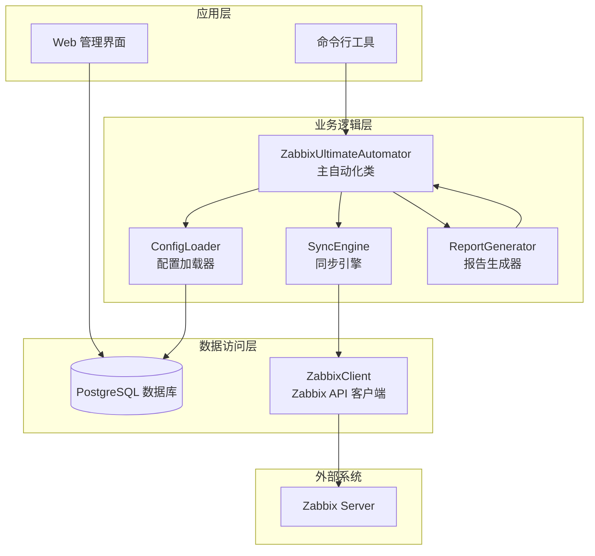
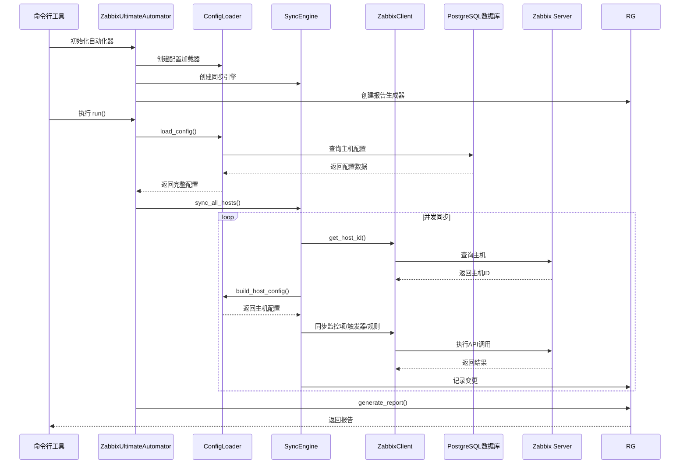
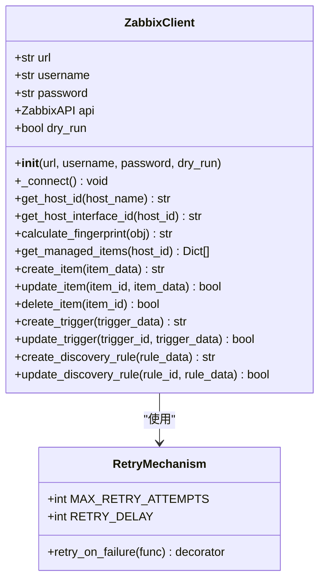
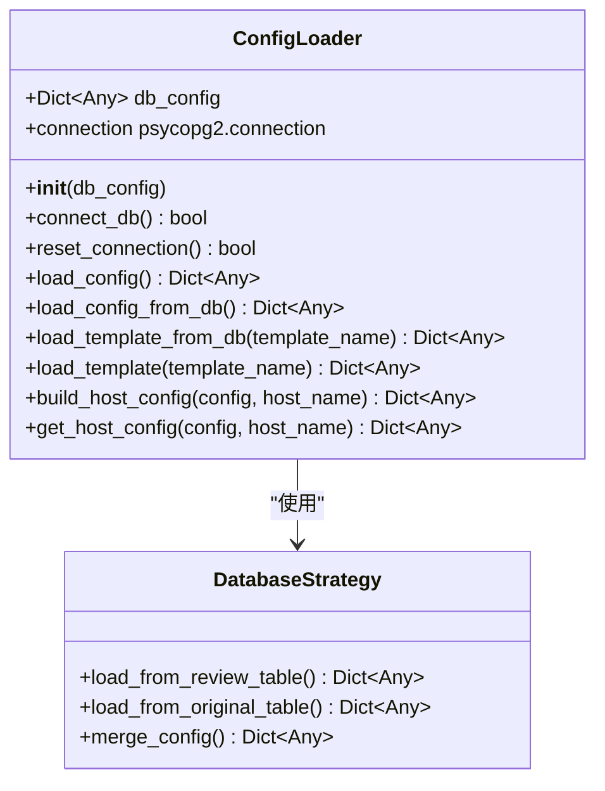
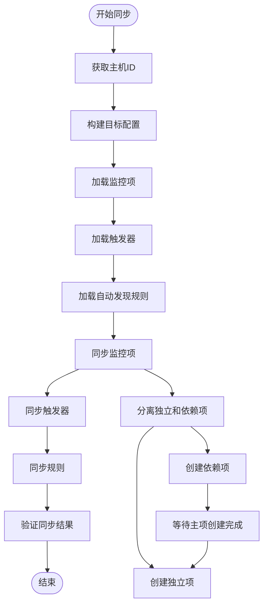
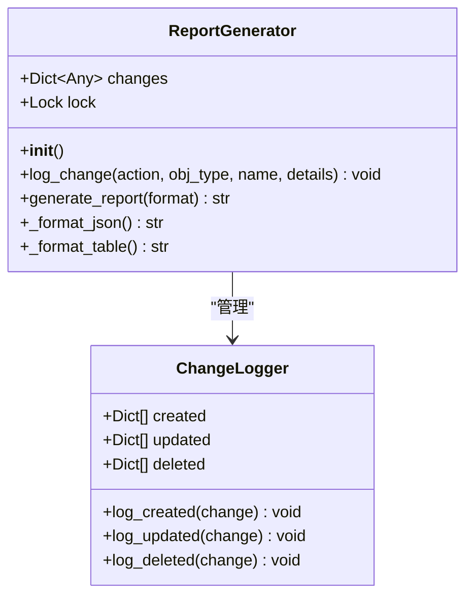
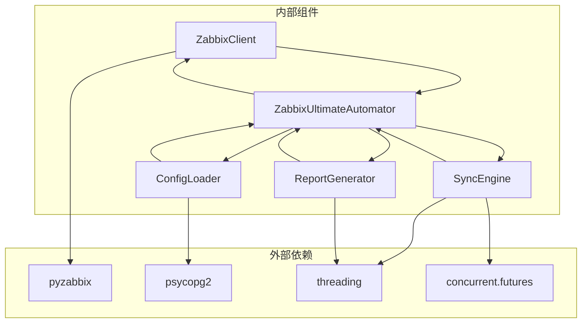
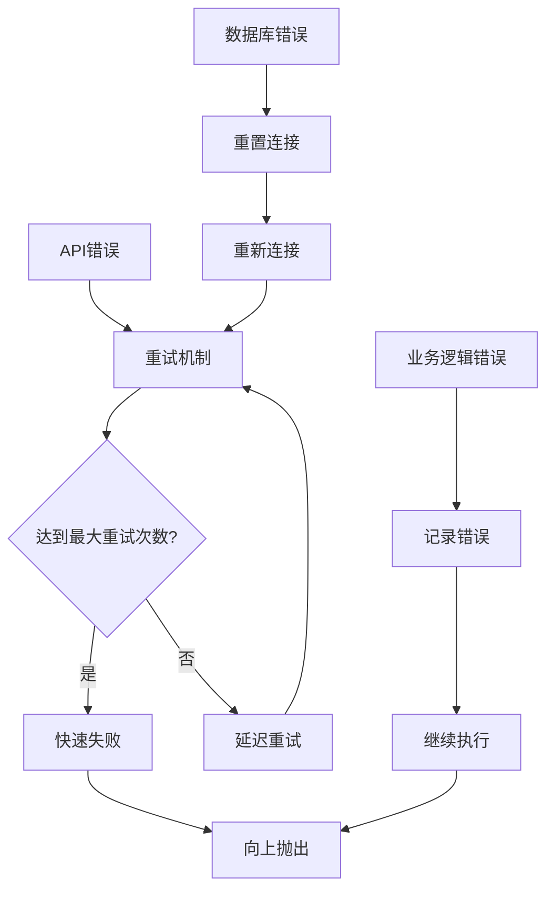

# 组件交互关系

<cite>
**本文档引用的文件**
- [zabbix_mac.py](file://zabbix_mac.py)
- [app.py](file://app.py)
- [zabbix_template_parser.py](file://zabbix_template_parser.py)
- [sync_monitoring_data.py](file://sync_monitoring_data.py)
- [monitor_config.yaml](file://monitor_config.yaml)
- [CODE_WIKI.md](file://CODE_WIKI.md)
</cite>

## 目录
1. [引言](#引言)
2. [项目结构](#项目结构)
3. [核心组件](#核心组件)
4. [架构概览](#架构概览)
5. [详细组件分析](#详细组件分析)
6. [依赖关系分析](#依赖关系分析)
7. [性能考虑](#性能考虑)
8. [故障排除指南](#故障排除指南)
9. [结论](#结论)

## 引言

本项目是一个基于 Python 3 的 Zabbix 监控审核和自动化控制中心，实现了监控配置的声明式同步和版本化管理。系统采用模块化架构设计，通过四个核心组件协同工作：ZabbixClient（Zabbix API 客户端）、ConfigLoader（配置加载器）、SyncEngine（同步引擎）和ReportGenerator（报告生成器）。该架构支持并发同步多台主机，提供详细的变更报告，并具备完善的错误处理和容错机制。

## 项目结构

项目采用分层架构设计，主要包含以下层次：

**图表来源**
- [zabbix_mac.py:39-300](file://zabbix_mac.py#L39-L300)
- [app.py:1-774](file://app.py#L1-L774)

**章节来源**
- [zabbix_mac.py:1-300](file://zabbix_mac.py#L1-L300)
- [CODE_WIKI.md:17-50](file://CODE_WIKI.md#L17-L50)

## 核心组件

### ZabbixClient（Zabbix API 客户端）

ZabbixClient 是系统的核心组件，负责与 Zabbix Server 进行 API 通信。它提供了完整的监控配置管理能力：

- **连接管理**：支持重试机制和断线自动恢复
- **主机管理**：获取主机 ID、接口 ID，管理主机配置
- **监控项管理**：创建、更新、删除监控项，支持依赖项处理
- **触发器管理**：创建、更新触发器，处理依赖关系
- **自动发现规则管理**：管理 LLD 规则及其原型
- **指纹计算**：用于配置变更检测和比较

### ConfigLoader（配置加载器）

ConfigLoader 负责从 PostgreSQL 数据库加载和处理配置数据：

- **数据库连接**：支持连接池管理和重连机制
- **配置加载**：从数据库表加载主机、模板、监控项等配置
- **模板解析**：从复核表和原始表加载模板数据
- **配置构建**：将多个数据源的配置组合成完整的主机配置

### SyncEngine（同步引擎）

SyncEngine 是系统的协调者，负责执行实际的同步操作：

- **并发控制**：使用线程池支持多主机并发同步
- **同步策略**：实现声明式同步，确保目标状态与实际状态一致
- **依赖处理**：智能处理监控项和触发器的依赖关系
- **验证机制**：同步完成后进行状态验证

### ReportGenerator（报告生成器）

ReportGenerator 负责记录和生成变更报告：

- **变更跟踪**：记录创建、更新、删除的操作
- **多格式输出**：支持 JSON 和表格格式的报告
- **线程安全**：使用锁机制保证并发安全性

**章节来源**
- [zabbix_mac.py:39-300](file://zabbix_mac.py#L39-L300)
- [zabbix_mac.py:916-1019](file://zabbix_mac.py#L916-L1019)
- [zabbix_mac.py:1533-1732](file://zabbix_mac.py#L1533-L1732)
- [zabbix_mac.py:1466-1509](file://zabbix_mac.py#L1466-L1509)

## 架构概览

系统采用典型的三层架构设计，各组件之间通过清晰的接口进行交互：

**图表来源**
- [zabbix_mac.py:2653-2733](file://zabbix_mac.py#L2653-L2733)
- [zabbix_mac.py:1533-1732](file://zabbix_mac.py#L1533-L1732)
- [zabbix_mac.py:916-1019](file://zabbix_mac.py#L916-L1019)

## 详细组件分析

### ZabbixClient 类分析

ZabbixClient 采用了面向对象的设计模式，提供了完整的 API 封装：

**图表来源**
- [zabbix_mac.py:39-300](file://zabbix_mac.py#L39-L300)

#### 错误处理策略

ZabbixClient 实现了多层次的错误处理机制：

1. **重试机制**：每个 API 调用都支持最多3次重试
2. **异常分类**：区分网络错误、认证错误、业务逻辑错误
3. **降级处理**：在 dry-run 模式下提供模拟响应
4. **超时控制**：防止长时间阻塞操作

**章节来源**
- [zabbix_mac.py:39-300](file://zabbix_mac.py#L39-L300)

### ConfigLoader 类分析

ConfigLoader 采用工厂模式和策略模式相结合的设计：

**图表来源**
- [zabbix_mac.py:916-1400](file://zabbix_mac.py#L916-L1400)

#### 数据加载策略

ConfigLoader 实现了智能的数据加载策略：

1. **优先级机制**：优先从复核表加载已确认的配置
2. **回退机制**：复核表为空时自动回退到原始表
3. **模板合并**：支持多个模板的配置合并
4. **数据验证**：对加载的数据进行格式和类型验证

**章节来源**
- [zabbix_mac.py:916-1400](file://zabbix_mac.py#L916-L1400)

### SyncEngine 类分析

SyncEngine 采用了策略模式和状态机设计：

**图表来源**
- [zabbix_mac.py:1533-1732](file://zabbix_mac.py#L1533-L1732)

#### 并发同步机制

SyncEngine 实现了高效的并发同步：

1. **线程池管理**：使用 ThreadPoolExecutor 控制并发度
2. **任务调度**：支持动态任务分配和负载均衡
3. **错误隔离**：单个主机的错误不影响其他主机
4. **进度跟踪**：实时监控同步进度和状态

**章节来源**
- [zabbix_mac.py:1533-1732](file://zabbix_mac.py#L1533-L1732)

### ReportGenerator 类分析

ReportGenerator 采用了观察者模式和单例模式：

**图表来源**
- [zabbix_mac.py:1466-1509](file://zabbix_mac.py#L1466-L1509)

#### 报告生成策略

ReportGenerator 提供了灵活的报告生成能力：

1. **多格式支持**：JSON 和表格两种输出格式
2. **增量记录**：只记录发生变化的对象
3. **详细信息**：包含变更前后的详细对比
4. **线程安全**：支持多线程环境下的并发记录

**章节来源**
- [zabbix_mac.py:1466-1509](file://zabbix_mac.py#L1466-L1509)

## 依赖关系分析

系统采用松耦合的设计，通过依赖注入模式实现组件间的解耦：

**图表来源**
- [zabbix_mac.py:1-300](file://zabbix_mac.py#L1-L300)

### 依赖注入模式

系统广泛使用依赖注入模式，实现了高度的模块化：

1. **构造函数注入**：所有组件通过构造函数接收依赖
2. **接口抽象**：通过抽象基类定义组件接口
3. **配置驱动**：通过配置文件控制组件行为
4. **测试友好**：支持单元测试和集成测试

### 错误传播机制

系统实现了完整的错误传播和处理机制：

**图表来源**
- [zabbix_mac.py:39-300](file://zabbix_mac.py#L39-L300)
- [zabbix_mac.py:916-1019](file://zabbix_mac.py#L916-L1019)

**章节来源**
- [zabbix_mac.py:39-300](file://zabbix_mac.py#L39-L300)
- [zabbix_mac.py:916-1019](file://zabbix_mac.py#L916-L1019)

## 性能考虑

### 并发优化

系统在多个层面实现了性能优化：

1. **线程池管理**：默认5个并发线程，可根据环境调整
2. **批量操作**：支持批量 API 调用减少网络开销
3. **连接池**：数据库连接采用连接池管理
4. **异步处理**：使用异步 I/O 减少阻塞

### 缓存策略

系统实现了多层次的缓存机制：

1. **内存缓存**：缓存已获取的配置和对象信息
2. **指纹缓存**：缓存对象指纹用于快速比较
3. **连接缓存**：缓存 API 连接避免重复建立连接

### 监控和诊断

系统提供了完善的监控和诊断功能：

1. **日志记录**：详细的日志记录便于问题排查
2. **性能指标**：记录关键性能指标
3. **健康检查**：定期检查系统健康状态

## 故障排除指南

### 常见问题和解决方案

#### 连接问题

**问题**：无法连接到 Zabbix Server
**解决方案**：
1. 检查网络连通性和防火墙设置
2. 验证 API URL 和认证凭据
3. 查看重试日志了解具体失败原因

**章节来源**
- [zabbix_mac.py:39-300](file://zabbix_mac.py#L39-L300)

#### 数据库连接问题

**问题**：数据库连接失败或超时
**解决方案**：
1. 检查数据库服务状态
2. 验证连接参数配置
3. 查看连接池状态和资源限制

#### 同步失败问题

**问题**：监控项或触发器同步失败
**解决方案**：
1. 检查目标配置的语法和格式
2. 验证 Zabbix Server 的权限设置
3. 查看详细的错误日志定位问题

### 调试技巧

1. **启用详细日志**：设置日志级别为 DEBUG 获取更多信息
2. **使用 dry-run 模式**：在模拟环境中测试同步逻辑
3. **分步调试**：逐个组件进行独立测试
4. **监控资源使用**：关注内存和 CPU 使用情况

## 结论

本项目通过精心设计的架构实现了 Zabbix 监控配置的自动化管理。四个核心组件各司其职，通过依赖注入模式实现了高度的模块化和可维护性。系统不仅提供了完整的功能特性，还具备良好的扩展性和容错能力。

主要优势包括：
- **模块化设计**：清晰的职责分离和接口定义
- **并发优化**：高效的多线程同步机制
- **错误处理**：完善的错误传播和恢复机制
- **可扩展性**：支持插件化和自定义扩展
- **可观测性**：全面的日志记录和监控功能

该架构为类似的企业级监控管理系统提供了优秀的参考模型，具有很高的实用价值和推广意义。