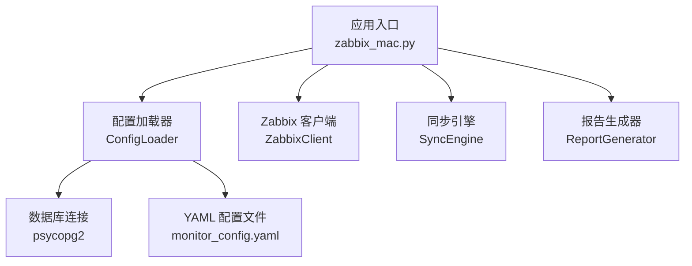
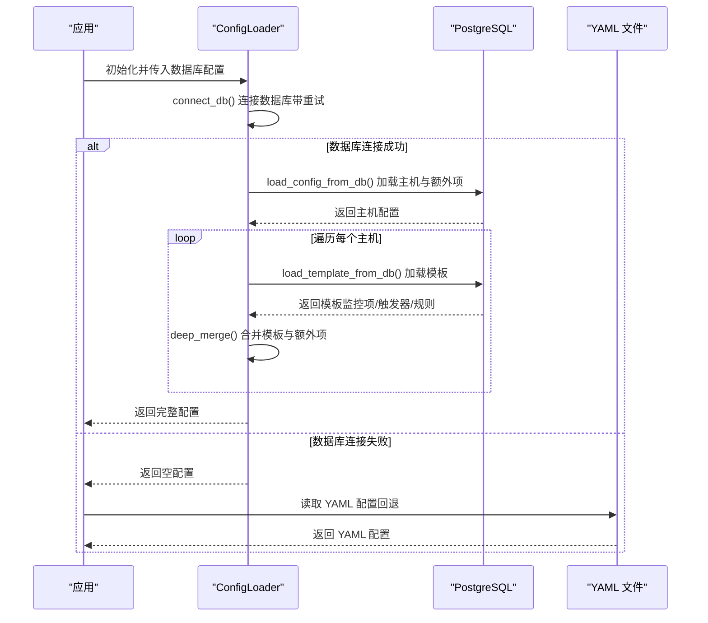
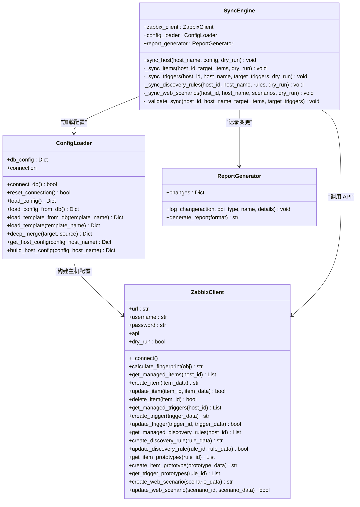
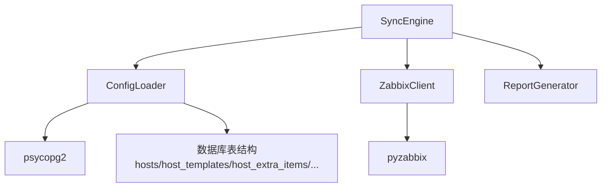

# 配置加载器

<cite>
**本文引用的文件**
- [zabbix_mac.py](file://zabbix_mac.py)
- [monitor_config.yaml](file://monitor_config.yaml)
- [DATABASE_MIGRATION_PLAN.md](file://DATABASE_MIGRATION_PLAN.md)
- [check_postgres_config.py](file://check_postgres_config.py)
- [update_postgres_config.py](file://update_postgres_config.py)
</cite>

## 目录
1. [简介](#简介)
2. [项目结构](#项目结构)
3. [核心组件](#核心组件)
4. [架构总览](#架构总览)
5. [详细组件分析](#详细组件分析)
6. [依赖关系分析](#依赖关系分析)
7. [性能考量](#性能考量)
8. [故障排查指南](#故障排查指南)
9. [结论](#结论)
10. [附录](#附录)

## 简介
本文件面向“配置加载器”（ConfigLoader）进行全面技术文档说明，重点覆盖以下方面：
- 设计理念与实现机制：数据库连接管理、配置数据加载策略、YAML 回退机制
- 配置验证流程、数据转换逻辑与错误处理策略
- 使用示例：从 PostgreSQL 数据库、YAML 文件以及混合模式加载配置
- 配置缓存机制、增量加载策略与性能优化
- 配置格式规范、字段定义与约束条件

## 项目结构
围绕配置加载器的关键文件与职责如下：
- zabbix_mac.py：包含 ConfigLoader 类、Zabbix 客户端、同步引擎与报告生成器等核心模块
- monitor_config.yaml：示例 YAML 配置文件，用于演示主机与额外监控项的结构
- DATABASE_MIGRATION_PLAN.md：数据库迁移与配置加载流程的规划文档，明确从 YAML 到数据库表的演进路径
- check_postgres_config.py / update_postgres_config.py：PostgreSQL 配置检查与更新脚本，辅助理解数据库连接与访问控制

**图表来源**
- [zabbix_mac.py:1-200](file://zabbix_mac.py#L1-L200)
- [monitor_config.yaml:1-20](file://monitor_config.yaml#L1-L20)

**章节来源**
- [zabbix_mac.py:1-200](file://zabbix_mac.py#L1-L200)
- [monitor_config.yaml:1-20](file://monitor_config.yaml#L1-L20)

## 核心组件
- ConfigLoader：负责从 PostgreSQL 数据库加载配置，支持模板、主机、额外监控项与自动发现规则的组合；具备连接重试、异常恢复与回退机制
- ZabbixClient：封装 Zabbix API 客户端，提供连接重试、指纹计算与 CRUD 操作
- SyncEngine：协调配置加载与 Zabbix 同步，执行校验与变更记录
- ReportGenerator：生成同步变更报告

**章节来源**
- [zabbix_mac.py:916-1463](file://zabbix_mac.py#L916-L1463)
- [zabbix_mac.py:39-800](file://zabbix_mac.py#L39-L800)
- [zabbix_mac.py:1466-1531](file://zabbix_mac.py#L1466-L1531)

## 架构总览
ConfigLoader 的整体工作流包括：数据库连接、配置加载、模板合并、回退策略与错误恢复。

**图表来源**
- [zabbix_mac.py:928-1096](file://zabbix_mac.py#L928-L1096)
- [zabbix_mac.py:1098-1385](file://zabbix_mac.py#L1098-L1385)
- [zabbix_mac.py:1408-1463](file://zabbix_mac.py#L1408-L1463)

## 详细组件分析

### ConfigLoader 类设计与实现
- 数据库连接管理
  - 支持重试与延迟重试，自动设置 autocommit
  - 连接失败时记录日志并触发 reset_connection() 以清理与重建连接
- 配置加载策略
  - load_config() 优先从数据库加载主机配置；失败则回退至 YAML
  - load_config_from_db() 从 hosts/host_templates/host_extra_items 表加载主机与额外监控项
  - load_template_from_db() 从 items_review/triggers_review/discovery_rules/filter_conditions/item_prototypes_review/trigger_prototypes_review 等表加载模板内容；若复核表无确认记录，则回退到原始表
- 数据转换逻辑
  - 历史与趋势字段从整数天数转换为字符串格式（如 "7d"），或在原型场景下转换为秒
  - 通过 deep_merge() 实现字典层级合并，保证额外监控项优先级最高
- 错误处理策略
  - 捕获 OperationalError 与通用异常，记录错误并重置连接
  - 对无效历史/趋势值进行警告并使用默认值

**图表来源**
- [zabbix_mac.py:916-1463](file://zabbix_mac.py#L916-L1463)
- [zabbix_mac.py:39-800](file://zabbix_mac.py#L39-L800)
- [zabbix_mac.py:1466-1531](file://zabbix_mac.py#L1466-L1531)

**章节来源**
- [zabbix_mac.py:916-1463](file://zabbix_mac.py#L916-L1463)

### 数据库连接管理与重试机制
- 连接参数来源于 db_config，包含 host、port、database、user、password
- 采用 MAX_RETRY_ATTEMPTS 与 RETRY_DELAY 控制重试次数与间隔
- 连接成功后设置 autocommit=true，简化事务控制
- reset_connection() 关闭旧连接并重新建立，避免连接失效导致的后续操作失败

**章节来源**
- [zabbix_mac.py:928-984](file://zabbix_mac.py#L928-L984)

### 配置加载策略与回退机制
- load_config() 优先从数据库加载主机配置；失败则记录错误并返回空字典
- DATABASE_MIGRATION_PLAN.md 明确了从 YAML 到数据库表的迁移路径，当前代码已实现“数据库优先 + YAML 回退”的策略
- YAML 示例文件 monitor_config.yaml 展示了主机、模板与额外监控项的基本结构

**章节来源**
- [zabbix_mac.py:986-1002](file://zabbix_mac.py#L986-L1002)
- [monitor_config.yaml:1-20](file://monitor_config.yaml#L1-L20)
- [DATABASE_MIGRATION_PLAN.md:19-21](file://DATABASE_MIGRATION_PLAN.md#L19-L21)

### 模板加载与数据转换
- load_template_from_db() 从 items_review/triggers_review/discovery_rules/filter_conditions/item_prototypes_review/trigger_prototypes_review 等表加载模板内容
- 若复核表中无 confirmed=true 的记录，则回退到 items/triggers/item_prototypes/trigger_prototypes 等原始表
- 历史与趋势字段在不同场景下进行格式转换（字符串 "Xd" 或秒）

**章节来源**
- [zabbix_mac.py:1098-1385](file://zabbix_mac.py#L1098-L1385)

### 合并与优先级
- build_host_config() 通过模板合并与 deep_merge() 实现：
  - 先合并模板内容
  - 再合并主机额外监控项（最高优先级）
- get_host_config() 提供按主机名检索主机配置的能力

**章节来源**
- [zabbix_mac.py:1425-1463](file://zabbix_mac.py#L1425-L1463)

### 错误处理与异常恢复
- 捕获 OperationalError 与通用异常，记录错误并调用 reset_connection() 重置连接
- 对无效历史/趋势值进行警告并使用默认值，避免同步中断

**章节来源**
- [zabbix_mac.py:1087-1096](file://zabbix_mac.py#L1087-L1096)
- [zabbix_mac.py:1376-1385](file://zabbix_mac.py#L1376-L1385)

### 使用示例与最佳实践

- 从 PostgreSQL 数据库加载配置
  - 步骤：初始化 ConfigLoader 并传入 db_config；调用 load_config() 获取主机配置；对每个主机调用 build_host_config() 合并模板与额外项
  - 参考路径：[zabbix_mac.py:986-1002](file://zabbix_mac.py#L986-L1002)、[zabbix_mac.py:1438-1463](file://zabbix_mac.py#L1438-L1463)

- 从 YAML 文件加载配置（回退）
  - 步骤：当数据库加载失败时，读取 monitor_config.yaml 并解析 hosts 与 extra_items 字段
  - 参考路径：[monitor_config.yaml:1-20](file://monitor_config.yaml#L1-L20)

- 混合模式（数据库优先 + YAML 回退）
  - 步骤：优先调用 load_config()；若返回空字典，则读取 YAML 文件作为回退方案
  - 参考路径：[zabbix_mac.py:986-1002](file://zabbix_mac.py#L986-L1002)

- 配置验证与同步
  - 步骤：使用 ZabbixClient 获取当前配置，计算指纹并比较差异；通过 ReportGenerator 记录变更
  - 参考路径：[zabbix_mac.py:1533-1595](file://zabbix_mac.py#L1533-L1595)

**章节来源**
- [zabbix_mac.py:986-1002](file://zabbix_mac.py#L986-L1002)
- [zabbix_mac.py:1438-1463](file://zabbix_mac.py#L1438-L1463)
- [monitor_config.yaml:1-20](file://monitor_config.yaml#L1-L20)
- [zabbix_mac.py:1533-1595](file://zabbix_mac.py#L1533-L1595)

### 配置格式规范、字段定义与约束条件
- 主机配置（来自数据库）
  - hosts：主机名 -> { description, templates[], extra_items{...} }
  - templates：模板名称列表
  - extra_items：以 item_key 为键的监控项集合，字段包括 name、type、value_type、delay、description、units、multiplier、delta、history、trends、status 等
- 模板配置（来自数据库）
  - items：从 items_review 或 items 表加载，字段包括 name、type、value_type、delay、description、units、multiplier、delta、history、trends、status、master_item、preprocessing
  - triggers：从 triggers_review 或 triggers 表加载，字段包括 name、expression、priority、description、status
  - discovery_rules：从 discovery_rules 表加载，包含 filter.conditions、item_prototypes[]、trigger_prototypes[]
  - item_prototypes/trigger_prototypes：从对应复核表或原始表加载，字段包括 name/key/description、expression、priority、status 等
- 历史与趋势字段
  - items：history/trends 通常为整数天，转换为字符串格式（如 "7d"）
  - item_prototypes：history/trends 通常为整数天，转换为秒（如 7*86400）
- 约束条件
  - hosts.name 唯一
  - host_templates(host_id, template_name) 唯一
  - host_extra_items(host_id, item_key) 唯一
  - 复核表中需 confirmed=true 才会纳入模板加载

**章节来源**
- [zabbix_mac.py:1014-1086](file://zabbix_mac.py#L1014-L1086)
- [zabbix_mac.py:1117-1385](file://zabbix_mac.py#L1117-L1385)
- [DATABASE_MIGRATION_PLAN.md:29-75](file://DATABASE_MIGRATION_PLAN.md#L29-L75)

## 依赖关系分析
- ConfigLoader 依赖 psycopg2 进行数据库连接与查询
- ZabbixClient 依赖 pyzabbix 进行 API 调用
- SyncEngine 协调 ConfigLoader 与 ZabbixClient，生成 ReportGenerator 报告
- DATABASE_MIGRATION_PLAN.md 为 ConfigLoader 的演进提供数据库表结构与加载流程指导

**图表来源**
- [zabbix_mac.py:916-1463](file://zabbix_mac.py#L916-L1463)
- [zabbix_mac.py:39-800](file://zabbix_mac.py#L39-L800)
- [zabbix_mac.py:1466-1531](file://zabbix_mac.py#L1466-L1531)

**章节来源**
- [zabbix_mac.py:916-1463](file://zabbix_mac.py#L916-L1463)
- [DATABASE_MIGRATION_PLAN.md:1-210](file://DATABASE_MIGRATION_PLAN.md#L1-L210)

## 性能考量
- 连接池与并发：当前实现为每实例单连接，建议在高并发场景引入连接池或线程安全的连接管理
- 查询优化：load_config_from_db() 与 load_template_from_db() 已通过 LIMIT 控制返回数量；可在大数据量场景下增加分页或索引
- 数据转换开销：历史/趋势字段的格式转换为常量时间操作，影响较小
- 回退策略：数据库失败时回退 YAML，避免长时间阻塞；建议在生产环境开启数据库优先模式并确保其稳定性

[本节为通用性能讨论，无需具体文件引用]

## 故障排查指南
- 数据库连接失败
  - 现象：connect_db() 多次重试后仍失败
  - 排查：检查 db_config、网络连通性、PostgreSQL 服务状态
  - 参考路径：[zabbix_mac.py:938-971](file://zabbix_mac.py#L938-L971)
- 连接异常或事务中止
  - 现象：OperationalError 或异常导致连接失效
  - 排查：调用 reset_connection() 重置连接；检查数据库日志
  - 参考路径：[zabbix_mac.py:1087-1096](file://zabbix_mac.py#L1087-L1096)、[zabbix_mac.py:1376-1385](file://zabbix_mac.py#L1376-L1385)
- PostgreSQL 配置问题
  - 现象：无法从容器或其他网络访问数据库
  - 排查：使用 check_postgres_config.py 检查 listen_addresses、port、data_directory、config_file、hba_file；必要时使用 update_postgres_config.py 更新配置并重启服务
  - 参考路径：[check_postgres_config.py:1-64](file://check_postgres_config.py#L1-L64)、[update_postgres_config.py:1-74](file://update_postgres_config.py#L1-L74)
- YAML 回退不生效
  - 现象：数据库加载失败但未读取 YAML
  - 排查：确认 load_config() 返回空字典时是否正确进入回退逻辑
  - 参考路径：[zabbix_mac.py:986-1002](file://zabbix_mac.py#L986-L1002)、[monitor_config.yaml:1-20](file://monitor_config.yaml#L1-L20)

**章节来源**
- [zabbix_mac.py:938-971](file://zabbix_mac.py#L938-L971)
- [zabbix_mac.py:1087-1096](file://zabbix_mac.py#L1087-L1096)
- [zabbix_mac.py:1376-1385](file://zabbix_mac.py#L1376-L1385)
- [check_postgres_config.py:1-64](file://check_postgres_config.py#L1-L64)
- [update_postgres_config.py:1-74](file://update_postgres_config.py#L1-L74)
- [monitor_config.yaml:1-20](file://monitor_config.yaml#L1-L20)

## 结论
ConfigLoader 通过“数据库优先 + YAML 回退”的策略，实现了灵活、可扩展的配置加载能力。其连接重试、异常恢复与数据转换逻辑保障了在复杂环境下的稳定性。结合 DATABASE_MIGRATION_PLAN.md 的演进路线，系统正逐步从 YAML 配置迁移到数据库集中管理，提升可维护性与可审计性。建议在生产环境中优先启用数据库配置，并配合完善的监控与回退策略，确保系统稳定运行。

[本节为总结性内容，无需具体文件引用]

## 附录

### 数据库表结构概览（迁移规划）
- hosts：主机信息（唯一 name）
- host_templates：主机与模板的多对多关联（唯一 host_id+template_name）
- host_extra_items：主机额外监控项（唯一 host_id+item_key）
- items/triggers/discovery_rules：模板与规则主表
- filter_conditions：自动发现规则过滤条件
- item_prototypes/trigger_prototypes：规则对应的原型
- items_review/triggers_review/item_prototypes_review/trigger_prototypes_review：复核表，confirmed=true 时纳入加载

**章节来源**
- [DATABASE_MIGRATION_PLAN.md:29-75](file://DATABASE_MIGRATION_PLAN.md#L29-L75)