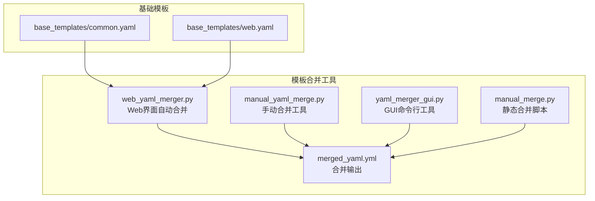
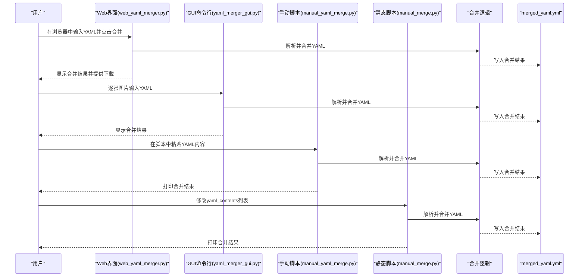
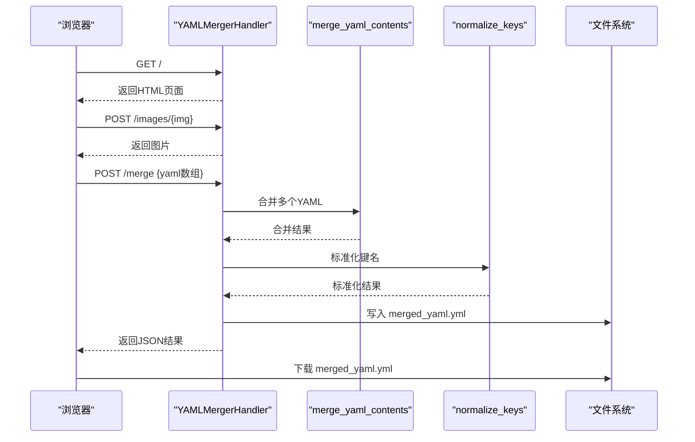
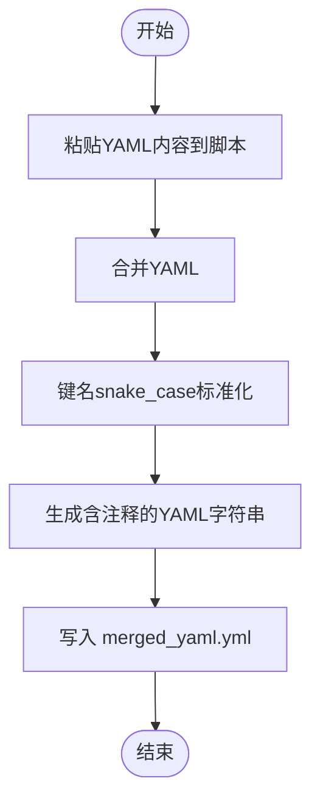
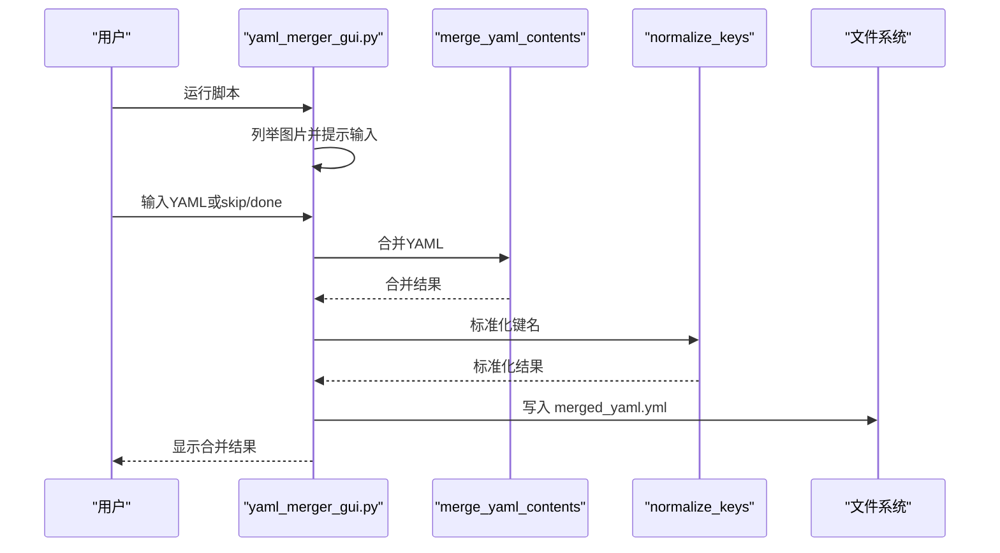
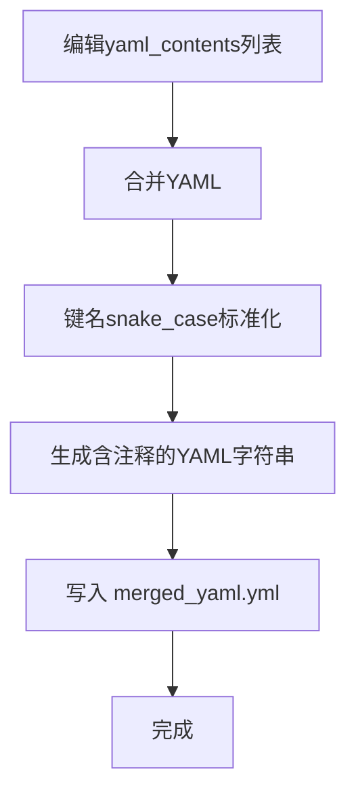
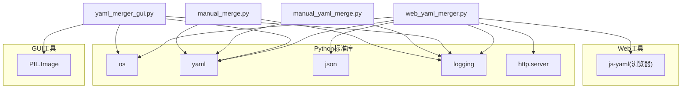

# 模板合并工具

<cite>
**本文引用的文件**
- [web_yaml_merger.py](file://web_yaml_merger.py)
- [manual_yaml_merge.py](file://manual_yaml_merge.py)
- [yaml_merger_gui.py](file://yaml_merger_gui.py)
- [manual_merge.py](file://manual_merge.py)
- [merged_yaml.yml](file://merged_yaml.yml)
- [base_templates/common.yaml](file://base_templates/common.yaml)
- [base_templates/web.yaml](file://base_templates/web.yaml)
- [CODE_WIKI.md](file://CODE_WIKI.md)
- [ZABBIX_SETUP_GUIDE.md](file://ZABBIX_SETUP_GUIDE.md)
</cite>

## 目录
1. [简介](#简介)
2. [项目结构](#项目结构)
3. [核心组件](#核心组件)
4. [架构总览](#架构总览)
5. [详细组件分析](#详细组件分析)
6. [依赖分析](#依赖分析)
7. [性能考虑](#性能考虑)
8. [故障排除指南](#故障排除指南)
9. [结论](#结论)
10. [附录](#附录)

## 简介
本文件面向“模板合并工具”的使用者与维护者，系统性介绍三类YAML合并工具的使用方法与工作机制：
- 自动合并工具：web_yaml_merger.py，提供Web界面，支持批量从图片中提取YAML并一键合并。
- 手动合并工具：manual_yaml_merge.py，提供最小化流程，适合快速合并少量YAML片段。
- 图形界面工具：yaml_merger_gui.py，提供命令行交互界面，适合本地化、非Web场景。
- 手动合并脚本：manual_merge.py，提供静态配置方式，适合将已有YAML直接合并输出。

同时，文档给出 merged_yaml.yml 输出文件的格式说明与验证方法，并提供完整操作流程、最佳实践与故障排除指南。

## 项目结构
模板合并工具位于仓库根目录，核心文件如下：
- web_yaml_merger.py：Web界面自动合并工具
- manual_yaml_merge.py：手动合并工具（最小化流程）
- yaml_merger_gui.py：带GUI的命令行工具
- manual_merge.py：静态YAML合并脚本
- merged_yaml.yml：合并结果输出文件
- base_templates/common.yaml、base_templates/web.yaml：基础模板样例

图表来源
- [web_yaml_merger.py](file://web_yaml_merger.py)
- [manual_yaml_merge.py](file://manual_yaml_merge.py)
- [yaml_merger_gui.py](file://yaml_merger_gui.py)
- [manual_merge.py](file://manual_merge.py)
- [merged_yaml.yml](file://merged_yaml.yml)
- [base_templates/common.yaml](file://base_templates/common.yaml)
- [base_templates/web.yaml](file://base_templates/web.yaml)

章节来源
- [web_yaml_merger.py](file://web_yaml_merger.py)
- [manual_yaml_merge.py](file://manual_yaml_merge.py)
- [yaml_merger_gui.py](file://yaml_merger_gui.py)
- [manual_merge.py](file://manual_merge.py)
- [merged_yaml.yml](file://merged_yaml.yml)
- [base_templates/common.yaml](file://base_templates/common.yaml)
- [base_templates/web.yaml](file://base_templates/web.yaml)

## 核心组件
- Web自动合并器：提供浏览器界面，自动扫描指定目录下的图片，逐张显示并收集YAML内容，支持批量合并与下载。
- 手动合并器：最小化流程，用户直接在脚本中粘贴YAML内容，执行后输出合并结果。
- GUI命令行工具：在终端中以交互方式逐张图片输入YAML，完成后统一合并输出。
- 静态合并脚本：通过修改脚本中的yaml_contents列表，一次性合并并输出结果。
- 合并输出：统一写入 merged_yaml.yml，包含头部注释与规范化后的键名（snake_case）。

章节来源
- [web_yaml_merger.py](file://web_yaml_merger.py)
- [manual_yaml_merge.py](file://manual_yaml_merge.py)
- [yaml_merger_gui.py](file://yaml_merger_gui.py)
- [manual_merge.py](file://manual_merge.py)
- [merged_yaml.yml](file://merged_yaml.yml)

## 架构总览
三种工具共享相同的合并算法与键名规范化策略，差异在于输入方式与交互体验。

图表来源
- [web_yaml_merger.py](file://web_yaml_merger.py)
- [yaml_merger_gui.py](file://yaml_merger_gui.py)
- [manual_yaml_merge.py](file://manual_yaml_merge.py)
- [manual_merge.py](file://manual_merge.py)
- [merged_yaml.yml](file://merged_yaml.yml)

## 详细组件分析

### Web自动合并器（web_yaml_merger.py）
- 功能特性
  - 提供Web界面，自动扫描指定目录下的图片文件，支持上一张/下一张导航。
  - 用户将图片中的YAML内容粘贴到文本框，点击“添加此YAML”后加入待合并队列。
  - 点击“合并所有”后，前端向后端发起合并请求，后端返回合并结果并可下载。
  - 合并过程对键名进行snake_case标准化，输出文件为merged_yaml.yml。
- 输入输出
  - 输入：图片目录（默认为“common yaml data”），用户粘贴的YAML文本。
  - 输出：merged_yaml.yml，包含头部注释与规范化键名。
- 关键流程
  - 列举图片 -> 展示图片 -> 用户输入YAML -> 合并 -> 保存文件 -> 返回结果。
- 错误处理
  - YAML解析失败、网络请求失败、无有效YAML内容等情况均返回错误提示。

图表来源
- [web_yaml_merger.py](file://web_yaml_merger.py)

章节来源
- [web_yaml_merger.py](file://web_yaml_merger.py)

### 手动合并器（manual_yaml_merge.py）
- 功能特性
  - 最小化流程，适合快速合并少量YAML片段。
  - 合并后进行键名snake_case标准化，生成含注释的YAML字符串并写入merged_yaml.yml。
- 使用方式
  - 直接在脚本中粘贴YAML内容，运行后输出合并结果。
- 适用场景
  - 临时合并、小规模配置、快速验证。

图表来源
- [manual_yaml_merge.py](file://manual_yaml_merge.py)

章节来源
- [manual_yaml_merge.py](file://manual_yaml_merge.py)

### GUI命令行工具（yaml_merger_gui.py）
- 功能特性
  - 在终端中逐张图片输入YAML，支持跳过与完成。
  - 合并后进行键名snake_case标准化，生成含注释的YAML字符串并写入merged_yaml.yml。
- 使用方式
  - 运行后按提示逐张输入YAML，输入“done”完成合并。
- 适用场景
  - 本地化、无Web环境或偏好命令行的用户。

图表来源
- [yaml_merger_gui.py](file://yaml_merger_gui.py)

章节来源
- [yaml_merger_gui.py](file://yaml_merger_gui.py)

### 静态合并脚本（manual_merge.py）
- 功能特性
  - 通过修改脚本中的yaml_contents列表，一次性合并并输出结果。
  - 合并后进行键名snake_case标准化，生成含注释的YAML字符串并写入merged_yaml.yml。
- 使用方式
  - 在脚本中填入每张图片的YAML内容，运行后输出合并结果。
- 适用场景
  - 已有YAML内容、批量处理、离线合并。

图表来源
- [manual_merge.py](file://manual_merge.py)

章节来源
- [manual_merge.py](file://manual_merge.py)

### 合并算法与键名规范化
- 合并策略
  - 递归合并字典；列表合并追加；重复键覆盖值。
- 键名规范化
  - 将键名转为小写并用下划线替换空格，形成snake_case风格。
- 注释与头部
  - 输出文件包含头部注释，说明生成时间与键名规范化信息。

章节来源
- [web_yaml_merger.py](file://web_yaml_merger.py)
- [manual_yaml_merge.py](file://manual_yaml_merge.py)
- [yaml_merger_gui.py](file://yaml_merger_gui.py)
- [manual_merge.py](file://manual_merge.py)

## 依赖分析
- 共同依赖
  - Python标准库：os、yaml、json、logging、http.server等。
  - Web工具额外依赖：浏览器端js-yaml库（用于前端解析）。
- 工具间耦合
  - 三个工具共享相同的合并逻辑与键名规范化函数，耦合度低，便于独立维护与扩展。
- 外部依赖
  - Web工具依赖浏览器与HTTP服务；GUI工具依赖终端与PIL库（用于图片处理）。

图表来源
- [web_yaml_merger.py](file://web_yaml_merger.py)
- [yaml_merger_gui.py](file://yaml_merger_gui.py)
- [manual_yaml_merge.py](file://manual_yaml_merge.py)
- [manual_merge.py](file://manual_merge.py)

章节来源
- [web_yaml_merger.py](file://web_yaml_merger.py)
- [yaml_merger_gui.py](file://yaml_merger_gui.py)
- [manual_yaml_merge.py](file://manual_yaml_merge.py)
- [manual_merge.py](file://manual_merge.py)

## 性能考虑
- 合并复杂度
  - 合并算法为O(n)，其中n为所有YAML节点数量；键名规范化为O(k)，k为键总数。
- I/O优化
  - Web工具在合并后一次性写入文件，避免多次磁盘写入。
  - GUI与手动工具在合并后一次性写入文件。
- 并发与资源
  - Web工具为单进程HTTP服务，适合本地使用；GUI与手动工具为单进程，适合小规模合并。
- 建议
  - 对于大量YAML文件，建议使用GUI或手动脚本分批处理，避免单次合并过大导致内存压力。

## 故障排除指南
- Web工具常见问题
  - 无法访问Web界面：检查端口占用与防火墙设置。
  - 图片无法显示：确认图片目录存在且包含合法图片文件。
  - 合并失败：检查YAML语法，确保每个片段可被解析。
- GUI工具常见问题
  - 无图片：确认图片目录存在且包含图片文件。
  - 输入YAML失败：检查YAML格式，确保为有效YAML。
- 手动与静态脚本常见问题
  - 未提供YAML内容：检查脚本中的YAML列表是否填写。
  - 合并结果异常：检查键名是否符合预期，必要时调整规范化策略。
- 通用建议
  - 使用前先备份merged_yaml.yml。
  - 合并后使用YAML校验工具验证格式正确性。

章节来源
- [web_yaml_merger.py](file://web_yaml_merger.py)
- [yaml_merger_gui.py](file://yaml_merger_gui.py)
- [manual_yaml_merge.py](file://manual_yaml_merge.py)
- [manual_merge.py](file://manual_merge.py)

## 结论
模板合并工具提供了多种使用路径，满足不同场景下的YAML合并需求：
- Web自动合并器适合批量、可视化、非技术用户的场景；
- GUI命令行工具适合本地化、命令行偏好的用户；
- 手动与静态脚本适合快速、小规模或离线合并。

统一的合并逻辑与键名规范化策略保证了输出的一致性与可读性。配合merged_yaml.yml的格式说明与验证方法，用户可以高效地完成模板合并任务。

## 附录

### merged_yaml.yml 输出格式说明
- 文件头
  - 包含生成时间与键名规范化说明的注释行。
- 内容结构
  - 采用YAML标准格式，键名已转换为snake_case。
  - 字典与列表嵌套清晰，便于阅读与后续处理。
- 示例参考
  - 参考现有输出文件与基础模板，了解典型结构与字段命名。

章节来源
- [merged_yaml.yml](file://merged_yaml.yml)
- [base_templates/common.yaml](file://base_templates/common.yaml)
- [base_templates/web.yaml](file://base_templates/web.yaml)

### 操作流程与最佳实践
- Web自动合并流程
  - 准备图片目录（默认“common yaml data”）。
  - 启动Web工具，浏览图片并逐张粘贴YAML。
  - 点击“合并所有”，下载merged_yaml.yml进行验证。
- GUI命令行流程
  - 运行GUI工具，逐张输入YAML，输入“done”完成。
  - 查看合并结果并确认输出文件。
- 手动与静态脚本流程
  - 在脚本中粘贴或编辑YAML内容，运行脚本输出结果。
- 最佳实践
  - 合并前备份原文件，合并后进行格式校验。
  - 对于复杂结构，建议先在小范围内验证合并逻辑。
  - 使用基础模板作为参考，确保字段命名一致性。

章节来源
- [web_yaml_merger.py](file://web_yaml_merger.py)
- [yaml_merger_gui.py](file://yaml_merger_gui.py)
- [manual_yaml_merge.py](file://manual_yaml_merge.py)
- [manual_merge.py](file://manual_merge.py)
- [merged_yaml.yml](file://merged_yaml.yml)
- [base_templates/common.yaml](file://base_templates/common.yaml)
- [base_templates/web.yaml](file://base_templates/web.yaml)

### 验证方法
- 格式验证
  - 使用YAML解析器或在线YAML校验工具检查语法。
- 内容验证
  - 对比基础模板与合并结果，确认字段完整性与命名一致性。
- 输出确认
  - 检查merged_yaml.yml的文件头注释与键名规范化效果。

章节来源
- [merged_yaml.yml](file://merged_yaml.yml)
- [base_templates/common.yaml](file://base_templates/common.yaml)
- [base_templates/web.yaml](file://base_templates/web.yaml)