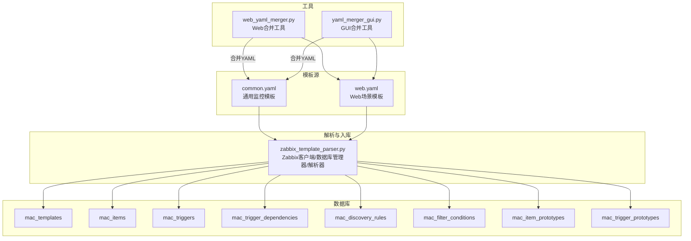
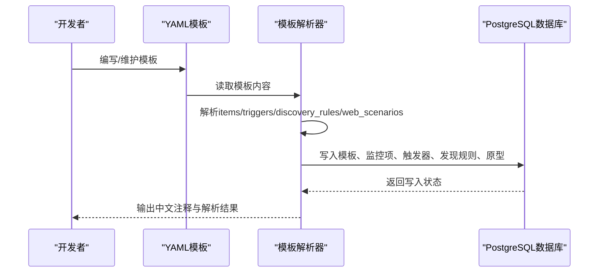
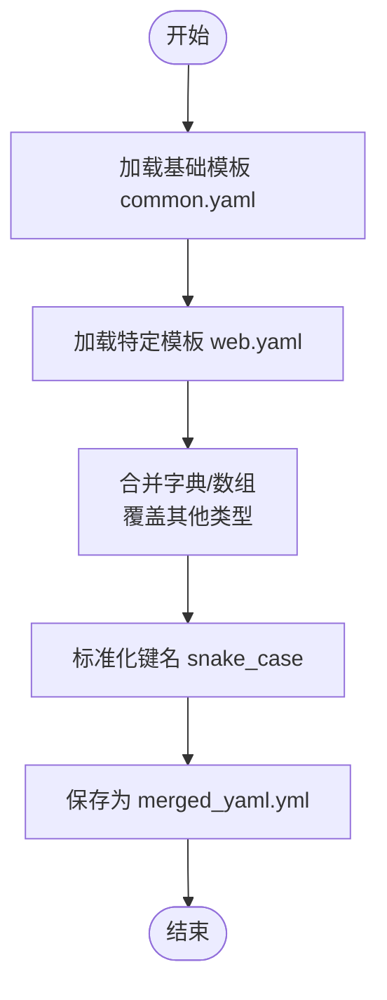
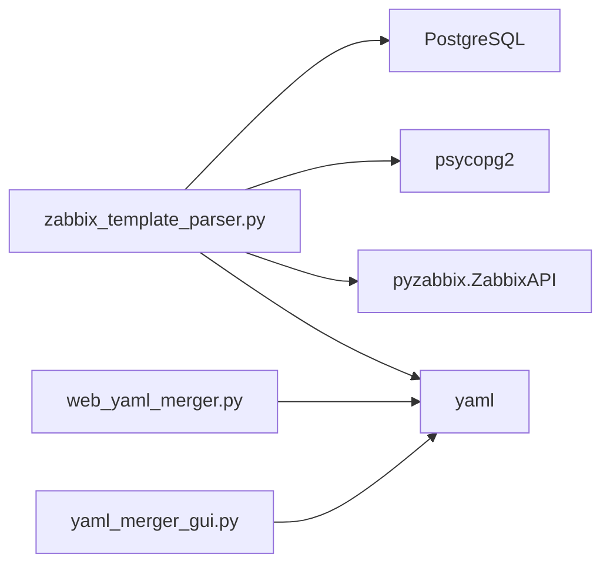

# 模板格式设计

<cite>
**本文引用的文件**
- [base_templates/common.yaml](file://base_templates/common.yaml)
- [base_templates/web.yaml](file://base_templates/web.yaml)
- [zabbix_template_parser.py](file://zabbix_template_parser.py)
- [web_yaml_merger.py](file://web_yaml_merger.py)
- [yaml_merger_gui.py](file://yaml_merger_gui.py)
- [check_item_prototypes_delay.py](file://check_item_prototypes_delay.py)
- [check_trigger_expressions.py](file://check_trigger_expressions.py)
- [check_prototypes.py](file://check_prototypes.py)
- [check_api_params.py](file://check_api_params.py)
- [monitor_config.yaml](file://monitor_config.yaml)
- [merged_yaml.yml](file://merged_yaml.yml)
</cite>

## 目录
1. [简介](#简介)
2. [项目结构](#项目结构)
3. [核心组件](#核心组件)
4. [架构总览](#架构总览)
5. [详细组件分析](#详细组件分析)
6. [依赖分析](#依赖分析)
7. [性能考虑](#性能考虑)
8. [故障排查指南](#故障排查指南)
9. [结论](#结论)
10. [附录](#附录)

## 简介
本文件面向Zabbix监控模板格式设计与实现，基于仓库中的YAML模板与解析工具，系统阐述模板的YAML语法与结构规范，覆盖监控项(items)、触发器(triggers)、自动发现规则(discovery_rules)及Web场景(web_scenarios)的标准格式；解释关键字段如name、type、value_type、delay等的语义与配置方式；说明模板继承与扩展机制（基础模板common.yaml与特定模板web.yaml的组合复用）；并提供模板开发最佳实践、命名约定、完整配置示例路径与错误处理指南。

## 项目结构
本项目围绕“模板即代码”的理念组织，核心由以下部分组成：
- 基础模板：base_templates/common.yaml（通用Linux监控）、base_templates/web.yaml（Web场景监控）
- 模板解析与持久化：zabbix_template_parser.py（从Zabbix API读取并入库）
- YAML合并工具：web_yaml_merger.py（Web界面）、yaml_merger_gui.py（命令行界面）
- 数据库模式：PostgreSQL表结构用于存储模板、监控项、触发器、自动发现规则及其原型
- 验证与检查：各类检查脚本用于校验延迟、表达式、原型等

图表来源
- [base_templates/common.yaml:1-288](file://base_templates/common.yaml#L1-L288)
- [base_templates/web.yaml:1-48](file://base_templates/web.yaml#L1-L48)
- [zabbix_template_parser.py:1-834](file://zabbix_template_parser.py#L1-L834)
- [web_yaml_merger.py:1-513](file://web_yaml_merger.py#L1-L513)
- [yaml_merger_gui.py:1-172](file://yaml_merger_gui.py#L1-L172)

章节来源
- [base_templates/common.yaml:1-288](file://base_templates/common.yaml#L1-L288)
- [base_templates/web.yaml:1-48](file://base_templates/web.yaml#L1-L48)
- [zabbix_template_parser.py:1-834](file://zabbix_template_parser.py#L1-L834)
- [web_yaml_merger.py:1-513](file://web_yaml_merger.py#L1-L513)
- [yaml_merger_gui.py:1-172](file://yaml_merger_gui.py#L1-L172)

## 核心组件
- 模板字段与类型
  - items：监控项集合，每个监控项包含name、type、value_type、delay等关键字段
  - triggers：触发器集合，包含expression与priority
  - discovery_rules：自动发现规则集合，包含filter与item_prototypes、trigger_prototypes
  - web_scenarios：Web场景集合，包含steps与triggers
  - web_items：Web场景相关的监控项集合
  - web_triggers：Web场景相关的触发器集合
- 解析器职责
  - 从Zabbix API读取模板的监控项、触发器、自动发现规则及其原型
  - 将解析结果写入PostgreSQL数据库，形成可审计、可复用的模板资产
  - 为监控项与触发器添加中文注释，便于运维理解
- 合并工具
  - 提供Web界面与命令行两种方式，将多张图片中的YAML内容合并为单一文件

章节来源
- [base_templates/common.yaml:1-288](file://base_templates/common.yaml#L1-L288)
- [base_templates/web.yaml:1-48](file://base_templates/web.yaml#L1-L48)
- [zabbix_template_parser.py:583-790](file://zabbix_template_parser.py#L583-L790)
- [web_yaml_merger.py:38-57](file://web_yaml_merger.py#L38-L57)
- [yaml_merger_gui.py:48-67](file://yaml_merger_gui.py#L48-L67)

## 架构总览
模板格式设计采用“YAML即模板”的架构，结合解析器与数据库持久化，形成可审计、可复用、可扩展的监控模板体系。

图表来源
- [zabbix_template_parser.py:583-790](file://zabbix_template_parser.py#L583-L790)
- [base_templates/common.yaml:1-288](file://base_templates/common.yaml#L1-L288)
- [base_templates/web.yaml:1-48](file://base_templates/web.yaml#L1-L48)

## 详细组件分析

### YAML模板基本语法与结构规范
- 顶层键
  - items：监控项集合，键名为监控项键（key），值为对象，包含name、type、value_type、delay等
  - triggers：触发器集合，键为触发器描述，值为对象，包含expression、priority等
  - discovery_rules：自动发现规则数组，每项包含name、key、delay、filter、item_prototypes、trigger_prototypes
  - web_scenarios：Web场景数组，每项包含name、key、delay、status、steps、triggers
  - web_items：Web场景相关的监控项数组
  - web_triggers：Web场景相关的触发器数组
- 字段语义与配置要点
  - name：监控项/触发器/规则的显示名称
  - type：监控项类型（数值、字符、文本、无符号数、计算值等）
  - value_type：返回值类型（浮点、整数、字符、日志、文本）
  - delay：采集间隔（字符串或秒数）
  - expression：触发器表达式（支持宏与时间范围函数）
  - priority：触发器严重级别（未分类、信息、警告、一般、高、灾难）
  - filter：自动发现过滤条件（evaltype、conditions）
  - item_prototypes/trigger_prototypes：自动发现规则下的原型集合
  - steps：Web场景步骤（name、url、status_codes、no）
  - status：Web场景启用状态（0启用，非0禁用）

章节来源
- [base_templates/common.yaml:1-288](file://base_templates/common.yaml#L1-L288)
- [base_templates/web.yaml:1-48](file://base_templates/web.yaml#L1-L48)

### 监控项(items)标准格式
- 关键字段
  - name：监控项名称
  - type：监控项类型（agent、SNMP、Zabbix内部、Web场景等）
  - value_type：数值类型（浮点、整数、字符、日志、文本）
  - delay：采集周期（如“1m”、“1h”、“60s”）
- 典型示例路径
  - [CPU利用率监控项:42-106](file://base_templates/common.yaml#L42-L106)
  - [系统主机名监控项:139-143](file://base_templates/common.yaml#L139-L143)

章节来源
- [base_templates/common.yaml:4-150](file://base_templates/common.yaml#L4-L150)

### 触发器(triggers)标准格式
- 关键字段
  - expression：触发器表达式（支持宏、时间范围函数）
  - priority：严重级别
- 典型示例路径
  - [高CPU利用率触发器:154-156](file://base_templates/common.yaml#L154-L156)
  - [系统主机名变更触发器:167-169](file://base_templates/common.yaml#L167-L169)

章节来源
- [base_templates/common.yaml:151-170](file://base_templates/common.yaml#L151-L170)

### 自动发现规则(discovery_rules)标准格式
- 关键字段
  - name/key/delay：规则名称、键、执行周期
  - filter：过滤条件（evaltype、conditions，支持正则匹配/不匹配）
  - item_prototypes：发现对象的监控项原型集合
  - trigger_prototypes：发现对象的触发器原型集合
- 典型示例路径
  - [块设备发现规则:172-236](file://base_templates/common.yaml#L172-L236)
  - [文件系统发现规则:237-288](file://base_templates/common.yaml#L237-L288)

章节来源
- [base_templates/common.yaml:171-288](file://base_templates/common.yaml#L171-L288)

### Web场景(web_scenarios)标准格式
- 关键字段
  - name/key/delay/status：场景名称、键、周期、启用状态
  - steps：步骤数组（name、url、status_codes、no）
  - triggers：场景相关触发器（description、expression、priority）
- 典型示例路径
  - [网站可用性场景:4-26](file://base_templates/web.yaml#L4-L26)
  - [Web监控项:28-39](file://base_templates/web.yaml#L28-L39)
  - [Web触发器:42-48](file://base_templates/web.yaml#L42-L48)

章节来源
- [base_templates/web.yaml:1-48](file://base_templates/web.yaml#L1-L48)

### 模板继承与扩展机制
- 基础模板(common.yaml)提供通用监控项、触发器与自动发现规则
- 特定模板(web.yaml)在基础之上叠加Web场景监控项与触发器
- 合并策略
  - 字典递归合并：同名键值为字典时进行深度合并
  - 数组合并：同名键值为数组时进行拼接
  - 覆盖策略：其他情况直接覆盖
- 合并工具
  - Web界面：[web_yaml_merger.py:444-487](file://web_yaml_merger.py#L444-L487)
  - 命令行界面：[yaml_merger_gui.py:48-67](file://yaml_merger_gui.py#L48-L67)

图表来源
- [web_yaml_merger.py:38-57](file://web_yaml_merger.py#L38-L57)
- [yaml_merger_gui.py:22-34](file://yaml_merger_gui.py#L22-L34)
- [merged_yaml.yml:1-12](file://merged_yaml.yml#L1-L12)

章节来源
- [base_templates/common.yaml:1-288](file://base_templates/common.yaml#L1-L288)
- [base_templates/web.yaml:1-48](file://base_templates/web.yaml#L1-L48)
- [web_yaml_merger.py:38-57](file://web_yaml_merger.py#L38-L57)
- [yaml_merger_gui.py:22-34](file://yaml_merger_gui.py#L22-L34)
- [merged_yaml.yml:1-12](file://merged_yaml.yml#L1-L12)

### 模板字段含义与配置选项详解
- items
  - name：监控项显示名
  - type：监控项类型（见解析器注释映射）
  - value_type：返回值类型（见解析器注释映射）
  - delay：采集周期（支持“1m”、“1h”等）
- triggers
  - expression：触发器表达式（支持宏与时间范围函数）
  - priority：严重级别（0~5）
- discovery_rules
  - filter.evaltype：条件评估类型
  - filter.conditions：条件数组（macro、value、operator）
  - item_prototypes/trigger_prototypes：原型集合
- web_scenarios
  - steps：步骤数组（name、url、status_codes、no）
  - status：启用状态（0启用）

章节来源
- [base_templates/common.yaml:1-288](file://base_templates/common.yaml#L1-L288)
- [base_templates/web.yaml:1-48](file://base_templates/web.yaml#L1-L48)
- [zabbix_template_parser.py:696-789](file://zabbix_template_parser.py#L696-L789)

### 模板开发最佳实践与命名约定
- 字段命名
  - 使用snake_case（合并工具会统一转换）
- 字段顺序
  - items/triggers/discovery_rules/web_scenarios/web_items/web_triggers按需排列
- 命名约定
  - key使用清晰、可读性强的标识，避免特殊字符
  - name体现业务含义，便于告警定位
- 宏与阈值
  - 使用{$VAR:...}宏统一管理阈值，便于集中调整
- 表达式
  - 优先使用min()/max()/last()等聚合函数与时间窗口
  - 表达式应具备可读性与可审计性
- Web场景
  - steps按访问顺序编号（no），便于排障
  - status默认启用（0）

章节来源
- [web_yaml_merger.py:24-36](file://web_yaml_merger.py#L24-L36)
- [yaml_merger_gui.py:22-34](file://yaml_merger_gui.py#L22-L34)
- [base_templates/web.yaml:10-18](file://base_templates/web.yaml#L10-L18)

### 完整配置示例与路径
- 通用模板示例
  - [CPU监控项集合:4-106](file://base_templates/common.yaml#L4-L106)
  - [通用触发器集合:151-170](file://base_templates/common.yaml#L151-L170)
  - [自动发现规则集合:171-288](file://base_templates/common.yaml#L171-L288)
- Web场景模板示例
  - [Web场景集合:4-26](file://base_templates/web.yaml#L4-L26)
  - [Web监控项集合:28-39](file://base_templates/web.yaml#L28-L39)
  - [Web触发器集合:42-48](file://base_templates/web.yaml#L42-L48)
- 合并输出示例
  - [合并后的YAML示例:1-12](file://merged_yaml.yml#L1-L12)

章节来源
- [base_templates/common.yaml:1-288](file://base_templates/common.yaml#L1-L288)
- [base_templates/web.yaml:1-48](file://base_templates/web.yaml#L1-L48)
- [merged_yaml.yml:1-12](file://merged_yaml.yml#L1-L12)

## 依赖分析
- 组件耦合
  - 模板解析器依赖Zabbix API与PostgreSQL驱动
  - 合并工具独立于Zabbix，仅负责YAML合并与键名标准化
- 外部依赖
  - pyzabbix：Zabbix API调用
  - psycopg2：PostgreSQL数据库访问
  - yaml：YAML解析与序列化
- 数据模型
  - 模板与监控项、触发器、发现规则、原型之间存在一对一/一对多关系

图表来源
- [zabbix_template_parser.py:13-25](file://zabbix_template_parser.py#L13-L25)
- [web_yaml_merger.py:7-11](file://web_yaml_merger.py#L7-L11)
- [yaml_merger_gui.py:7-10](file://yaml_merger_gui.py#L7-L10)

章节来源
- [zabbix_template_parser.py:13-25](file://zabbix_template_parser.py#L13-L25)
- [web_yaml_merger.py:7-11](file://web_yaml_merger.py#L7-L11)
- [yaml_merger_gui.py:7-10](file://yaml_merger_gui.py#L7-L10)

## 性能考虑
- 采集间隔(delay)
  - 高频监控项（如CPU利用率）建议“1m”，低频项（如系统启动时间）可设为“15m”或更长
  - Web场景监控项通常“5m”即可满足需求
- 表达式优化
  - 使用min()/max()等聚合函数时，合理设置时间窗口，避免过长导致误报或过短导致抖动
- 数据库写入
  - 批量写入时注意ON CONFLICT DO UPDATE策略，减少重复写入开销
- 合并工具
  - 大量图片合并时，建议使用Web界面工具，提升交互效率

## 故障排查指南
- 常见问题与定位
  - 监控项原型delay字段异常：使用检查脚本核对数据库记录
    - [检查监控项原型delay:19-25](file://check_item_prototypes_delay.py#L19-L25)
    - [检查触发器原型:27-33](file://check_item_prototypes_delay.py#L27-L33)
  - 触发器表达式异常：使用检查脚本查看前N条表达式
    - [检查触发器表达式:20-28](file://check_trigger_expressions.py#L20-L28)
    - [检查触发器原型表达式:30-37](file://check_trigger_expressions.py#L30-L37)
  - 自动发现规则与原型缺失：使用检查脚本核对表记录
    - [检查发现规则/原型:19-44](file://check_prototypes.py#L19-L44)
- API参数校验
  - 使用API参数检查脚本确认Zabbix API方法参数
    - [触发器原型参数:15-25](file://check_api_params.py#L15-L25)
    - [监控项原型参数:27-36](file://check_api_params.py#L27-L36)
- 数据库配置
  - 使用PostgreSQL配置检查脚本核对监听地址、端口、数据目录等
    - [PostgreSQL配置检查:9-52](file://check_postgres_config.py#L9-L52)

章节来源
- [check_item_prototypes_delay.py:1-38](file://check_item_prototypes_delay.py#L1-L38)
- [check_trigger_expressions.py:1-48](file://check_trigger_expressions.py#L1-L48)
- [check_prototypes.py:1-49](file://check_prototypes.py#L1-L49)
- [check_api_params.py:1-42](file://check_api_params.py#L1-L42)
- [check_postgres_config.py:1-64](file://check_postgres_config.py#L1-L64)

## 结论
本设计以YAML为模板载体，结合解析器与数据库持久化，实现了模板的标准化、可审计与可复用。通过common.yaml与web.yaml的分层设计与合并工具，开发者可在保持一致性的同时灵活扩展监控覆盖面。建议在实际落地中严格遵循命名约定、宏管理与表达式规范，并配合检查脚本持续验证模板质量。

## 附录
- 主机配置示例（Monitor as Code）
  - [主机与模板引用示例:4-19](file://monitor_config.yaml#L4-L19)
- 合并工具使用
  - Web界面：[web_yaml_merger.py:489-513](file://web_yaml_merger.py#L489-L513)
  - 命令行界面：[yaml_merger_gui.py:79-172](file://yaml_merger_gui.py#L79-L172)

章节来源
- [monitor_config.yaml:1-20](file://monitor_config.yaml#L1-L20)
- [web_yaml_merger.py:489-513](file://web_yaml_merger.py#L489-L513)
- [yaml_merger_gui.py:79-172](file://yaml_merger_gui.py#L79-L172)