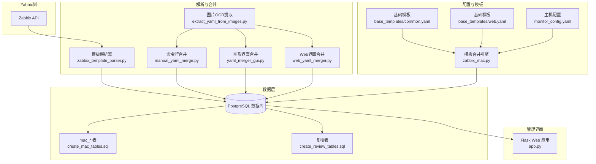
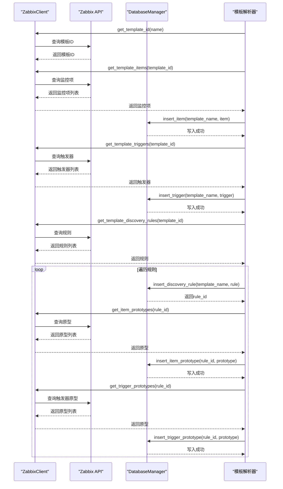
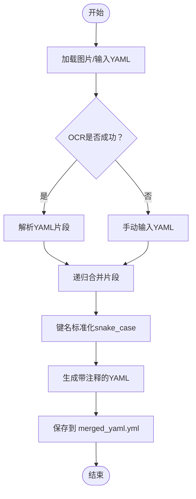
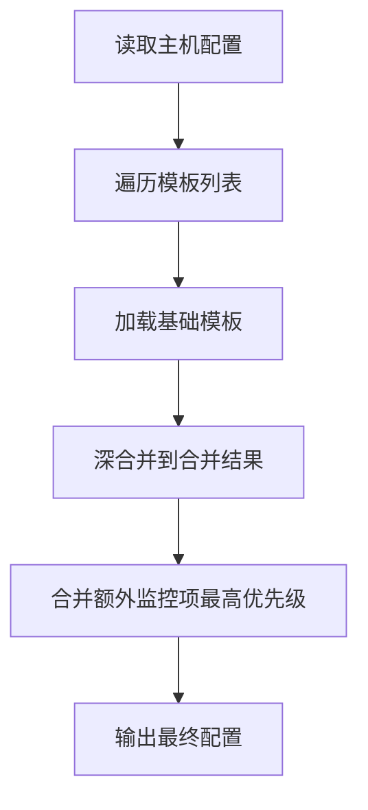
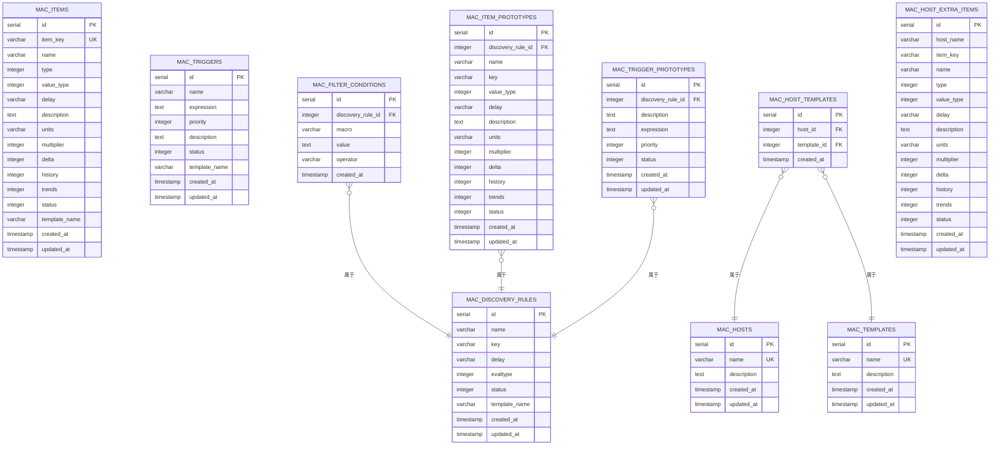
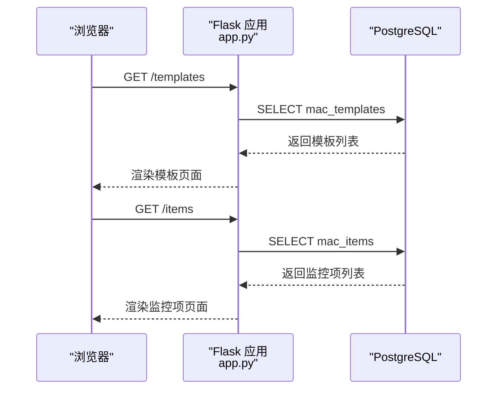
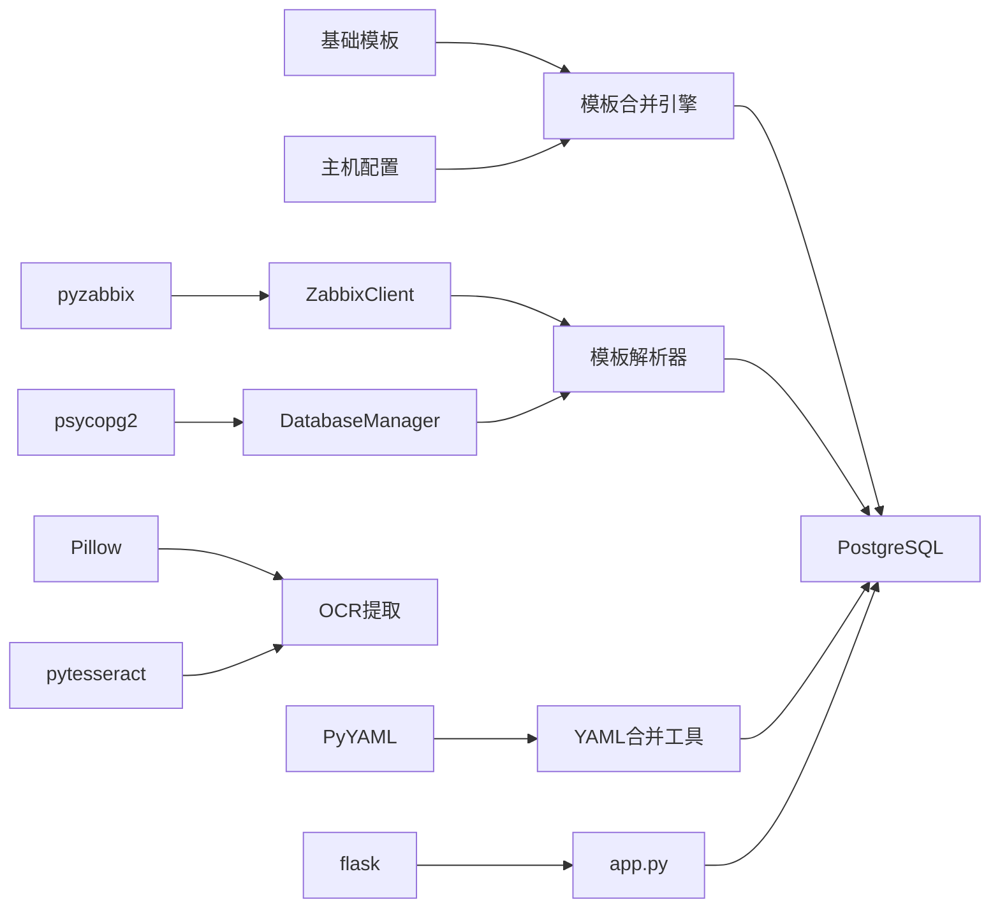

# 模板系统

<cite>
**本文引用的文件**   
- [zabbix_template_parser.py](file://zabbix_template_parser.py)
- [web_yaml_merger.py](file://web_yaml_merger.py)
- [manual_yaml_merge.py](file://manual_yaml_merge.py)
- [yaml_merger_gui.py](file://yaml_merger_gui.py)
- [extract_yaml_from_images.py](file://extract_yaml_from_images.py)
- [base_templates/common.yaml](file://base_templates/common.yaml)
- [base_templates/web.yaml](file://base_templates/web.yaml)
- [monitor_config.yaml](file://monitor_config.yaml)
- [create_mac_tables.sql](file://create_mac_tables.sql)
- [create_review_tables.sql](file://create_review_tables.sql)
- [app.py](file://app.py)
- [zabbix_mac.py](file://zabbix_mac.py)
</cite>

## 目录
1. [简介](#简介)
2. [项目结构](#项目结构)
3. [核心组件](#核心组件)
4. [架构总览](#架构总览)
5. [详细组件分析](#详细组件分析)
6. [依赖分析](#依赖分析)
7. [性能考虑](#性能考虑)
8. [故障排查指南](#故障排查指南)
9. [结论](#结论)
10. [附录](#附录)

## 简介
本模板系统围绕“监控即代码（Monitor as Code, MaC）”理念，提供从Zabbix模板解析、YAML模板合并、数据库持久化到Web管理界面的完整链路。系统支持：
- 从Zabbix模板中抽取监控项、触发器、自动发现规则及其原型，并写入PostgreSQL数据库；
- 通过多种方式（手动、Web界面、OCR）将图片中的YAML内容提取并合并为统一的模板；
- 基于基础模板与主机配置进行模板合并与优先级覆盖；
- 提供Web管理界面用于查看与复核模板、监控项、触发器等。

## 项目结构
系统主要由以下模块组成：
- 模板解析与数据库层：负责从Zabbix读取模板并入库；
- 模板合并工具：提供命令行、Web界面与OCR辅助的YAML合并能力；
- 基础模板：提供通用监控项、触发器与自动发现规则的基准配置；
- 配置与复核：主机配置与复核表，支撑模板合并与变更审计；
- Web管理界面：Flask应用，提供模板与监控对象的浏览与编辑入口。



**图示来源**
- [zabbix_template_parser.py:37-177](file://zabbix_template_parser.py#L37-L177)
- [web_yaml_merger.py:69-488](file://web_yaml_merger.py#L69-L488)
- [manual_yaml_merge.py:17-108](file://manual_yaml_merge.py#L17-L108)
- [yaml_merger_gui.py:22-172](file://yaml_merger_gui.py#L22-L172)
- [extract_yaml_from_images.py:26-217](file://extract_yaml_from_images.py#L26-L217)
- [create_mac_tables.sql:4-252](file://create_mac_tables.sql#L4-L252)
- [create_review_tables.sql:4-201](file://create_review_tables.sql#L4-L201)
- [base_templates/common.yaml:1-288](file://base_templates/common.yaml#L1-L288)
- [base_templates/web.yaml:1-48](file://base_templates/web.yaml#L1-L48)
- [monitor_config.yaml:1-20](file://monitor_config.yaml#L1-L20)
- [zabbix_mac.py:1438-1463](file://zabbix_mac.py#L1438-L1463)
- [app.py:9-774](file://app.py#L9-L774)

**章节来源**
- [zabbix_template_parser.py:37-177](file://zabbix_template_parser.py#L37-L177)
- [web_yaml_merger.py:69-488](file://web_yaml_merger.py#L69-L488)
- [manual_yaml_merge.py:17-108](file://manual_yaml_merge.py#L17-L108)
- [yaml_merger_gui.py:22-172](file://yaml_merger_gui.py#L22-L172)
- [extract_yaml_from_images.py:26-217](file://extract_yaml_from_images.py#L26-L217)
- [create_mac_tables.sql:4-252](file://create_mac_tables.sql#L4-L252)
- [create_review_tables.sql:4-201](file://create_review_tables.sql#L4-L201)
- [base_templates/common.yaml:1-288](file://base_templates/common.yaml#L1-L288)
- [base_templates/web.yaml:1-48](file://base_templates/web.yaml#L1-L48)
- [monitor_config.yaml:1-20](file://monitor_config.yaml#L1-L20)
- [zabbix_mac.py:1438-1463](file://zabbix_mac.py#L1438-L1463)
- [app.py:9-774](file://app.py#L9-L774)

## 核心组件
- 模板解析器：封装Zabbix客户端与数据库管理器，负责从Zabbix读取模板并写入数据库；支持监控项、触发器、自动发现规则及其原型的抽取与注释增强。
- YAML合并工具：提供三种合并路径（命令行、GUI、Web），统一键命名风格（snake_case），合并多个YAML片段为单一模板。
- 基础模板：提供通用Linux监控、Web场景监控的基础配置，作为模板继承与扩展的起点。
- 配置与复核：主机配置文件定义主机引用模板与额外监控项；复核表用于变更审计与确认流程。
- Web管理界面：基于Flask，展示数据库中的模板与监控对象，支持增删改查与复核状态管理。

**章节来源**
- [zabbix_template_parser.py:583-790](file://zabbix_template_parser.py#L583-L790)
- [web_yaml_merger.py:38-57](file://web_yaml_merger.py#L38-L57)
- [manual_yaml_merge.py:17-108](file://manual_yaml_merge.py#L17-L108)
- [yaml_merger_gui.py:48-67](file://yaml_merger_gui.py#L48-L67)
- [base_templates/common.yaml:1-288](file://base_templates/common.yaml#L1-L288)
- [base_templates/web.yaml:1-48](file://base_templates/web.yaml#L1-L48)
- [monitor_config.yaml:1-20](file://monitor_config.yaml#L1-L20)
- [create_review_tables.sql:4-201](file://create_review_tables.sql#L4-L201)
- [app.py:9-774](file://app.py#L9-L774)

## 架构总览
系统采用“解析-合并-持久化-展示”的分层架构：
- 输入层：Zabbix模板、图片YAML、主机配置；
- 处理层：模板解析器、YAML合并工具、模板合并引擎；
- 存储层：PostgreSQL数据库（mac_*表与复核表）；
- 展示层：Flask Web应用。

```mermaid
sequenceDiagram
participant U as "用户"
participant W as "Web界面<br/>app.py"
participant M as "模板合并引擎<br/>zabbix_mac.py"
participant P as "模板解析器<br/>zabbix_template_parser.py"
participant D as "数据库<br/>PostgreSQL"
U->>W : 访问管理界面
W-->>U : 展示模板/监控项/触发器
U->>M : 提交主机配置与模板引用
M-->>D : 读取基础模板与主机配置
M-->>D : 合并结果写入/更新
U->>P : 执行模板解析任务
P->>Z as "Zabbix API"
Z-->>P : 返回模板数据
P-->>D : 写入mac_*表
D-->>W : 提供数据渲染
```

**图示来源**
- [app.py:9-774](file://app.py#L9-L774)
- [zabbix_mac.py:1438-1463](file://zabbix_mac.py#L1438-L1463)
- [zabbix_template_parser.py:596-622](file://zabbix_template_parser.py#L596-L622)
- [create_mac_tables.sql:4-252](file://create_mac_tables.sql#L4-L252)

## 详细组件分析

### 组件A：模板解析器（Zabbix → 数据库）
- 职责：连接Zabbix API，读取模板的监控项、触发器、自动发现规则及其原型，标准化注释后写入数据库。
- 关键流程：
  - 获取模板ID → 插入模板元数据；
  - 读取监控项/触发器/规则 → 标准化注释 → 写入对应表；
  - 对规则下的原型进行递归解析与写入。
- 错误处理：对API异常与数据库异常进行捕获与回滚，保证幂等写入（ON CONFLICT）。



**图示来源**
- [zabbix_template_parser.py:64-177](file://zabbix_template_parser.py#L64-L177)
- [zabbix_template_parser.py:596-695](file://zabbix_template_parser.py#L596-L695)

**章节来源**
- [zabbix_template_parser.py:37-177](file://zabbix_template_parser.py#L37-L177)
- [zabbix_template_parser.py:583-790](file://zabbix_template_parser.py#L583-L790)

### 组件B：YAML模板合并工具
- 命令行合并：接收多个YAML片段，递归合并、键名标准化（snake_case），输出统一的YAML文件。
- GUI合并：交互式收集多张图片中的YAML内容，逐条校验与合并。
- Web合并：提供HTTP服务，前端上传YAML，后端合并并返回结果，同时保存至文件。
- OCR辅助：从图片中提取文本并尝试解析YAML，若失败则回退到手动输入。



**图示来源**
- [manual_yaml_merge.py:17-108](file://manual_yaml_merge.py#L17-L108)
- [yaml_merger_gui.py:48-67](file://yaml_merger_gui.py#L48-L67)
- [web_yaml_merger.py:38-57](file://web_yaml_merger.py#L38-L57)
- [extract_yaml_from_images.py:78-151](file://extract_yaml_from_images.py#L78-L151)

**章节来源**
- [manual_yaml_merge.py:17-108](file://manual_yaml_merge.py#L17-L108)
- [yaml_merger_gui.py:22-172](file://yaml_merger_gui.py#L22-L172)
- [web_yaml_merger.py:69-488](file://web_yaml_merger.py#L69-L488)
- [extract_yaml_from_images.py:26-217](file://extract_yaml_from_images.py#L26-L217)

### 组件C：模板合并引擎（主机配置 → 最终配置）
- 功能：根据主机配置文件，加载引用的基础模板，执行深度合并；额外监控项具有最高优先级覆盖。
- 关键点：模板加载与深合并、额外项覆盖策略。



**图示来源**
- [zabbix_mac.py:1438-1463](file://zabbix_mac.py#L1438-L1463)
- [monitor_config.yaml:1-20](file://monitor_config.yaml#L1-L20)
- [base_templates/common.yaml:1-288](file://base_templates/common.yaml#L1-L288)
- [base_templates/web.yaml:1-48](file://base_templates/web.yaml#L1-L48)

**章节来源**
- [zabbix_mac.py:1438-1463](file://zabbix_mac.py#L1438-L1463)
- [monitor_config.yaml:1-20](file://monitor_config.yaml#L1-L20)
- [base_templates/common.yaml:1-288](file://base_templates/common.yaml#L1-L288)
- [base_templates/web.yaml:1-48](file://base_templates/web.yaml#L1-L48)

### 组件D：数据库模型与复核机制
- 数据模型：mac_templates、mac_items、mac_triggers、mac_discovery_rules、mac_filter_conditions、mac_item_prototypes、mac_trigger_prototypes、mac_hosts、mac_host_templates、mac_host_extra_items。
- 复核表：items_review、triggers_review、item_prototypes_review、trigger_prototypes_review，支持modified、confirmed、status_verification等字段，便于审计与审批流程。
- 索引优化：为常用查询字段建立索引，提升性能。



**图示来源**
- [create_mac_tables.sql:4-252](file://create_mac_tables.sql#L4-L252)

**章节来源**
- [create_mac_tables.sql:4-252](file://create_mac_tables.sql#L4-L252)
- [create_review_tables.sql:4-201](file://create_review_tables.sql#L4-L201)

### 组件E：Web管理界面
- 功能：展示系统统计、模板、监控项、触发器、原型等；支持增删改查与复核状态管理。
- 数据来源：PostgreSQL数据库中的mac_*与复核表。



**图示来源**
- [app.py:65-101](file://app.py#L65-L101)
- [app.py:223-231](file://app.py#L223-L231)

**章节来源**
- [app.py:9-774](file://app.py#L9-L774)

## 依赖分析
- 外部依赖：pyzabbix（Zabbix API）、psycopg2（PostgreSQL）、Flask（Web）、Pillow与pytesseract（OCR）、PyYAML（YAML解析）。
- 内部耦合：模板解析器依赖ZabbixClient与DatabaseManager；模板合并引擎依赖基础模板与主机配置；Web界面依赖数据库表结构。



**图示来源**
- [zabbix_template_parser.py:13-25](file://zabbix_template_parser.py#L13-L25)
- [app.py:9-15](file://app.py#L9-L15)
- [web_yaml_merger.py:7-12](file://web_yaml_merger.py#L7-L12)
- [extract_yaml_from_images.py:7-11](file://extract_yaml_from_images.py#L7-L11)
- [zabbix_mac.py:9-22](file://zabbix_mac.py#L9-L22)

**章节来源**
- [zabbix_template_parser.py:13-25](file://zabbix_template_parser.py#L13-L25)
- [app.py:9-15](file://app.py#L9-L15)
- [web_yaml_merger.py:7-12](file://web_yaml_merger.py#L7-L12)
- [extract_yaml_from_images.py:7-11](file://extract_yaml_from_images.py#L7-L11)
- [zabbix_mac.py:9-22](file://zabbix_mac.py#L9-L22)

## 性能考虑
- 数据库层面：为高频查询字段建立索引，减少查询延迟；使用ON CONFLICT避免重复写入带来的冲突。
- API访问：对Zabbix API调用增加重试与超时控制，降低网络波动影响。
- 合并算法：递归合并与键名标准化为O(n)复杂度，建议限制单次合并的YAML数量，避免内存峰值过高。
- Web界面：分页与缓存策略可进一步优化大数据量展示性能。

## 故障排查指南
- Zabbix连接失败：检查URL、用户名与密码；查看重试日志；确认网络连通性。
- 数据库连接失败：检查主机、端口、数据库名、用户与密码；确认PostgreSQL服务状态。
- YAML解析失败：确认YAML缩进与语法；使用Web界面的js-yaml进行在线校验；必要时启用调试模式。
- 合并结果异常：检查键名标准化是否符合预期；确认额外监控项覆盖顺序是否正确。
- 复核状态异常：确认复核表字段（modified、confirmed、status_verification）是否按流程更新。

**章节来源**
- [zabbix_template_parser.py:59-62](file://zabbix_template_parser.py#L59-L62)
- [web_yaml_merger.py:444-487](file://web_yaml_merger.py#L444-L487)
- [extract_yaml_from_images.py:26-36](file://extract_yaml_from_images.py#L26-L36)
- [create_review_tables.sql:22-25](file://create_review_tables.sql#L22-L25)

## 结论
该模板系统通过“解析-合并-持久化-展示”的闭环，实现了Zabbix监控配置的标准化与可审计化。基础模板与主机配置的组合提供了灵活的继承与覆盖机制；YAML合并工具与OCR辅助提升了从非结构化来源采集配置的能力；数据库与复核表保障了变更的可追溯性；Web界面则提供了直观的运维入口。建议在生产环境中结合CI/CD流程，对模板变更进行版本化管理与自动化测试。

## 附录

### YAML模板格式与语法规则
- 顶层键：items、triggers、discovery_rules、web_scenarios、web_items、web_triggers等。
- items：键名为监控项key_，子键包含name、type、value_type、delay等。
- triggers：键名为触发器描述，子键包含expression、priority等。
- discovery_rules：数组元素，包含name、key、delay、filter（conditions/operator/evaltype）与item_prototypes、trigger_prototypes。
- web_scenarios：数组元素，包含steps（name、url、status_codes、no）与triggers。
- web_items：数组元素，包含type=9（Web场景）。
- web_triggers：数组元素，包含expression、priority。

**章节来源**
- [base_templates/common.yaml:1-288](file://base_templates/common.yaml#L1-L288)
- [base_templates/web.yaml:1-48](file://base_templates/web.yaml#L1-L48)

### 模板解析器工作原理
- 读取Zabbix模板 → 抽取监控项/触发器/规则 → 标准化注释 → 写入数据库。
- 支持触发器依赖转换与原型递归解析。
- 使用ON CONFLICT进行幂等写入，避免重复。

**章节来源**
- [zabbix_template_parser.py:596-695](file://zabbix_template_parser.py#L596-L695)
- [zabbix_template_parser.py:696-790](file://zabbix_template_parser.py#L696-L790)

### 模板合并工具使用指南
- 自动合并：将多张图片中的YAML内容通过OCR提取并合并，或通过Web界面上传YAML片段，后端递归合并并标准化键名。
- 手动合并：在命令行中逐张图片输入YAML，或使用GUI界面交互式添加与合并。
- 输出：生成merged_yaml.yml，包含头部注释与标准化键名。

**章节来源**
- [web_yaml_merger.py:38-57](file://web_yaml_merger.py#L38-L57)
- [manual_yaml_merge.py:50-108](file://manual_yaml_merge.py#L50-L108)
- [yaml_merger_gui.py:79-172](file://yaml_merger_gui.py#L79-L172)
- [extract_yaml_from_images.py:78-217](file://extract_yaml_from_images.py#L78-L217)

### 版本管理、继承与复用
- 版本管理：通过Git管理基础模板与主机配置；每次变更提交包含变更说明与影响范围。
- 继承关系：主机配置引用基础模板，模板合并引擎执行深合并；额外监控项具有最高优先级覆盖。
- 复用机制：基础模板（common.yaml、web.yaml）可被多主机共享；通过复核表实现跨团队协作与审批。

**章节来源**
- [zabbix_mac.py:1438-1463](file://zabbix_mac.py#L1438-L1463)
- [monitor_config.yaml:1-20](file://monitor_config.yaml#L1-L20)
- [create_review_tables.sql:4-201](file://create_review_tables.sql#L4-L201)

### 模板最佳实践
- 使用snake_case命名键，保持一致的键风格；
- 在triggers与item_prototypes中使用参数化宏（如{$VAR}）提升可移植性；
- 为每个监控项与触发器提供清晰的描述与注释；
- 通过复核表进行双人复核与状态标记，确保变更可控；
- 对频繁变更的项设置合理的delay与历史/趋势保留周期。

### 常见问题与解决方案
- YAML缩进错误：使用Web界面的js-yaml进行实时校验；逐步增加缩进层级。
- 键名冲突：合并前进行键名标准化（snake_case）；避免重复键覆盖。
- Zabbix API权限不足：确认用户角色与API权限；检查URL与凭据。
- 数据库写入失败：检查唯一约束（如UNIQUE(template_name,item_key)）；清理冲突数据后重试。