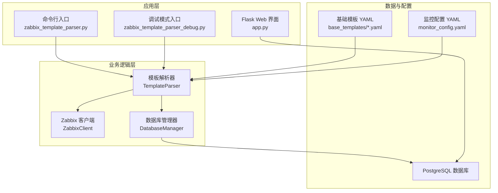
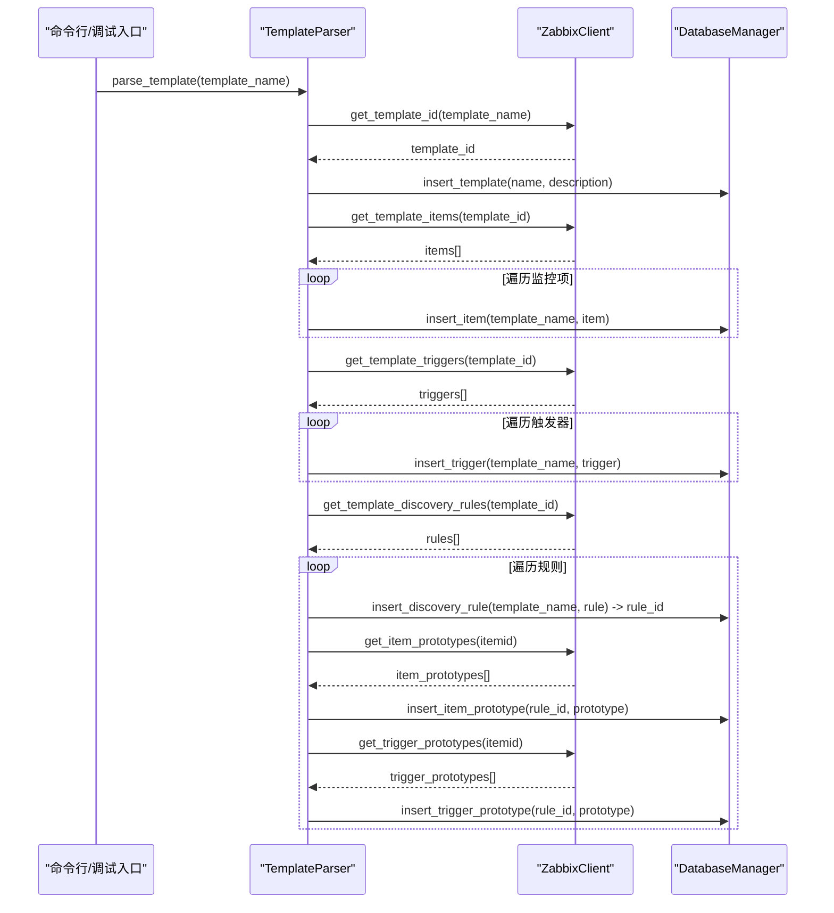
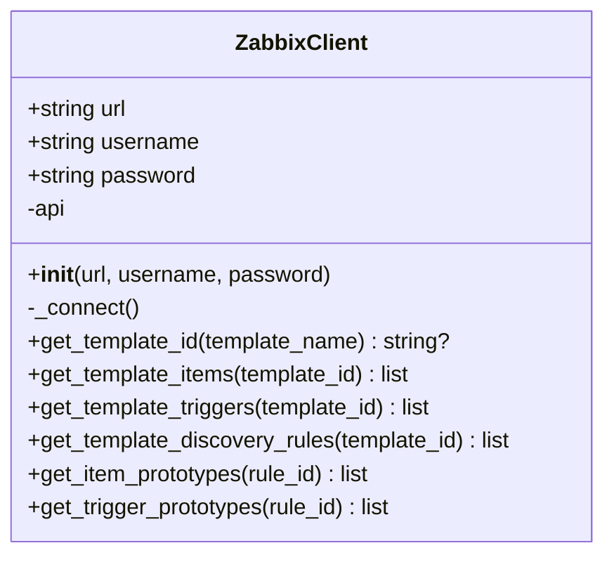
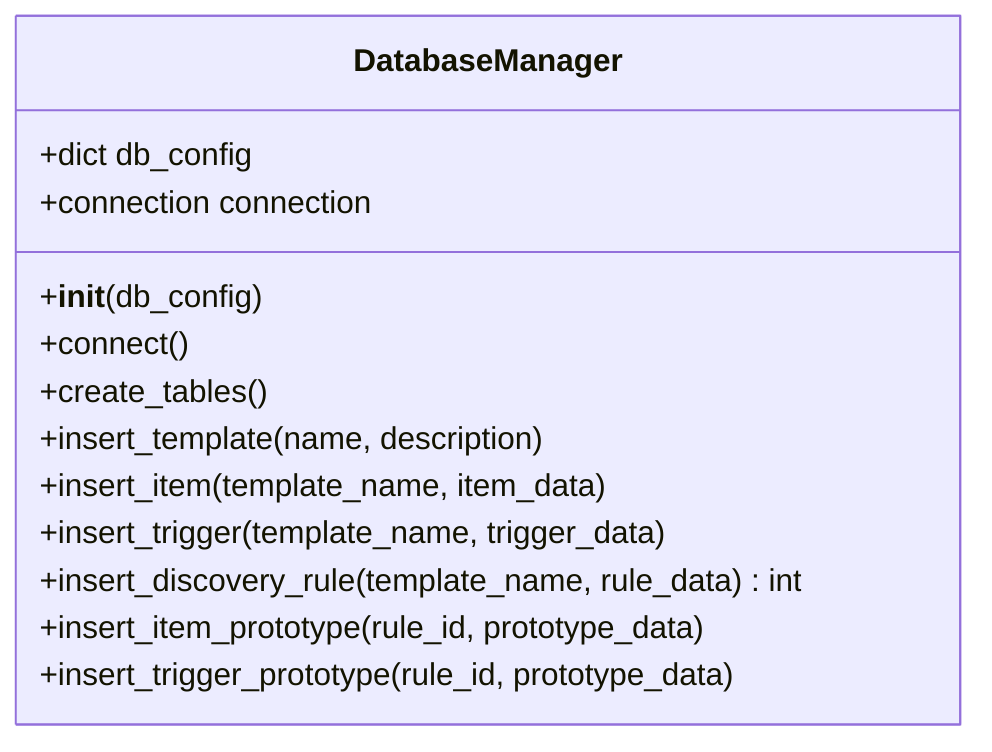
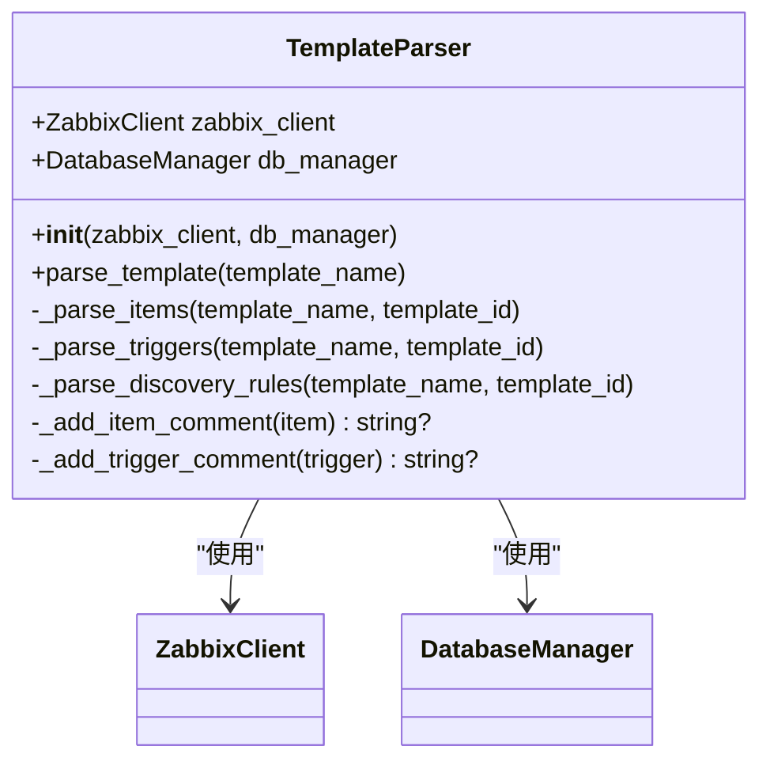
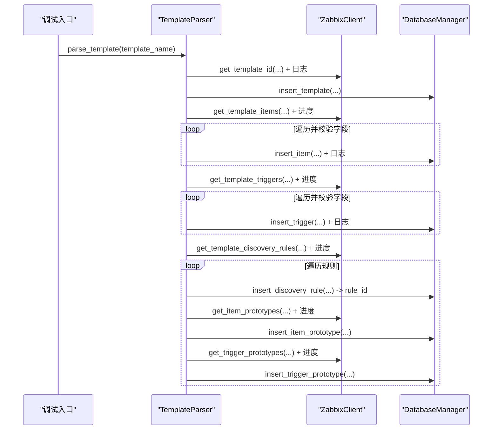
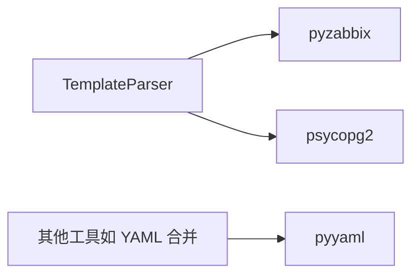

# 模板解析器

<cite>
**本文引用的文件**
- [zabbix_template_parser.py](file://zabbix_template_parser.py)
- [zabbix_template_parser_debug.py](file://zabbix_template_parser_debug.py)
- [base_templates/common.yaml](file://base_templates/common.yaml)
- [base_templates/web.yaml](file://base_templates/web.yaml)
- [monitor_config.yaml](file://monitor_config.yaml)
- [docker-compose.yml](file://docker-compose.yml)
- [check_api_params.py](file://check_api_params.py)
- [app.py](file://app.py)
</cite>

## 目录
1. [简介](#简介)
2. [项目结构](#项目结构)
3. [核心组件](#核心组件)
4. [架构总览](#架构总览)
5. [详细组件分析](#详细组件分析)
6. [依赖分析](#依赖分析)
7. [性能考虑](#性能考虑)
8. [故障排查指南](#故障排查指南)
9. [结论](#结论)
10. [附录](#附录)

## 简介
本文件面向“模板解析器”的使用者与维护者，系统性阐述 zabbix_template_parser.py 的核心功能、实现原理与使用方式。重点覆盖以下方面：
- YAML 文件读取、解析与验证流程
- 解析器的数据结构设计与内部模型映射
- 调试模式的功能与使用方法（含输出格式与错误诊断）
- API 接口说明（输入参数、返回值、异常处理）
- 完整使用示例与常见问题解决方案

## 项目结构
该仓库围绕“Zabbix 监控即代码（Monitor as Code）”目标构建，模板解析器负责从 Zabbix API 抓取模板及其子对象（监控项、触发器、自动发现规则及原型），并将其标准化后写入本地数据库。相关文件组织如下：
- zabbix_template_parser.py：生产版解析器脚本
- zabbix_template_parser_debug.py：调试增强版解析器脚本
- base_templates/*.yaml：基础模板样例（通用与 Web 场景）
- monitor_config.yaml：示例配置文件
- docker-compose.yml：Zabbix 与数据库容器编排
- check_api_params.py：Zabbix API 方法参数检查工具
- app.py：基于 Flask 的 Web 管理界面（用于展示与复核）

图表来源
- [zabbix_template_parser.py:792-834](file://zabbix_template_parser.py#L792-L834)
- [zabbix_template_parser_debug.py:966-1032](file://zabbix_template_parser_debug.py#L966-L1032)
- [app.py:1-774](file://app.py#L1-L774)

章节来源
- [zabbix_template_parser.py:1-834](file://zabbix_template_parser.py#L1-L834)
- [zabbix_template_parser_debug.py:1-1032](file://zabbix_template_parser_debug.py#L1-L1032)
- [base_templates/common.yaml:1-288](file://base_templates/common.yaml#L1-L288)
- [base_templates/web.yaml:1-48](file://base_templates/web.yaml#L1-L48)
- [monitor_config.yaml:1-20](file://monitor_config.yaml#L1-L20)
- [docker-compose.yml:1-76](file://docker-compose.yml#L1-L76)
- [check_api_params.py:1-42](file://check_api_params.py#L1-L42)
- [app.py:1-774](file://app.py#L1-L774)

## 核心组件
- ZabbixClient：封装 Zabbix API 访问，负责获取模板、监控项、触发器、自动发现规则及其原型等数据，并进行基本错误处理。
- DatabaseManager：封装数据库连接与建表、插入操作，确保数据一致性与幂等（ON CONFLICT）。
- TemplateParser：协调 ZabbixClient 与 DatabaseManager，完成模板解析与入库流程；提供中文注释增强与依赖关系转换。

章节来源
- [zabbix_template_parser.py:37-177](file://zabbix_template_parser.py#L37-L177)
- [zabbix_template_parser.py:179-581](file://zabbix_template_parser.py#L179-L581)
- [zabbix_template_parser.py:583-790](file://zabbix_template_parser.py#L583-L790)

## 架构总览
模板解析器采用“客户端-解析器-数据库”三层协作模式：
- 输入：Zabbix 模板名称与数据库连接信息
- 处理：解析模板下的监控项、触发器、自动发现规则及原型，生成中文注释
- 输出：标准化数据写入本地 PostgreSQL 表

图表来源
- [zabbix_template_parser.py:596-695](file://zabbix_template_parser.py#L596-L695)
- [zabbix_template_parser.py:82-176](file://zabbix_template_parser.py#L82-L176)
- [zabbix_template_parser.py:340-580](file://zabbix_template_parser.py#L340-L580)

## 详细组件分析

### ZabbixClient 组件
职责
- 建立与 Zabbix API 的连接并登录
- 查询模板 ID、模板下的监控项、触发器、自动发现规则
- 查询规则对应的监控项原型与触发器原型

关键方法
- get_template_id：根据模板名查询模板 ID
- get_template_items / get_template_triggers / get_template_discovery_rules：获取模板层级对象
- get_item_prototypes / get_trigger_prototypes：获取规则层级对象

错误处理
- 对 ZabbixAPIException 进行捕获与日志记录，避免中断

图表来源
- [zabbix_template_parser.py:37-177](file://zabbix_template_parser.py#L37-L177)

章节来源
- [zabbix_template_parser.py:37-177](file://zabbix_template_parser.py#L37-L177)

### DatabaseManager 组件
职责
- 建立与 PostgreSQL 的连接
- 创建/迁移表结构（mac_templates、mac_items、mac_triggers、mac_trigger_dependencies、mac_discovery_rules、mac_filter_conditions、mac_item_prototypes、mac_trigger_prototypes）
- 提供插入与更新操作，保证唯一性约束下的幂等更新

关键方法
- create_tables：创建所需表
- insert_template / insert_item / insert_trigger / insert_discovery_rule / insert_item_prototype / insert_trigger_prototype：插入或更新对应实体

事务与回滚
- 每个插入操作均在 try-except 中执行，失败时 rollback 并抛出异常

图表来源
- [zabbix_template_parser.py:179-581](file://zabbix_template_parser.py#L179-L581)

章节来源
- [zabbix_template_parser.py:179-581](file://zabbix_template_parser.py#L179-L581)

### TemplateParser 组件
职责
- 协调 ZabbixClient 与 DatabaseManager
- 解析模板：监控项、触发器、自动发现规则及原型
- 生成中文注释（监控项类型/值类型/单位；触发器优先级）
- 处理触发器依赖关系转换

关键方法
- parse_template：主流程入口
- _parse_items / _parse_triggers / _parse_discovery_rules：分模块解析
- _add_item_comment / _add_trigger_comment：生成中文注释

图表来源
- [zabbix_template_parser.py:583-790](file://zabbix_template_parser.py#L583-L790)

章节来源
- [zabbix_template_parser.py:583-790](file://zabbix_template_parser.py#L583-L790)

### 调试模式（zabbix_template_parser_debug.py）
增强点
- 日志级别提升至 DEBUG，输出更详尽的 API 请求与响应信息
- 在关键步骤打印耗时统计
- 对每个对象（监控项、触发器、规则、原型）增加字段校验与进度提示
- 对异常场景输出失败对象上下文，便于定位问题

使用方法
- 通过 --debug 参数启用调试模式
- 结合日志输出快速定位模板缺失、字段缺失、API 调用失败等问题

图表来源
- [zabbix_template_parser_debug.py:676-869](file://zabbix_template_parser_debug.py#L676-L869)
- [zabbix_template_parser_debug.py:966-1032](file://zabbix_template_parser_debug.py#L966-L1032)

章节来源
- [zabbix_template_parser_debug.py:1-1032](file://zabbix_template_parser_debug.py#L1-L1032)

### YAML 文件读取、解析与验证
- 基础模板样例（common.yaml、web.yaml）展示了监控项、触发器、自动发现规则与原型的标准结构
- monitor_config.yaml 展示了主机与模板引用、额外监控项等配置方式
- 解析器并不直接读取这些 YAML 文件，而是通过 Zabbix API 获取模板数据；但这些 YAML 可作为理解数据结构与字段含义的参考

章节来源
- [base_templates/common.yaml:1-288](file://base_templates/common.yaml#L1-L288)
- [base_templates/web.yaml:1-48](file://base_templates/web.yaml#L1-L48)
- [monitor_config.yaml:1-20](file://monitor_config.yaml#L1-L20)

## 依赖分析
外部依赖
- pyzabbix：访问 Zabbix API
- psycopg2：连接 PostgreSQL
- pyyaml：YAML 解析（主要用于其他工具，解析器主脚本不直接解析 YAML）

图表来源
- [zabbix_template_parser.py:13-25](file://zabbix_template_parser.py#L13-L25)
- [zabbix_template_parser_debug.py:19-31](file://zabbix_template_parser_debug.py#L19-L31)

章节来源
- [zabbix_template_parser.py:13-25](file://zabbix_template_parser.py#L13-L25)
- [zabbix_template_parser_debug.py:19-31](file://zabbix_template_parser_debug.py#L19-L31)

## 性能考虑
- 批量写入：解析器对每类对象逐条插入，未使用批量事务优化；在对象数量较大时，建议在上层调用处增加批量提交策略或分批处理
- 网络开销：Zabbix API 调用次数与模板对象数量线性相关；建议在大规模场景下缓存模板 ID 与对象列表
- 数据库写入：使用 ON CONFLICT 做幂等更新，避免重复写入；建议在高并发场景下增加索引与分区策略

## 故障排查指南
- 连接 Zabbix API 失败
  - 确认 URL、用户名、密码正确
  - 使用调试模式观察连接阶段日志
- 模板不存在
  - 确认模板名称拼写与大小写
  - 使用调试模式查看模板查询返回
- 字段缺失导致跳过
  - 调试模式会输出“缺少必要字段”的警告，检查对象是否包含 key_/name/description/expression 等关键字段
- 数据库连接失败
  - 检查数据库地址、端口、账号、密码
  - 确认数据库服务运行正常
- 触发器依赖处理
  - 确保依赖对象存在且名称一致；调试模式会输出依赖插入日志

章节来源
- [zabbix_template_parser_debug.py:686-708](file://zabbix_template_parser_debug.py#L686-L708)
- [zabbix_template_parser_debug.py:726-745](file://zabbix_template_parser_debug.py#L726-L745)
- [zabbix_template_parser_debug.py:767-793](file://zabbix_template_parser_debug.py#L767-L793)
- [zabbix_template_parser_debug.py:815-865](file://zabbix_template_parser_debug.py#L815-L865)

## 结论
模板解析器通过清晰的三层架构，实现了从 Zabbix API 到本地数据库的标准化数据流转。其核心优势在于：
- 结构化解析与中文注释增强，便于审计与复核
- 调试模式提供丰富的日志与进度信息，显著降低问题定位成本
- 幂等写入保障数据一致性，适合持续集成与自动化部署

## 附录

### API 接口说明（命令行）
- 入口文件
  - 生产版：zabbix_template_parser.py
  - 调试版：zabbix_template_parser_debug.py
- 输入参数
  - --url：Zabbix API URL（必填）
  - --username：Zabbix 用户名（默认 Admin）
  - --password：Zabbix 密码（默认 zabbix）
  - --template：模板名称（默认 Template OS Linux by Zabbix agent）
  - --db-host：数据库主机（默认 localhost）
  - --db-port：数据库端口（默认 5433）
  - --db-name：数据库名称（默认 zabbix）
  - --db-user：数据库用户（默认 zabbix）
  - --db-password：数据库密码（默认 zabbix）
  - --debug：启用调试模式（仅调试版）
- 返回值
  - 成功：无返回值，日志输出“模板解析任务完成”
  - 失败：抛出异常并记录错误日志
- 异常处理
  - Zabbix API 连接失败：抛出 ZabbixAPIException
  - 数据库连接失败：抛出异常并回滚
  - 解析过程中遇到无效对象：记录警告并跳过

章节来源
- [zabbix_template_parser.py:792-834](file://zabbix_template_parser.py#L792-L834)
- [zabbix_template_parser_debug.py:966-1032](file://zabbix_template_parser_debug.py#L966-L1032)

### 使用示例
- 基本用法（生产版）
  - python zabbix_template_parser.py --url http://localhost:8080/api_jsonrpc.php --template "Template OS Linux by Zabbix agent"
- 启用调试模式
  - python zabbix_template_parser_debug.py --url http://localhost:8080/api_jsonrpc.php --template "Template OS Linux by Zabbix agent" --debug
- 使用自定义数据库配置
  - python zabbix_template_parser.py --url http://localhost:8080/api_jsonrpc.php --db-host 127.0.0.1 --db-port 5432 --db-name zabbix --db-user zabbix --db-password zabbix

章节来源
- [zabbix_template_parser.py:792-834](file://zabbix_template_parser.py#L792-L834)
- [zabbix_template_parser_debug.py:966-1032](file://zabbix_template_parser_debug.py#L966-L1032)

### 常见问题与解决方案
- 无法连接 Zabbix API
  - 检查 URL 是否正确（通常为 http(s)://host/api_jsonrpc.php）
  - 确认网络连通性与认证信息
- 模板名称不匹配
  - 使用调试模式查看实际模板列表
  - 注意大小写与空格
- 字段缺失导致解析跳过
  - 确保对象包含 key_、name、description、expression 等关键字段
- 数据库表未创建
  - 首次运行会自动创建表；若失败，检查权限与连接信息
- Web 界面无法访问数据库
  - 确认 app.py 中的数据库连接配置与实际环境一致

章节来源
- [check_api_params.py:1-42](file://check_api_params.py#L1-L42)
- [docker-compose.yml:1-76](file://docker-compose.yml#L1-L76)
- [app.py:17-29](file://app.py#L17-L29)