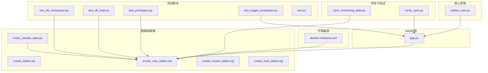
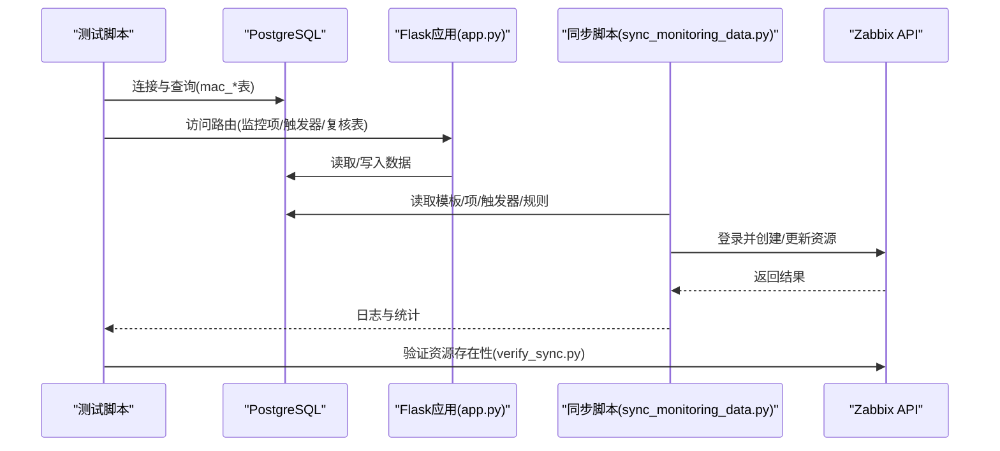
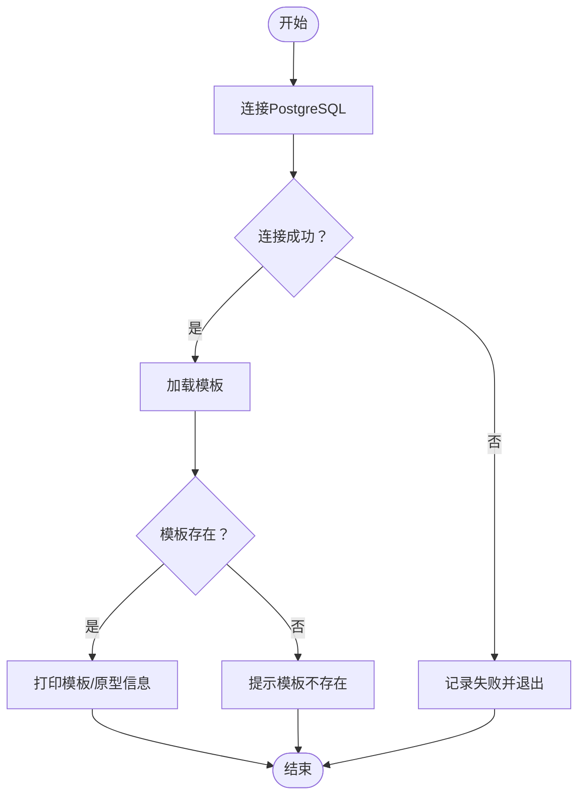
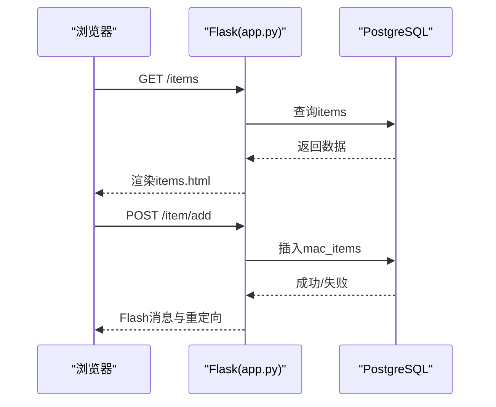
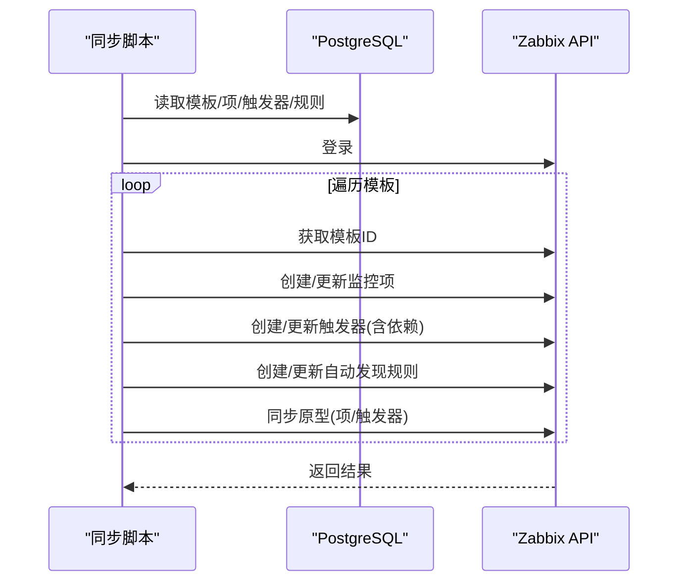
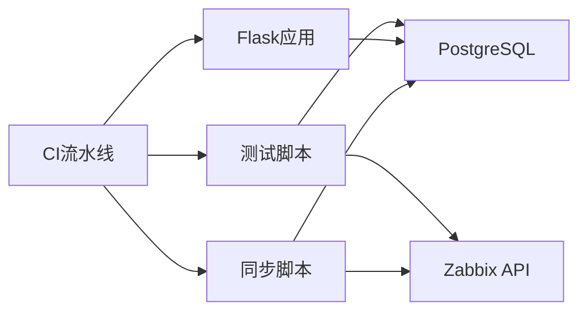

# 测试与验证

<cite>
**本文引用的文件**
- [test.py](file://test.py)
- [test_db_connection.py](file://test_db_connection.py)
- [test_db_load.py](file://test_db_load.py)
- [test_prototypes.py](file://test_prototypes.py)
- [test_trigger_prototypes.py](file://test_trigger_prototypes.py)
- [app.py](file://app.py)
- [sync_monitoring_data.py](file://sync_monitoring_data.py)
- [verify_sync.py](file://verify_sync.py)
- [docker-compose.yml](file://docker-compose.yml)
- [insert_sample_data.py](file://insert_sample_data.py)
- [create_tables.sql](file://create_tables.sql)
- [create_mac_tables.sql](file://create_mac_tables.sql)
- [create_review_tables.sql](file://create_review_tables.sql)
- [create_host_tables.sql](file://create_host_tables.sql)
- [zabbix_mac.py](file://zabbix_mac.py)
</cite>

## 目录
1. [简介](#简介)
2. [项目结构](#项目结构)
3. [核心组件](#核心组件)
4. [架构总览](#架构总览)
5. [详细组件分析](#详细组件分析)
6. [依赖分析](#依赖分析)
7. [性能考虑](#性能考虑)
8. [故障排查指南](#故障排查指南)
9. [结论](#结论)
10. [附录](#附录)

## 简介
本文件面向“Zabbix监控审核与自动化控制中心”的测试与验证工作，覆盖单元测试、集成测试与系统测试的实施方法与测试用例设计；提供同步验证的完整流程与验证标准，确保监控配置在数据库与Zabbix之间的同步准确性与完整性；给出测试环境搭建与测试数据准备方法；总结测试结果分析与问题定位技巧；并提供自动化测试与持续集成的实施建议以及性能测试与压力测试的最佳实践。

## 项目结构
该项目采用“Flask Web应用 + PostgreSQL数据库 + Zabbix API”的分层架构。测试相关的关键文件包括：
- 测试脚本：数据库连接测试、数据库加载测试、原型数据测试、触发器原型测试、Web应用路由测试等
- 同步与验证：监控数据同步脚本、Zabbix侧验证脚本
- 环境编排：Docker Compose定义PostgreSQL与Zabbix服务
- 数据建模：多套SQL脚本定义不同阶段的数据库表结构与示例数据
- 核心逻辑：Zabbix客户端封装与指纹校验等

图表来源
- [test_db_connection.py](file://test_db_connection.py)
- [test_db_load.py](file://test_db_load.py)
- [test_prototypes.py](file://test_prototypes.py)
- [test_trigger_prototypes.py](file://test_trigger_prototypes.py)
- [app.py](file://app.py)
- [sync_monitoring_data.py](file://sync_monitoring_data.py)
- [verify_sync.py](file://verify_sync.py)
- [docker-compose.yml](file://docker-compose.yml)
- [create_tables.sql](file://create_tables.sql)
- [create_mac_tables.sql](file://create_mac_tables.sql)
- [create_review_tables.sql](file://create_review_tables.sql)
- [create_host_tables.sql](file://create_host_tables.sql)
- [insert_sample_data.py](file://insert_sample_data.py)
- [zabbix_mac.py](file://zabbix_mac.py)

章节来源
- [docker-compose.yml](file://docker-compose.yml)
- [create_tables.sql](file://create_tables.sql)
- [create_mac_tables.sql](file://create_mac_tables.sql)
- [create_review_tables.sql](file://create_review_tables.sql)
- [create_host_tables.sql](file://create_host_tables.sql)
- [insert_sample_data.py](file://insert_sample_data.py)

## 核心组件
- 数据库连接与加载测试：验证PostgreSQL连接、查询mac_*表数据、加载模板与原型数据
- Web应用路由测试：验证Flask路由、模板渲染、CRUD操作（监控项、触发器、主机、复核表）
- 同步与验证：将数据库中的监控配置同步至Zabbix，并验证Zabbix侧资源存在性
- 环境编排：通过Docker Compose一键拉起PostgreSQL与Zabbix服务
- 数据建模：多套SQL脚本定义不同阶段的数据库表结构与示例数据
- 核心逻辑：Zabbix客户端封装、重试机制、指纹计算、受管资源识别

章节来源
- [test_db_connection.py](file://test_db_connection.py)
- [test_db_load.py](file://test_db_load.py)
- [test_prototypes.py](file://test_prototypes.py)
- [test_trigger_prototypes.py](file://test_trigger_prototypes.py)
- [app.py](file://app.py)
- [sync_monitoring_data.py](file://sync_monitoring_data.py)
- [verify_sync.py](file://verify_sync.py)
- [zabbix_mac.py](file://zabbix_mac.py)

## 架构总览
下图展示测试与验证的整体流程：从测试脚本到数据库，再到Zabbix API，最终验证Zabbix侧资源状态。

图表来源
- [test_db_connection.py](file://test_db_connection.py)
- [test_db_load.py](file://test_db_load.py)
- [app.py](file://app.py)
- [sync_monitoring_data.py](file://sync_monitoring_data.py)
- [verify_sync.py](file://verify_sync.py)

## 详细组件分析

### 数据库连接与加载测试
- 目标：验证PostgreSQL连接、查询mac_*表、加载模板与原型数据
- 方法：
  - 使用psycopg2连接PostgreSQL，执行基础查询
  - 使用ConfigLoader加载模板，打印模板信息与原型概要
  - 查询自动发现规则、监控项原型、触发器原型的数量与示例
- 测试用例设计要点：
  - 正常路径：连接成功、查询返回非空
  - 异常路径：连接失败、查询异常、模板不存在
- 验证标准：
  - 连接日志/输出成功
  - 模板与原型数量与预期一致
  - 示例数据可读且字段齐全

图表来源
- [test_db_connection.py](file://test_db_connection.py)
- [test_db_load.py](file://test_db_load.py)
- [test_prototypes.py](file://test_prototypes.py)

章节来源
- [test_db_connection.py](file://test_db_connection.py)
- [test_db_load.py](file://test_db_load.py)
- [test_prototypes.py](file://test_prototypes.py)

### Web应用路由测试
- 目标：验证Flask路由、模板渲染、CRUD操作
- 方法：
  - 访问首页、系统信息、模板、监控项、触发器、主机、复核表等路由
  - 对监控项/触发器进行增删改操作，观察Flash消息与数据库变更
- 测试用例设计要点：
  - 正常路径：路由可达、模板渲染正常、CRUD成功
  - 异常路径：不存在的记录、数据库异常回滚、Flash提示
- 验证标准：
  - 页面返回200，模板字段正确
  - CRUD操作后数据库记录符合预期

图表来源
- [app.py](file://app.py)

章节来源
- [app.py](file://app.py)

### 同步与验证流程
- 目标：将数据库中的监控配置同步至Zabbix，并验证Zabbix侧资源存在性
- 方法：
  - 同步脚本：连接数据库与Zabbix API，按模板逐条同步监控项、触发器、自动发现规则及其原型
  - 验证脚本：登录Zabbix API，列出Zabbix server上的监控项、触发器、自动发现规则
- 测试用例设计要点：
  - 正常路径：模板存在、资源创建/更新成功、依赖关系处理
  - 异常路径：Zabbix API连接失败、资源冲突、表达式格式不正确
- 验证标准：
  - 同步日志包含创建/更新记录
  - 验证脚本能列出对应资源

图表来源
- [sync_monitoring_data.py](file://sync_monitoring_data.py)
- [verify_sync.py](file://verify_sync.py)

章节来源
- [sync_monitoring_data.py](file://sync_monitoring_data.py)
- [verify_sync.py](file://verify_sync.py)

### 触发器原型测试（Zabbix API）
- 目标：验证通过Zabbix API创建触发器原型的能力
- 方法：
  - 连接Zabbix API，获取自动发现规则ID
  - 调用triggerprototype.create创建触发器原型
- 测试用例设计要点：
  - 正常路径：规则存在、表达式有效、创建成功
  - 异常路径：规则不存在、表达式无效、API异常
- 验证标准：
  - 返回包含新触发器原型ID
  - Zabbix侧可查询到该原型

章节来源
- [test_trigger_prototypes.py](file://test_trigger_prototypes.py)

### 数据建模与测试数据准备
- 目标：为测试提供稳定的数据库结构与示例数据
- 方法：
  - 使用SQL脚本创建表结构（原始表、MaC表、复核表、主机表）
  - 使用Python脚本批量插入示例数据
- 测试用例设计要点：
  - 表结构创建成功、索引存在
  - 示例数据插入成功、数量与预期一致
- 验证标准：
  - 查询计数与插入计数一致
  - 外键关系与唯一约束生效

章节来源
- [create_tables.sql](file://create_tables.sql)
- [create_mac_tables.sql](file://create_mac_tables.sql)
- [create_review_tables.sql](file://create_review_tables.sql)
- [create_host_tables.sql](file://create_host_tables.sql)
- [insert_sample_data.py](file://insert_sample_data.py)

### 核心逻辑：Zabbix客户端封装与指纹校验
- 目标：封装Zabbix API调用、重试机制、指纹计算与受管资源识别
- 方法：
  - ZabbixClient封装连接、主机/接口查询、资源CRUD、重试与异常处理
  - 计算对象指纹用于差异比对
- 测试用例设计要点：
  - 正常路径：连接成功、资源查询/创建/更新成功
  - 异常路径：多次重试后失败、未知异常捕获
- 验证标准：
  - 日志包含重试与成功信息
  - 指纹计算稳定、排除无关字段

章节来源
- [zabbix_mac.py](file://zabbix_mac.py)

## 依赖分析
- 组件耦合：
  - 测试脚本依赖PostgreSQL与Zabbix API
  - Web应用依赖数据库表结构与模板渲染
  - 同步脚本依赖数据库与Zabbix API
- 外部依赖：
  - psycopg2（PostgreSQL驱动）
  - pyzabbix（Zabbix API）
  - Flask（Web框架）
- 潜在风险：
  - API版本差异导致字段或行为变化
  - 数据库迁移导致表结构变化
  - Docker网络与端口映射问题

图表来源
- [test_db_connection.py](file://test_db_connection.py)
- [test_db_load.py](file://test_db_load.py)
- [app.py](file://app.py)
- [sync_monitoring_data.py](file://sync_monitoring_data.py)
- [docker-compose.yml](file://docker-compose.yml)

章节来源
- [docker-compose.yml](file://docker-compose.yml)
- [test_db_connection.py](file://test_db_connection.py)
- [sync_monitoring_data.py](file://sync_monitoring_data.py)
- [app.py](file://app.py)

## 性能考虑
- 连接池与并发：
  - 在高并发场景下，建议引入连接池减少连接开销
- 批量操作：
  - 同步脚本中尽量使用批量创建/更新接口，降低API调用次数
- 索引优化：
  - 确保常用查询字段（如item_key、template_name）具备索引
- 重试策略：
  - 合理设置重试次数与退避间隔，避免对Zabbix造成过大压力
- 监控与告警：
  - 在CI中加入同步耗时阈值与错误率阈值的告警

## 故障排查指南
- 数据库连接失败：
  - 检查PostgreSQL容器状态与端口映射
  - 核对连接参数（host/port/database/user/password）
- Zabbix API连接失败：
  - 检查Zabbix Web容器状态与端口映射
  - 确认URL、用户名与密码正确
- 同步失败：
  - 查看同步脚本日志，定位具体API调用失败点
  - 检查模板ID是否存在、资源是否已存在
- Web应用异常：
  - 查看Flask日志与数据库异常回滚信息
  - 确认模板渲染所需数据存在

章节来源
- [test_db_connection.py](file://test_db_connection.py)
- [sync_monitoring_data.py](file://sync_monitoring_data.py)
- [app.py](file://app.py)

## 结论
通过上述测试与验证方案，可以系统性地保证监控配置在数据库与Zabbix之间的同步质量。建议在CI中集成数据库连接测试、Web路由测试、同步流程测试与Zabbix侧验证，形成闭环的质量保障体系。

## 附录

### 测试环境搭建步骤
- 使用Docker Compose启动PostgreSQL与Zabbix服务
- 初始化数据库：执行建表SQL与示例数据插入脚本
- 启动Flask应用与同步脚本
- 运行测试脚本进行验证

章节来源
- [docker-compose.yml](file://docker-compose.yml)
- [create_mac_tables.sql](file://create_mac_tables.sql)
- [insert_sample_data.py](file://insert_sample_data.py)
- [app.py](file://app.py)
- [sync_monitoring_data.py](file://sync_monitoring_data.py)

### 测试数据准备方法
- 使用示例数据脚本批量插入模板、监控项、触发器、自动发现规则、原型与主机数据
- 验证插入结果：查询各表计数与关键字段

章节来源
- [insert_sample_data.py](file://insert_sample_data.py)
- [create_tables.sql](file://create_tables.sql)
- [create_mac_tables.sql](file://create_mac_tables.sql)

### 测试结果分析与问题定位技巧
- 日志驱动：关注同步脚本与测试脚本的日志输出
- 分层定位：先验证数据库，再验证Web应用，最后验证Zabbix API
- 快速回归：针对常见异常（连接失败、模板不存在、资源冲突）编写最小化用例

章节来源
- [sync_monitoring_data.py](file://sync_monitoring_data.py)
- [test_db_connection.py](file://test_db_connection.py)
- [test_db_load.py](file://test_db_load.py)

### 自动化测试与持续集成配置建议
- 单元测试：针对数据库连接、数据加载、Zabbix客户端封装
- 集成测试：Web路由CRUD、同步流程端到端
- 系统测试：Zabbix侧资源存在性验证
- CI流水线：在Docker环境中执行，使用pytest或unittest组织用例，结合日志与报告

[本节为通用指导，无需特定文件引用]

### 性能测试与压力测试最佳实践
- 基准测试：在小规模数据集上测量同步耗时与API调用次数
- 压力测试：逐步增加模板数量、监控项数量与并发同步任务
- 资源监控：同时监控数据库与Zabbix服务器的CPU、内存与连接数
- 优化策略：启用连接池、批量API调用、索引优化与合理的重试策略

[本节为通用指导，无需特定文件引用]