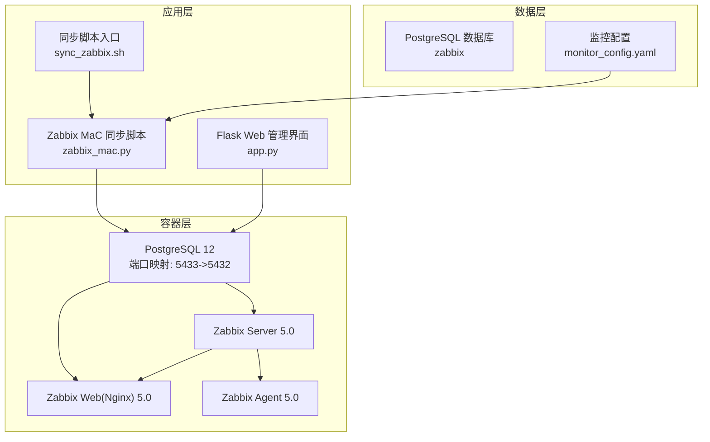
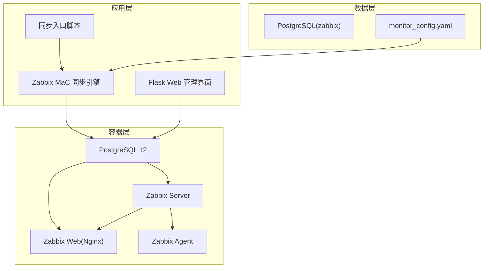
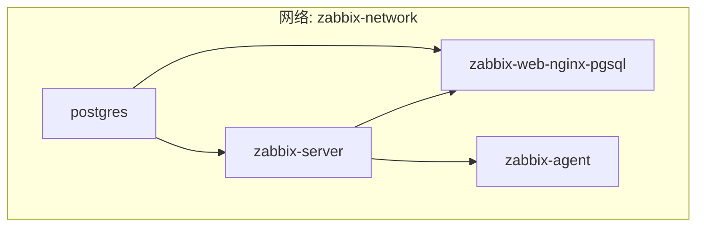
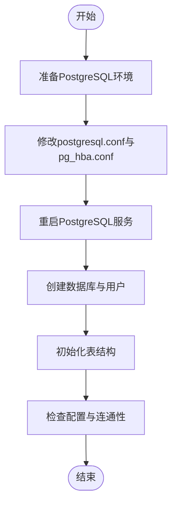
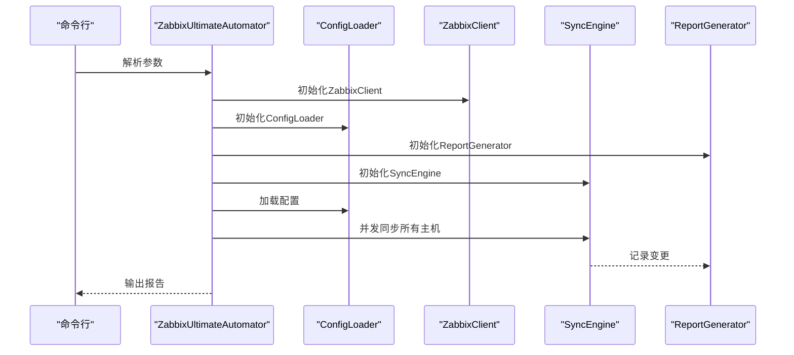
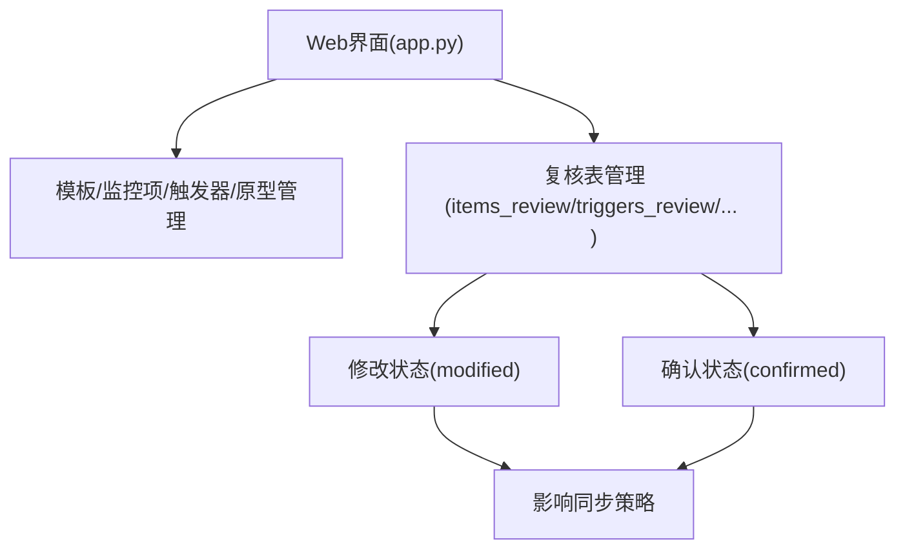
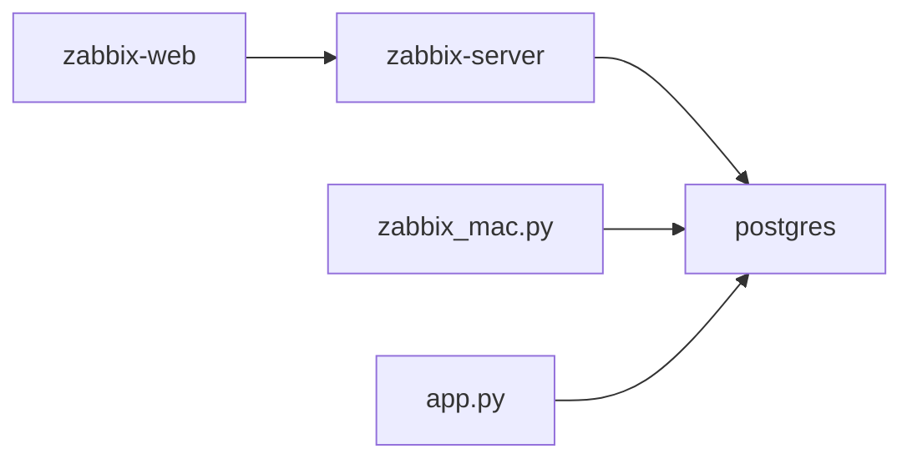
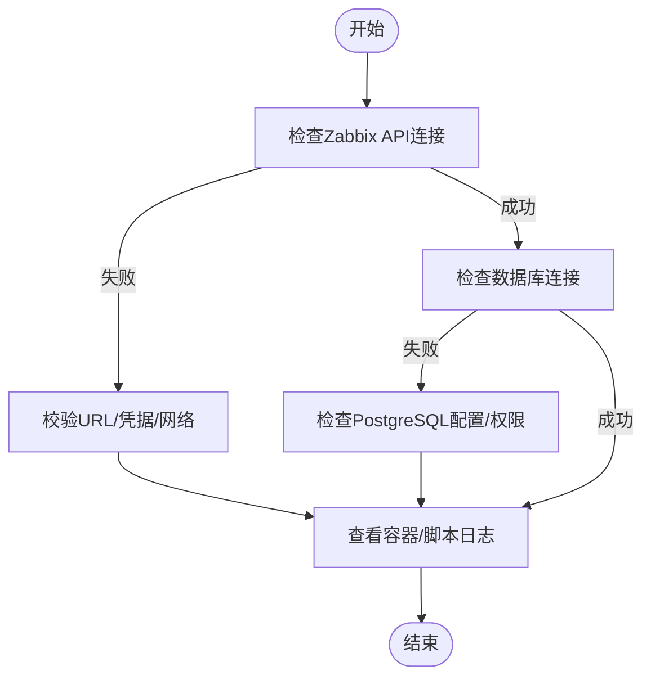

# 部署与运维

<cite>
**本文引用的文件**   
- [docker-compose.yml](file://docker-compose.yml)
- [ZABBIX_SETUP_GUIDE.md](file://ZABBIX_SETUP_GUIDE.md)
- [monitor_config.yaml](file://monitor_config.yaml)
- [CODE_WIKI.md](file://CODE_WIKI.md)
- [app.py](file://app.py)
- [setup_zabbix_db.py](file://setup_zabbix_db.py)
- [create_tables.sql](file://create_tables.sql)
- [create_host_tables.sql](file://create_host_tables.sql)
- [create_review_tables.sql](file://create_review_tables.sql)
- [backup_database.py](file://backup_database.py)
- [sync_zabbix.sh](file://sync_zabbix.sh)
- [check_postgres_config.py](file://check_postgres_config.py)
- [update_postgres_config.py](file://update_postgres_config.py)
- [zabbix_mac.py](file://zabbix_mac.py)
</cite>

## 目录
1. [简介](#简介)
2. [项目结构](#项目结构)
3. [核心组件](#核心组件)
4. [架构总览](#架构总览)
5. [详细组件分析](#详细组件分析)
6. [依赖分析](#依赖分析)
7. [性能考虑](#性能考虑)
8. [故障排除指南](#故障排除指南)
9. [结论](#结论)
10. [附录](#附录)

## 简介
本文件面向“Zabbix监控审核和自动化控制中心”的部署与运维，覆盖以下目标：
- Docker容器化部署：服务编排、网络与数据持久化配置
- 传统部署方式：环境准备、服务安装与配置优化
- 监控与日志管理最佳实践：确保系统稳定运行
- 故障排除：常见问题诊断与解决
- 性能调优与容量规划：提升同步效率与资源利用
- 备份策略与灾难恢复：保障数据与配置安全

## 项目结构
项目采用“容器化 + 数据库 + Web管理 + 同步脚本”的组合架构，核心文件与职责如下：
- 容器编排：docker-compose.yml
- Zabbix安装指南：ZABBIX_SETUP_GUIDE.md
- 监控配置样例：monitor_config.yaml
- 核心同步脚本：zabbix_mac.py
- Web管理界面：app.py
- 数据库初始化与表结构：create_tables.sql、create_host_tables.sql、create_review_tables.sql
- 数据库备份与修复：backup_database.py
- PostgreSQL配置检查与更新：check_postgres_config.py、update_postgres_config.py
- 同步入口脚本：sync_zabbix.sh

**图表来源**
- [docker-compose.yml:1-76](file://docker-compose.yml#L1-L76)
- [sync_zabbix.sh:1-31](file://sync_zabbix.sh#L1-L31)
- [zabbix_mac.py:1-200](file://zabbix_mac.py#L1-L200)
- [app.py:1-774](file://app.py#L1-L774)

**章节来源**
- [docker-compose.yml:1-76](file://docker-compose.yml#L1-L76)
- [ZABBIX_SETUP_GUIDE.md:1-138](file://ZABBIX_SETUP_GUIDE.md#L1-L138)
- [monitor_config.yaml:1-20](file://monitor_config.yaml#L1-L20)
- [CODE_WIKI.md:1-481](file://CODE_WIKI.md#L1-L481)

## 核心组件
- 容器编排与网络
  - 使用独立卷与桥接网络隔离服务，PostgreSQL数据持久化至本地卷，Zabbix服务通过环境变量与网络互通
- Zabbix同步引擎
  - 通过Zabbix API客户端封装、配置加载器、同步引擎与报告生成器协同工作，支持并发与模拟运行
- Web管理界面
  - 基于Flask，提供模板、监控项、触发器、原型与复核表的增删改查与审核确认
- 数据库层
  - 初始化表结构、主机与复核表，支持从数据库加载配置与审计

**章节来源**
- [docker-compose.yml:1-76](file://docker-compose.yml#L1-L76)
- [zabbix_mac.py:1-200](file://zabbix_mac.py#L1-L200)
- [app.py:1-774](file://app.py#L1-L774)
- [create_tables.sql:1-198](file://create_tables.sql#L1-L198)
- [create_host_tables.sql:1-60](file://create_host_tables.sql#L1-L60)
- [create_review_tables.sql:1-201](file://create_review_tables.sql#L1-L201)

## 架构总览
系统采用“容器化Zabbix + 数据库 + Web管理 + 同步脚本”的分层架构。容器层提供Zabbix核心服务；应用层通过zabbix_mac.py与Zabbix API交互，从数据库加载配置并同步；Web层提供可视化管理与复核；数据层持久化配置与审计记录。

**图表来源**
- [docker-compose.yml:1-76](file://docker-compose.yml#L1-L76)
- [sync_zabbix.sh:1-31](file://sync_zabbix.sh#L1-L31)
- [zabbix_mac.py:1-200](file://zabbix_mac.py#L1-L200)
- [app.py:1-774](file://app.py#L1-L774)

## 详细组件分析

### Docker容器化部署
- 服务编排
  - PostgreSQL：镜像postgres:12-alpine，端口映射5433:5432，使用本地卷postgres-data持久化
  - Zabbix Server：镜像zabbix/zabbix-server-pgsql:ubuntu-5.0-latest，依赖PostgreSQL
  - Zabbix Web(Nginx)：镜像zabbix/zabbix-web-nginx-pgsql:ubuntu-5.0-latest，依赖PostgreSQL与Server
  - Zabbix Agent：镜像zabbix/zabbix-agent:ubuntu-5.0-latest，可选
- 网络配置
  - 使用自定义bridge网络zabbix-network，容器间通过服务名通信
- 数据持久化
  - 卷postgres-data挂载至容器内PostgreSQL数据目录，避免容器重建导致数据丢失

**图表来源**
- [docker-compose.yml:1-76](file://docker-compose.yml#L1-L76)

**章节来源**
- [docker-compose.yml:1-76](file://docker-compose.yml#L1-L76)
- [ZABBIX_SETUP_GUIDE.md:55-85](file://ZABBIX_SETUP_GUIDE.md#L55-L85)

### 传统部署方式（非容器）
- 环境准备
  - 安装PostgreSQL 14，修改postgresql.conf与pg_hba.conf，允许Docker网段访问
  - 使用脚本备份与更新配置，重启PostgreSQL服务
- 服务安装
  - 使用setup_zabbix_db.py创建数据库与用户并授权
  - 初始化数据库表结构：create_tables.sql、create_host_tables.sql、create_review_tables.sql
- 配置优化
  - 通过check_postgres_config.py检查监听地址、端口、数据目录等关键参数
  - 通过update_postgres_config.py自动更新配置并提示重启命令

**图表来源**
- [update_postgres_config.py:1-74](file://update_postgres_config.py#L1-L74)
- [check_postgres_config.py:1-64](file://check_postgres_config.py#L1-L64)
- [setup_zabbix_db.py:1-85](file://setup_zabbix_db.py#L1-L85)
- [create_tables.sql:1-198](file://create_tables.sql#L1-L198)
- [create_host_tables.sql:1-60](file://create_host_tables.sql#L1-L60)
- [create_review_tables.sql:1-201](file://create_review_tables.sql#L1-L201)

**章节来源**
- [ZABBIX_SETUP_GUIDE.md:10-54](file://ZABBIX_SETUP_GUIDE.md#L10-L54)
- [update_postgres_config.py:1-74](file://update_postgres_config.py#L1-L74)
- [check_postgres_config.py:1-64](file://check_postgres_config.py#L1-L64)
- [setup_zabbix_db.py:1-85](file://setup_zabbix_db.py#L1-L85)
- [create_tables.sql:1-198](file://create_tables.sql#L1-L198)
- [create_host_tables.sql:1-60](file://create_host_tables.sql#L1-L60)
- [create_review_tables.sql:1-201](file://create_review_tables.sql#L1-L201)

### Zabbix同步与自动化
- 同步流程
  - 解析命令行参数，初始化ZabbixClient、ConfigLoader、ReportGenerator与SyncEngine
  - 从数据库加载配置，按主机并发同步Items、Triggers、Discovery Rules与Prototypes
  - 生成变更报告并输出
- 并发与容错
  - 支持多线程并发同步，内置重试与超时处理
  - 支持dry-run模式预演，降低变更风险

**图表来源**
- [zabbix_mac.py:1-200](file://zabbix_mac.py#L1-L200)
- [CODE_WIKI.md:391-401](file://CODE_WIKI.md#L391-L401)

**章节来源**
- [zabbix_mac.py:1-200](file://zabbix_mac.py#L1-L200)
- [CODE_WIKI.md:348-401](file://CODE_WIKI.md#L348-L401)

### Web管理界面与复核机制
- Web界面
  - 基于Flask，提供模板、监控项、触发器、原型与复核表的管理页面
  - 支持增删改查与确认/取消确认，配合复核表实现变更审计
- 复核表
  - 为监控项、触发器、原型分别提供复核表，包含modified与confirmed字段
  - 通过确认状态控制同步行为，确保变更经过审核

**图表来源**
- [app.py:1-774](file://app.py#L1-L774)
- [create_review_tables.sql:1-201](file://create_review_tables.sql#L1-L201)

**章节来源**
- [app.py:1-774](file://app.py#L1-L774)
- [create_review_tables.sql:1-201](file://create_review_tables.sql#L1-L201)

### 监控配置与数据持久化
- 配置来源
  - monitor_config.yaml提供主机与模板的示例配置，zabbix_mac.py支持从数据库加载配置
- 数据持久化
  - PostgreSQL卷postgres-data持久化数据库数据
  - Web界面与同步脚本均连接同一数据库，保证配置一致性

**章节来源**
- [monitor_config.yaml:1-20](file://monitor_config.yaml#L1-L20)
- [docker-compose.yml:13-14](file://docker-compose.yml#L13-L14)
- [zabbix_mac.py:1-200](file://zabbix_mac.py#L1-L200)

## 依赖分析
- 容器依赖
  - zabbix-server依赖postgres；zabbix-web依赖postgres与zabbix-server
- 应用依赖
  - zabbix_mac.py依赖pyzabbix与psycopg2；app.py依赖Flask与psycopg2
- 数据依赖
  - 所有组件依赖PostgreSQL数据库，表结构由SQL脚本初始化

**图表来源**
- [docker-compose.yml:1-76](file://docker-compose.yml#L1-L76)
- [zabbix_mac.py:1-200](file://zabbix_mac.py#L1-L200)
- [app.py:1-774](file://app.py#L1-L774)

**章节来源**
- [docker-compose.yml:1-76](file://docker-compose.yml#L1-L76)
- [zabbix_mac.py:1-200](file://zabbix_mac.py#L1-L200)
- [app.py:1-774](file://app.py#L1-L774)

## 性能考虑
- 并发与吞吐
  - 使用多线程并发同步主机，合理设置workers参数以平衡吞吐与资源
- 数据库性能
  - 初始化SQL脚本创建索引，提升查询性能；建议定期分析与更新统计信息
- 网络与I/O
  - 容器网络使用桥接网络，避免跨主机网络抖动；数据持久化使用本地卷，减少IO延迟
- 资源规划
  - 根据主机规模与同步频率评估CPU、内存与数据库连接池大小

**章节来源**
- [CODE_WIKI.md:445-451](file://CODE_WIKI.md#L445-L451)
- [create_tables.sql:100-108](file://create_tables.sql#L100-L108)

## 故障排除指南
- 容器无法连接数据库
  - 检查PostgreSQL监听地址、防火墙与容器网络；查看Zabbix Server与Web容器日志
- Web界面无法访问
  - 检查容器状态与端口占用；查看Web容器日志
- PostgreSQL配置问题
  - 使用check_postgres_config.py检查关键参数；使用update_postgres_config.py更新配置并重启服务
- 同步失败
  - 检查Zabbix API凭据与URL；查看同步脚本日志；必要时使用dry-run模式预演

**图表来源**
- [ZABBIX_SETUP_GUIDE.md:106-138](file://ZABBIX_SETUP_GUIDE.md#L106-L138)
- [check_postgres_config.py:1-64](file://check_postgres_config.py#L1-L64)
- [update_postgres_config.py:1-74](file://update_postgres_config.py#L1-L74)

**章节来源**
- [ZABBIX_SETUP_GUIDE.md:106-138](file://ZABBIX_SETUP_GUIDE.md#L106-L138)
- [check_postgres_config.py:1-64](file://check_postgres_config.py#L1-L64)
- [update_postgres_config.py:1-74](file://update_postgres_config.py#L1-L74)

## 结论
本项目通过容器化部署与数据库驱动的配置管理，提供了高可用、可审计、可扩展的Zabbix自动化控制中心。结合Web界面与复核机制，可有效提升监控配置的治理水平；通过同步脚本与并发策略，可满足大规模环境的运维需求。建议在生产环境中配套完善的备份与灾备策略，并持续优化数据库与网络配置以获得最佳性能。

## 附录

### 备份策略与灾难恢复
- 数据库备份
  - 使用backup_database.py备份指定表，支持修改数据与修复表结构
  - 建议定期执行备份并验证恢复流程
- 灾难恢复
  - 优先恢复PostgreSQL数据卷与数据库用户/权限
  - 重新初始化Zabbix相关表结构，恢复配置后执行同步

**章节来源**
- [backup_database.py:1-214](file://backup_database.py#L1-L214)
- [create_tables.sql:1-198](file://create_tables.sql#L1-L198)
- [create_host_tables.sql:1-60](file://create_host_tables.sql#L1-L60)
- [create_review_tables.sql:1-201](file://create_review_tables.sql#L1-L201)

### 同步入口与配置
- 同步入口脚本
  - sync_zabbix.sh封装Zabbix API与数据库连接参数，统一调用zabbix_mac.py
- 监控配置
  - monitor_config.yaml提供主机与模板示例，zabbix_mac.py支持从数据库加载配置

**章节来源**
- [sync_zabbix.sh:1-31](file://sync_zabbix.sh#L1-L31)
- [monitor_config.yaml:1-20](file://monitor_config.yaml#L1-L20)
- [zabbix_mac.py:1-200](file://zabbix_mac.py#L1-L200)