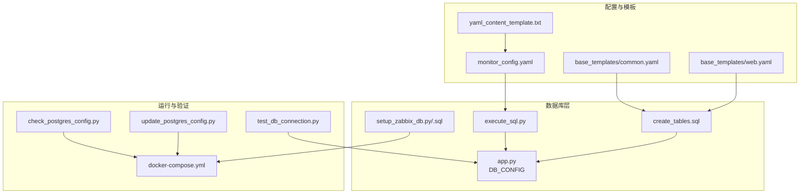
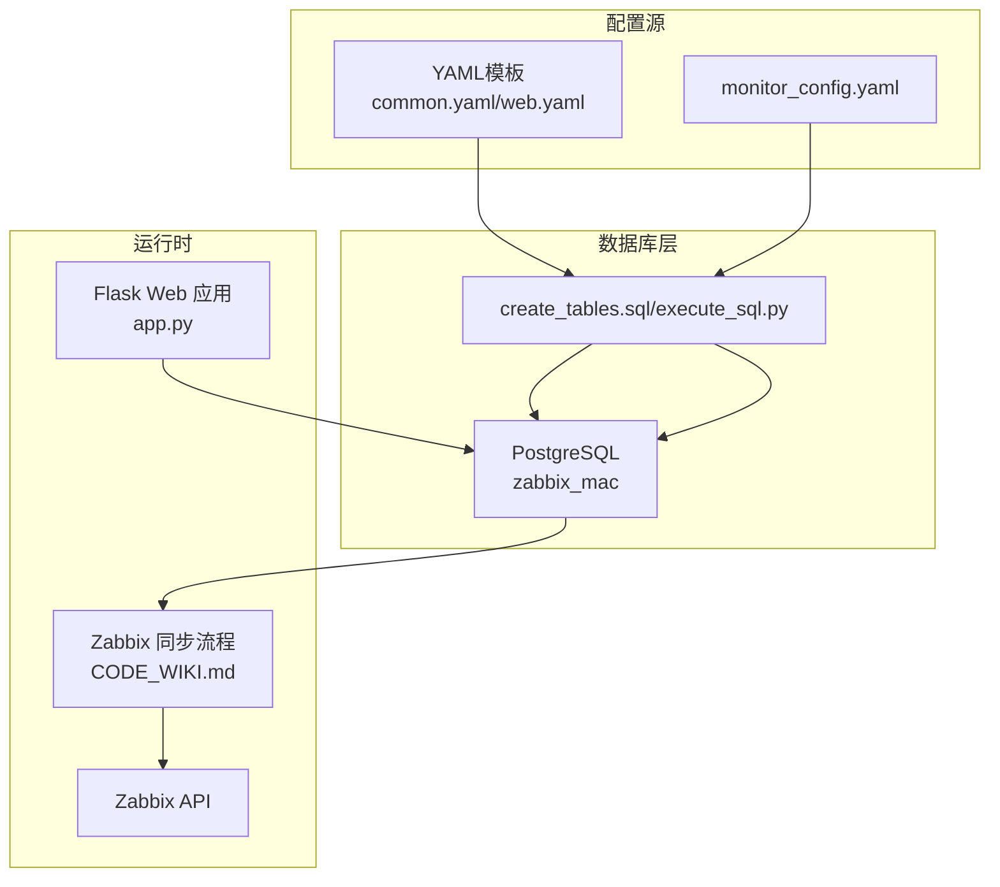
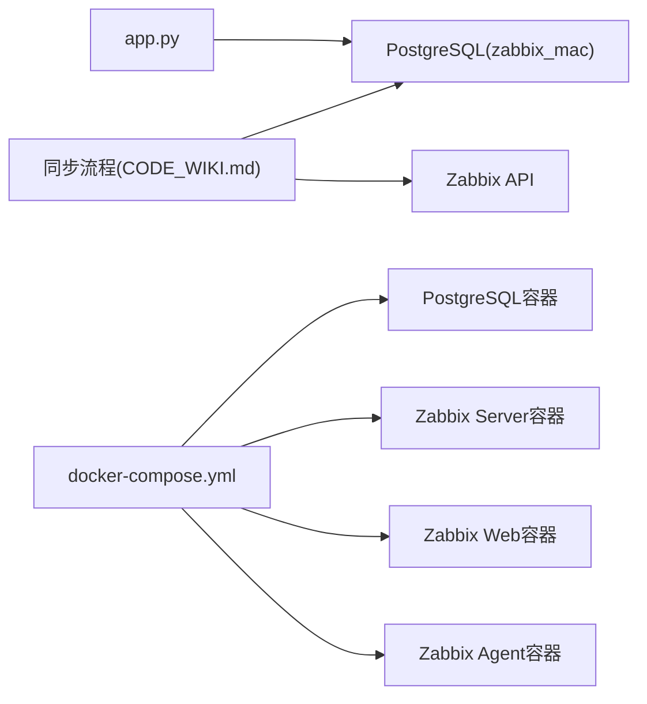

# 配置管理

<cite>
**本文引用的文件**
- [monitor_config.yaml](file://monitor_config.yaml)
- [docker-compose.yml](file://docker-compose.yml)
- [check_postgres_config.py](file://check_postgres_config.py)
- [update_postgres_config.py](file://update_postgres_config.py)
- [setup_zabbix_db.py](file://setup_zabbix_db.py)
- [setup_zabbix_db.sql](file://setup_zabbix_db.sql)
- [test_db_connection.py](file://test_db_connection.py)
- [execute_sql.py](file://execute_sql.py)
- [create_tables.sql](file://create_tables.sql)
- [app.py](file://app.py)
- [CODE_WIKI.md](file://CODE_WIKI.md)
- [DATABASE_MIGRATION_PLAN.md](file://DATABASE_MIGRATION_PLAN.md)
- [base_templates/common.yaml](file://base_templates/common.yaml)
- [base_templates/web.yaml](file://base_templates/web.yaml)
- [yaml_content_template.txt](file://yaml_content_template.txt)
</cite>

## 目录
1. [简介](#简介)
2. [项目结构](#项目结构)
3. [核心组件](#核心组件)
4. [架构总览](#架构总览)
5. [详细组件分析](#详细组件分析)
6. [依赖分析](#依赖分析)
7. [性能考虑](#性能考虑)
8. [故障排查指南](#故障排查指南)
9. [结论](#结论)
10. [附录](#附录)

## 简介
本文件面向“Zabbix监控审核和自动化控制中心”项目，系统化梳理配置管理相关内容，覆盖以下方面：
- 监控配置文件结构与参数说明（含Zabbix服务器配置、数据库连接配置、系统参数配置）
- 配置模板与示例（YAML模板、Docker编排、数据库初始化SQL）
- 环境配置最佳实践（开发/测试/生产差异）
- 配置验证与测试方法
- 动态更新与热重载机制说明

## 项目结构
该项目采用“数据库驱动 + Web界面 + 同步脚本”的架构，配置相关的关键文件如下：
- 监控配置文件：monitor_config.yaml（主机与模板、额外监控项）
- 基础模板：base_templates/common.yaml、base_templates/web.yaml
- 数据库初始化：create_tables.sql、execute_sql.py
- Zabbix数据库准备：setup_zabbix_db.py、setup_zabbix_db.sql
- PostgreSQL配置检查与更新：check_postgres_config.py、update_postgres_config.py
- Docker编排：docker-compose.yml
- Web应用配置：app.py（数据库连接参数）
- 运行与迁移文档：CODE_WIKI.md、DATABASE_MIGRATION_PLAN.md

**图表来源**
- [monitor_config.yaml:1-20](file://monitor_config.yaml#L1-L20)
- [base_templates/common.yaml:1-288](file://base_templates/common.yaml#L1-L288)
- [base_templates/web.yaml:1-48](file://base_templates/web.yaml#L1-L48)
- [yaml_content_template.txt:1-55](file://yaml_content_template.txt#L1-L55)
- [create_tables.sql:1-198](file://create_tables.sql#L1-L198)
- [execute_sql.py:1-170](file://execute_sql.py#L1-L170)
- [app.py:17-24](file://app.py#L17-L24)
- [setup_zabbix_db.py:1-85](file://setup_zabbix_db.py#L1-L85)
- [setup_zabbix_db.sql:1-11](file://setup_zabbix_db.sql#L1-L11)
- [docker-compose.yml:1-76](file://docker-compose.yml#L1-L76)
- [check_postgres_config.py:1-64](file://check_postgres_config.py#L1-L64)
- [update_postgres_config.py:1-74](file://update_postgres_config.py#L1-L74)
- [test_db_connection.py:1-34](file://test_db_connection.py#L1-L34)

**章节来源**
- [CODE_WIKI.md:48-125](file://CODE_WIKI.md#L48-L125)

## 核心组件
- 监控配置文件（YAML）
  - 作用：定义主机、模板引用、额外监控项等
  - 关键字段：主机名、模板列表、额外监控项（优先级最高）
- 基础模板（YAML）
  - 作用：提供通用监控项、触发器、自动发现规则、Web场景等模板
- 数据库初始化与表结构
  - 作用：创建items、triggers、discovery_rules、filter_conditions、item_prototypes、trigger_prototypes、templates等表
- Zabbix数据库准备
  - 作用：创建zabbix用户、zabbix数据库并授权；设置时区
- Docker编排
  - 作用：定义PostgreSQL、Zabbix Server、Zabbix Web、Zabbix Agent容器及网络、环境变量
- Web应用配置
  - 作用：定义本地PostgreSQL数据库连接参数（zabbix_mac库）

**章节来源**
- [monitor_config.yaml:1-20](file://monitor_config.yaml#L1-L20)
- [base_templates/common.yaml:1-288](file://base_templates/common.yaml#L1-L288)
- [base_templates/web.yaml:1-48](file://base_templates/web.yaml#L1-L48)
- [create_tables.sql:1-198](file://create_tables.sql#L1-L198)
- [setup_zabbix_db.py:1-85](file://setup_zabbix_db.py#L1-L85)
- [setup_zabbix_db.sql:1-11](file://setup_zabbix_db.sql#L1-L11)
- [docker-compose.yml:1-76](file://docker-compose.yml#L1-L76)
- [app.py:17-24](file://app.py#L17-L24)

## 架构总览
下图展示了配置从模板到数据库、再到Zabbix API的同步路径，以及Web界面的配置入口。

**图表来源**
- [base_templates/common.yaml:1-288](file://base_templates/common.yaml#L1-L288)
- [base_templates/web.yaml:1-48](file://base_templates/web.yaml#L1-L48)
- [monitor_config.yaml:1-20](file://monitor_config.yaml#L1-L20)
- [create_tables.sql:1-198](file://create_tables.sql#L1-L198)
- [execute_sql.py:1-170](file://execute_sql.py#L1-L170)
- [app.py:17-24](file://app.py#L17-L24)
- [CODE_WIKI.md:127-190](file://CODE_WIKI.md#L127-L190)

## 详细组件分析

### 监控配置文件（monitor_config.yaml）
- 结构要点
  - 主机分组：每个主机包含引用的模板列表与额外监控项
  - 额外监控项优先级最高：用于覆盖或补充模板中的监控项
- 关键参数说明（示例字段）
  - 模板列表：引用模板ID或名称
  - 额外监控项.items：包含自定义监控项的键、名称、类型、值类型、采集周期等
- 推荐值与注意事项
  - 采集周期（delay）应结合业务SLA与Zabbix性能平衡
  - 值类型（value_type）需与监控项实际返回值匹配
  - 类型（type）需与采集端能力一致（如Agent、SNMP、JMX等）
- 模板与示例
  - 参考：[monitor_config.yaml:1-20](file://monitor_config.yaml#L1-L20)

**章节来源**
- [monitor_config.yaml:1-20](file://monitor_config.yaml#L1-L20)

### 基础模板（common.yaml、web.yaml）
- common.yaml
  - 作用：Linux通用监控项、触发器、块设备与文件系统自动发现规则及原型
  - 字段：items、triggers、discovery_rules（含filter、item_prototypes、trigger_prototypes）
  - 推荐值：delay、value_type、priority等按场景设定
  - 参考：[base_templates/common.yaml:1-288](file://base_templates/common.yaml#L1-L288)
- web.yaml
  - 作用：Web场景监控（可用性、响应时间、状态码）
  - 字段：web_scenarios、web_items、web_triggers
  - 参考：[base_templates/web.yaml:1-48](file://base_templates/web.yaml#L1-L48)

**章节来源**
- [base_templates/common.yaml:1-288](file://base_templates/common.yaml#L1-L288)
- [base_templates/web.yaml:1-48](file://base_templates/web.yaml#L1-L48)

### 数据库初始化与表结构（create_tables.sql、execute_sql.py）
- 表结构概览
  - items、triggers、discovery_rules、filter_conditions、item_prototypes、trigger_prototypes、templates
  - 索引优化：针对常用查询字段建立索引
- 初始化流程
  - 通过execute_sql.py或create_tables.sql创建表并插入示例数据
  - 参考：[create_tables.sql:1-198](file://create_tables.sql#L1-L198)，[execute_sql.py:1-170](file://execute_sql.py#L1-L170)
- 推荐实践
  - 在生产环境使用独立的zabbix_mac数据库
  - 对items.item_key、discovery_rules.template_name等建立唯一约束，避免重复

**章节来源**
- [create_tables.sql:1-198](file://create_tables.sql#L1-L198)
- [execute_sql.py:1-170](file://execute_sql.py#L1-L170)

### Zabbix数据库准备（setup_zabbix_db.py、setup_zabbix_db.sql）
- 功能
  - 创建zabbix用户与zabbix数据库并授权
  - 设置时区（Asia/Shanghai）
- 运行方式
  - 直接执行setup_zabbix_db.py或使用setup_zabbix_db.sql
  - 参考：[setup_zabbix_db.py:1-85](file://setup_zabbix_db.py#L1-L85)，[setup_zabbix_db.sql:1-11](file://setup_zabbix_db.sql#L1-L11)

**章节来源**
- [setup_zabbix_db.py:1-85](file://setup_zabbix_db.py#L1-L85)
- [setup_zabbix_db.sql:1-11](file://setup_zabbix_db.sql#L1-L11)

### Docker编排（docker-compose.yml）
- 服务与端口
  - postgres：5433:5432
  - zabbix-server：10051:10051
  - zabbix-web-nginx-pgsql：8080:8080
  - zabbix-agent：可选
- 环境变量
  - 数据库连接参数（DB_SERVER_HOST、DB_SERVER_PORT、POSTGRES_USER、POSTGRES_PASSWORD、POSTGRES_DB）
  - ZBX_SERVER_HOST、ZBX_SERVER_PORT、PHP_TZ等
- 网络与卷
  - 使用zabbix-network桥接网络
  - postgres-data持久化卷

**章节来源**
- [docker-compose.yml:1-76](file://docker-compose.yml#L1-L76)

### Web应用配置（app.py）
- 数据库连接参数（DB_CONFIG）
  - host、port、database、user、password
  - 默认连接zabbix_mac库（用于Web界面管理）
- 运行方式
  - python app.py
  - 访问 http://localhost:5000

**章节来源**
- [app.py:17-24](file://app.py#L17-L24)

### PostgreSQL配置检查与更新（check_postgres_config.py、update_postgres_config.py）
- 检查内容
  - 监听地址、端口、数据目录、配置文件、HBA文件
- 更新策略
  - 修改postgresql.conf的listen_addresses为*（允许Docker容器访问）
  - 在pg_hba.conf追加Docker网段访问规则
  - 重启PostgreSQL服务
- 注意事项
  - 需要管理员权限
  - 建议先备份配置文件

**章节来源**
- [check_postgres_config.py:1-64](file://check_postgres_config.py#L1-L64)
- [update_postgres_config.py:1-74](file://update_postgres_config.py#L1-L74)

### 配置验证与测试（test_db_connection.py、CODE_WIKI.md）
- 数据库连接测试
  - 使用test_db_connection.py验证PostgreSQL连接与基本查询
  - 参考：[test_db_connection.py:1-34](file://test_db_connection.py#L1-L34)
- 运行参数与最佳实践
  - 命令行参数：--url、--username、--password、--dry-run、--workers、--db-*等
  - 参考：[CODE_WIKI.md:350-379](file://CODE_WIKI.md#L350-L379)

**章节来源**
- [test_db_connection.py:1-34](file://test_db_connection.py#L1-L34)
- [CODE_WIKI.md:350-379](file://CODE_WIKI.md#L350-L379)

### YAML内容模板与合并（yaml_content_template.txt）
- 用途
  - 将图片中的YAML内容粘贴到指定占位，统一合并为标准格式
- 使用建议
  - 保持字段命名一致性（snake_case）
  - 合并后校验语法与字段完整性

**章节来源**
- [yaml_content_template.txt:1-55](file://yaml_content_template.txt#L1-L55)

## 依赖分析
- 组件耦合
  - Web应用依赖本地PostgreSQL（zabbix_mac），用于管理监控模板与复核表
  - 同步流程依赖Zabbix API与数据库（zabbix_mac）
- 外部依赖
  - Python运行时、psycopg2、Flask、Bootstrap
- 潜在风险
  - 数据库连接失败或Zabbix API不可达会导致同步中断
  - Docker网络与端口冲突影响容器通信

**图表来源**
- [app.py:17-24](file://app.py#L17-L24)
- [CODE_WIKI.md:127-190](file://CODE_WIKI.md#L127-L190)
- [docker-compose.yml:1-76](file://docker-compose.yml#L1-L76)

**章节来源**
- [CODE_WIKI.md:406-411](file://CODE_WIKI.md#L406-L411)

## 性能考虑
- 并发同步
  - 通过--workers参数提升同步吞吐，建议根据主机规模与API限流策略调整
- 数据库索引
  - create_tables.sql已为常用查询字段建立索引，建议结合实际查询模式持续优化
- 采集周期
  - 合理设置delay，避免过度频繁采集导致Zabbix负载升高
- Docker网络
  - 使用桥接网络与固定端口映射，减少容器间通信开销

[本节为通用指导，无需具体文件分析]

## 故障排查指南
- 数据库连接失败
  - 检查DB_CONFIG与数据库服务状态
  - 使用test_db_connection.py验证连接
- PostgreSQL配置问题
  - 使用check_postgres_config.py检查listen_addresses、端口、配置文件
  - 使用update_postgres_config.py更新配置并重启服务
- Docker容器无法访问数据库
  - 确认端口映射（5433:5432）与网络（zabbix-network）
  - 检查防火墙与Docker网段访问规则
- Zabbix API连接失败
  - 核对--url、--username、--password
  - 确认Zabbix Server与Web容器健康状态

**章节来源**
- [test_db_connection.py:1-34](file://test_db_connection.py#L1-L34)
- [check_postgres_config.py:1-64](file://check_postgres_config.py#L1-L64)
- [update_postgres_config.py:1-74](file://update_postgres_config.py#L1-L74)
- [docker-compose.yml:1-76](file://docker-compose.yml#L1-L76)
- [CODE_WIKI.md:460-469](file://CODE_WIKI.md#L460-L469)

## 结论
本项目通过“YAML模板 + 数据库 + Docker编排 + Web界面 + 同步脚本”的组合，实现了Zabbix监控配置的代码化与自动化管理。建议在生产环境中：
- 使用独立数据库与严格的权限控制
- 通过复核表与dry-run模式保障变更安全
- 建立完善的备份与迁移策略（参考DATABASE_MIGRATION_PLAN.md）
- 持续优化采集周期与并发参数，确保系统稳定高效

[本节为总结性内容，无需具体文件分析]

## 附录

### 环境配置最佳实践
- 开发环境
  - 使用本地PostgreSQL（zabbix_mac）与Flask调试模式
  - 端口：5000（Web）、5432（DB）
- 测试环境
  - 使用docker-compose部署，端口映射至宿主机
  - 网络隔离与最小权限原则
- 生产环境
  - 使用独立数据库实例与高可用策略
  - 严格限制数据库访问IP与凭证管理
  - 通过CI/CD自动化部署与配置校验

**章节来源**
- [docker-compose.yml:1-76](file://docker-compose.yml#L1-L76)
- [app.py:17-24](file://app.py#L17-L24)
- [CODE_WIKI.md:436-451](file://CODE_WIKI.md#L436-L451)

### 配置模板与示例清单
- 监控配置文件
  - [monitor_config.yaml:1-20](file://monitor_config.yaml#L1-L20)
- 基础模板
  - [base_templates/common.yaml:1-288](file://base_templates/common.yaml#L1-L288)
  - [base_templates/web.yaml:1-48](file://base_templates/web.yaml#L1-L48)
- 数据库初始化
  - [create_tables.sql:1-198](file://create_tables.sql#L1-L198)
  - [execute_sql.py:1-170](file://execute_sql.py#L1-L170)
- Zabbix数据库准备
  - [setup_zabbix_db.py:1-85](file://setup_zabbix_db.py#L1-L85)
  - [setup_zabbix_db.sql:1-11](file://setup_zabbix_db.sql#L1-L11)
- Docker编排
  - [docker-compose.yml:1-76](file://docker-compose.yml#L1-L76)
- Web应用配置
  - [app.py:17-24](file://app.py#L17-L24)
- 配置验证
  - [test_db_connection.py:1-34](file://test_db_connection.py#L1-L34)
- PostgreSQL配置检查与更新
  - [check_postgres_config.py:1-64](file://check_postgres_config.py#L1-L64)
  - [update_postgres_config.py:1-74](file://update_postgres_config.py#L1-L74)
- YAML内容模板
  - [yaml_content_template.txt:1-55](file://yaml_content_template.txt#L1-L55)

**章节来源**
- [monitor_config.yaml:1-20](file://monitor_config.yaml#L1-L20)
- [base_templates/common.yaml:1-288](file://base_templates/common.yaml#L1-L288)
- [base_templates/web.yaml:1-48](file://base_templates/web.yaml#L1-L48)
- [create_tables.sql:1-198](file://create_tables.sql#L1-L198)
- [execute_sql.py:1-170](file://execute_sql.py#L1-L170)
- [setup_zabbix_db.py:1-85](file://setup_zabbix_db.py#L1-L85)
- [setup_zabbix_db.sql:1-11](file://setup_zabbix_db.sql#L1-L11)
- [docker-compose.yml:1-76](file://docker-compose.yml#L1-L76)
- [app.py:17-24](file://app.py#L17-L24)
- [test_db_connection.py:1-34](file://test_db_connection.py#L1-L34)
- [check_postgres_config.py:1-64](file://check_postgres_config.py#L1-L64)
- [update_postgres_config.py:1-74](file://update_postgres_config.py#L1-L74)
- [yaml_content_template.txt:1-55](file://yaml_content_template.txt#L1-L55)

### 动态更新与热重载机制
- 配置动态更新
  - 通过Web界面或数据库直接修改items、triggers、discovery_rules等表
  - 使用复核表（items_review、triggers_review等）进行审核与确认
- 热重载与同步
  - 项目未内置Zabbix服务端热重载机制
  - 建议通过同步脚本（参考CODE_WIKI.md）定期或按需同步，配合dry-run验证
- 数据库迁移与回滚
  - 参考DATABASE_MIGRATION_PLAN.md，确保迁移前后数据一致性与可回滚

**章节来源**
- [CODE_WIKI.md:170-190](file://CODE_WIKI.md#L170-L190)
- [DATABASE_MIGRATION_PLAN.md:1-210](file://DATABASE_MIGRATION_PLAN.md#L1-L210)