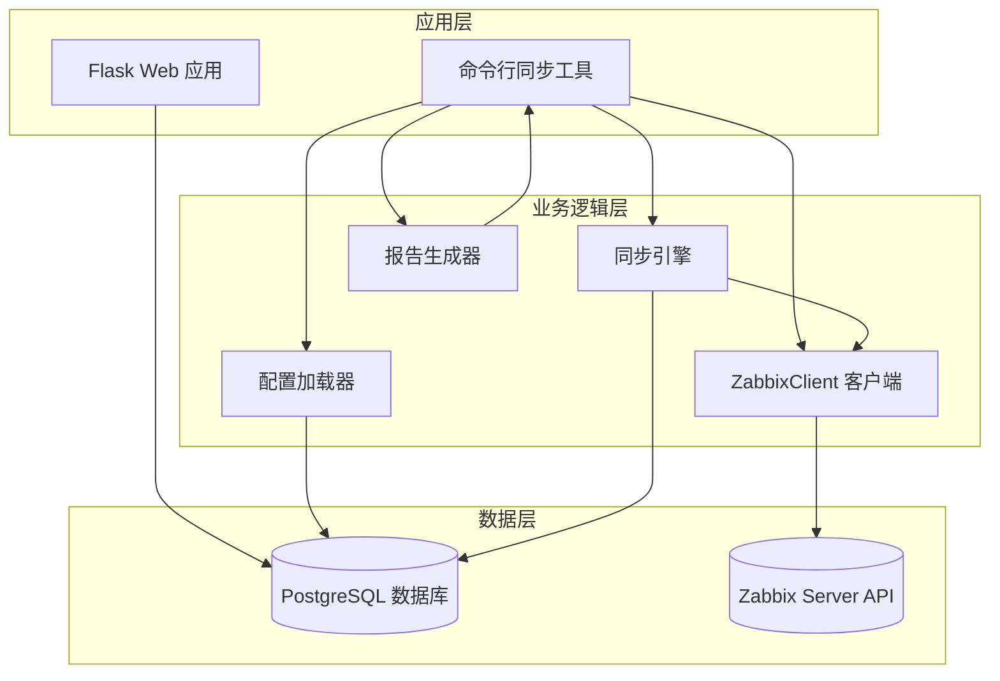
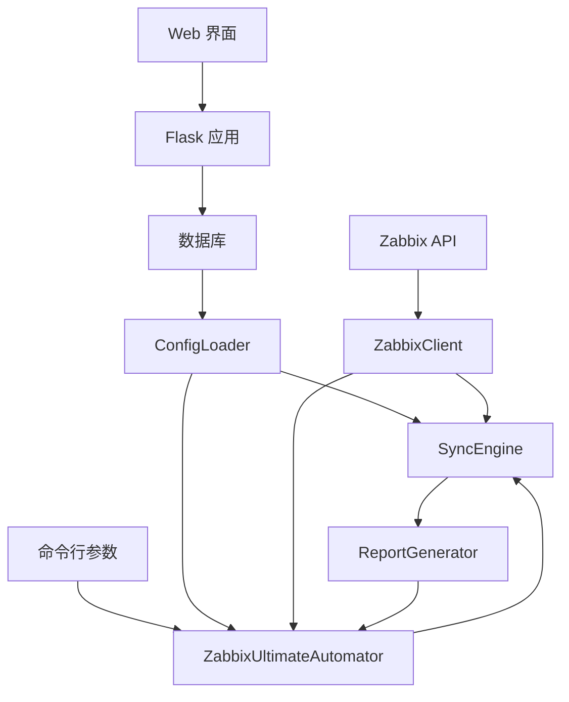
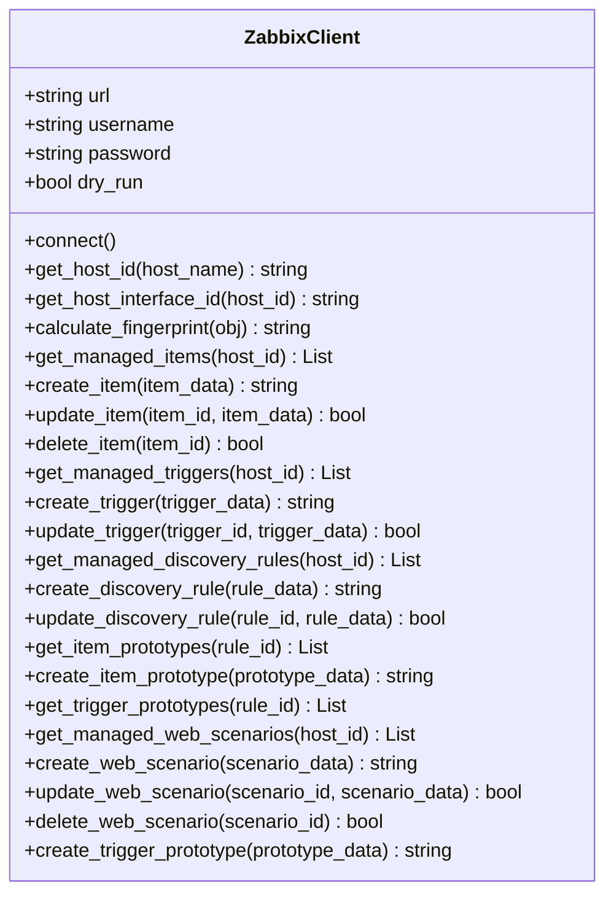
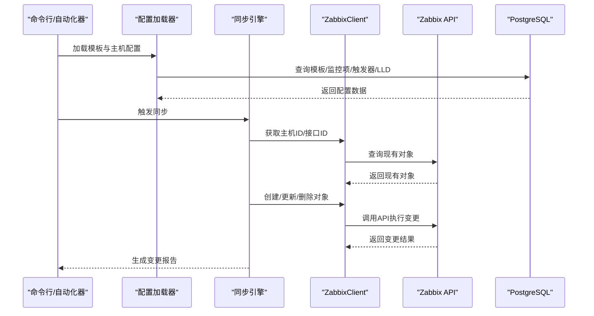
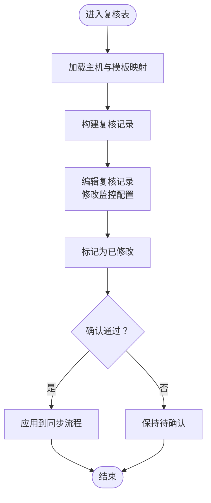
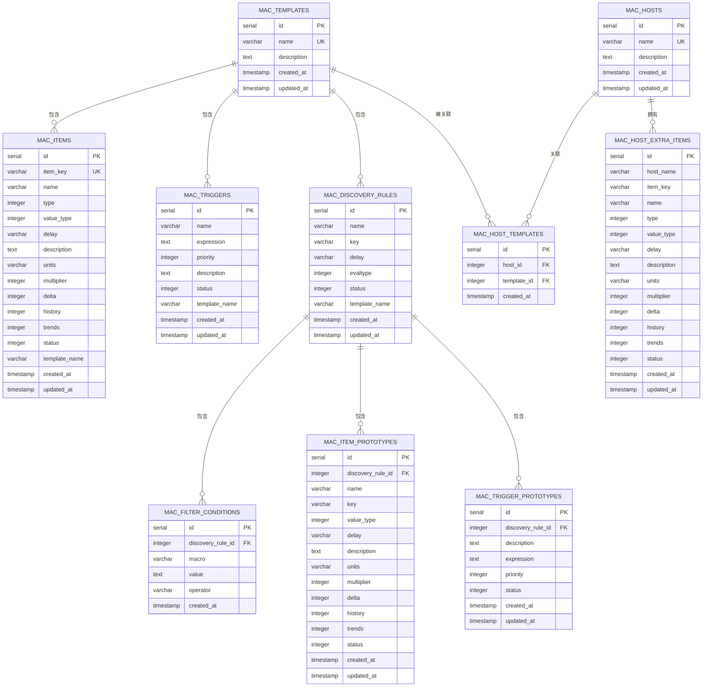
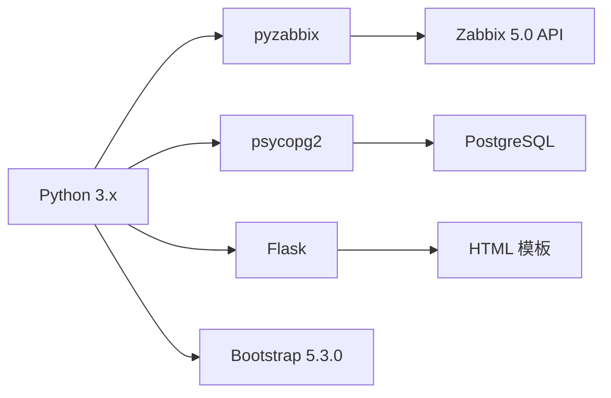

# 项目概述

<cite>
**本文档引用的文件**
- [app.py](file://app.py)
- [zabbix_mac.py](file://zabbix_mac.py)
- [zabbix_template_parser.py](file://zabbix_template_parser.py)
- [sync_monitoring_data.py](file://sync_monitoring_data.py)
- [CODE_WIKI.md](file://CODE_WIKI.md)
- [monitor_config.yaml](file://monitor_config.yaml)
- [create_tables.sql](file://create_tables.sql)
- [create_mac_tables.sql](file://create_mac_tables.sql)
- [create_review_tables.sql](file://create_review_tables.sql)
- [docker-compose.yml](file://docker-compose.yml)
- [ZABBIX_SETUP_GUIDE.md](file://ZABBIX_SETUP_GUIDE.md)
</cite>

## 目录
1. [简介](#简介)
2. [项目结构](#项目结构)
3. [核心组件](#核心组件)
4. [架构总览](#架构总览)
5. [详细组件分析](#详细组件分析)
6. [依赖关系分析](#依赖关系分析)
7. [性能考虑](#性能考虑)
8. [故障排除指南](#故障排除指南)
9. [结论](#结论)
10. [附录](#附录)

## 简介
Zabbix 监控审核和自动化控制中心是一个面向企业级监控场景的自动化平台，旨在通过“监控即代码”（Monitor as Code, MaC）理念，将 Zabbix 监控配置以声明式方式管理与同步。项目围绕 Zabbix 5.0 API，结合 PostgreSQL 数据库存储与 Flask Web 管理界面，提供从模板解析、配置加载、并发同步到审核确认的全链路能力，显著提升大规模监控环境的可维护性与一致性。

- **核心价值**：将监控配置代码化、版本化与自动化，降低变更风险，提升可审计性与可追溯性。
- **主要功能**：
  - 从数据库加载监控模板，实现监控项、触发器、自动发现规则（LLD）及 Web 场景的声明式同步；
  - 支持并发同步多台主机，生成详细变更报告；
  - 提供 Web 管理界面与复核表，支持配置的可视化管理与审核确认；
  - 支持模拟运行（dry-run）模式，保障变更前的安全评估。

## 项目结构
项目采用“脚本 + Web 界面 + 数据库”的分层组织方式，便于独立扩展与维护。

图表来源
- [app.py:1-774](file://app.py#L1-L774)
- [zabbix_mac.py:1-800](file://zabbix_mac.py#L1-L800)
- [zabbix_template_parser.py:1-800](file://zabbix_template_parser.py#L1-L800)
- [sync_monitoring_data.py:1-467](file://sync_monitoring_data.py#L1-L467)

章节来源
- [CODE_WIKI.md:48-125](file://CODE_WIKI.md#L48-L125)

## 核心组件
- **ZabbixClient（Zabbix API 客户端）**：封装 Zabbix 5.0 API 调用，提供主机/接口查询、监控项/触发器/自动发现规则/原型/Web 场景的创建、更新、删除能力，并支持指纹计算用于变更对比。
- **配置加载器（ConfigLoader）**：从数据库加载模板与主机配置，构建主机完整配置。
- **同步引擎（SyncEngine）**：执行声明式同步，处理监控项、触发器、LLD 规则及其原型、Web 场景的创建/更新/清理，支持并发与 dry-run。
- **报告生成器（ReportGenerator）**：记录创建、更新、删除等变更，生成 JSON/表格报告。
- **主自动化类（ZabbixUltimateAutomator）**：整合组件，加载配置，执行同步并生成报告。
- **Web 管理界面（Flask 应用）**：提供系统信息、模板、监控项、触发器、原型、主机、复核表等管理页面。
- **复核表功能**：基于主机 IP 关联监控配置，支持修改、确认/取消确认、标记修改状态，通过确认状态控制同步行为。

章节来源
- [CODE_WIKI.md:127-190](file://CODE_WIKI.md#L127-L190)

## 架构总览
系统采用“数据库驱动 + API 同步 + Web 审核”的三层架构，确保配置的可追溯与可审计。

图表来源
- [CODE_WIKI.md:19-35](file://CODE_WIKI.md#L19-L35)

章节来源
- [CODE_WIKI.md:17-47](file://CODE_WIKI.md#L17-L47)

## 详细组件分析

### ZabbixClient 组件分析
ZabbixClient 封装了与 Zabbix 5.0 API 的交互，具备高可用与健壮性设计，包含重试机制、指纹计算、对象管理等能力。

图表来源
- [zabbix_mac.py:39-800](file://zabbix_mac.py#L39-L800)

章节来源
- [zabbix_mac.py:39-800](file://zabbix_mac.py#L39-L800)

### 同步流程序列图（声明式同步）
展示从数据库加载配置到同步至 Zabbix 的关键步骤。

图表来源
- [zabbix_mac.py:1-800](file://zabbix_mac.py#L1-L800)
- [sync_monitoring_data.py:179-414](file://sync_monitoring_data.py#L179-L414)

章节来源
- [zabbix_mac.py:1-800](file://zabbix_mac.py#L1-L800)
- [sync_monitoring_data.py:179-414](file://sync_monitoring_data.py#L179-L414)

### 复核表流程图（配置审核与确认）
展示复核表在配置变更中的作用与流程。

图表来源
- [create_review_tables.sql:1-201](file://create_review_tables.sql#L1-L201)
- [app.py:411-771](file://app.py#L411-L771)

章节来源
- [create_review_tables.sql:1-201](file://create_review_tables.sql#L1-L201)
- [app.py:411-771](file://app.py#L411-L771)

### 数据库模型（核心表）
系统通过 PostgreSQL 存储模板、监控项、触发器、LLD 规则、原型与复核表，形成完整的配置基线。

图表来源
- [create_mac_tables.sql:1-252](file://create_mac_tables.sql#L1-L252)

章节来源
- [create_mac_tables.sql:1-252](file://create_mac_tables.sql#L1-L252)

## 依赖关系分析
项目依赖关系清晰，职责边界明确，便于扩展与维护。

图表来源
- [CODE_WIKI.md:402-411](file://CODE_WIKI.md#L402-L411)

章节来源
- [CODE_WIKI.md:402-411](file://CODE_WIKI.md#L402-L411)

## 性能考虑
- 并发同步：通过线程池并发处理多台主机，提升大规模部署下的同步效率。
- 指纹校验：使用对象指纹（排除无关字段）进行变更检测，避免重复同步。
- 索引优化：为常用查询字段建立索引，降低数据库查询开销。
- dry-run 模式：在生产前进行模拟运行，评估变更范围与影响，降低风险。

章节来源
- [zabbix_mac.py:1-800](file://zabbix_mac.py#L1-L800)
- [create_mac_tables.sql:139-151](file://create_mac_tables.sql#L139-L151)

## 故障排除指南
常见问题与解决思路：
- 连接 Zabbix API 失败：检查 URL 与登录凭据；确认 Zabbix 服务可达。
- 主机不存在：检查主机名与 Zabbix 主机配置；确认主机已在 Zabbix 中注册。
- 同步失败：检查用户权限与数据库配置；查看日志定位具体错误。
- 数据库连接失败：检查数据库配置与服务状态；确认网络连通性。
- Web 服务器启动失败：检查端口占用并释放端口；查看日志定位问题。

章节来源
- [CODE_WIKI.md:458-474](file://CODE_WIKI.md#L458-L474)

## 结论
Zabbix 监控审核和自动化控制中心通过“监控即代码”的理念，将配置管理、同步与审核一体化，显著提升了大规模监控环境的可维护性与一致性。其以数据库为单一事实源，结合 Zabbix 5.0 API 的声明式同步能力与 Web 审核机制，为企业提供了安全、可控、可追溯的监控配置管理体系。配合 Docker 化部署与完善的文档，项目易于上手与扩展，适合在生产环境中长期演进。

## 附录

### 快速开始指南
- 环境准备
  - 安装 Docker 与 Docker Compose，参考 [ZABBIX_SETUP_GUIDE.md:55-84](file://ZABBIX_SETUP_GUIDE.md#L55-L84)。
  - 启动服务：在项目根目录执行 `docker compose up -d`。
  - 访问 Web 界面：浏览器打开 http://localhost:8080，默认账号密码见安装指南。
- 数据库初始化
  - 执行数据库初始化脚本：参考 [create_mac_tables.sql:1-252](file://create_mac_tables.sql#L1-L252)。
  - 可选：执行 [create_review_tables.sql:1-201](file://create_review_tables.sql#L1-L201) 初始化复核表。
- 配置加载与同步
  - 使用命令行工具加载配置并同步：参考 [zabbix_mac.py:1-800](file://zabbix_mac.py#L1-L800) 与 [sync_monitoring_data.py:1-467](file://sync_monitoring_data.py#L1-L467)。
  - Web 管理界面：启动 [app.py:1-774](file://app.py#L1-L774)，访问 http://localhost:5000。
- 模板解析
  - 使用 [zabbix_template_parser.py:1-800](file://zabbix_template_parser.py#L1-L800) 解析 Zabbix 模板并写入数据库。

章节来源
- [ZABBIX_SETUP_GUIDE.md:55-84](file://ZABBIX_SETUP_GUIDE.md#L55-L84)
- [create_mac_tables.sql:1-252](file://create_mac_tables.sql#L1-L252)
- [create_review_tables.sql:1-201](file://create_review_tables.sql#L1-L201)
- [zabbix_mac.py:1-800](file://zabbix_mac.py#L1-L800)
- [sync_monitoring_data.py:1-467](file://sync_monitoring_data.py#L1-L467)
- [app.py:1-774](file://app.py#L1-L774)
- [zabbix_template_parser.py:1-800](file://zabbix_template_parser.py#L1-L800)