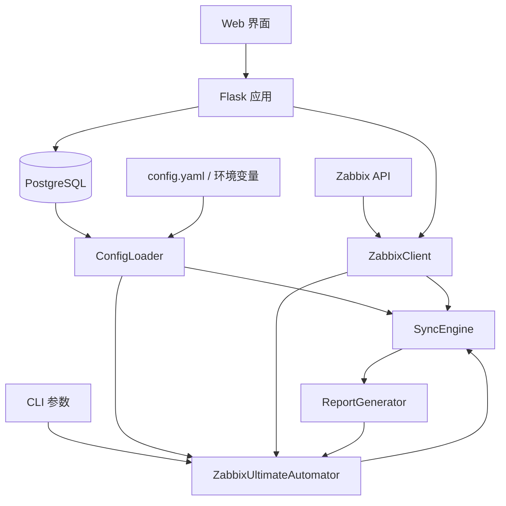

# Zabbix Monitor as Code (MaC) — 项目文档

## 1. 项目概述

Zabbix Monitor as Code (MaC) 是一套基于 Python 3 的工具集，通过调用 Zabbix 5.0 API，实现监控项（Items）、触发器（Triggers）、自动发现规则（LLD）及 Web 场景的声明式同步。

- **核心价值**：将监控配置代码化，实现版本控制和自动化管理，同时提供 Web 界面进行审核和管理
- **主要功能**：
  - 从 PostgreSQL 数据库加载监控模板
  - 自动同步监控项、触发器、自动发现规则和 Web 场景到多台 Zabbix 主机
  - 支持并发同步多台主机
  - 生成详细的变更报告
  - 支持模拟运行（dry-run）模式
  - Web 管理界面（Flask），支持可视化 CRUD 和复核审批
  - 复核表机制：监控配置变更需审核确认后才同步
  - YAML 配置文件 + 环境变量外部化配置
  - 离线部署支持（Bootstrap 5 + Icons 本地化）
  - 预定义模版管理页面支持模板筛选、Excel 导出/导入
  - Web 界面同步支持孤儿清理（自动删除 Zabbix 中已移除的配置项）
  - 复核表页面支持固定列（sticky columns）便于横向滚动浏览

## 2. 项目架构

### 2.1 系统架构



### 2.2 核心组件

| 组件 | 职责 | 文件 |
|------|------|------|
| ZabbixClient | Zabbix API 客户端封装 | `zabbix_mac.py` |
| ConfigLoader | 从 YAML 配置文件和数据库加载模板和主机配置 | `config_loader.py` |
| ReportGenerator | 变更报告（创建/更新/删除记录） | `zabbix_mac.py` |
| SyncEngine | 核心同步逻辑（Items/Triggers/LLD/Web），含孤儿清理 | `zabbix_mac.py` |
| ZabbixUltimateAutomator | 主自动化类，整合上述组件 | `zabbix_mac.py` |
| Flask 应用 | Web 管理界面 + 复核表管理 + Excel 导入导出 | `app.py` |

### 2.3 目录结构

```
zabbix_mac/
├── app.py                         # Flask Web 应用
├── zabbix_mac.py                  # 核心同步引擎 (CLI)
├── config_loader.py               # 配置加载器 (YAML + 环境变量)
├── config.yaml                    # 应用配置文件
├── config.yaml.example            # 配置文件模板
├── Dockerfile                     # 生产环境容器构建
├── requirements-macos-arm.txt     # Mac M4 开发环境依赖
├── requirements-linux-x86.txt     # Intel Linux 生产环境依赖
├── requirements-test.txt          # 测试依赖
├── CODE_WIKI.md                   # 项目文档（本文件）
├── PRD.md                         # 产品需求文档
├── database_update/               # 数据库 DDL 迁移脚本
│   ├── 001_create_schema.sql
│   ├── 002_create_hosts_table.sql
│   ├── ...
│   ├── apply_migrations.sh        # 迁移部署脚本
│   └── README.md                  # 迁移规范说明
├── 数据导出/                       # pg_dump 数据快照
├── .claude/skills/                # Claude Code 技能定义
│   └── deploy-production/         #   部署上线自动化技能
├── templates/                     # Jinja2 模板 (36 个)
│   ├── base.html
│   ├── index.html
│   ├── hosts.html / add_host.html / edit_host.html
│   ├── items.html / add_item.html / edit_item.html
│   ├── triggers.html / add_trigger.html / edit_trigger.html
│   ├── templates.html / template_detail.html
│   ├── discovery_rules.html / edit_discovery_rule.html
│   ├── item_prototypes.html / edit_item_prototype.html
│   ├── trigger_prototypes.html / edit_trigger_prototype.html
│   ├── filter_conditions.html / edit_filter_condition.html
│   ├── items_review.html / edit_item_review.html
│   ├── triggers_review.html / edit_trigger_review.html
│   ├── item_prototypes_review.html / edit_item_prototype_review.html
│   ├── trigger_prototypes_review.html / edit_trigger_prototype_review.html
│   ├── webscenarios_review.html / edit_webscenario_review.html
│   ├── search.html / system_info.html
│   └── _pagination.html
├── static/
│   ├── css/app.css
│   ├── js/app.js
│   └── vendor/                    # Bootstrap 5.3 离线资源
│       ├── bootstrap/css/bootstrap.min.css
│       ├── bootstrap/js/bootstrap.bundle.min.js
│       ├── bootstrap-icons/css/bootstrap-icons.css
│       └── bootstrap-icons/fonts/  (bootstrap-icons.woff2, .woff)
└── tests/
    ├── conftest.py
    ├── test_app.py
    ├── test_zabbix_client.py
    ├── test_sync_engine.py
    ├── test_config_loader.py
    ├── test_security.py
    ├── test_concurrency.py
    ├── test_performance.py
    └── test_environment.py
```

## 3. CLI 操作参考

### 3.1 基本语法

```bash
python3 zabbix_mac.py [操作模式] [参数]
```

### 3.2 操作模式一览

| # | 操作模式 | 说明 | Zabbix API | 数据库 |
|---|---------|------|:---:|:---:|
| 1 | `--sync` | 同步监控配置到 Zabbix 服务器（含孤儿清理） | ✓ | ✓ |
| 2 | `--initialize-reviews` | 初始化 items_review + triggers_review | ✗ | ✓ |
| 3 | `--initialize-items-review` | 仅初始化 items_review | ✗ | ✓ |
| 4 | `--initialize-triggers-review` | 仅初始化 triggers_review | ✗ | ✓ |
| 5 | `--initialize-webscenario-items-review` | 初始化 webscenario_items_review | ✗ | ✓ |
| 6 | `--export-items-review <FILE>` | 导出 items_review → Excel | ✗ | ✓ |
| 7 | `--export-triggers-review <FILE>` | 导出 triggers_review → Excel | ✗ | ✓ |
| 8 | `--import-items-review <FILE>` | 从 Excel 导入 → items_review | ✗ | ✓ |
| 9 | `--import-triggers-review <FILE>` | 从 Excel 导入 → triggers_review | ✗ | ✓ |
| 10 | `--create-web-scenarios` | 从复核表创建 Web 场景到 Zabbix | ✓ | ✓ |
| 11 | `--create-web-scenario-triggers` | 为 Web 场景创建触发器 | ✓ | ✓ |

### 3.3 Zabbix API 参数

| 参数 | 说明 | 必填 |
|------|------|:---:|
| `--url` | Zabbix API URL（如 `http://10.24.3.12:8080`） | ✓ |
| `--username` | Zabbix 用户名 | ✓ |
| `--password` | Zabbix 密码 | ✓ |

### 3.4 数据库参数

| 参数 | 说明 | 默认值 |
|------|------|--------|
| `--db-host` | PostgreSQL 主机 | `localhost` |
| `--db-port` | PostgreSQL 端口 | `5432` |
| `--db-name` | 数据库名 | `ops` |
| `--db-user` | 用户名 | `postgres` |
| `--db-password` | 密码 | 空 |

### 3.5 同步参数

| 参数 | 说明 | 默认值 |
|------|------|--------|
| `--dry-run` | 模拟运行，不实际执行 | `False` |
| `--workers` | 并发线程数 | `5` |

### 3.6 使用示例

```bash
# 1. 同步监控配置
python3 zabbix_mac.py --sync \
  --url http://10.24.3.12:8080 \
  --username Admin --password zabbix \
  --db-host localhost --db-port 5432 --db-name ops --db-user postgres

# 2. 模拟运行（预览变更，不实际执行）
python3 zabbix_mac.py --sync --dry-run \
  --url http://10.24.3.12:8080 \
  --username Admin --password zabbix

# 3. 初始化所有复核表
python3 zabbix_mac.py --initialize-reviews \
  --db-host localhost --db-port 5432 --db-name ops --db-user postgres

# 4. 创建 Web 场景监控
python3 zabbix_mac.py --create-web-scenarios \
  --url http://10.24.3.12:8080 \
  --username Admin --password zabbix \
  --db-host localhost --db-port 5432 --db-name ops --db-user postgres

# 5. 为 Web 场景创建触发器
python3 zabbix_mac.py --create-web-scenario-triggers \
  --url http://10.24.3.12:8080 \
  --username Admin --password zabbix \
  --db-host localhost --db-port 5432 --db-name ops --db-user postgres

# 6. 导出复核数据到 Excel
python3 zabbix_mac.py --export-items-review items_review.xlsx \
  --db-host localhost --db-port 5432 --db-name ops --db-user postgres

# 7. 从 Excel 导入复核数据
python3 zabbix_mac.py --import-items-review items_review.xlsx \
  --db-host localhost --db-port 5432 --db-name ops --db-user postgres
```

## 4. Web 场景监控工作流

1. **准备数据**：确保 `webscenario_items` 表中有数据
2. **初始化复核表**：
   ```bash
   python3 zabbix_mac.py --initialize-webscenario-items-review
   ```
3. **审核确认**：在 Web 界面或数据库中标记 `confirmed = true`
4. **同步 Web 场景**：在 Web 界面工具栏选择目标环境，点击"同步Web场景"
5. **同步触发器**：点击"同步Web场景触发器"

触发器表达式格式：`{host:web.test.fail[name].count(#3,0,ne)}>2`（连续 3 次检查失败则触发告警）

## 5. Web 管理界面

### 5.1 启动

```bash
python3 app.py
# 访问 http://localhost:5000（端口由 config.yaml 中 app.port 配置）
# 或通过 APP_PORT 环境变量覆盖：APP_PORT=5001 python3 app.py
```

### 5.2 功能模块

| 菜单 | 功能 |
|------|------|
| 系统信息 | 数据库连接状态、表统计、Zabbix 环境配置概览 |
| 模版管理 | 模板 CRUD + 模板详情（关联的监控项/触发器/LLD） |
| 监控项管理 | 监控项 CRUD + 分页列表 + 模板筛选 + Excel 导出/导入 |
| 触发器管理 | 触发器 CRUD + 分页列表 + 模板筛选 + Excel 导出/导入 |
| 监控项原型 | 按 LLD 规则分组展示 + 编辑 + 模板筛选 + Excel 导出/导入 |
| 触发器原型 | 按 LLD 规则分组展示 + 编辑 + 模板筛选 + Excel 导出/导入 |
| 自动发现规则 | LLD 规则管理 + 过滤条件管理 + 模板筛选 + Excel 导出/导入 |
| 主机管理 | 主机 CRUD + 从 ops.sub_assets 同步 |
| 复核表 (×5) | 监控项/触发器/原型/Web场景复核，审核 → 确认 → 同步 → 核验，含初始化/导出/导入 |
| 搜索 | 跨表搜索主机名/模板名/IP |

### 5.3 预定义模版管理 - 模板筛选

所有 6 个预定义模版管理页面（items, triggers, item_prototypes, trigger_prototypes, discovery_rules, filter_conditions）的工具栏均支持按**模板名称**模糊筛选，通过 `DEFAULT_TEMPLATE_NAME` 配置项指定默认模板。

### 5.4 预定义模版管理 - Excel 导出/导入

所有 6 个预定义模版管理页面支持将表数据导出为 `.xlsx` 文件，以及从 Excel 文件导入（清空后写入）。导出使用 `BytesIO` 内存流（无临时文件），导入使用 `DELETE` + `executemany` `INSERT` 批量写入。

### 5.5 复核表同步 - 孤儿清理

Web 界面复核表同步（`/items-review/sync`, `/webscenarios-review/sync`）实现了与 CLI `--sync` 一致的孤儿清理逻辑：

- **创建**：已确认但 Zabbix 中不存在的项 → 新建
- **更新**：已确认且内容有变化 → 指纹对比后更新
- **删除**：Zabbix 中存在但已不在确认列表中的项 → 自动删除
- **安全保护**：自动排除模板继承的项（`templateid != "0"`），避免删除失败

### 5.6 复核表页面 - 固定列

所有复核表页面（items_review, triggers_review, item_prototypes_review, trigger_prototypes_review, webscenarios_review）的表格支持固定列：

- **左侧固定**：ID 列 + 主机IP列 — 横向滚动时保持可见
- **右侧固定**：修改状态、确认状态、状态核验、操作列 — 横向滚动时保持可见
- 实现方式：CSS `position: sticky` + 显式 `left`/`right` 偏移量

### 5.7 离线部署

项目已内置 Bootstrap 5.3 和 Bootstrap Icons 1.11.0 的静态资源（`static/vendor/`），无需 CDN 即可在内网环境正常运行。

### 5.8 主要路由

| 路由 | 方法 | 说明 |
|------|------|------|
| `/` | GET | 首页 |
| `/system-info` | GET | 系统信息 |
| `/templates` | GET | 模板列表 |
| `/template/<id>` | GET | 模板详情 |
| `/items` | GET | 监控项列表 |
| `/items/export` | GET | 导出 items → Excel |
| `/items/import` | POST | 从 Excel 导入 items |
| `/item/add` | GET, POST | 添加监控项 |
| `/item/edit/<id>` | GET, POST | 编辑监控项 |
| `/item/delete/<id>` | GET | 删除监控项 |
| `/triggers` | GET | 触发器列表 |
| `/triggers/export` | GET | 导出 triggers → Excel |
| `/triggers/import` | POST | 从 Excel 导入 triggers |
| `/trigger/add` | GET, POST | 添加触发器 |
| `/trigger/edit/<id>` | GET, POST | 编辑触发器 |
| `/hosts` | GET | 主机列表 |
| `/host/add` | GET, POST | 添加主机 |
| `/host/edit/<id>` | GET, POST | 编辑主机 |
| `/host/sync` | POST | 同步主机资产 |
| `/discovery-rules` | GET | LLD 规则列表 |
| `/discovery-rules/export` | GET | 导出 discovery_rules → Excel |
| `/discovery-rules/import` | POST | 从 Excel 导入 discovery_rules |
| `/discovery-rule/edit/<id>` | GET, POST | 编辑 LLD 规则 |
| `/item-prototypes` | GET | 监控项原型 |
| `/item-prototypes/export` | GET | 导出 item_prototypes → Excel |
| `/item-prototypes/import` | POST | 从 Excel 导入 item_prototypes |
| `/trigger-prototypes` | GET | 触发器原型 |
| `/trigger-prototypes/export` | GET | 导出 trigger_prototypes → Excel |
| `/trigger-prototypes/import` | POST | 从 Excel 导入 trigger_prototypes |
| `/filter-conditions` | GET | 过滤条件列表 |
| `/filter-conditions/export` | GET | 导出 filter_conditions → Excel |
| `/filter-conditions/import` | POST | 从 Excel 导入 filter_conditions |
| `/filter-condition/edit/<id>` | GET, POST | 编辑过滤条件 |
| `/items-review` | GET | 监控项复核表 |
| `/items-review/initialize` | POST | 初始化复核表 |
| `/items-review/sync` | POST | 同步已确认项到 Zabbix（含孤儿清理） |
| `/items-review/export` | GET | 导出复核表 Excel |
| `/items-review/import` | POST | 导入复核表 Excel |
| `/item-review/edit/<id>` | GET, POST | 编辑复核记录 |
| `/item-review/confirm/<id>` | GET | 确认复核 |
| `/triggers-review` | GET | 触发器复核表 |
| `/triggers-review/initialize` | POST | 初始化复核表 |
| `/triggers-review/export` | GET | 导出复核表 Excel |
| `/triggers-review/import` | POST | 导入复核表 Excel |
| `/item-prototypes-review` | GET | 监控项原型复核表 |
| `/trigger-prototypes-review` | GET | 触发器原型复核表 |
| `/webscenarios-review` | GET | Web场景复核表 |
| `/webscenarios-review/initialize` | POST | 初始化复核表 |
| `/webscenarios-review/sync` | POST | 同步已确认Web场景（含孤儿清理） |
| `/webscenarios-review/sync-triggers` | POST | 同步Web场景触发器 |
| `/webscenarios-review/export` | GET | 导出复核表 Excel |
| `/webscenarios-review/import` | POST | 导入复核表 Excel |
| `/webscenario-review/edit/<id>` | GET, POST | 编辑Web场景复核 |
| `/webscenario-review/add` | POST | 添加Web场景复核 |
| `/webscenario-review/confirm/<id>` | GET | 确认Web场景复核 |
| `/webscenario-review/unconfirm/<id>` | GET | 取消确认Web场景复核 |
| `/item-prototypes-review/initialize` | POST | 初始化监控项原型复核表 |
| `/item-prototypes-review/export` | GET | 导出监控项原型复核表 |
| `/item-prototypes-review/import` | POST | 导入监控项原型复核表 |
| `/trigger-prototypes-review/initialize` | POST | 初始化触发器原型复核表 |
| `/trigger-prototypes-review/export` | GET | 导出触发器原型复核表 |
| `/trigger-prototypes-review/import` | POST | 导入触发器原型复核表 |
| `/items-review/verify` | POST | 核验监控项复核状态 |
| `/triggers-review/verify` | POST | 核验触发器复核状态 |
| `/webscenarios-review/verify` | POST | 核验Web场景复核状态 |
| `/item-prototypes-review/verify` | POST | 核验监控项原型复核状态 |
| `/trigger-prototypes-review/verify` | POST | 核验触发器原型复核状态 |
| `/search` | GET | 全局搜索 |

### 5.9 状态核验

复核表每条记录都有 `status_verification` 字段，表示与 Zabbix 实际配置的对账结果：

| 值 | 含义 |
|----|------|
| `pending` | 未核验（默认值） |
| `verified` | 与 Zabbix 中的配置一致 |
| `mismatch` | 存在但字段不一致（仅监控项/Web场景） |
| `not_found` | Zabbix 中不存在对应配置 |

**核验触发**: 在复核表页面选择目标环境 → 点击"核验"按钮，系统将拉取 Zabbix 实际配置并与复核表逐条比对：

| 复核表 | 比对方式 |
|--------|---------|
| `items_review` | 按 `key_` 匹配 → 比对 name/type/value_type/delay |
| `triggers_review` | 按 `description` 匹配 → 存在性检查 |
| `webscenario_items_review` | 按 `name` 匹配 → 比对 url/status_code |
| `item_prototypes_review` | 按 `key_` 匹配（通过发现规则） → 比对 name/type/value_type/delay |
| `trigger_prototypes_review` | 按 `description` 匹配（通过发现规则） → 存在性检查 |

## 6. 关键类与函数

### 6.1 ZabbixClient — Zabbix API 客户端

| 方法 | 说明 |
|------|------|
| `__init__(url, username, password, dry_run)` | 初始化连接 |
| `get_host_id(host_name)` | 按名称查主机 ID |
| `get_host_interface_id(host_id)` | 获取主机接口 ID |
| `get_managed_items(host_id)` | 获取主机自有监控项（自动排除模板继承项 templateid != "0"） |
| `create_item(item_data)` / `update_item(id, data)` / `delete_item(id)` | 监控项 CRUD |
| `get_managed_triggers(host_id)` | 获取受管理触发器（按 ManagedBy 标签过滤） |
| `create_trigger(data)` / `update_trigger(id, data)` | 触发器管理 |
| `get_managed_discovery_rules(host_id)` | 获取 LLD 规则 |
| `create_discovery_rule(data)` / `update_discovery_rule(id, data)` | LLD 管理 |
| `get_item_prototypes(rule_id)` / `create_item_prototype(data)` | 监控项原型 |
| `get_trigger_prototypes(rule_id)` / `create_trigger_prototype(data)` | 触发器原型 |
| `get_managed_web_scenarios(host_id)` | 获取 Web 场景（按 ManagedBy 标签过滤） |
| `create_web_scenario(data)` / `update_web_scenario(id, data)` / `delete_web_scenario(id)` | Web 场景管理 |
| `calculate_fingerprint(obj)` | 计算对象 MD5 指纹（排除 itemid, hostid, triggerid, ruleid, prototypeid, created, lastclock, httptestid, templateid, nextcheck） |

### 6.2 SyncEngine — 同步引擎

| 方法 | 说明 |
|------|------|
| `sync_host(host_name, config, dry_run)` | 同步单台主机 |
| `sync_all_hosts(config, dry_run, workers)` | 并发同步所有主机 |
| `_sync_items(host_id, target_items, dry_run)` | 同步监控项（含依赖项处理 + 孤儿清理） |
| `_sync_triggers(host_id, host_name, target_triggers, dry_run)` | 同步触发器 |
| `_sync_discovery_rules(host_id, host_name, rules, dry_run)` | 同步 LLD 规则（含孤儿清理） |
| `_sync_item_prototypes(...)` | 同步监控项原型 |
| `_sync_trigger_prototypes(...)` | 同步触发器原型 |
| `_sync_web_scenarios(host_id, host_name, scenarios, dry_run)` | 同步 Web 场景（含孤儿清理） |

### 6.3 ConfigLoader — 配置加载器

| 方法 | 说明 |
|------|------|
| `load_config()` | 从 `config.yaml` 加载配置，环境变量覆盖 YAML 值 |
| `get_webscenario_items_review()` | 获取已确认的 Web 场景复核记录 |

配置优先级：**环境变量 > config.yaml > 默认值**

### 6.4 StatusVerifier — 状态核验器

位于 `zabbix_mac.py`，负责从 Zabbix 拉取实际配置并与复核表逐条比对。

| 方法 | 说明 |
|------|------|
| `verify_items(host_ip)` | 按 `key_` 匹配，比对 name/type/value_type/delay，标记 verified/mismatch/not_found |
| `verify_triggers(host_ip)` | 按 `description` 匹配，存在性检查，标记 verified/not_found |
| `verify_web_scenarios(host_ip)` | 按 `name` 匹配，比对 url/status_code，标记 verified/mismatch/not_found |
| `verify_item_prototypes(host_ip)` | 通过发现规则按 `key_` 匹配，比对字段 |
| `verify_trigger_prototypes(host_ip)` | 通过发现规则按 `description` 匹配，存在性检查 |
| `verify_all()` | 遍历所有主机执行 items + triggers 核验，打印汇总报告 |

Web UI 通过 5 条 `POST /xxx-review/verify` 路由触发，CLI 通过 `--verify-status` 参数触发。

## 7. 数据库结构

### 7.1 配置

```python
# 配置来源（优先级从高到低）
# 1. 环境变量（APP_PORT, DB_HOST, DB_PORT, DB_NAME, DB_USER, DB_PASSWORD, APP_SECRET_KEY 等）
# 2. config.yaml 文件
# 3. config_loader.py 中的默认值
```

### 7.2 核心表（schema: `zabbix_mac`）

| 表名 | 说明 |
|------|------|
| `hosts` | 主机列表（name, system, subsystem, template_id） |
| `templates` | 监控模板（template_id, description） |
| `items` | 监控项模板（item_key, type, value_type, delay, preprocessing） |
| `triggers` | 触发器模板（expression, priority） |
| `discovery_rules` | 自动发现规则（key, delay, type） |
| `item_prototypes` | 监控项原型 → FK `discovery_rules` |
| `trigger_prototypes` | 触发器原型 → FK `discovery_rules` |
| `filter_conditions` | LLD 过滤条件 → FK `discovery_rules` |
| `host_templates` | 主机-模板关联 → FK `hosts`, `templates` |
| `host_extra_items` | 主机额外监控项 |
| `webscenario_items` | Web 场景配置 |
| `items_review` | 监控项复核表 → FK `items` |
| `triggers_review` | 触发器复核表 → FK `triggers` |
| `item_prototypes_review` | 监控项原型复核表 → FK `item_prototypes`, `discovery_rules` |
| `trigger_prototypes_review` | 触发器原型复核表 → FK `trigger_prototypes`, `discovery_rules` |
| `webscenario_items_review` | Web 场景复核表 |

### 7.3 跨 schema 表（schema: `ops`）

| 表名 | 说明 |
|------|------|
| `sub_assets` | 主机资产信息（ip, hostname, system, subsystem, template_id） |

### 7.4 复核表字段说明

所有复核表包含：
- 原始表的所有业务字段
- `modified BOOLEAN` — 是否被修改
- `confirmed BOOLEAN` — 是否已确认
- `status_verification VARCHAR(50)` — 审核状态 (pending/confirmed/rejected/verified/mismatch/not_found)
- `host_ip VARCHAR(255)` — 关联主机 IP
- `system VARCHAR(100)` / `subsystem VARCHAR(100)` — 系统/模块分类

### 7.5 迁移管理

使用 `database_update/apply_migrations.sh` 进行数据库结构变更。详见 `database_update/README.md`。

### 7.6 ID 序列重置

复核表的"初始化"操作使用 `TRUNCATE <table> RESTART IDENTITY`（而非 `DELETE`），确保清空表后 `SERIAL` 主键序列从 1 开始重新计数。涉及: `items_review`、`triggers_review`、`webscenario_items_review`、`item_prototypes_review`、`trigger_prototypes_review`。

## 8. 依赖关系

| 依赖 | 用途 |
|------|------|
| Python 3.x | 运行环境 |
| Flask | Web 框架 |
| psycopg2-binary | PostgreSQL 驱动 |
| pyzabbix | Zabbix API 客户端 |
| requests | HTTP 请求 |
| PyYAML | YAML 配置解析 |
| pandas / numpy | 数据处理（Excel 导入导出） |
| openpyxl | Excel 读写 |
| Bootstrap 5.3 (本地) | 前端 UI（`static/vendor/`） |
| Bootstrap Icons 1.11 (本地) | 图标库（`static/vendor/`） |

## 9. 配置说明

### 9.1 config.yaml 结构

```yaml
app:
  host: "0.0.0.0"
  port: 5000
  debug: false
  secret_key: "your-secret-key"

database:
  host: "localhost"
  port: 5432
  name: "ops"
  user: "postgres"
  password: ""

default_template_name: "21001"
```

### 9.2 环境变量覆盖

| 环境变量 | 对应配置项 |
|---------|-----------|
| `APP_PORT` | `app.port` |
| `APP_HOST` | `app.host` |
| `APP_SECRET_KEY` | `app.secret_key` |
| `DB_HOST` | `database.host` |
| `DB_PORT` | `database.port` |
| `DB_NAME` | `database.name` |
| `DB_USER` | `database.user` |
| `DB_PASSWORD` | `database.password` |
| `DEFAULT_TEMPLATE_NAME` | `default_template_name` |

Zabbix 机房凭据通过环境变量注入（不写入代码）：
- `ZABBIX_SZSE_ZW_URL` / `ZABBIX_SZSE_ZW_USER` / `ZABBIX_SZSE_ZW_PASS` — 深交所证联网
- `ZABBIX_SZSE_HLW_URL` / `ZABBIX_SZSE_HLW_USER` / `ZABBIX_SZSE_HLW_PASS` — 深交所互联网
- `ZABBIX_SSE_ZW_URL` / `ZABBIX_SSE_ZW_USER` / `ZABBIX_SSE_ZW_PASS` — 上交所证联网
- `ZABBIX_SSE_HLW_URL` / `ZABBIX_SSE_HLW_USER` / `ZABBIX_SSE_HLW_PASS` — 上交所互联网

## 10. 最佳实践

- **首次同步用 `--dry-run`**：预览变更后再实际执行
- **按主机数量调整 `--workers`**：控制并发压力
- **复核表机制**：先在复核表修改/确认，确认后同步到 Zabbix，形成审批流。同步会自动清理 Zabbix 中已取消确认的孤儿项
- **Web 场景同步**：先同步 Web 场景，再同步触发器，确保依赖关系正确
- **Excel 导入**：导入会清空目标表全部数据后写入，请先导出备份
- **JOIN 表导出**：关联表（item_prototypes, trigger_prototypes, filter_conditions）导出的是主表原始列，不含 JOIN 字段，确保可安全导入
- **模板继承安全**：系统自动排除模板继承的监控项（`templateid != "0"`），避免同步时误删
- **数据库迁移**：DDL 变更走 `database_update/` 编号迁移，不直接改数据库
- **定期备份**：数据库和数据导出文件应定期归档
- **内网部署**：项目使用本地 Bootstrap 资源，`static/vendor/` 目录需随部署打包

## 11. 故障排除

| 错误 | 可能原因 | 解决方案 |
|------|----------|----------|
| `502 Server Error: Bad Gateway` | Zabbix API URL 不正确或服务未运行 | 检查 Zabbix 服务器状态和 API URL |
| `Invalid params., unexpected parameter "tags"` | Zabbix 5.0 API 不支持此参数 | 已修复，受管理标记自动处理 |
| `Application with applicationid "xxx" does not exist` | 应用 ID 无效 | 移除 applicationid 参数 |
| `Invalid parameter "/1": unexpected parameter "hostid/hosts"` | API 参数不兼容 | 已适配 Zabbix 5.0 |
| 数据库连接失败 | 配置错误或 PostgreSQL 未启动 | 检查 config.yaml 和数据库服务状态 |
| Flask 启动失败 | 端口被占用 | `lsof -i :5000` 检查并释放端口，或设 `APP_PORT` 环境变量 |
| 同步主机失败 | 主机名不匹配或 API 权限不足 | 检查 Zabbix 中主机名和用户权限 |
| 删除模板项失败 | 尝试删除模板继承的监控项 | 已修复：`get_managed_items()` 自动排除 `templateid != "0"` |
| Bootstrap 图标显示方框 | 字体路径错误 | 已修复：`bootstrap-icons.css` 中字体路径改为 `../fonts/` |
| 侧边栏菜单错误高亮 | URL 前缀匹配过于宽泛 | 已修复：JS 增加词边界检查 |
| 横向滚动时固定列失效 | 父容器 `overflow:hidden` 冲突 | 已修复：`.data-card` 移除 `overflow:hidden` |
| 核验提示"无效的环境" | `zabbix_environments` 未在 config.yaml 中配置 | 在 config.yaml 添加 Zabbix 环境配置（参考 config.yaml.example） |
| 原型核验全部 not_found | 发现规则未同步到 Zabbix 或 key 不匹配 | 先执行"同步"操作确保发现规则已存在于 Zabbix |

## 12. 部署上线

### 12.1 数据库迁移

```bash
cd database_update/
./apply_migrations.sh <DB_HOST> <DB_PORT> <DB_NAME> <DB_USER>
```

### 12.2 容器化部署

**构建镜像**（Apple Silicon Mac 上构建 Linux x86_64 镜像）：

```bash
# 格式: docker build --platform linux/amd64 -t zabbix-mac:<版本号> ./
# 示例:
docker build --platform linux/amd64 -t zabbix-mac:20260618v1 ./
```

- `--platform linux/amd64`：在 ARM Mac 上交叉编译 Intel Linux 镜像，确保与生产服务器兼容
- 版本号建议格式：`YYYYMMDDvN`（日期 + 递增版本号）

**运行容器**：

```bash
docker run -d -p 5000:5000 \
  -e DB_HOST=... -e DB_PORT=5432 -e DB_NAME=ops -e DB_USER=postgres \
  zabbix-mac:20260618v1
```

### 12.3 环境变量

详见第 9 节配置说明。

### 12.4 deploy-production 技能

Claude Code 内置技能，通过说"部署环境上线"或输入 `/deploy-production` 触发，自动执行三阶段部署准备：

| 阶段 | 操作 |
|------|------|
| Phase 1 - 依赖检查 | 扫描 `app.py`/`zabbix_mac.py` 导入 → 对比 `requirements-*.txt` → 检查 `Dockerfile` COPY 指令 → 检查 `config.yaml` |
| Phase 2 - 数据库迁移 | 列出 `database_update/` 下 SQL 文件 → 查询 `schema_migrations` 状态 → 询问用户 → 执行 `apply_migrations.sh` |
| Phase 3 - 数据导出 | 启动 Flask → curl 6 个导出端点 → 保存至 `数据导出/` → 生成时间戳备份 → 停止 Flask |

技能文件: `.claude/skills/deploy-production/SKILL.md`

---

**文档版本**: 3.1
**最后更新**: 2026-06-17
