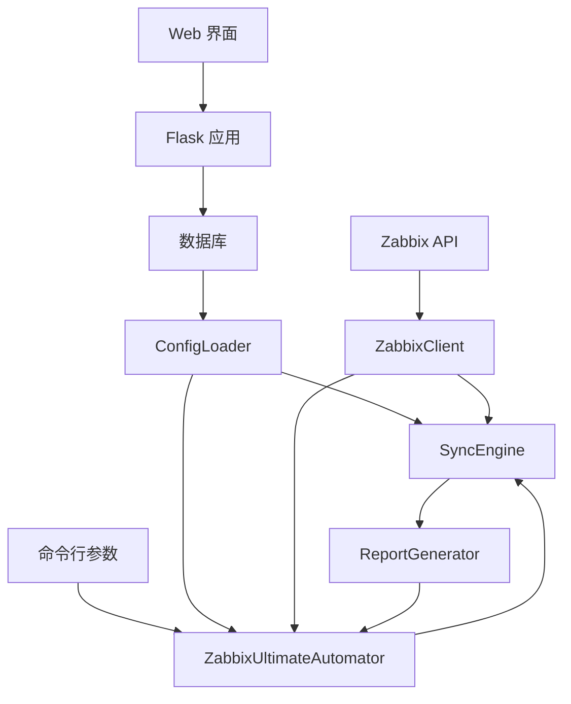

# Zabbix 监控审核和自动化控制中心

## 1. 项目概述

Zabbix Monitor as Code (MaC) 自动化系统是一个基于 Python 3 的工具，通过调用 Zabbix 5.0 API，实现监控项（Items）、触发器（Triggers）及自动发现规则（LLD）的声明式同步。

- **核心价值**：将监控配置代码化，实现版本控制和自动化管理，同时提供Web界面进行审核和管理
- **主要功能**：
  - 从数据库加载监控模板
  - 自动同步监控项、触发器、自动发现规则和 web 场景
  - 支持并发同步多台主机
  - 生成详细的变更报告
  - 支持模拟运行（dry-run）模式
  - Web 管理界面，支持监控配置的可视化管理
  - 复核表功能，支持监控配置的审核和确认

## 2. 项目架构

### 2.1 系统架构



### 2.2 核心组件

| 组件 | 职责 | 文件位置 |
|------|------|----------|
| ZabbixClient | Zabbix API 客户端封装 | [zabbix_mac.py](file:///Users/fan/Documents/Trae编程工具/zabbix监控审核和自动化控制中心/zabbix_mac.py) |
| ConfigLoader | 配置加载器 | [zabbix_mac.py](file:///Users/fan/Documents/Trae编程工具/zabbix监控审核和自动化控制中心/zabbix_mac.py) |
| ReportGenerator | 变更报告生成器 | [zabbix_mac.py](file:///Users/fan/Documents/Trae编程工具/zabbix监控审核和自动化控制中心/zabbix_mac.py) |
| SyncEngine | 同步引擎 | [zabbix_mac.py](file:///Users/fan/Documents/Trae编程工具/zabbix监控审核和自动化控制中心/zabbix_mac.py) |
| ZabbixUltimateAutomator | 主自动化类 | [zabbix_mac.py](file:///Users/fan/Documents/Trae编程工具/zabbix监控审核和自动化控制中心/zabbix_mac.py) |
| Flask 应用 | Web 管理界面 | [app.py](file:///Users/fan/Documents/Trae编程工具/zabbix监控审核和自动化控制中心/app.py) |

### 2.3 目录结构

```
zabbix监控审核和自动化控制中心/
├── __pycache__/              # 编译缓存
├── base_templates/           # 基础监控模板（YAML格式）
├── database_backup/          # 数据库备份文件
├── templates/                # Web 界面模板
│   ├── add_host.html         # 添加主机页面
│   ├── add_item.html         # 添加监控项页面
│   ├── add_trigger.html      # 添加触发器页面
│   ├── base.html             # 基础模板
│   ├── edit_host.html        # 编辑主机页面
│   ├── edit_item.html        # 编辑监控项页面
│   ├── edit_item_review.html # 编辑监控项复核记录页面
│   ├── edit_trigger.html     # 编辑触发器页面
│   ├── edit_trigger_review.html # 编辑触发器复核记录页面
│   ├── hosts.html            # 主机列表页面
│   ├── index.html            # 首页
│   ├── item_prototypes.html  # 监控项原型页面
│   ├── items.html            # 监控项列表页面
│   ├── items_review.html     # 监控项复核表页面
│   ├── system_info.html      # 系统信息页面
│   ├── template_detail.html  # 模板详情页面
│   ├── templates.html        # 模板列表页面
│   ├── trigger_prototypes.html # 触发器原型页面
│   ├── triggers.html         # 触发器列表页面
│   └── triggers_review.html  # 触发器复核表页面
├── CODE_WIKI.md              # 项目文档
├── DATABASE_MIGRATION_PLAN.md # 数据库迁移计划
├── ZABBIX_SETUP_GUIDE.md     # Zabbix 设置指南
├── app.py                    # Web 应用主文件
├── backup_database.py        # 数据库备份脚本
├── check_api_params.py       # API 参数检查脚本
├── check_host.py             # 主机检查脚本
├── check_item_prototypes_delay.py # 监控项原型延迟检查脚本
├── check_postgres_config.py  # PostgreSQL 配置检查脚本
├── check_prototypes.py       # 原型检查脚本
├── check_trigger_expressions.py # 触发器表达式检查脚本
├── check_trigger_prototypes.py # 触发器原型检查脚本
├── check_zabbix_prototypes.py # Zabbix 原型检查脚本
├── create_host_tables.sql    # 创建主机表 SQL 脚本
├── create_mac_tables.sql     # 创建 Mac 表 SQL 脚本
├── create_review_tables.sql  # 创建复核表 SQL 脚本
├── create_tables.sql         # 数据库初始化脚本
├── delete_mac_tables.py      # 删除 Mac 表脚本
├── docker-compose.yml        # Docker 配置文件
├── execute_sql.py            # 执行 SQL 脚本
├── execute_update_schema.py  # 执行架构更新脚本
├── extract_yaml_from_images.py # 从图片提取 YAML 脚本
├── fix_trigger_expressions.py # 修复触发器表达式脚本
├── insert_sample_data.py     # 插入示例数据脚本
├── manual_merge.py           # 手动合并脚本
├── manual_yaml_merge.py      # 手动 YAML 合并脚本
├── merged_yaml.yml           # 合并后的 YAML 文件
├── monitor_config.yaml       # 监控配置文件
├── read_template_from_zabbix.py # 从 Zabbix 读取模板脚本
├── setup_zabbix_db.py        # 设置 Zabbix 数据库脚本
├── setup_zabbix_db.sql       # 设置 Zabbix 数据库 SQL 脚本
├── sync_monitoring_data.py   # 同步监控数据脚本
├── sync_zabbix.sh            # 同步 Zabbix 脚本
├── test.py                   # 测试脚本
├── test_db_connection.py     # 数据库连接测试脚本
├── test_db_load.py           # 数据库加载测试脚本
├── test_prototypes.py        # 原型测试脚本
├── test_trigger_prototypes.py # 触发器原型测试脚本
├── update_database_schema.sql # 更新数据库架构 SQL 脚本
├── update_postgres_config.py # 更新 PostgreSQL 配置脚本
├── update_review_tables.sql  # 更新复核表 SQL 脚本
├── verify_sync.py            # 同步验证脚本
├── view_images.html          # 查看图片页面
├── web_yaml_merger.py        # Web YAML 合并器
├── yaml_content_template.txt # YAML 内容模板
├── yaml_merger_gui.py        # YAML 合并器 GUI
├── zabbix_mac.py            # 核心同步脚本
├── zabbix_template_parser.py # Zabbix 模板解析器
└── zabbix_template_parser_debug.py # Zabbix 模板解析器调试
```

## 3. 核心功能模块

### 3.1 Zabbix API 客户端 (ZabbixClient)

封装 Zabbix API 调用，提供以下功能：
- 连接 Zabbix API
- 获取主机 ID 和接口 ID
- 管理监控项（创建、更新、删除）
- 管理触发器（创建、更新）
- 管理自动发现规则（创建、更新）
- 管理 web 场景（创建、更新、删除）
- 计算对象指纹用于比较变更

### 3.2 配置加载器 (ConfigLoader)

负责加载和处理配置：
- 从数据库加载模板
- 构建主机完整配置

### 3.3 同步引擎 (SyncEngine)

核心同步逻辑：
- 同步监控项（包括依赖项处理）
- 同步触发器（包括依赖关系处理）
- 同步自动发现规则及其原型
- 同步 web 场景
- 清理多余的监控对象
- 支持并发同步多台主机

### 3.4 变更报告生成器 (ReportGenerator)

记录和生成变更报告：
- 记录创建、更新、删除的对象
- 生成 JSON 或表格格式的报告

### 3.5 主自动化类 (ZabbixUltimateAutomator)

整合所有组件：
- 初始化各个组件
- 加载配置
- 执行同步
- 生成报告

### 3.6 Web 管理界面

基于 Flask 的 Web 应用，提供以下功能：
- 系统信息展示
- 模板管理
- 监控项管理
- 触发器管理
- 监控项原型管理
- 触发器原型管理
- 主机管理
- 复核表管理（监控项、触发器、监控项原型、触发器原型）

### 3.7 复核表功能

提供监控配置的审核和确认机制：
- 基于主机 IP 关联监控配置
- 支持修改监控配置
- 支持确认/取消确认监控配置
- 支持标记修改状态
- 通过确认状态控制同步行为

## 4. 关键类与函数

### 4.1 ZabbixClient 类

| 方法 | 描述 | 参数 | 返回值 |
|------|------|------|--------|
| `__init__` | 初始化 Zabbix 客户端 | url, username, password | 无 |
| `_connect` | 建立 API 连接 | 无 | 无 |
| `get_host_id` | 获取主机 ID | host_name | 主机 ID 或 None |
| `get_host_interface_id` | 获取主机接口 ID | host_id | 接口 ID 或 None |
| `calculate_fingerprint` | 计算对象指纹 | obj | MD5 指纹字符串 |
| `get_managed_items` | 获取主机的所有监控项 | host_id | 监控项列表 |
| `create_item` | 创建监控项 | item_data | 监控项 ID 或 None |
| `update_item` | 更新监控项 | item_id, item_data | 是否成功 |
| `delete_item` | 删除监控项 | item_id | 是否成功 |
| `get_managed_triggers` | 获取主机的所有受管理触发器 | host_id | 触发器列表 |
| `create_trigger` | 创建触发器 | trigger_data | 触发器 ID 或 None |
| `update_trigger` | 更新触发器 | trigger_id, trigger_data | 是否成功 |
| `get_managed_discovery_rules` | 获取主机的所有受管理自动发现规则 | host_id | 自动发现规则列表 |
| `create_discovery_rule` | 创建自动发现规则 | rule_data | 规则 ID 或 None |
| `update_discovery_rule` | 更新自动发现规则 | rule_id, rule_data | 是否成功 |
| `get_item_prototypes` | 获取自动发现规则的监控项原型 | rule_id | 监控项原型列表 |
| `create_item_prototype` | 创建监控项原型 | prototype_data | 原型 ID 或 None |
| `get_trigger_prototypes` | 获取自动发现规则的触发器原型 | rule_id | 触发器原型列表 |
| `get_managed_web_scenarios` | 获取主机的所有受管理 web 场景 | host_id | web 场景列表 |
| `create_web_scenario` | 创建 web 场景 | scenario_data | web 场景 ID 或 None |
| `update_web_scenario` | 更新 web 场景 | scenario_id, scenario_data | 是否成功 |
| `delete_web_scenario` | 删除 web 场景 | scenario_id | 是否成功 |
| `create_trigger_prototype` | 创建触发器原型 | prototype_data | 原型 ID 或 None |

### 4.2 ConfigLoader 类

| 方法 | 描述 | 参数 | 返回值 |
|------|------|------|--------|
| `__init__` | 初始化配置加载器 | db_config | 无 |
| `connect_db` | 连接数据库 | 无 | 是否成功 |
| `load_config` | 加载配置 | 无 | 配置字典 |
| `load_template_from_db` | 从数据库加载模板 | template_name | 模板字典 |
| `get_host_config` | 获取主机配置 | config, host_name | 主机配置或 None |
| `build_host_config` | 构建主机完整配置 | config, host_name | 完整的主机配置 |

### 4.3 ReportGenerator 类

| 方法 | 描述 | 参数 | 返回值 |
|------|------|------|--------|
| `__init__` | 初始化报告生成器 | 无 | 无 |
| `log_change` | 记录变更 | action, obj_type, name, details | 无 |
| `generate_report` | 生成变更报告 | format | 报告字符串 |

### 4.4 SyncEngine 类

| 方法 | 描述 | 参数 | 返回值 |
|------|------|------|--------|
| `__init__` | 初始化同步引擎 | zabbix_client, config_loader, report_generator | 无 |
| `sync_host` | 同步单个主机 | host_name, config, dry_run | 无 |
| `_sync_items` | 同步监控项 | host_id, target_items, dry_run | 无 |
| `_sync_triggers` | 同步触发器 | host_id, host_name, target_triggers, dry_run | 无 |
| `_sync_discovery_rules` | 同步自动发现规则 | host_id, host_name, discovery_rules, dry_run | 无 |
| `_sync_web_scenarios` | 同步 web 场景 | host_id, host_name, web_scenarios, dry_run | 无 |
| `_sync_item_prototypes` | 同步监控项原型 | rule_id, host_id, interface_id, host_name, item_prototypes, dry_run | 无 |
| `_sync_trigger_prototypes` | 同步触发器原型 | rule_id, host_id, host_name, trigger_prototypes, dry_run | 无 |
| `sync_all_hosts` | 同步所有主机 | config, dry_run, workers | 无 |

### 4.5 ZabbixUltimateAutomator 类

| 方法 | 描述 | 参数 | 返回值 |
|------|------|------|--------|
| `__init__` | 初始化自动化器 | zabbix_url, username, password, db_config | 无 |
| `run` | 运行同步 | dry_run, workers | 无 |

### 4.6 Web 应用路由

| 路由 | 描述 | 方法 |
|------|------|------|
| `/` | 首页 | GET |
| `/system-info` | 系统信息详情 | GET |
| `/templates` | 模板管理 | GET |
| `/template/<int:template_id>` | 模板详情 | GET |
| `/item-prototypes` | 监控项原型管理 | GET |
| `/trigger-prototypes` | 触发器原型管理 | GET |
| `/items` | 监控项管理 | GET |
| `/item/add` | 添加监控项 | GET, POST |
| `/item/edit/<int:item_id>` | 编辑监控项 | GET, POST |
| `/item/delete/<int:item_id>` | 删除监控项 | GET |
| `/triggers` | 触发器管理 | GET |
| `/trigger/add` | 添加触发器 | GET, POST |
| `/trigger/edit/<int:trigger_id>` | 编辑触发器 | GET, POST |
| `/trigger/delete/<int:trigger_id>` | 删除触发器 | GET |
| `/hosts` | 主机管理 | GET |
| `/host/add` | 添加主机 | GET, POST |
| `/host/edit/<int:host_id>` | 编辑主机 | GET, POST |
| `/host/delete/<int:host_id>` | 删除主机 | GET |
| `/items-review` | 监控项复核表管理 | GET |
| `/item-review/edit/<int:review_id>` | 编辑监控项复核记录 | GET, POST |
| `/item-review/confirm/<int:review_id>` | 确认监控项复核记录 | GET |
| `/item-review/unconfirm/<int:review_id>` | 取消确认监控项复核记录 | GET |
| `/triggers-review` | 触发器复核表管理 | GET |
| `/trigger-review/edit/<int:review_id>` | 编辑触发器复核记录 | GET, POST |
| `/trigger-review/confirm/<int:review_id>` | 确认触发器复核记录 | GET |
| `/trigger-review/unconfirm/<int:review_id>` | 取消确认触发器复核记录 | GET |
| `/item-prototypes-review` | 监控项原型复核表管理 | GET |
| `/item-prototype-review/edit/<int:review_id>` | 编辑监控项原型复核记录 | GET, POST |
| `/item-prototype-review/confirm/<int:review_id>` | 确认监控项原型复核记录 | GET |
| `/item-prototype-review/unconfirm/<int:review_id>` | 取消确认监控项原型复核记录 | GET |
| `/trigger-prototypes-review` | 触发器原型复核表管理 | GET |
| `/trigger-prototype-review/edit/<int:review_id>` | 编辑触发器原型复核记录 | GET, POST |
| `/trigger-prototype-review/confirm/<int:review_id>` | 确认触发器原型复核记录 | GET |
| `/trigger-prototype-review/unconfirm/<int:review_id>` | 取消确认触发器原型复核记录 | GET |

### 4.7 主函数

| 函数 | 描述 | 参数 | 返回值 |
|------|------|------|--------|
| `main` | 主函数 | 无 | 无 |

## 5. 数据库结构

### 5.1 数据库表结构

通过 create_tables.sql 创建以下表：

- `items` - 存储监控项模板
- `triggers` - 存储触发器模板
- `discovery_rules` - 存储自动发现规则模板
- `filter_conditions` - 存储自动发现规则的过滤条件
- `item_prototypes` - 存储监控项原型
- `trigger_prototypes` - 存储触发器原型

通过 create_review_tables.sql 创建以下复核表：

- `items_review` - 监控项复核表
- `triggers_review` - 触发器复核表
- `item_prototypes_review` - 监控项原型复核表
- `trigger_prototypes_review` - 触发器原型复核表

### 5.2 复核表结构

复核表包含以下字段：
- `id` - 主键
- 原始表的所有字段
- `host_ip` - 主机 IP 地址
- `modified` - 修改状态（布尔值）
- `confirmed` - 确认状态（布尔值）
- `status_verified` - 状态核验（布尔值）

### 5.3 数据库配置

```python
db_config = {
    'host': 'localhost',
    'port': 5432,
    'database': 'zabbix_mac',
    'user': 'fan',
    'password': ''
}
```

## 6. 项目运行

### 6.1 运行参数

| 参数 | 描述 | 必须 | 默认值 |
|------|------|------|--------|
| --url | Zabbix API URL | 是 | 无 |
| --username | Zabbix 用户名 | 是 | 无 |
| --password | Zabbix 密码 | 是 | 无 |
| --dry-run | 模拟运行，不实际执行操作 | 否 | False |
| --workers | 并发线程数 | 否 | 5 |
| --db-host | PostgreSQL 主机地址 | 否 | localhost |
| --db-port | PostgreSQL 端口 | 否 | 5432 |
| --db-name | PostgreSQL 数据库名称 | 否 | zabbix_mac |
| --db-user | PostgreSQL 用户名 | 否 | fan |
| --db-password | PostgreSQL 密码 | 否 | "" |

### 6.2 运行示例

```bash
# 基本运行
python zabbix_mac.py --url http://zabbix-server/api_jsonrpc.php --username Admin --password zabbix

# 模拟运行（不实际执行操作）
python zabbix_mac.py --url http://zabbix-server/api_jsonrpc.php --username Admin --password zabbix --dry-run

# 增加并发线程数
python zabbix_mac.py --url http://zabbix-server/api_jsonrpc.php --username Admin --password zabbix --workers 10

# 使用自定义数据库配置
python zabbix_mac.py --url http://zabbix-server/api_jsonrpc.php --username Admin --password zabbix --db-host db-server --db-name zabbix_mac --db-user zabbix --db-password password
```

### 6.3 运行 Web 服务器

```bash
# 启动 Web 服务器
python app.py

# 访问地址
# http://localhost:5000
```

### 6.4 运行流程

1. 解析命令行参数
2. 初始化 ZabbixClient 连接到 Zabbix API
3. 初始化 ConfigLoader 连接数据库并加载配置
4. 初始化 ReportGenerator 用于记录变更
5. 初始化 SyncEngine 用于执行同步
6. 从数据库加载配置
7. 并发同步所有主机
8. 生成变更报告

## 7. 依赖关系

| 依赖 | 版本/说明 | 用途 |
|------|-----------|------|
| Python | 3.x | 运行环境 |
| pyzabbix | - | Zabbix API 客户端库 |
| psycopg2 | - | PostgreSQL 数据库驱动 |
| Flask | - | Web 应用框架 |
| Bootstrap | 5.3.0 | 前端 UI 框架 |

## 8. 监控对象类型

### 8.1 监控项 (Items)

- 基本监控项：通过 Zabbix agent 收集的指标
- 依赖监控项：依赖其他监控项的计算结果
- 计算监控项：基于其他监控项计算的结果

### 8.2 触发器 (Triggers)

- 基于监控项值的告警规则
- 支持依赖关系
- 支持不同优先级

### 8.3 自动发现规则 (LLD)

- 自动发现系统中的实体（如磁盘、文件系统等）
- 基于发现的实体自动创建监控项和触发器

### 8.4 Web 场景

- 模拟用户访问网站的过程
- 监控网站的可用性和响应时间

## 9. 最佳实践

### 9.1 配置管理

- 定期备份数据库中的监控模板
- 使用数据库管理监控配置，确保配置的一致性
- 为不同类型的主机创建专门的模板
- 使用复核表进行监控配置的审核和确认

### 9.2 运行策略

- 首次运行建议使用 `--dry-run` 模式检查变更
- 根据主机数量调整 `--workers` 参数以提高性能
- 定期运行以确保监控配置与数据库中的模板保持同步
- 通过 Web 界面定期审核和确认监控配置

### 9.3 模板设计

- 通用模板包含基础监控项（CPU、内存、磁盘等）
- 专用模板包含特定服务的监控项（Web、数据库等）
- 使用自动发现规则减少手动配置

## 10. 故障排除

### 10.1 常见问题

| 问题 | 可能原因 | 解决方案 |
|------|----------|----------|
| 连接 Zabbix API 失败 | URL 错误或凭据错误 | 检查 URL 和登录凭据 |
| 主机不存在 | 主机名错误或主机未在 Zabbix 中注册 | 检查主机名和 Zabbix 主机配置 |
| 同步失败 | API 权限不足或配置错误 | 检查用户权限和数据库配置 |
| 数据库连接失败 | 数据库配置错误或服务不可用 | 检查数据库配置和服务状态 |
| Web 服务器启动失败 | 端口被占用 | 检查端口占用情况并释放端口 |

### 10.2 日志输出

- 详细的日志输出有助于排查问题
- 日志级别可在代码中调整

## 11. 总结

Zabbix Monitor as Code 自动化系统通过将监控配置代码化，实现了监控配置的版本控制和自动化管理。它提供了一种声明式的方式来定义和同步监控项、触发器、自动发现规则和 web 场景，大大简化了 Zabbix 监控的管理工作。

该系统支持从数据库加载配置，支持并发同步多台主机，并提供详细的变更报告，使监控配置的管理更加透明和可控。此外，Web 管理界面和复核表功能进一步增强了系统的可用性和可管理性。

通过使用此工具，运维团队可以更有效地管理大规模的 Zabbix 监控环境，确保监控配置的一致性和可靠性。复核表功能的引入，使得监控配置的变更更加可控，提高了系统的安全性和稳定性。