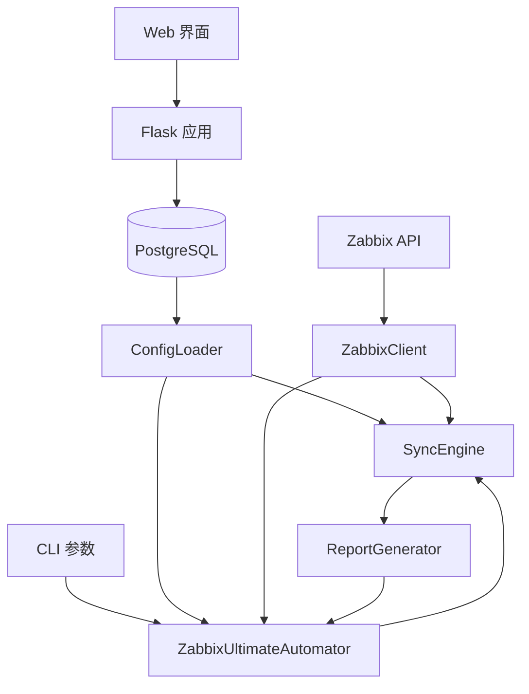

# Zabbix Monitor as Code (MaC) — 项目文档

## 1. 项目概述

Zabbix Monitor as Code (MaC) 是一套基于 Python 3 的工具集，通过调用 Zabbix 5.0 API，实现监控项（Items）、触发器（Triggers）、自动发现规则（LLD）及 Web 场景的声明式同步。

- **核心价值**：将监控配置代码化，实现版本控制和自动化管理，同时提供 Web 界面进行审核和管理
- **主要功能**：
  - 从 PostgreSQL 数据库加载监控模板
  - 自动同步监控项、触发器、自动发现规则和 Web 场景到多台 Zabbix 主机
  - 支持并发同步多台主机
  - 生成详细的变更报告
  - 支持模拟运行（dry-run）模式
  - Web 管理界面（Flask），支持可视化 CRUD 和复核审批
  - 复核表机制：监控配置变更需审核确认后才同步

## 2. 项目架构

### 2.1 系统架构



### 2.2 核心组件

| 组件 | 职责 | 文件 |
|------|------|------|
| ZabbixClient | Zabbix API 客户端封装 | `zabbix_mac.py` |
| ConfigLoader | 从数据库加载模板和主机配置 | `zabbix_mac.py` |
| ReportGenerator | 变更报告（创建/更新/删除记录） | `zabbix_mac.py` |
| SyncEngine | 核心同步逻辑（Items/Triggers/LLD/Web） | `zabbix_mac.py` |
| ZabbixUltimateAutomator | 主自动化类，整合上述组件 | `zabbix_mac.py` |
| Flask 应用 | Web 管理界面 + 复核表管理 | `app.py` |

### 2.3 目录结构

```
zabbix_mac/
├── app.py                         # Flask Web 应用
├── zabbix_mac.py                  # 核心同步引擎 (CLI)
├── Dockerfile                     # 生产环境容器构建
├── requirements-macos-arm.txt     # Mac M4 开发环境依赖
├── requirements-linux-x86.txt     # Intel Linux 生产环境依赖
├── requirements-test.txt          # 测试依赖
├── CODE_WIKI.md                   # 项目文档（本文件）
├── PRD.md                         # 产品需求文档
├── database_update/               # 数据库 DDL 迁移脚本
│   ├── 001_create_schema.sql
│   ├── 002_create_hosts_table.sql
│   ├── ...
│   ├── apply_migrations.sh        # 迁移部署脚本
│   └── README.md                  # 迁移规范说明
├── 数据导出/                       # pg_dump 数据快照
├── templates/                     # Jinja2 模板 (34 个)
│   ├── base.html
│   ├── index.html
│   ├── hosts.html / add_host.html / edit_host.html
│   ├── items.html / add_item.html / edit_item.html
│   ├── triggers.html / add_trigger.html / edit_trigger.html
│   ├── templates.html / template_detail.html
│   ├── discovery_rules.html / edit_discovery_rule.html
│   ├── item_prototypes.html / edit_item_prototype.html
│   ├── trigger_prototypes.html / edit_trigger_prototype.html
│   ├── filter_conditions.html / edit_filter_condition.html
│   ├── items_review.html / edit_item_review.html
│   ├── triggers_review.html / edit_trigger_review.html
│   ├── item_prototypes_review.html / edit_item_prototype_review.html
│   ├── trigger_prototypes_review.html / edit_trigger_prototype_review.html
│   ├── search.html / system_info.html
│   └── _pagination.html
├── static/
│   ├── css/app.css
│   └── js/app.js
└── tests/
    ├── conftest.py
    ├── test_app.py
    ├── test_zabbix_client.py
    ├── test_sync_engine.py
    ├── test_config_loader.py
    ├── test_security.py
    ├── test_concurrency.py
    ├── test_performance.py
    └── test_environment.py
```

## 3. CLI 操作参考

### 3.1 基本语法

```bash
python3 zabbix_mac.py [操作模式] [参数]
```

### 3.2 操作模式一览

| # | 操作模式 | 说明 | Zabbix API | 数据库 |
|---|---------|------|:---:|:---:|
| 1 | `--sync` | 同步监控配置到 Zabbix 服务器 | ✓ | ✓ |
| 2 | `--initialize-reviews` | 初始化 items_review + triggers_review | ✗ | ✓ |
| 3 | `--initialize-items-review` | 仅初始化 items_review | ✗ | ✓ |
| 4 | `--initialize-triggers-review` | 仅初始化 triggers_review | ✗ | ✓ |
| 5 | `--initialize-webscenario-items-review` | 初始化 webscenario_items_review | ✗ | ✓ |
| 6 | `--export-items-review <FILE>` | 导出 items_review → Excel | ✗ | ✓ |
| 7 | `--export-triggers-review <FILE>` | 导出 triggers_review → Excel | ✗ | ✓ |
| 8 | `--import-items-review <FILE>` | 从 Excel 导入 → items_review | ✗ | ✓ |
| 9 | `--import-triggers-review <FILE>` | 从 Excel 导入 → triggers_review | ✗ | ✓ |
| 10 | `--create-web-scenarios` | 从复核表创建 Web 场景到 Zabbix | ✓ | ✓ |
| 11 | `--create-web-scenario-triggers` | 为 Web 场景创建触发器 | ✓ | ✓ |

### 3.3 Zabbix API 参数

| 参数 | 说明 | 必填 |
|------|------|:---:|
| `--url` | Zabbix API URL（如 `http://10.24.3.12:8080`） | ✓ |
| `--username` | Zabbix 用户名 | ✓ |
| `--password` | Zabbix 密码 | ✓ |

### 3.4 数据库参数

| 参数 | 说明 | 默认值 |
|------|------|--------|
| `--db-host` | PostgreSQL 主机 | `localhost` |
| `--db-port` | PostgreSQL 端口 | `5432` |
| `--db-name` | 数据库名 | `ops` |
| `--db-user` | 用户名 | `postgres` |
| `--db-password` | 密码 | 空 |

### 3.5 同步参数

| 参数 | 说明 | 默认值 |
|------|------|--------|
| `--dry-run` | 模拟运行，不实际执行 | `False` |
| `--workers` | 并发线程数 | `5` |

### 3.6 使用示例

```bash
# 1. 同步监控配置
python3 zabbix_mac.py --sync \
  --url http://10.24.3.12:8080 \
  --username Admin --password zabbix \
  --db-host localhost --db-port 5432 --db-name ops --db-user postgres

# 2. 模拟运行（预览变更，不实际执行）
python3 zabbix_mac.py --sync --dry-run \
  --url http://10.24.3.12:8080 \
  --username Admin --password zabbix

# 3. 初始化所有复核表
python3 zabbix_mac.py --initialize-reviews \
  --db-host localhost --db-port 5432 --db-name ops --db-user postgres

# 4. 创建 Web 场景监控
python3 zabbix_mac.py --create-web-scenarios \
  --url http://10.24.3.12:8080 \
  --username Admin --password zabbix \
  --db-host localhost --db-port 5432 --db-name ops --db-user postgres

# 5. 为 Web 场景创建触发器
python3 zabbix_mac.py --create-web-scenario-triggers \
  --url http://10.24.3.12:8080 \
  --username Admin --password zabbix \
  --db-host localhost --db-port 5432 --db-name ops --db-user postgres

# 6. 导出复核数据到 Excel
python3 zabbix_mac.py --export-items-review items_review.xlsx \
  --db-host localhost --db-port 5432 --db-name ops --db-user postgres

# 7. 从 Excel 导入复核数据
python3 zabbix_mac.py --import-items-review items_review.xlsx \
  --db-host localhost --db-port 5432 --db-name ops --db-user postgres
```

## 4. Web 场景监控工作流

1. **准备数据**：确保 `webscenario_items` 表中有数据
2. **初始化复核表**：
   ```bash
   python3 zabbix_mac.py --initialize-webscenario-items-review
   ```
3. **审核确认**：在 Web 界面或数据库中标记 `confirmed = true`
4. **创建 Web 场景**：
   ```bash
   python3 zabbix_mac.py --create-web-scenarios --url ... --username ... --password ...
   ```
5. **创建触发器**：
   ```bash
   python3 zabbix_mac.py --create-web-scenario-triggers --url ... --username ... --password ...
   ```

触发器表达式格式：`{host:web.test.fail[name].count(#3,0,ne)}>2`（连续 3 次检查失败则触发告警）

## 5. Web 管理界面

### 5.1 启动

```bash
python3 app.py
# 访问 http://localhost:5000
```

### 5.2 功能模块

| 菜单 | 功能 |
|------|------|
| 系统信息 | 数据库连接状态、表统计、Zabbix 环境配置概览 |
| 模版管理 | 模板 CRUD + 模板详情（关联的监控项/触发器/LLD） |
| 监控项管理 | 监控项 CRUD + 分页列表 |
| 触发器管理 | 触发器 CRUD + 分页列表 |
| 监控项原型 | 按 LLD 规则分组展示 + 编辑 |
| 触发器原型 | 按 LLD 规则分组展示 + 编辑 |
| 自动发现规则 | LLD 规则管理 + 过滤条件管理 |
| 主机管理 | 主机 CRUD + 从 ops.sub_assets 同步 |
| 复核表 (×4) | 监控项/触发器/原型复核，审核 → 确认 → 同步 |
| Web场景复核 | Web 场景监控项审核 |
| 搜索 | 跨表搜索主机名/模板名/IP |

### 5.3 主要路由

| 路由 | 方法 | 说明 |
|------|------|------|
| `/` | GET | 首页 |
| `/system-info` | GET | 系统信息 |
| `/templates` | GET | 模板列表 |
| `/template/<id>` | GET | 模板详情 |
| `/items` | GET | 监控项列表 |
| `/item/add` | GET, POST | 添加监控项 |
| `/item/edit/<id>` | GET, POST | 编辑监控项 |
| `/item/delete/<id>` | GET | 删除监控项 |
| `/triggers` | GET | 触发器列表 |
| `/trigger/add` | GET, POST | 添加触发器 |
| `/trigger/edit/<id>` | GET, POST | 编辑触发器 |
| `/hosts` | GET | 主机列表 |
| `/host/add` | GET, POST | 添加主机 |
| `/host/edit/<id>` | GET, POST | 编辑主机 |
| `/discovery-rules` | GET | LLD 规则列表 |
| `/discovery-rule/edit/<id>` | GET, POST | 编辑 LLD 规则 |
| `/item-prototypes` | GET | 监控项原型 |
| `/trigger-prototypes` | GET | 触发器原型 |
| `/filter-conditions` | GET | 过滤条件列表 |
| `/items-review` | GET | 监控项复核表 |
| `/item-review/edit/<id>` | GET, POST | 编辑复核记录 |
| `/item-review/confirm/<id>` | GET | 确认复核 |
| `/triggers-review` | GET | 触发器复核表 |
| `/trigger-review/edit/<id>` | GET, POST | 编辑复核记录 |
| `/item-prototypes-review` | GET | 原型复核表 |
| `/trigger-prototypes-review` | GET | 原型复核表 |
| `/items-review/export` | GET | 导出 Excel |
| `/items-review/import` | POST | 导入 Excel |
| `/search` | GET | 全局搜索 |

## 6. 关键类与函数

### 6.1 ZabbixClient — Zabbix API 客户端

| 方法 | 说明 |
|------|------|
| `__init__(url, username, password, dry_run)` | 初始化连接 |
| `get_host_id(host_name)` | 按名称查主机 ID |
| `get_host_interface_id(host_id)` | 获取主机接口 ID |
| `get_managed_items(host_id)` | 获取受管理标记的监控项 |
| `create_item(item_data)` / `update_item(id, data)` / `delete_item(id)` | 监控项 CRUD |
| `get_managed_triggers(host_id)` | 获取受管理触发器 |
| `create_trigger(data)` / `update_trigger(id, data)` | 触发器管理 |
| `get_managed_discovery_rules(host_id)` | 获取 LLD 规则 |
| `create_discovery_rule(data)` / `update_discovery_rule(id, data)` | LLD 管理 |
| `get_item_prototypes(rule_id)` / `create_item_prototype(data)` | 监控项原型 |
| `get_trigger_prototypes(rule_id)` / `create_trigger_prototype(data)` | 触发器原型 |
| `get_managed_web_scenarios(host_id)` | 获取 Web 场景 |
| `create_web_scenario(data)` / `update_web_scenario(id, data)` / `delete_web_scenario(id)` | Web 场景管理 |
| `calculate_fingerprint(obj)` | 计算对象 MD5 指纹（用于比较变更） |

### 6.2 SyncEngine — 同步引擎

| 方法 | 说明 |
|------|------|
| `sync_host(host_name, config, dry_run)` | 同步单台主机 |
| `sync_all_hosts(config, dry_run, workers)` | 并发同步所有主机 |
| `_sync_items(host_id, target_items, dry_run)` | 同步监控项（含依赖项处理） |
| `_sync_triggers(host_id, host_name, target_triggers, dry_run)` | 同步触发器 |
| `_sync_discovery_rules(host_id, host_name, rules, dry_run)` | 同步 LLD 规则 |
| `_sync_item_prototypes(...)` | 同步监控项原型 |
| `_sync_trigger_prototypes(...)` | 同步触发器原型 |
| `_sync_web_scenarios(host_id, host_name, scenarios, dry_run)` | 同步 Web 场景 |

## 7. 数据库结构

### 7.1 配置

```python
DB_CONFIG = {
    'host': 'localhost',
    'port': 5432,
    'database': 'ops',
    'user': 'postgres',
    'password': '',
    'options': '-c search_path=zabbix_mac'
}
```

### 7.2 核心表（schema: `zabbix_mac`）

| 表名 | 说明 |
|------|------|
| `hosts` | 主机列表（name, system, subsystem, template_id） |
| `templates` | 监控模板（template_id, description） |
| `items` | 监控项模板（item_key, type, value_type, delay, preprocessing） |
| `triggers` | 触发器模板（expression, priority） |
| `discovery_rules` | 自动发现规则（key, delay, type） |
| `item_prototypes` | 监控项原型 → FK `discovery_rules` |
| `trigger_prototypes` | 触发器原型 → FK `discovery_rules` |
| `filter_conditions` | LLD 过滤条件 → FK `discovery_rules` |
| `host_templates` | 主机-模板关联 → FK `hosts`, `templates` |
| `host_extra_items` | 主机额外监控项 |
| `webscenario_items` | Web 场景配置 |
| `items_review` | 监控项复核表 → FK `items` |
| `triggers_review` | 触发器复核表 → FK `triggers` |
| `item_prototypes_review` | 监控项原型复核表 → FK `item_prototypes`, `discovery_rules` |
| `trigger_prototypes_review` | 触发器原型复核表 → FK `trigger_prototypes`, `discovery_rules` |
| `webscenario_items_review` | Web 场景复核表 |

### 7.3 跨 schema 表（schema: `ops`）

| 表名 | 说明 |
|------|------|
| `sub_assets` | 主机资产信息（ip, hostname, system, subsystem, template_id） |

### 7.4 复核表字段说明

所有复核表包含：
- 原始表的所有业务字段
- `modified BOOLEAN` — 是否被修改
- `confirmed BOOLEAN` — 是否已确认
- `status_verification VARCHAR(50)` — 审核状态 (pending/confirmed/rejected)
- `host_ip VARCHAR(255)` — 关联主机 IP
- `system VARCHAR(100)` / `subsystem VARCHAR(100)` — 系统/模块分类

### 7.5 迁移管理

使用 `database_update/apply_migrations.sh` 进行数据库结构变更。详见 `database_update/README.md`。

## 8. 依赖关系

| 依赖 | 用途 |
|------|------|
| Python 3.x | 运行环境 |
| Flask | Web 框架 |
| psycopg2-binary | PostgreSQL 驱动 |
| pyzabbix | Zabbix API 客户端 |
| requests | HTTP 请求 |
| PyYAML | YAML 解析 |
| pandas / numpy | 数据处理（Excel 导入导出） |
| openpyxl | Excel 读写 |
| Bootstrap 5 (CDN) | 前端 UI |

## 9. 最佳实践

- **首次同步用 `--dry-run`**：预览变更后再实际执行
- **按主机数量调整 `--workers`**：控制并发压力
- **复核表机制**：先在复核表修改/确认，确认后同步到 Zabbix，形成审批流
- **数据库迁移**：DDL 变更走 `database_update/` 编号迁移，不直接改数据库
- **定期备份**：数据库和数据导出文件应定期归档
- **Web 场景依赖**：创建触发器前必须先创建对应的 Web 场景监控

## 10. 故障排除

| 错误 | 可能原因 | 解决方案 |
|------|----------|----------|
| `502 Server Error: Bad Gateway` | Zabbix API URL 不正确或服务未运行 | 检查 Zabbix 服务器状态和 API URL |
| `Invalid params., unexpected parameter "tags"` | Zabbix 5.0 API 不支持此参数 | 已修复，受管理标记自动处理 |
| `Application with applicationid "xxx" does not exist` | 应用 ID 无效 | 移除 applicationid 参数 |
| `Invalid parameter "/1": unexpected parameter "hostid/hosts"` | API 参数不兼容 | 已适配 Zabbix 5.0 |
| 数据库连接失败 | 配置错误或 PostgreSQL 未启动 | 检查 DB_CONFIG 和服务状态 |
| Flask 启动失败 | 端口被占用 | `lsof -i :5000` 检查并释放端口 |
| 同步主机失败 | 主机名不匹配或 API 权限不足 | 检查 Zabbix 中主机名和用户权限 |

## 11. 部署上线

### 11.1 数据库迁移

```bash
cd database_update/
./apply_migrations.sh <DB_HOST> <DB_PORT> <DB_NAME> <DB_USER>
```

### 11.2 容器化部署

```bash
# Intel Mac 上构建
docker build -t zabbix-mac:latest .
docker run -d -p 5000:5000 \
  -e DB_HOST=... -e DB_PORT=5432 -e DB_NAME=ops -e DB_USER=postgres \
  zabbix-mac:latest
```

### 11.3 环境变量

Zabbix 机房凭据通过环境变量注入（不写入代码）：
- `ZABBIX_SZSE_ZW_URL` / `ZABBIX_SZSE_ZW_USER` / `ZABBIX_SZSE_ZW_PASS` — 深交所证联网
- `ZABBIX_SZSE_HLW_URL` / `ZABBIX_SZSE_HLW_USER` / `ZABBIX_SZSE_HLW_PASS` — 深交所互联网
- `ZABBIX_SSE_ZW_URL` / `ZABBIX_SSE_ZW_USER` / `ZABBIX_SSE_ZW_PASS` — 上交所证联网
- `ZABBIX_SSE_HLW_URL` / `ZABBIX_SSE_HLW_USER` / `ZABBIX_SSE_HLW_PASS` — 上交所互联网

---

**文档版本**: 2.0
**最后更新**: 2026-06-10
