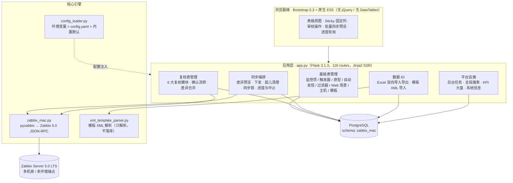
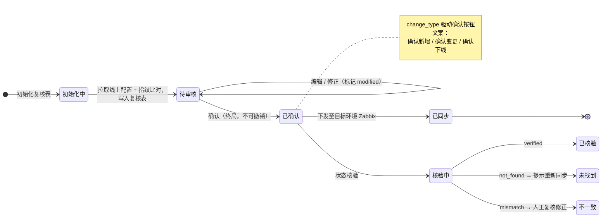
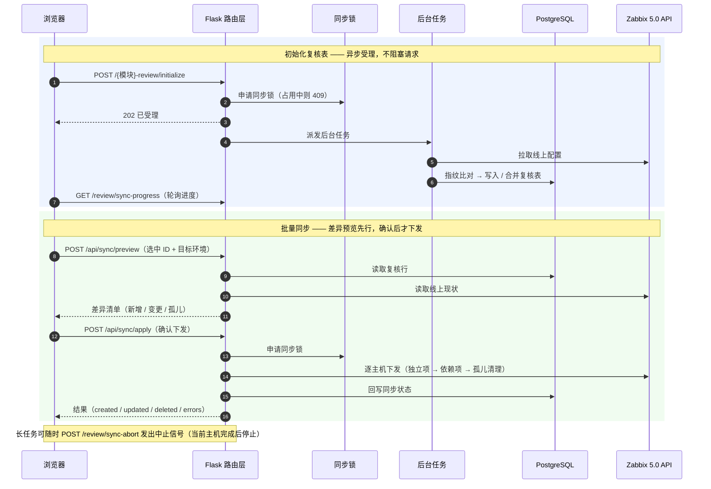
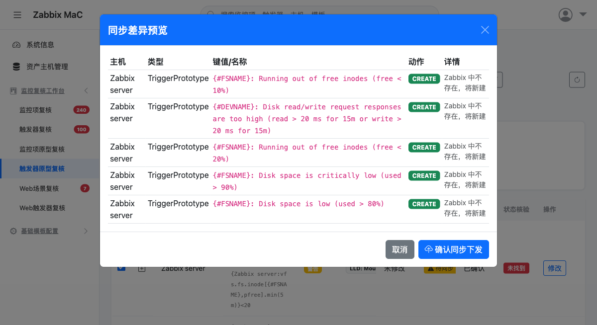

<div align="center">

# Zabbix Monitor as Code (MaC)

**监控审核与自动化控制中心**

面向多机房 Zabbix 环境的声明式监控配置管理平台 —— 把「监控配置」当作代码来管理：版本可控、流程可审、状态可验、批量可同步。


`116 路由` · `43 页面模板` · `6 大复核模块` · `25 条数据库迁移` · `纯 mock 测试套件`

</div>

---

## 目录

- [项目简介](#项目简介)
- [系统架构](#系统架构)
- [核心机制](#核心机制)
- [功能特性](#功能特性)
- [技术栈](#技术栈)
- [界面展示](#界面展示)
- [快速开始](#快速开始)
- [CLI 参考](#cli-参考)
- [配置说明](#配置说明)
- [部署上线](#部署上线)
- [测试](#测试)
- [目录结构](#目录结构)
- [文档索引](#文档索引)

---

## 项目简介

传统监控运维中，监控项、触发器、自动发现规则往往由工程师在 Zabbix 界面手工维护 —— 多机房环境下配置逐渐漂移，变更无审核、无追溯，线上实际状态与台账长期脱节。

本项目将监控配置**代码化 + 流程化**：配置以数据库为声明式事实源，经「复核 → 确认 → 同步 → 核验」闭环下发至远程 Zabbix，全链路留痕。

| 痛点 | 解决方案 |
| --- | --- |
| 配置手工操作，易出错、无版本 | 声明式配置集中管理，数据库一键同步至 Zabbix |
| 多机房（多环境）配置不一致 | 按环境隔离的 Zabbix API 端点，分别同步与核验 |
| 监控变更无审核、无追溯 | 6 大复核模块 + 确认状态流转，确认即终局（不可撤销） |
| 台账与线上实际状态脱节 | 集成式状态核验，逐条比对数据库与线上存在性 |
| 批量维护依赖手工点击 | Excel 双向导入导出、模板 XML 导入、批量同步预览与下发 |

**目标用户**：运维工程师（模板/同步）、审核人员（复核确认）、系统管理员（资产与自动发现）。

---

## 系统架构



| 设计原则 | 说明 |
| --- | --- |
| **单一事实来源** | 远程 Zabbix 5.0 API 为运行态事实源；本地 `*_review` 表仅记录审核状态与变更暂存 |
| **复核先行** | 任何变更先进复核表，确认后才允许下发，形成审批留痕 |
| **解析与落库分离** | 解析器只做解析（`xml_template_parser.py`），SQL 全部收敛在路由层 |
| **无 ORM** | 原生 psycopg2 + DictCursor，SQL 可读、可控、可审计 |
| **零前端构建链** | 无打包器、无模块化框架，本地 Bootstrap 资源随包部署，适配内网离线环境 |

---

## 核心机制

### 复核审批流



- **状态字段**：`sync_status`（待同步 / 已同步）、`status_verification`（verified / mismatch / not_found）、`change_type`（new / update / delete）、`confirmed`（确认后不可撤销）
- **6 大复核模块**：监控项 · 触发器 · 监控项原型 · 触发器原型 · Web 场景 · Web 触发器
- **机房维度**：6 张复核表均含机房字段，列表支持 主机 / 系统 / 子系统 / 机房 服务端筛选（监控项另有基线筛选）

### 同步链路



**关键保障**

- **同步锁**：同一时刻仅允许一个同步 / 初始化任务，冲突请求返回 409，避免并发下发互相干扰
- **孤儿清理**：已取消确认（下线）的托管项在下次同步时自动从 Zabbix 清理
- **模板继承安全**：自动排除模板继承项（`templateid != "0"`），绝不误删继承而来的监控项
- **并发可控**：同步 worker 数可配置，按主机规模调节对 Zabbix 的压力
- **勾选态管理**：跨分页保留勾选，同步完成后统一释放（失败时保留，便于修正重试）

---

## 功能特性

### 配置管理

| 模块 | 能力 |
| --- | --- |
| 监控项 / 触发器 | 增删改查、模板归属、主机与机房维度筛选 |
| 监控项原型 / 触发器原型 | LLD 原型管理，依赖项与主项关联 |
| 自动发现规则 / 过滤器条件 | LLD 规则与其过滤条件成对维护 |
| Web 场景 | 多端点（API / Nginx）逗号分隔批量展开，初始化时按端点生成独立场景 |
| 主机 / 模板 | 资产台账、模板关联（支持多模板） |

### 复核与同步

| 能力 | 说明 |
| --- | --- |
| 6 大复核模块 | 独立列表页 + 编辑页 + 确认流转 + 服务端筛选 + 分页 |
| 批量同步预览 | 下发前展示差异清单（新增 / 变更 / 孤儿），确认后才提交 |
| 异步初始化 | 202 受理 + 后台任务执行 + 进度轮询，规避长请求超时 |
| 状态核验 | 按选中记录逐条核验线上存在性，产出 verified / not_found 计数与失败明细 |
| 同步中止 | 长任务可发出中止信号，当前主机完成后安全停止 |

### 数据 IO

| 能力 | 说明 |
| --- | --- |
| Excel 双向 | 13 组导出 / 导入路由，覆盖基础表与复核表；导入前整体清空目标表 |
| 导入防错 | 列名白名单校验（非法列名直接拒绝并回滚）、空值归一、类 JSON 字符串自动转义、主键列静默剔除以便导出文件可原样回导 |
| 模板 XML 导入 | 解析 Zabbix 5.0 导出 XML，幂等 Upsert 至 6 张基础表；重复导入同一模板 ID 返回 409 守卫 |
| 导出可回导 | 导出列为主表原始列，确保「导出 → 编辑 → 导入」闭环可用 |

### 平台设施

| 能力 | 说明 |
| --- | --- |
| KPI 大盘 | 6 复核模块共用的统计卡片与待办计数 |
| 全局搜索 | 监控项 / 触发器 / 主机 / 模板 / 自动发现规则 五类实体一次检索 |
| 系统信息 | 运行环境、组件连通性、资产统计实时采集 |
| 后台任务 | 任务进度共享态 + 任务级字段清理，杜绝轮询端读到陈旧状态 |

---

## 技术栈

| 层 | 技术 | 说明 |
| --- | --- | --- |
| 后端 | Python 3.12 + Flask 3.1.3 | Jinja2 服务端渲染，116 路由 |
| 数据库 | PostgreSQL（schema `zabbix_mac`） | psycopg2 + DictCursor，原生 SQL，无 ORM |
| 前端 | Bootstrap 5.3 + Bootstrap Icons + 原生 ES5 | 无 jQuery、无 DataTables、无构建工具 |
| 集成 | Zabbix 5.0 LTS JSON-RPC（pyzabbix） | 多环境端点，凭据经环境变量注入 |
| 数据处理 | pandas + openpyxl | Excel 导入导出 |
| 部署 | Docker（linux/amd64）+ 编号式 SQL 迁移 | 内网离线可部署（本地前端资源） |

---

## 界面展示

> 界面遵循「业务降维」原则：表格首屏聚焦业务语义列，技术细节列可一键切换显隐；关键列采用 CSS Sticky 固定，横向滚动不丢失上下文。

### 批量同步差异预览

下发前的差异清单弹窗 —— 确认后才真正提交，是「先看后做」的核心安全阀。



### 待补充截图

将对应截图放入 `docs/images/` 后，把下表的文件名补进图片引用路径即可：

| 建议文件名 | 建议内容 |
| --- | --- |
| `items-review.png` | 监控项复核列表（含 Sticky 固定列与状态徽标） |
| `verify-result.png` | 状态核验结果（verified / not_found 提示） |
| `xml-import.png` | 模板 XML 导入预览与确认弹窗 |
| `dashboard.png` | KPI 大盘统计卡片 |

---

## 快速开始

### 前置条件

- Python 3.12
- PostgreSQL（建议 12+），目标 schema 为 `zabbix_mac`
- 可达的 Zabbix 5.0 LTS API 端点（多环境可选）
- 依赖安装：生产路径用 `requirements-linux-x86.txt`，macOS ARM 开发用 `requirements-macos-arm.txt`

### 四步启动

```bash
# 1. 准备配置（含数据库与各环境 Zabbix 凭据，勿提交到版本库）
cp config.yaml.example config.yaml
#    按注释填写 database.* 与 zabbix_environments.*

# 2. 初始化数据库结构（按编号顺序应用 25 条迁移，自动跳过已应用项）
cd database_update/
./apply_migrations.sh <DB_HOST> <DB_PORT> <DB_NAME> <DB_USER>
cd ..

# 3. 安装依赖
pip install -r requirements-linux-x86.txt

# 4. 启动 Web 服务
python3 app.py
```

访问 `http://<host>:<port>` —— **端口以 `config.yaml` 中 `app.port` 为准**（开发环境常用 5050，容器映射 5000）。修改代码或模板后需重启服务（生产模式无热载）。

### 首次使用建议顺序

1. 在 **模板管理** 中录入模板，或用 **模板 XML 导入** 批量导入 Zabbix 导出的模板 XML
2. 在 **基础表管理** 中维护监控项、触发器、自动发现规则、Web 场景
3. 在 6 大 **复核页面** 执行「初始化复核表」，从远程 Zabbix 拉取现状并做指纹比对
4. 审核修正后**确认**，再执行**批量同步差异预览 → 确认下发**
5. 同步完成后执行**状态核验**，对 `not_found` 项重新同步

---

## CLI 参考

除 Web 界面外，核心引擎 `zabbix_mac.py` 提供命令行入口，适合脚本化与定时任务。

```bash
# 1. 同步监控配置
python3 zabbix_mac.py --sync \
  --url http://<zabbix-host>:8080 --username <user> --password <pass> \
  --db-host <db-host> --db-port 5432 --db-name <db-name> --db-user <db-user>

# 2. 模拟运行（预览变更，不实际下发）—— 首次同步强烈建议
python3 zabbix_mac.py --sync --dry-run --url http://<zabbix-host>:8080

# 3. 初始化所有复核表
python3 zabbix_mac.py --initialize-reviews \
  --db-host <db-host> --db-port 5432 --db-name <db-name> --db-user <db-user>

# 4. 创建 Web 场景监控
python3 zabbix_mac.py --create-web-scenarios --url http://<zabbix-host>:8080

# 5. 为 Web 场景创建触发器
python3 zabbix_mac.py --create-web-scenario-triggers --url http://<zabbix-host>:8080

# 6. 导出 / 导入复核数据
python3 zabbix_mac.py --export-items-review items_review.xlsx
python3 zabbix_mac.py --import-items-review items_review.xlsx
```

| 通用参数 | 说明 | 默认值 |
| --- | --- | --- |
| `--dry-run` | 模拟运行，不实际执行 | `False` |
| `--workers` | 并发线程数 | `5` |

> **Web 场景触发器表达式格式**：`{host:web.test.fail[<场景名>].count(#3,0,ne)}>2` —— 连续 3 次检查失败即触发告警。

---

## 配置说明

### config.yaml 结构

```yaml
app:
  host: "0.0.0.0"
  port: 5000
  debug: false
  secret_key: "<secret>"

database:
  host: "<db-host>"
  port: 5432
  name: "<db-name>"
  user: "<db-user>"
  password: "<password>"

# 多机房 / 多环境 Zabbix 端点，每个环境独立同步与核验
zabbix_environments:
  - key: <env-key>
    name: "<环境名称>"
    url: "http://<zabbix-host>/api_jsonrpc.php"
    username: "<user>"
    password: "<pass>"

zabbix_room_mapping: {}   # 机房映射
sync: {}                  # 同步并发与重试参数
```

### 环境变量覆盖

配置优先级：**环境变量 > `config.yaml` > 内置默认**（统一由 `config_loader.py` 处理）。

| 环境变量 | 覆盖项 |
| --- | --- |
| `APP_CONFIG` | 配置文件路径（默认 `config.yaml`） |
| `APP_SECRET_KEY` | `app.secret_key`（生产必需） |
| `APP_HOST` / `APP_PORT` | `app.host` / `app.port` |
| `DB_HOST` / `DB_PORT` / `DB_NAME` / `DB_USER` / `DB_PASSWORD` | `database.*` |
| `ZABBIX_<ENV>_URL` / `ZABBIX_<ENV>_USER` / `ZABBIX_<ENV>_PASS` | 对应环境的 Zabbix 凭据（按环境 key 大写拼装） |

> 凭据只经环境变量注入，**不写入代码与版本库**；`config.yaml` 已在 `.gitignore` 中排除。

---

## 部署上线

### 数据库迁移

```bash
cd database_update/
./apply_migrations.sh <DB_HOST> <DB_PORT> <DB_NAME> <DB_USER>
```

迁移脚本按编号顺序执行 `database_update/*.sql`，并以 `schema_migrations` 追踪表记录已应用版本，重复执行幂等跳过。

### 容器化

```bash
# 在 ARM Mac 上交叉编译 Intel Linux 镜像，确保与生产服务器兼容
docker build --platform linux/amd64 -t zabbix-mac:<版本号> ./

# 版本号建议格式：YYYYMMDDvN
docker run -d -p 5000:5000 \
  -e DB_HOST=<db-host> -e DB_PORT=5432 -e DB_NAME=<db-name> -e DB_USER=<db-user> \
  zabbix-mac:<版本号>
```

> 迁移使用 `psql`，需在**宿主机**执行（应用容器内不含 `postgresql-client`）。

---

## 测试

```bash
python3 -m pytest tests/ -q            # 全量
python3 -m pytest tests/ -q --tb=short # 带简要堆栈
```

测试套件覆盖导出/导入路由契约、复核增删改与确认流转、API 端点分支、同步编排与差异合并、后台任务等；**全程纯 mock，不依赖活库与真实 Zabbix API**，可在无外部环境的 CI 中运行。

> 当前全量数百用例通过（少量 skip 为环境相关项），通过数以实际输出为准。Mock 策略：`get_db_connection` 打桩返回假连接/游标；测试内清空 `before_request` 以绕过 CSRF。

---

## 目录结构

```
.
├── app.py                     # Flask 应用与全部路由（116 routes）
├── zabbix_mac.py              # Zabbix 集成核心引擎 + CLI 入口
├── xml_template_parser.py     # 模板 XML 解析器（只解析，不落库）
├── config_loader.py           # 配置加载：环境变量 > config.yaml > 默认值
├── config.yaml.example        # 配置模板（实际配置不提交）
├── requirements-*.txt         # 依赖（linux-x86 / macos-arm / test）
├── Dockerfile                 # 容器构建（linux/amd64）
├── templates/                 # Jinja2 页面（43 个，含 3 个共享片段）
│   ├── base.html
│   ├── _dashboard_cards.html  # 6 复核页共用 KPI 卡片
│   ├── _batch_sync_modal.html # 批量同步预览弹窗
│   ├── _pagination.html       # 统一分页组件
│   └── *_review.html          # 6 大复核模块页面
├── static/
│   ├── css/app.css            # 主样式（含 Sticky 固定列体系）
│   ├── js/app.js              # 全局行为（侧边栏/搜索/Toast/批量同步）
│   ├── js/review_common.js    # 复核页共享模块
│   └── vendor/                # Bootstrap 本地资源（内网离线可用）
├── database_update/           # 编号式 SQL 迁移 + apply_migrations.sh
├── tests/                     # 纯 mock 测试套件
├── docker/                    # 辅助容器配置
├── PRD.md                     # 产品需求文档
├── CODE_WIKI.md               # 项目文档（架构 / CLI / 配置 / 排障）
└── CLAUDE.md                  # 开发与架构规范
```

---

## 文档索引

| 文档 | 内容 |
| --- | --- |
| [`PRD.md`](PRD.md) | 产品定位、核心价值、目标用户、需求细则 |
| [`CODE_WIKI.md`](CODE_WIKI.md) | 架构详解、CLI 操作参考、配置说明、最佳实践、故障排除、部署流程 |
| [`CLAUDE.md`](CLAUDE.md) | 开发与架构规范：技术栈、铁律（Sticky 列体系、6 模块联动、同步勾选契约）、测试规范 |

---

<div align="center">

**Zabbix Monitor as Code (MaC)** —— 让监控配置像代码一样被审核、被追溯、被同步。

</div>
